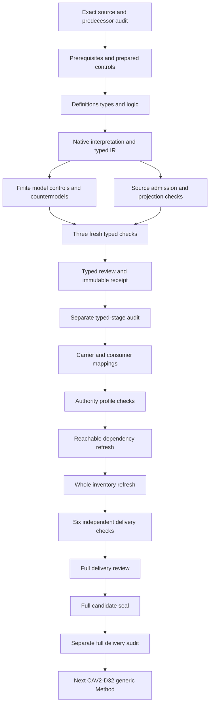

# Craft Method: definitions, types and logic candidate review

## 1. Target, evidence and completion boundary

This review selects CAV2-D20@1.0.0-candidate.1, Craft Method, at digest f99635daec1bb7f3df027f6aa7bcfbcd0e14f1d20a700e93588dfb6268112a17. The selected Definition is admitted by CAL-DECISION-0029-CML07-SEMANTIC-FOUNDATION-V1. This candidate translation is separate from that admission. It does not establish source-owner acceptance, whole-definition proof, an adopted Method binding or execution of construction.

The predecessor is Typed Connection Extension Rule's full candidate delivery: 9735 sealed files and a separately captured successful audit. Its manifest hashes are rechecked before authoring and during verification. All 201 original source files remain bound to the current snapshot. The original planning scope remains 183 identities, 189 versions, 121 tasks, 511 planning edges, 797 work units and 36 frontiers. This candidate contributes one working typed draft; it does not complete that episode.

Authoring, building, model verification and source verification have actual terminal exit zero. The source verifier performs 84 checks, including exact admission references, independently reproduced Definition projections and source-query correspondence. The prepared model check supplied 353 controls, 51 countermodel queries and a maximum 15314 evaluation steps within the existing limit. The typed-stage receipt is created only after separate fresh contract, model and source processes succeed. Full consumer inspection, profile validation, dependency and inventory refresh, six delivery replays, full review, seal and separate delivery audit follow this stage.

## 2. Source accounting and formalization model

The model uses many-sorted first-order logic with equality. All 25 nonempty source units have complete character accounting. Fourteen clauses are encoded, nine units remain explanatory and two units are explicitly deferred. The normative statement selects eight primitive rules; the formal expression selects the eleven-coordinate root rule. Applicability selects root, recomposition and closure rules. Source boundaries and tests select the appropriate primitive guards.

Explanatory notation, domain examples, the original workspace label and plain-language explanation remain visible in the correspondence packet. They are not converted into executed processes or authority. The authority-scope reference and candidate claim ceiling remain deferred; complete accounting is not evidence that their denotations have been accepted.

The signature contains 32 sorts, one EMPTY token constant, 75 total functions and 201 predicates or relations, for 309 declarations. Sorts distinguish Craft Method from generic Method, scope, Product, Project, all eleven tuple coordinates, construction stages, subjects, identities, types, sources, evidence, generated views, canonical inputs, digests, residue, routes, recomposition, closure, owners and decisions. An independently qualified dependency reference does not import another Definition's whole theory.

## 3. Typed references, applicability and exact bindings

The six primary carriers are Craft, Stage, View, Residue, Recompose and Closure. Applicability is tied to the selected in-scope declaration for each. Necessary obligations are guarded by applicability, so an out-of-scope object cannot accidentally inherit them. Nonempty sort domains alone do not assert that a construction or closure exists.

Every required reference has declared membership and a nonempty handle. Each selected field has an exact binding relation: a candidate value is bound if and only if it equals the nominated function value. This rejects missing and conflicting bindings. Total function semantics are retained without demanding meaningful bindings for unused optional fields. EMPTY is a token marker, not a fabricated object of every reference sort.

The 26 required population obligations are independent from the primary theory. They request selected and outside carriers, root and child stages, implementation and nonimplementation cases, following-CAV2-D65 and prerequisite-residue cases, generated views without actual determinism, open and nonopen residues, same and different child/parent scopes, distinct subject identities and pending and closed closures. Removing a requested population can leave the necessary theory true while failing coverage. Another 201 populations remain unresolved rather than acquiring invented owner mappings.

## 4. Craft Method and its eleven-coordinate tuple

The root rule declares specialization of generic Method, recursive construction, typed identity preservation, canonical source authority, separate construction and conformance, view derivation, typed residue, recomposition, owner closure and ledger continuity. It nominates context, product intent, domain meaning, system specification, realization selection, construction, conformance, operation, recovery/evolution, owner continuation and ledger state. Generic Method and the bounded Product/Project scope are separate references surrounding those eleven coordinates.

Distinct sorts prevent treating a ledger state as a Method or a Product as a Project. They do not provide accepted real-world meanings for the proposed sorts. The functions are typed nominations; they do not execute the construction process or specify every legal lifecycle transition. The translation leaves actual specialization, preservation, authority and operational fidelity independent.

## 5. Construction stages and predecessor evidence

Each selected stage nominates its Method, subject, canonical source, predecessor evidence, result evidence and construction coordinate. The subject has exact identity and type nominations and their declared binding. The stage declares preservation of typed identity and canonical authority, and its construction agrees with the Method's construction coordinate.

A stage is exactly one of root or child. Roots can cite external prerequisite evidence without a fabricated parent stage. Children nominate a distinct parent and an exact parent-to-predecessor-evidence relation. Parent and child stages may represent different subjects and artifact types, as a definitions-to-carriers-to-instances chain requires. The model does not force them to share an identity. It also does not establish global ordering, well-founded recursion or termination from a finite example.

## 6. Implementation prerequisites

For an implementation-bearing stage, declared following of CAV2-D65 satisfies one branch. The alternative requires an exact applicable residue, declared typed and prerequisite, whose Method agrees with the stage's Method. Actual following and actual prerequisite adequacy have separate query targets.

A type label is insufficient evidence that a real prerequisite was met. Residue is not permission to build. Nonimplementation stages and stages declaring that they follow CAV2-D65 need no fabricated prerequisite record. Controls explicitly preserve the absence of those unused binding relations. The selected prototype-first Definition is independently referenced; its whole theory is not merged into this one.

## 7. Generated views and canonical direction

A generated view nominates its Method, machine-canonical input and two render digests. The input separately nominates source and input digest. The input digest need not equal the output digest: a generated representation can have different bytes from its canonical input. The two nominated render digests must agree.

This necessary declared reproducibility condition does not prove that a real generator is deterministic. The theory therefore allows the declarations to hold while actual deterministic reproduction remains false. Separately, the source checker extracts the three pure Definition rendering functions, renders twice and compares both outputs against the existing projection without mutating the source document. That observed 4425-byte projection reproduction is a bounded software result, not proof of every Craft generator.

Boundaries reject nominating a generated view as canonical source, reverse writable authority, conformance from view shape or actual determinism from digest labels. Actual source authority and deterministic generation still require source-to-consumer evidence.

## 8. Typed residue and owner routes

Every selected residue nominates its Method and type. Open residue additionally requires an exact declared owner route with a nonempty handle. Nonopen residue has no invented owner-route obligation. Residue continuity and prerequisite adequacy remain actual-outcome queries.

One failed prepared run is retained intact. The negative empty-handle test first selected route0, which no open residue referenced. The interpretation correctly remained valid. The corrected test empties route1, actually selected by both open residues. Neither the formula nor the evaluator limits changed. The successful replay then rejected that interpretation as intended. This is a test-target correction, not a weakened theory or a hidden failed result.

## 9. Child-to-parent recomposition

Each selected recomposition nominates exact child, parent, evidence and residue. The child is declared a child stage, its parent matches the nominated parent, and child and parent differ. Recomposition evidence agrees with the child's result evidence; the residue belongs to the child's Method and is declared propagated. A declared scope-within relation relates child and parent Method scopes.

The supplied models include both distinct and equal child/parent scopes. They include different subject identities. Recomposition cannot erase residue or merge identities, and it does not establish parent conformance. Actual evidence adequacy, residue propagation and identity preservation remain independent. No convergence or termination theorem follows from this finite reference structure.

## 10. Owner-controlled closure

A closure nominates its Method, owner and continuation. The continuation agrees with the Method's owner-continuation coordinate, and the owner agrees with the continuation's owner. Every selected closure declares owner control.

Only a declared closed closure requires exact decision and evidence references, a declared decision-owner-Method relation and resolved evidence. A pending closure may leave those fields unused; it acquires no fabricated approval. The controls reject turning that pending record into a closed record without the required references. Conversely, independently supported actual owner authority may coexist with the theory; actual claims are not universally prohibited.

Closure labels cannot establish runtime conformance, adoption, permission or publication. The corresponding actual targets remain separate, including three targets explicitly conditioned on declared closure. This preserves owner-controlled continuation without treating a reference to an owner as an authorization.

## 11. Admission, upstream provenance and dependencies

C29 positively admits fourteen Definitions, one Artifact Type, four owner bindings, one selected chain and eleven exact source selections. Those effects are retained. Eight independently owned requests remain distinct. S2 is evaluable but not executed; identity carrier admission and accepted implementation binding counts remain zero. Source-body chain 0001 evidence is retained alongside the current selected chain 0002 overlay.

The local Definition upstream matches its bound digest. The original external definitions path is absent, while the relocated file supplies exactly lines 1014–1185 at the bound selected digest. Its full-file digest differs from the historical authoring digest; that does not invalidate the unchanged selected scope. The external Craft Product identity whole file also matches its bound digest. Only paths, digests, selectors and admission observations are retained in this candidate; external private meaning is not imported into the primary theory.

The immutable source body's candidate-unadmitted labels remain intact. C29's scoped source-use admission is represented as a separate overlay. Earlier narrower source admission does not silently widen use. Source selection, Definition admission and Method binding activation remain separate claims.

Twenty-five direct semantic dependencies are selected by complete identities, including CAV2-D32 generic Method, CAV2-D60 Project and CAV2-D59 Goal. Missing canonical labels for domain meaning, specification, realization selection, stage, recovery/evolution, continuation and ledger state remain explicit. No synthetic canonical Definitions are invented for them.

## 12. Logic checks and unresolved findings

The native finite model suite evaluates 104 controls with primary theory true, 241 with it false and eight malformed models rejected structurally. Controls cover exact bindings, empty selected handles, source/evidence relations, optional fields, source direction, wrong construction coordinates, residue mismatch, child/parent mismatch, closure ownership and prohibited identity or authority inferences. Malformed cases cover missing and empty domains, partial functions, ill-sorted results and tuples, missing symbols and wrong predicate arity.

All 51 nonentailment queries use a supplied interpretation satisfying both the primary theory and required populations, with the actual-outcome target false and the witness condition true. Six queries include source-specific implementation, open-residue or declared-closure conditions. They establish that those actual outcomes do not follow from these candidate declarations. They do not prove the Definition itself, validate universal operational behavior or establish a common denotation with every dependency.

The correspondence packet records CRM-FINDING-001 through CRM-FINDING-022. The findings retain specialization and identity separation; the proposed tuple; stage preservation, sources and predecessor evidence; recursion and termination; conditional prerequisites; view direction and digest limitations; residue typing and owner routing; recomposition scope and preservation; pending versus closed closure; owner authority; C29 positive effects and historical/current chain separation; relocated external provenance; consumer mappings; and the overall source-fidelity and proof ceiling. Their exact descriptions are in clause-analysis.json and correspondence.json. None is marked accepted.

## 13. Detailed continuation DAG

The machine-readable continuation DAG records dependencies and completion criteria. The typed-stage receipt and its separate audit close the present types-and-logic boundary. Consumer mappings follow; they cannot retroactively manufacture accepted meanings for this theory. Generic Method native authoring waits for Craft Method's full delivery seal and separate audit. Original-scope final review follows all remaining definitions and required assurance tasks, with acceptance and proof gaps stated explicitly.
