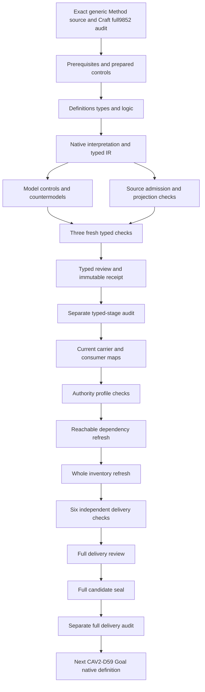

# Generic Method: definitions, types and logic candidate review

## 1. Exact target and evidence boundary

This candidate selects CAV2-D32@1.0.0-candidate.1, Method, at source digest 82743cbbac7b9ad9f393c56a9efa90aae4acc0d6dff769ddb40fd9b5face1c39. CAL-DECISION-0029-CML07-SEMANTIC-FOUNDATION-V1 admits that exact Definition. Definition admission is distinct from accepting this translation, admitting a Method instance, selecting an application or granting permission to execute. The native interpretation remains candidate with source fidelity pending.

Craft Method's full candidate delivery is the immutable predecessor: 9852 sealed files and a separately captured successful read-only audit. Every predecessor hash was rechecked before native creation. A04, C01 and E02 prerequisite receipts retain their exact bindings. All 201 original source files remain current. The fixed episode scope remains 183 identities, 189 versions, 121 tasks, 511 planning edges, 797 work units and 36 frontiers.

The native author, builder, model and source producers have actual exit-zero observations. Prepared controls passed before native creation. Three separate fresh processes validate contract, model and source, with fresh model/source outputs matching their initial observations. A typed receipt and separate audit close this stage. Consumer analysis, authority profiles, dependency/inventory refresh, six fresh delivery checks, full review, seal and separate full audit still follow before Goal native authoring.

## 2. Formalization model and source accounting

The interpretation uses many-sorted first-order logic with equality. T contains necessary candidate declarations; I independently requests coverage populations. Actual-outcome predicates are separate query targets and do not enter the encoded primary theory. Satisfying an exact reference nomination or declaration therefore does not assert real repeatability, valid owner decisions, successful application or actual execution permission.

All 21 nonempty source units have complete character accounting: twelve encoded clauses, seven explanatory units and two deferred mappings. The normative statement selects seven primitive rules. The formal expression selects the eleven-coordinate specification rule. Repeatability's source condition selects field identifiability; admission/application separation selects the two record rules and their distinct-decision constraint. Source tests and identity boundaries select their corresponding guards.

Notation, plain-language explanation, the historical workspace reference and two domain examples remain explanatory. The authority-scope reference and candidate migration claim ceiling remain explicitly deferred. This accounting preserves every selected string without converting examples into normative requirements or pretending unresolved semantic mappings are complete. The source-precedence review and all 21 source-owner findings remain pending.

## 3. Sorted signature and exact references

The signature contains eighteen sorts, one EMPTY token constant, 33 total functions and 107 predicates or relations, for 159 declarations. It distinguishes Method, scope, six plural collection specifications, residue rule, validation rule, recomposition rule, boundary, generic form, field reference, admission record, application record, decision and token. The 16 selector functions are separate from seventeen reference-handle functions.

Each required selector nominates a declared reference of the correct sort with a nonempty handle. Its binding relation is exact: a value is bound if and only if it equals that selector's nomination. Missing bindings, conflicting bindings, undeclared selected referents and empty selected handles fail. Total functions remain defined for unused arguments, while source-conditioned guards prevent unused results from fabricating records.

Actual contents and reference resolution remain separate from these necessary nomination conditions. A nonempty handle does not prove that the corresponding collection, rule or decision exists in an operational carrier. Distinct sorted roles also do not establish a common real-world carrier universe. Those correspondence maps require independent source-owner and consumer review.

## 4. Eleven minimum Method fields

The source tuple is scope, inputs, actions, roles, gates, outputs, evidence, residue rule, validation rule, recomposition rule and boundary. Every selected Method has an exact typed nomination for each coordinate. The candidate also declares governed repeatable transformation. These requirements apply to unnamed generic specifications and named specializations alike.

Generic Method's tuple differs from Craft Method's eleven construction coordinates. Craft has product intent, domain meaning, system specification, realization selection, construction, conformance, operation, recovery/evolution, owner continuation and ledger state around its context. Generic Method includes actions, roles, gates and three rules. Their shared number of coordinates does not equate their forms or identities. CAV2-D20 remains a separately identified specialization example.

The tuple is a proposed specification structure rather than a workflow interpreter or complete lifecycle state machine. No action executes, gate opens, output appears or residue resolves because a specification has those references. The selected rules are present as typed coordinates; their real adequacy and behavior are independent query targets. Method identity cannot replace a permission decision.

## 5. Plural collection coordinates

Inputs, actions, roles, gates, outputs and evidence use collection-specification references. The source says those fields must be explicit, but does not prescribe collection cardinalities, element membership, ordering, uniqueness or nonempty contents. A required nonempty reference handle therefore does not force a nonempty collection. No element-carrier domains or invented cardinality axioms are added.

This choice avoids treating a plural set of actions as one action or a body of evidence as one evidence item. It also avoids rejecting specifications whose explicit input collection could be empty. Conversely, the opaque nominations do not prove that real collections are well formed, complete or compatible. Actual source-to-schema collection maps remain pending.

The source's separate role, gate and evidence meanings are selected as qualified dependencies. Their whole theories are not imported into T. Real-world collections may share contents across coordinates where a reviewed map permits it; the proposed sorted nominations do not establish or forbid that content overlap. This is an explicit denotation gap rather than an unstated assumption.

## 6. Transformation alternatives and repeatability

Applicability describes transformation of intent, evidence, state or residue. The candidate requires at least one declared alternative for every selected Method. Alternatives are inclusive: a Method can declare more than one. The supplied specifications cover intent/evidence and state/residue combinations. Neither exactly-one classification nor a requirement that every Method transform all four is imposed.

Governed repeatability remains a necessary declaration. The source's testable conditions concern identifiable reusable/specialized fields, explicit minimum coordinates, rules and lack of execution authority from identity. The theory expresses those conditions without inventing determinism over every possible application, identical results across contexts or an unlimited repetition theorem.

Actual governed repeatability and transformation fidelity have separate nonentailment queries. Their false targets in a satisfying supplied model demonstrate that declarations alone are insufficient. They do not prove a real Method cannot be repeatable or deny independently supported successful applications. Owner and consumer evidence must supply the missing semantic bridge.

## 7. Named specialization

A declared named Method conditionally nominates an exact generic form. That form has declared minimum coordinates, and an exact Method-to-form specialization relation is present. The Method still satisfies the eleven-field root rule. The theory does not replace its own scope or field references with a prior whole Method theory.

An unnamed generic Method leaves its unused specialization binding absent without fabricating a form record. A control also permits an empty unused form handle. Named specialization without its exact relation or minimum-form declaration fails. Actual specialization fidelity is a query conditioned on the Method being declared named, so its counterexample is source-relevant.

Specialization does not inherit execution authority. The candidate rejects that prohibited nomination and permits independently supported actual authority in a different predicate. Shared naming, a form reference or exact Definition admission therefore cannot stand in for an authorized application. Generic Method and Craft Method remain separately qualified meanings.

## 8. Reusable and specialized field identifiability

For every selected Method, a field marked reusable or specialized must be a declared Field reference with a nonempty handle and a Method-to-field identifiable declaration. Missing identifiability for a reusable or specialized field, an undeclared marked field or an empty marked handle fails. The source does not specify a disjoint or exhaustive partition, so the model permits a field with both roles.

The supplied coverage also includes a declared field not classified for a selected Method. This population demonstrates the absence of an imposed exhaustive classification; it does not itself establish an additional operational field belonging to that Method. Real Method-field membership, field names and coordinate-to-field maps are not encoded by the standalone Field declaration. That limitation remains in the source-owner findings and downstream mapping obligations.

Thus explicit tuple coordinates and conditional field-role identifiability are different surfaces. The minimum eleven coordinates remain present even if no reusable/specialized role records are selected, while I then fails to supply the requested role examples. An unrelated unclassified field handle remains unused by the selected-role guard. Those cases do not waive identifiability for a field actually marked reusable or specialized.

## 9. Admission and application records

An admission record nominates its Method and decision, declares the admission decision role and supplies a decision-to-Method relation. An application record independently nominates its Method and decision, declares the application decision role and supplies its own relation. Each selected record requires exact fields and nonempty typed references.

The Method specification does not fabricate either record. An application can be selected without a matching selected admission record, and that situation is an explicit required population. This is a statement about the supplied declaration universe, not a claim that an unadmitted real Method may execute. The application record does not assert actual execution or valid permission.

Likewise, a Method's admitted Definition is not its instance admission, and a Method Binding is not automatically an executed application. Later C30/C31 type and carrier admissions must retain their exact scopes. Their real relation to these proposed record sorts remains a consumer-mapping question. The model does not infer an owner authorization from strings naming a decision or Method.

## 10. Separate decisions and execution authority

Every selected admission decision reference differs from every selected application decision reference. The candidate applies separation across the selected roles, including records that nominate different Methods. Reuse of one decision reference among admission records within the same role is not forbidden. The chosen role-wide scope is explicit in a source-owner finding; real batching and owner semantics remain pending review.

The controls reject admission/application decision collapse for the same Method and for different Methods. They permit multiple same-role admission records using one decision nomination. No application counterpart or admission counterpart is invented merely to make the separation rule nonvacuous; I independently requests populated examples demonstrating it.

Method identity, named specialization and application identity cannot nominate inherited execution authority. Actual permission and actual authority may nevertheless be independently supported. The finite model deliberately includes such an independent authority case while retaining Methods without actual outcomes. This prevents necessary declaration boundaries from becoming a universal denial of legitimate authority.

## 11. Source, provenance and dependencies

The source checker passes 69 actual checks. It verifies the current C29 generic Method selection, exact authorization/manifest/validation/candidate bindings, Definition schema/generator bindings, source text, the local Definition upstream and source-query correspondence. It extracts only the three pure Definition renderer functions, renders twice and compares both outputs with the existing 3654-byte projection without mutating the source.

Both projections have digest fe419ca7e65733512ea3113d19aa204466fbc5fcb1c7c49fa69dd9dcabc4f090. The original external definitions path is absent. The relocated file supplies exact lines 2114–2180 at digest 28608be42869eaf5183bd5b4154d9bded38f1a17ad35c11072b9a49f1e4dc348. The full-file digest differs from the historical authoring digest; the selected scope still matches. No external private meaning or legacy authority is imported into T.

The immutable source body's candidate-unadmitted upstream label remains intact. Current C29 scoped source-use admission is separately observed. The candidate selects 21 complete direct semantic dependency identities. Missing canonical labels for scope, action, state, collections, generic form and field identification remain explicit. No synthetic canonical Definitions are invented to fill those labels.

## 12. Controls, countermodels and retained evidence

The suite evaluates 173 authored controls: 69 satisfy T, 96 fail T and eight malformed models are rejected structurally. Positive cases preserve unnamed unused specialization fields, overlapping field roles, inclusive transformation alternatives, same-role decision reuse and independently supported actual outcomes. Negative cases cover every required exact binding, selected handle, marked field, named form, transformation alternative, decision role and prohibited identity/authority nomination.

All 39 actual-outcome queries have a supplied interpretation satisfying both T and I, with the target false and the witness condition true. One query is conditioned on named specialization. Their targets cover repeatability, transformation, collection/scope fidelity, rule adequacy, field identification, decision validity, admission/application, permission, execution, validation, residue, recomposition, source fidelity and authority. No target is assumed in primary T. Forty-seven source-query obligation rows preserve exact selectors, excerpts and byte digests; accepted semantic mappings remain pending.

One actual source-checker assembly/AST parse error occurred before native creation. A generated rendering loop was indented incorrectly. The erroneous generated checker and an exact observation of the exit-one assembly failure are retained. The correction changed the loop indentation, with no source, theory, model or limit change. Prepared semantic controls and all native producers passed; the assembly failure is not relabeled as a failed semantic test or hidden from the receipt.

Three fresh typed-stage processes independently pass contract, model and source. Existing one-million-byte, 50000-node, 100000-step and 30-second limits are unchanged. The prepared maximum is 7572 evaluation steps. These bounded software observations do not establish common denotations, source fidelity, whole translation or whole proof.

## 13. Detailed continuation DAG and completion scope

The machine-readable DAG records eighteen nodes and eighteen edges with completion criteria. It is a work-delivery dependency plan, distinct from the semantic dependency graph. Definitions, types and logic precede consumer and profile evidence. The typed receipt and its separate audit are required before the full candidate delivery sequence. Goal native creation waits for generic Method's full seal and separate audit.

The last sealed whole inventory has 105 partial drafts. Generic Method contributes the 106th working native draft, leaving 77 identities without native T; the current whole inventory refresh is still pending at this stage. All 9852 predecessor files and 201 sources remain unchanged. Accepted whole translations, whole-definition proofs and source-owner maps remain pending. The original unbounded goal stays active until all remaining definitions and original assurance requirements are completed and audited, followed by the requested complete review.
