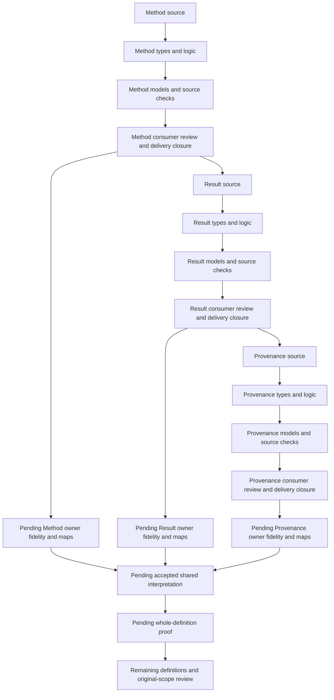

# Measurement formalization: verified sequence and assurance DAG

Measurement Method, Measurement Result and Provenance already have sealed partial candidate deliveries in the requested order. This verification preserves those packets, verifies their current bytes and replays their typed logic checks. It adds a consolidated explanation and execution DAG outside the authoritative Definitions and sealed candidates.

Twelve current commands—contract, model, source and qualification profile for each Definition—exited zero, produced empty stderr and matched their sealed stdout captures. All 6,485 unique files in the three nested delivery manifests matched SHA-256 before and after these commands. The respective manifests contain 6,286, 6,383 and 6,485 files. All eighteen historical terminal records—six per Definition—also record exit zero and empty stderr.

Historical exact-file-set audits are not rerun after subsequent packets were added. Dependency and inventory checks are historical observations, not new replays in this verification. Historical draft counts describe their delivery time. Source fidelity remains pending, semantic readiness false, accepted whole translations zero and whole-definition proofs zero.

## Definitions, types and logic

| Definition | Sorts | Declarations | Encoded / explanatory / deferred | Controls | Source checks | Nonentailment queries |
|---|---:|---:|---|---:|---:|---:|
| Measurement Method | 25 | 145 | 11 / 6 / 7 | 117 | 32 | 24 |
| Measurement Result | 21 | 164 | 15 / 6 / 3 | 147 | 35 | 30 |
| Provenance | 17 | 122 | 8 / 9 / 9 | 97 | 32 | 16 |

The 361 controls and seventy nonentailment queries are authored finite candidate evidence. Positive and negative models test necessary guards; malformed models test interpretation contracts. They establish the reported behavior of supplied interpretations, without proving all real instances or source-owner fidelity.

The theory T contains necessary declaration conditions. Requested populations I require examples that exercise important cases; T and I are evaluated separately. Descriptive sorts remain proposed vocabulary rather than new canonical Definitions. Every symbol is qualified by exact source version and candidate scope. Equal printed names do not merge the independently qualified theories.

## Measurement Method

The selected positive Definition is cal.definition.measurement-method@1.0.0-candidate.1, with C66 admission and SHA-256 b63f9192cc3141856e89aa9d603f16dac04d3530df27082486f999a0dc6f7b94. Its genus is a versioned reproducible procedure for one declared property under stated conditions. Specification, execution, actual subject and calibration state have separate types.

Twenty-five sorts preserve those distinctions. Seventeen Method projections retain version, property, procedure, subject specification, conditions, units, instrument or Tool specification, Implementation specification, calibration contract, sampling, computation, uncertainty treatment, evidence contract, applicability, owner route, failure contract and reproducibility criterion. Selected fields require declared carriers and nonempty handles. Executions separately bind exact Method, actual subject, conditions, Tool and Implementation versions, and calibration state.

Procedure or uncertainty changes require distinct Method versions under the selected change guards. The theory adds no universal version order or authority ranking. A distinct version does not establish correct revision or admission. Different governed properties and multiple actual subjects remain possible; residue entropy is one use rather than the entire meaning.

Declared calibration and reproducibility criteria do not establish actual calibration or reproducibility. A complete specification can exist without a measurement. The current residue-entropy carrier supplies bounded shape and projection evidence, leaving broader correspondence unresolved. Eighteen source-owner findings retain denotation and fidelity obligations. Actual suitability, execution and outcomes require further evidence.

## Measurement Result

The selected positive Definition is cal.definition.measurement-result@1.0.0-candidate.1, with C66 admission and SHA-256 4bc1e7d96b821dd384cb6ff731d56030a560c00a30ff6415d82d57d9fac89dec. Its genus is an immutable attributable record of one exact Method execution against one exact subject revision under declared conditions.

Twenty-one sorts separate record, execution, Method version, subject revision, values, units, uncertainty, raw evidence, Tool and Implementation versions, interval, validity posture, owner route, receipt, provenance, timestamp, snapshots, corrections and uses. Ten Result components must equal the referenced execution's declared outputs. Those equalities preserve exact binding within the candidate; actual authenticity and computation remain independent.

Selected snapshots preserve sixteen original content projections. A silent change under the same record identity fails those guards. A correction requires a distinct successor and retention of the original record and evidence. The successor can preserve the numerical value while correcting another detail. No unsupported unique-successor rule or global acyclic-lineage theorem is introduced.

Interpretation, acceptance and use in a Finding require separate governed-act declarations. Validity posture does not establish claim support. Snapshot equality does not prove authenticated immutable storage. Eighteen source-owner findings keep denotations, reference resolution and fidelity unresolved. Actual attribution, correct execution, retention, acceptance and support remain evidence obligations.

## Provenance

The selected Definition is cal.definition.provenance@1.0.0-candidate.1, with C53 admission and SHA-256 514e2c9e19882553cbdfb1f10b94dacb510bf010a9aa0727b1068aff839ca86b. Its source binds the precise D35 section and C12 normalization context. Historical embedded candidate posture and current admission overlays are preserved separately.

Seventeen sorts separate normalized Meaning, ProvenanceRecord, tracked Object, Path, Step, Position, Source, RelationKind, Operation, Handler, Posture, MissingSegment, Residue, OwnerRoute, Context and AuthorityUse. A selected step preserves source, relation, operation, owner-or-process and posture, together with its path and position. Owner-or-process is an inclusive disjunction.

Order is strict, total and transitive within a selected path. Distinct selected steps have distinct positions. Repeated sources remain possible. Local declared order proves neither actual chronology nor wider dependency-graph acyclicity. Relation labels distinguish transformations without becoming an exhaustive universal taxonomy.

Missing segments retain explicit residue and owner routes. A mathematically possible empty path receives no invented adequacy policy. Authority-bearing uses have separate typed-precision requirements. A complete declared trail, source posture or parent posture does not confer proof, trust, validation or instance authority. Independently justified authority remains possible.

Recorded inspection found no direct current carrier bound to this exact Provenance Definition. Generic Definition evaluation and normalization scaffolds retain separate meanings. Actual authenticity and completeness, empty-trail policy, consumer timing and accepted correspondence remain unresolved.

## Detailed DAG and completion gates

The [machine-readable DAG](dag.json) has thirty-six nodes and thirty-seven edges and a validated topological order. Each Definition has ten candidate stages: exact source, types, source account, logic, models, consumers, profiles, dependencies, delivery and separate audit. Method closure precedes Result source selection; Result closure precedes Provenance source selection.

The recorded candidate stages distinguish current contract/model/source/profile and manifest verification from historical dependency, inventory and audit evidence. Three additional owner-fidelity nodes, shared interpretation, whole proof and original-scope episode review remain pending.

An acyclic execution plan does not resolve semantic dependency cycles. Shared consistency requires accepted correspondence between independently qualified theories and actual consumers. Method, execution, Result and provenance references cannot be joined by printed-name equality or by inventing missing carriers. Whole proof must use accepted denotations, precise scope and explicit assumptions.

The wider goal remains active with its original scope: 183 identities, 189 versions, 201 source files, 121 tasks, 511 planning edges, 797 work units and 36 frontiers. This three-definition candidate sequence is present and currently verified. The remaining definitions, owner fidelity, shared consistency, whole proofs and final aspect-by-aspect explanation remain outstanding.

## Evidence and preservation

The [current verification report](verification.json) records terminal results, argv, stdout parity and manifest counts. Individual current stdout, stderr and command-result files are retained alongside it. [ARE evidence](ARE-evidence.json) records the initial no-match and subsequent route/context/effect gates, all without authority effects.

All new artifacts are outside sealed packets. No canonical Definition, admission, implementation, private data, live service, publication or memory file changed. Unrelated tracked changes remain thirty files, 4,833 insertions and 518 deletions.

The complete existing aspect reviews retain detailed source findings, carrier probes, populations and claim ceilings:

- [Measurement Method full aspect review](../../assurance-snapshots-v1/definitions/cal.definition.measurement-method/DELIVERY-REVIEW.md)
- [Measurement Result full aspect review](../../assurance-snapshots-v1/definitions/cal.definition.measurement-result/DELIVERY-REVIEW.md)
- [Provenance full aspect review](../../assurance-snapshots-v1/definitions/cal.definition.provenance/DELIVERY-REVIEW.md)
