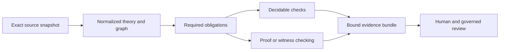

# Relational model and theorem checker detailed analysis

The useful product is a checker that explains whether a proposed relation change satisfies a named set of obligations, and supplies reproducible evidence for each conclusion. Its semantic foundation must distinguish valid records, justified assertions, permitted derivations, and governed admission.

This package contains a complete design analysis for the five proposed layers, with explicit remaining design decisions. It does not contain a completed formalization or checker implementation. Every layer remains not started; theorem names, module names, interfaces, and future artifacts below are proposals.

## Reading map

| Document | Purpose |
| --- | --- |
| [Roadmap](implementation-layering.md) | Layer decisions, boundaries, and execution order |
| [L0 — working proof](layers/L0-working-proof.md) | Independent semantics, finite checker, and first soundness theorem |
| [L1 — faithful baseline](layers/L1-faithful-baseline.md) | Registry interpretation, schema coverage, semantic coverage, and replay |
| [L2 — model evolution](layers/L2-model-evolution.md) | Change classification, preservation, consistency, and compatibility |
| [L3 — inference discipline](layers/L3-inference-discipline.md) | Derivation certificates, protected conclusions, and non-entailment |
| [L4 — workflow integration](layers/L4-workflow-integration.md) | CLI/CI, proof verification, evidence aggregation, and pilot acceptance |
| [Source baseline](SOURCE-BASELINE.json) | Measured source identities and schema-only control outcomes |

## 1. Verified baseline and its limits

The selected [admission registry](../../../authority/admissions/governance-transaction-surface/v1/registries/relation-kind-registry.json) has 41 entries, 41 distinct axis identifiers, and 550 relation-specific endpoint-pair entries. The 550 count sums pairs across kinds; it is not a claim of 550 globally distinct unlabelled kind pairs. All 41 referenced record hashes matched in this analysis.

| Finding | Evidence and implication |
| --- | --- |
| Exact pairs and closed qualifiers already exist | [Conforms-to](../../../authority/relation-kinds/candidates/0006-definition-complete-instances/instances/relation-kinds/conforms-to.json) supplies three ordered pairs and three required qualifier fields. Preserve these structures in normalization. |
| Source state and effective state differ | Selected source records say `candidate`, while the binding registry says `admitted-current`. Resolve authority through the selected registry and admission evidence; do not rewrite source records to make their labels agree. |
| Carrier coverage lags the selected registry | [Typed Relation/v2 schema](../../../authority/artifact-types/typed-relation/v2/schema.json) has 40 conditional branches. Its relation-kind enum excludes `materializes-consequence`. A synthetic record with that kind and the declared qualifiers is rejected at the enum. |
| Existing closure validation has useful controls | In-memory schema validation accepted the existing valid fixture, rejected an unregistered kind, and rejected the phantom `capability-instance -> context-profile` pair for `conforms-to`. These establish schema behavior only. |
| Semantic independence is not proved by current validation | [Extension validator](../../../authority/relation-kinds/candidates/0007-governance-transaction-extension/validate.py) checks uniqueness of axes/questions and structural distinctions. Unique strings do not establish logical independence. |
| Existing Lean certificates bind supplied values | [Certificate kernel](../../../craft/formalization/DomainSpecMetaTypeKernel.lean) checks equality of digest/identity fields and a supplied Boolean. It does not formalize hashing, parsing, or the business meaning of that Boolean. |
| Projection refinement is currently narrow | [TypeScript projection refinement](../../../craft/formalization/DomainSpecMetaTypeTypeScriptProjectionRefinement.lean) establishes field-preserving lowering for an already supplied graph. It is not a proof that arbitrary source JSON was parsed faithfully. |
| Candidate integration contracts have specific ownership | [FormalClaim Lean binding](../../../craft/formalization/schemas/formal-claim-lean-binding.schema.json) fixes a legacy owner string, and [theorem request](../../../craft/formalization/schemas/theorem-obligation-request.schema.json) fixes EVF ownership. New Lab integration needs an explicit fit assessment rather than relabelling old contracts. |

Checks were read-only, apart from the requested documentation writes. Existing relation validators were inspected, not executed: they invoke builders and rewrite receipts. The schema controls used copied fixtures in memory. No full admission-chain validation, runtime assessment, Lean build, or solver execution was performed.

## 2. Recommended formal architecture

Use a data-driven theory with a finite registry and explicit semantic profiles. Hard-coding all kinds into one Lean inductive type can serve the first slice, but should not become the extension mechanism. A later registry addition should supply data and obligations, not force duplication of the generic correctness theorem.

This diagram describes processing order. It declares no new global Relation Kind.

Recommended mathematical objects:

- `Snapshot`: exact selected authority roots, source identities, effective state, and supported profile.
- `NodeRef`: identity, exact version, content binding, and relevant scope. A displayed label is not an identity.
- `KindSpec`: exact ordered pairs, qualifier contract, semantic profile, and explicitly named rule bindings.
- `Assertion`: its own identity, kind reference, endpoints, qualifiers, provenance references, and posture.
- `Graph`: a finite collection of nodes and assertions. Distinct qualified assertions may share endpoints; reject duplicate assertion identity without silently merging them.
- `Theory`: signature, independently defined invariant predicates, explicit background assumptions, and selected rule semantics.
- `Proposal`: an exact diff against a named baseline, including its intended compatibility claim.
- `Obligation`: a required proposition/check, its dependencies, method, and evidence ceiling.

For a relation kind `r`, its pair set is `P(r) subset K x K`. Assertion validity requires endpoint resolution, membership of the ordered pair in `P(r)`, qualifier validity, and exact scope/version bindings. Additional relation semantics are applied only when their profile is selected and fully defined.

Do not interpret all prose as executable axioms. For example, the [materialization record](../../../authority/relation-kinds/candidates/0007-governance-transaction-extension/instances/relation-kinds/materializes-consequence.json) names an application receipt and output digest, but its qualifier schema only requires nonempty strings. Syntax cannot establish that the receipt authenticates the output or that bytes match the digest.

## 3. Four distinct correctness boundaries

| Boundary | Required argument | Residual assumption until separately verified |
| --- | --- | --- |
| Source to normalized model | Exact field mapping, no omitted kind/pair, deterministic decoding, reviewed source semantics | Parser correctness and faithful interpretation of source bytes |
| Model to executable checker | `check=true -> independently defined invariant` | Correct execution of the checker, unless supported by checked proof-producing evaluation |
| Evidence to theorem | Required statement and dependencies match; proof term and axioms pass the selected verification policy | Logic/kernel/toolchain assumptions for the chosen evidence method |
| Theorem to governed use | Evidence applies to the exact current proposal and baseline selected by the review/application workflow | The workflow faithfully enforces its currentness and authorization rules |

The existing kernel is useful for certificate plumbing. Copying its definition `StaticConforms := checker=true` would leave the semantic gap intact. Reuse the pattern while proving the new Boolean correct against independent predicates.

Digest equality is a binding check, not a theorem about cryptographic collision resistance or authentic source authority. Compute digests from read bytes, record that process, and keep hashing and resolver implementations in the stated trusted boundary unless they are separately formalized.

The first proof should quantify over arbitrary finite input graphs within the supported profile, rather than prove only one demonstration graph. The demonstration establishes non-vacuity and usability; it does not substitute for the generic theorem.

## 4. Precise interpretation of negative claims

Three superficially similar statements need different evidence:

1. **Rejected input:** this assertion violates a selected invariant. Supply a checked failure location or violation witness.
2. **No derivation:** this conclusion is absent from the least fixed point of the selected finite rule system and exact input facts. Supply a checked saturation result or a general boundary theorem.
3. **Non-entailment:** a proposed universal implication does not follow from the theory. Supply a full model satisfying the theory and falsifying the implication.

Conformance not implying admission is the third kind of statement; a workflow prohibition on justifying admission from conformance is a rule/provenance boundary. Neither means that a conformant artifact must be unadmitted.

A finite countermodel can refute an unrestricted implication if it is checked as a full model of the specified theory. Failure to find a countermodel within an Alloy bound cannot prove unrestricted entailment. Keep search bounds distinct from the scope of a checked witness. [Alloy specification](https://alloytools.org/spec.html)

## 5. Evidence and outcome design

Use separate dimensions instead of one overloaded pass flag:

| Dimension | Example values |
| --- | --- |
| Execution | completed, timeout, unavailable, provider-error |
| Currentness | current, stale, unresolved |
| Evidence method | verified-checker, kernel-proof, checked-model-witness, bounded-search |
| Obligation verdict | satisfied, violated, unknown, unsupported, not-run |
| Aggregate readiness | all required obligations satisfied, failed requirement, unresolved requirement |

An exhausted proof search is `unknown`, not a counterexample. A stale proof can remain mathematically valid for its old statement while being unusable for the current proposal. A resource limit can interrupt a decidable check without changing its logical decision procedure into evidence of success.

Bind each bundle to snapshot, normalized theory, graph, proposal, required statements, semantics/profile versions, transitive dependencies, toolchain, assumption audit, and actual results. Reference hashes should be recomputed, not trusted from a `current: true` field. Derive aggregate readiness from the complete required obligation set; a prover cannot omit difficult obligations and self-declare success.

The existing [theorem evidence binding](../../../craft/formalization/schemas/theorem-evidence-binding.schema.json) has a theorem-only claim ceiling. A bounded model-search result should use its own profile/evidence record rather than be forced into theorem success.

## 6. Layer dependency and delivery decisions

L0 proves the core check-to-semantics connection. L1 covers the selected registry faithfully. L2 introduces controlled theory changes. L3 closes the derivation and independence questions for an explicit rule profile. L4 makes those guarantees usable in an actual review workflow.

L0 must use a candidate companion input profile for the selected slice because the frozen Typed Relation/v2 carrier excludes one of its three kinds. That is a proposed checker input, not a silent carrier admission or a patch to immutable schema bytes. L1 reconciles the full carrier/registry coverage through an explicit successor or selected profile.

L2 must classify changes to rule definitions and generate their obligations, but full inference-boundary discharge waits for L3. This avoids calling a rule-changing extension safe before the inference checker exists. Additive instances under a frozen theory can finish earlier; unrestricted extension readiness cannot.

L4 adds packaging and independent-submission protection. Basic statement/dependency auditing belongs in L0 and persists throughout; it is not postponed to the final layer.

Reusable implementations should live in a new, clearly scoped formalization candidate area. Keep this planning directory for descriptions, task decomposition, and design evidence. Exact code paths and contract versions are selected when implementation begins.

## 7. Responsibilities, cost, and unresolved decisions

| Responsibility | Required decision or evidence |
| --- | --- |
| Semantic owner | Approves meanings, qualifier interpretation, and declared couplings |
| Formalization implementer | Defines independent predicates and proves checker/profile correctness |
| Integration implementer | Supplies snapshot resolution, decoding, dependency binding, CLI, and receipts |
| Reviewer | Checks meaning-to-statement correspondence and evidence limits |
| Admission owner | Selects any later governed effect on exact reviewed bytes |

Names remain unassigned. Separation of responsibilities does not require spawning agents or external messages.

Largest cost risks are the meaning of evidence references, reconciliation of carrier coverage, compatibility proof strength, and rule-boundary semantics. Solve one selected obligation family before adding another engine. General quantified obligations may remain undecidable or unresolved; a complete automatic prover is not an achievable completion condition. [cvc5 quantified-theory documentation](https://cvc5.github.io/tutorials/beginners/theories.html)

Implementation decisions to resolve at entry to the relevant task:

- L0: normative meanings of the three selected qualifier objects and the smallest graph invariant.
- L1: authority snapshot/profile selection and how carrier successors are represented.
- L2: exact backward-compatibility claim and supported extension profiles.
- L3: protected conclusion vocabulary and what counts as a legitimate root justification.
- L4: proof-submission trust boundary and evidence thresholds in review.

## 8. Validation performed for this analysis

- Verified all 41 selected relation-record digest bindings and measured 550 relation-specific pair entries.
- Compared registry kinds with the Typed Relation/v2 schema's 40 conditional branches.
- Executed five in-memory schema controls, including a materialization candidate with complete declared qualifiers and an invalid conformance pair. Results are recorded in [SOURCE-BASELINE.json](SOURCE-BASELINE.json).
- Inspected validators, certificate/refinement modules, the three selected relation records, runtime source-resolution behavior, and candidate theorem contracts.
- Refreshed primary documentation for proof checking and solver evidence limits.

The final documentation audit checks local links, required layer sections, and placeholder residue. Proof validation is future acceptance work, not a result of this documentation analysis. For the later proof pipeline, audit axioms and compare independently supplied statements before accepting evidence; fresh replay and stronger external checking depend on the submission profile. [Lean proof validation](https://lean-lang.org/doc/reference/latest/ValidatingProofs/)
