# Full dependency DAG

> Generated from [PLAN-SOURCE.json](../PLAN-SOURCE.json).
> Standalone candidate. 33/35 tasks accepted with hash-bound evidence; see task receipts for review scope. No formal Invoke admission is claimed.

An arrow means accepted, current and applicable evidence is required before the successor starts. Wave membership denotes dependency depth; it is not a deadline or staffing assignment.
The first phase is F0: P01 semantics → P03 independent formal predicates → P04 Lean reference checker → P05 general soundness and formalization review. Baseline refresh B00 and decoder/interface alignment P02 follow accepted P05 evidence.

```mermaid
flowchart TD
  subgraph L0["L0"]
    P01["P01: Define the relational semantics and theorem targets"]
    P03["P03: Formalize typed graphs and independent validity predicates"]
    P04["P04: Define the reference checker in Lean"]
    P05["P05: Prove and review general reference-checker soundness"]
    B00["B00: Refresh the execution baseline after formalization"]
    P02["P02: Align schemas and implement decoding from the formal model"]
    P06["P06: Produce a bound demonstration and hostile controls"]
    G0{"G0: Review the working proof gate"}
  end
  subgraph L1["L1"]
    C01["C01: Resolve the effective registry snapshot"]
    C02["C02: Reconcile carrier and registry coverage"]
    C03["C03: Generalize registry-driven checking"]
    C04["C04: Resolve qualified references"]
    C05["C05: Measure semantic coverage and exercise the baseline"]
    C06["C06: Make replay deterministic and invalidate stale evidence"]
    G1{"G1: Review the faithful baseline gate"}
  end
  subgraph L2["L2"]
    E01["E01: Classify relation-change proposals"]
    E02["E02: Derive the required obligation set"]
    E03["E03: Check compatibility and prove preservation"]
    E04["E04: Check inhabited models and conservative expansions"]
    E05["E05: Compose the compatibility and invalidation report"]
    G2{"G2: Review supported non-rule extension readiness"}
  end
  subgraph L3["L3"]
    I01["I01: Specify the restricted inference and root profile"]
    I02["I02: Check derivation certificates and prove soundness"]
    I03["I03: Check the least fixed point and completeness"]
    I04["I04: Prove protected lineage through indirect chains"]
    I05["I05: Check independence and non-entailment witnesses"]
    I06["I06: Discharge rule-change extension obligations"]
    G3{"G3: Review inference discipline"}
  end
  subgraph L4["L4"]
    R01["R01: Define CLI and outcome contracts"]
    R02["R02: Verify proof submissions and fresh replay"]
    R03["R03: Verify evidence bundles and aggregate obligations"]
    R04["R04: Integrate CLI and CI diagnostics"]
    R05["R05: Recheck the application baseline in a candidate adapter"]
    R06["R06: Run a representative shadow pilot"]
    G4{"G4: Review supported use and audit plan alignment"}
  end
  P01 --> P03
  P03 --> P04
  P04 --> P05
  P05 --> B00
  B00 --> P02
  P02 --> P06
  P04 --> P06
  P05 --> P06
  P06 --> G0
  G0 --> C01
  C01 --> C02
  C01 --> C03
  C02 --> C03
  C01 --> C04
  C03 --> C04
  C03 --> C05
  C04 --> C05
  C05 --> C06
  C05 --> G1
  C06 --> G1
  G1 --> E01
  E01 --> E02
  E02 --> E03
  E02 --> E04
  E03 --> E05
  E04 --> E05
  E05 --> G2
  G2 --> I01
  E02 --> I01
  I01 --> I02
  I02 --> I03
  I02 --> I04
  I03 --> I04
  I01 --> I05
  E04 --> I05
  I04 --> I06
  I05 --> I06
  E02 --> I06
  E05 --> I06
  I03 --> G3
  I06 --> G3
  G3 --> R01
  G3 --> R02
  P05 --> R02
  R01 --> R03
  R02 --> R03
  C06 --> R03
  E02 --> R03
  I06 --> R03
  R01 --> R04
  R03 --> R04
  R03 --> R05
  C06 --> R05
  R04 --> R06
  R05 --> R06
  R06 --> G4
```

## Dependency depth

The longest dependency path contains 31 tasks: P01 → P03 → P04 → P05 → B00 → P02 → P06 → G0 → C01 → C02 → C03 → C04 → C05 → C06 → G1 → E01 → E02 → E04 → E05 → G2 → I01 → I02 → I03 → I04 → I06 → G3 → R02 → R03 → R05 → R06 → G4.
This counts prerequisite steps; engineering effort and elapsed time remain unestimated.

## Rule-change handoff

E02 generates rule-change obligations. G2 closes supported non-rule extensions and releases I01. I06 combines L3 evidence with those obligations. G2 never waits on I06, so the handoff creates no cycle.

## Concurrent branches

- P01, P03, P04 and P05 form the opening formalization chain; P02 begins only after its accepted evidence and B00 alignment.
- E03 preservation and E04 model witnesses join at E05.
- I05 independence witnesses run alongside derivation and closure work after I01.
- R01 workflow contracts and R02 proof replay join at R03.
- R04 CLI integration and R05 application adapter join at R06.

Concurrency is permissible after shared predecessor contracts are fixed and accepted. Task scopes are disjoint; changing an upstream export triggers impact review and a replan.
