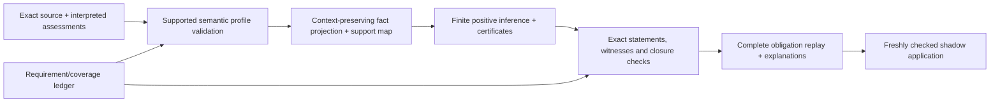

# Successor design: contextual semantics and finite evolution

Status: proposed, not implemented. Date: 2026-10-09. Baseline: current v1 candidate and its separately scoped semantic/stress evidence. New implementation namespace proposed: `/home/vlad_/projects/CyberAlchemy-lab/craft/formalization/candidates/relational-theorem-checker/v2`. The directory is not created by this review.

## 1. Product behavior and minimum useful release

A maintainer should be able to ask whether an exact subject revision conforms to an exact contract revision in a named scope; obtain its exact evidence and derivation; and propose a supported rule addition without changing old meanings. “Some conformance exists” remains a useful existential view, but does not answer the specific question.

The first release exposes contextual facts and an explanation for the result, with all existing version/evidence/root safeguards. It does not wait for a universal condition language, every registry relation's semantics, or a new solver. Subsequent releases broaden finite ordinary inference and add exact mappings for the two stress profiles.

## 2. Architecture



Six design views:

| View | Proposed design |
|---|---|
| Conceptual | Keep declarations, assertions, assessments, contextual facts, rules, condition evaluations, independent roots and application decisions separate. |
| Data | Exact reference pairs; relation-specific qualifiers; versioned profile/capability manifests; fact support keyed to graph/assertion/assessment identities. |
| Logical | New contextual predicates plus explicit existential views; finite positive recursion only in a newly proved extension profile; explicit unknown conditions. |
| Runtime | Generate/check projection witnesses, derive candidate facts, replay certificates and complete closure, then aggregate independently required obligations. |
| Boundary | Parser/runtime/hash/kernel/issuer assumptions stated per profile; unsupported legacy interpretations fail visibly; ordinary information never supplies independent roots. |
| Evolution/use | Preserve v1 evidence; introduce explicit profile versions and dependency migration; current local CLI/CI and shadow states remain the application surface. |

## 3. Contextual conformance

Introduce a fresh ordinary predicate:

```text
ConformsTo(subjectRef, targetRef, scope)
sorts = [reference, reference, scope]
```

Each `Ref` contains `id` and `version`. A fact is true in the projected initial inventory exactly when a member assertion of the validated graph has F0 conformance meaning with those endpoints and scope. The target may be a contract or another allowed F0 target kind; retain the source kind/pair policy in the formal projection contract. The public name must not imply a contract-only endpoint when the selected projection includes governed-model/context-profile targets. **Proposed default:** call the general internal predicate `ConformsTo`; expose the target's exact kind in explanations, and permit contract-specific rules only with a checked target-kind premise or a contract-only projection profile.

The requirement for that clarification is substantive: preserving target identity is necessary, but does not by itself distinguish a contract node from another permitted target kind.

The existing `Conforms(subjectRef)` keeps its declared existential meaning. New code should name that abstraction clearly in documentation, for example “has a conformance assertion.” Do not change the reserved v1 core signature or silently rename its semantics.

Compute the unary compatibility inventory during the checked projection. Do not install `ConformsTo(...) → Conforms(...)` as a new inference rule under the fresh-head profile: `Conforms` is an old predicate, and such a producer would require a different extension argument. The equivalence below concerns projected initial inventories, not arbitrary extra facts an old semantic model might assign to an ordinary predicate.

Proposed required statements, independently fixed before checker implementation:

```text
ProjectionSound:
  Inv(G) ∧ ConformsTo(s,t,c) ∈ project(G)
  → ∃ e ∈ G.assertions, F0ConformsAt(G,e,c) ∧ e.source=s ∧ e.target=t

ProjectionComplete:
  Inv(G) ∧ e ∈ G.assertions ∧ F0ConformsAt(G,e,c)
  → ConformsTo(e.source,e.target,c) ∈ project(G)

ExistentialViewExact:
  Conforms(s) ∈ project(G)
  ↔ ∃ t,c, ConformsTo(s,t,c) ∈ project(G)
```

These are theorem targets, not already checked Lean declarations. Define `F0ConformsAt` independently from the new projector and include exact accepted assessment binding. The theorem concerns graph membership; validity of a proposed unasserted edge cannot produce an initial fact by itself.

Support records retain graph identity, assertion ID, source/target references and kinds, scope, kind definition version, assessment reference and source binding, semantic-profile identity and projection identity. Multiple edges can justify one atom; retain the set of exact supports rather than inventing a unique origin. Check support completeness for initial facts. Derived facts use certificates that reference checked initial facts and substitutions.

A static scope acquires no temporal interpretation merely by appearing in this tuple. Add a snapshot argument only under a separately defined snapshot-relative meaning; record workflow snapshot identity in evidence metadata in the meantime.

### Worked intended behavior

```text
ConformsTo(Reviewer@v1, Contract-A@v2, static)
TargetKind(Contract-A@v2, contract)
    → ReviewSignalFor(Reviewer@v1, Contract-A@v2, static)
```

`TargetKind` is itself a checked projection from a validated graph, not caller-provided unchecked data. The signal is ordinary candidate information. Wrong-contract, wrong-scope, changed-version and wrong-target-kind cases must fail to derive this result. A unary `Conforms(Reviewer@v1)` premise cannot substitute for the rich premise.

## 4. Domains and backward compatibility

The first contextual-rule profile uses a fixed, captured finite domain. References and scopes needed by the rich facts must already be in that domain. If they are not, report that a new baseline/domain profile is required. Do not silently satisfy the current expansion theorem's `domain_same` hypothesis while widening the domain.

Where a richer baseline is necessary, recapture it as a new profile and prove the v1-to-v2 projection relationship explicitly. Domain growth and new ordinary initial facts are changes distinct from a rule-only addition. They cannot reuse the old rule-only classifier or its 15-obligation inventory unchanged.

Compatibility has three axes: selected concrete data, old-language invariant preservation, and every-old-model expansion. Compare source meanings and profile IDs as well as transport arity. Existing v1 receipts remain valid for their original inputs; they do not discharge newly named projection or recursion obligations.

## 5. Recursive ordinary definitions

Proposed `finite-positive-fresh-definitions/v2` supports nonempty valid old rule baselines and positive recursion among new ordinary predicates under these checked conditions:

1. The domain, roots, old predicate declarations, old rules and old initial facts are unchanged for a rule-only proposal.
2. Every added rule is typed, function-free and range-restricted.
3. Every added head is a fresh ordinary predicate. Added rules do not write old predicates, protected predicates or independent roots.
4. Added bodies may read old predicates or new ordinary predicates. Old rules retain their exact vocabulary and cannot consume fresh predicates.
5. Every new ground atom remains in a finite enumerated typed universe; resource exhaustion remains unknown.

For an arbitrary old semantic model `M`, freeze old truths to `M`. Start with the specified fresh initial facts, if the selected profile permits them, then iteratively add fresh heads whose premises hold in `M` or the accumulated fresh set. For the first **rule-only** profile there are no new initial facts. Fresh-fact additions require their own classified source/projection obligations.

Prove monotonicity, finite stabilization, closure, old-reduct equality and protected-root preservation. Then show every old model has the constructed expansion. Preserve existing derivation/certificate/closure statements where they apply; new profile hypotheses need concrete checking.

The old proof's one-step expansion is retained as a special case. A seeded cycle may produce finite ordinary facts; an unseeded cycle must not invent a fact. A certificate still cites earlier justified steps, so cyclic rule definitions do not license cyclic proof certificates.

This is a proposed proof strategy. Its Lean construction and costs must be established before any guard is widened. Finite recursion and generated-term termination differences are documented in the [official Datalog tutorial](https://souffle-lang.github.io/tutorial).

## 6. Requirement and assumption ledger

Extend the existing semantic coverage model with these fields for each requirement:

```text
requirement_id, source_binding + selector, intended_meaning,
profile_id + version, independent_predicate, required_statement,
status, assumption_refs, positive_cases, negative_cases,
applicable_mutants, mutant_results, owner_review
```

Statuses include imported declaration, structurally checked, semantically defined, theorem checked, supplied-truth assumption, unsupported and deferred. A requirement can have several scoped evidence rows. Do not compress “structural + supplied flag” into “meaning proved.” Keep the 263 inherited unsupported items until an exact source mapping and required evidence discharge them.

Seed challenges from existing evidence identity ambiguity, scope/version substitution, expiration/revocation, conformance/admission independence and obligation/conformance independence. Add wrong-target-kind, omitted projection membership and circular certificate controls for the richer bridge. A mutation suite is an adequacy aid, not proof that every possible missing requirement has been discovered.

## 7. Conditions and source adapters

An interpreted condition assessment names an exact condition definition, context/snapshot reference, epoch where relevant, result and supporting source identities. Use `holds`, `does-not-hold` and `unknown`. Its checked mapping produces an ordinary positive `ConditionHolds` fact only for an exact supplied `holds` assessment. A missing or mismatched assessment remains unresolved. An explicit false assessment may yield a distinct negative-status fact under its own definition; it is not absence-as-negation.

The first adapter release maps legacy delegation qualifiers into the typed temporal profile and inheritance qualifiers into the typed norm profile using explicit interpretation records. Every field must be mapped, deliberately opaque or unsupported. Check source/interpretation/typed-record reference equality, scope, interval boundaries, revocation and condition identity. Supply exact target node kind evidence.

Prove the supported mapping's correspondence and transport it through checked projection witnesses. External truth remains an issuer/context assumption. Redelegation chains, overrides, executable arbitrary conditions and runtime fulfillment are separate future profiles.

## 8. Interfaces and explanations

Publish a successor capability manifest with exact supported profiles, predicate signatures, change classes, required obligation catalogs, evidence methods, domain policies, condition semantics, resource budgets and trust assumptions. Add richer-profile commands through the existing local JSON workflow. A proposed `explain` operation reads a current checked outcome/derivation and renders the support chain; it never manufactures evidence or upgrades readiness.

Normalize current main/stress operation documentation while preserving their existing versions and differing exit conventions. Show execution status, semantic verdict, currentness, hard-obligation readiness, candidate acceptance and human review separately. Do not turn the OpenAPI design into a claim of a running HTTP service.

New projection, context-mapping and recursion obligations are generated from the selected change profile. Their inventory is not hard-coded as nine or 15. Determine exact counts after the formal profile has fixed its independent statements. Continue to reject caller-shrunken inventories, weakened statements, stale witnesses and unverified provider flags.

Explanations show the precise input assertion, assessment assumptions, projection tuple, rule/substitution, certificate and theorem scope. For absence, display whether a complete closure was checked. Provenance-tree presentation has an established precedent in [Soufflé's explanation interface](https://souffle-lang.github.io/provenance); UI resemblance grants no proof trust.

## 9. Runtime, performance and application

Instrument stages before choosing optimizations. Proposed workload axes: node/assertion count, domain size, predicate arity, variables per rule, rule count, chain/cycle depth, witness size and dependency size. Record warm/cold compilation separately. Set declared resource ceilings and return unknown on exhaustion; benchmark targets are chosen after the measured baseline, not fabricated in this proposal.

Typed grounding should enumerate sort-compatible values directly; indexed matching should avoid full Cartesian substitution where possible. Prove equality with reference grounding/closure, retain support certificates and compare exact outputs on finite hostile inputs. Cache only validated immutable compilation artifacts keyed by complete source/import/toolchain/policy identities, if measurement justifies it. Never cache semantic readiness or skip fresh application binding checks.

Introduce successor shadow baselines with explicit profile/manifest registration. A second supported application must bind the new before-state and check its required evidence. Source, graph, rules, condition interpretation, epoch, proof, policy or toolchain drift invalidates the affected review. Keep writes within candidate shadow/runs and keep the local cooperative-lock claim.

## 10. Trade-offs and decisions

| Decision | Proposed default | Reason / alternative |
|---|---|---|
| D20 contextual facts | Add fresh `ConformsTo`, preserve unary existential view. | Gives specific rules context without altering v1 core meaning. |
| D21 new core | Reuse typed finite Horn engine; prove new projection/profile laws. | Engine already supports argument lists and cycles. A new solver would not close the semantic gap. |
| D22 recursion | Fresh ordinary definitions, fixed domain/roots/old meanings. | Broadens useful composition while preserving a clear expansion proof boundary. |
| D23 conditions | Exact interpreted assessments and explicit unknown. | Useful integration without inventing execution or treating absence as false. |
| D24 negation | Deferred optional design, with explicit closed-world scope and stratification if pursued. | New semantics and absence policy need independent soundness/closure work. |
| D25 performance | Measure first, prove optimization equivalence, uncached replay retained. | Avoid accelerating an incomplete or stale result. |
| D26 authority/truth | Keep explicit assumptions; no live authority integration in this successor. | Authentication and organizational use need separately specified contracts. |

These are reviewable proposed defaults, not recorded human approvals. The successor plan turns them into formal decisions before implementation. No external service, solver installation or publication is required to prepare this proposal.
