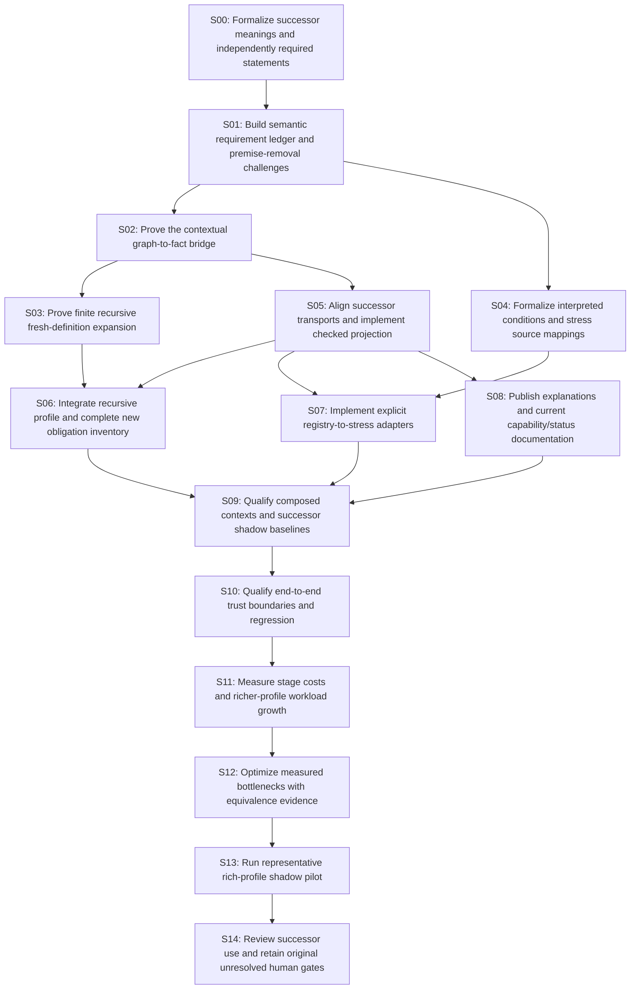

# Proposed successor DAG and plan

Status: proposal; no tasks executed. Formalization is the first step. Existing v1 receipts remain a separate regression baseline.

## Release slices

| Slice | Value | Evidence before continuation |
|---|---|---|
| A: exact contextual conformance | Ask which target revision/scope is justified and see the support. | S00–S02, S05 and S08; independent projection proofs and exact-context controls. |
| B: finite recursive composition | Multi-step ordinary definitions preserve old meanings. | S03 and S06; every-old-model expansion and seeded/unseeded controls. |
| C: interpreted stress mappings | Source-bound delegation/norm contexts become usable. | S04 and S07; every field mapped and unknown preserved. |
| D: qualified successor workflow | Two supported shadow transitions, fresh context/evidence checks. | S09–S10 with all branches integrated. |
| E: measured candidate recommendation | Explain costs and qualified scope with actual feedback. | S11–S14, equivalence-qualified optimization or reference fallback. |

## Dependency graph

## Tasks

| Task | Layer | Depends on | Deliverable |
|---|---|---|---|
| S00 | N0 | none; first step | Formalize successor meanings and independently required statements |
| S01 | N0 | S00 | Build semantic requirement ledger and premise-removal challenges |
| S02 | N0 | S01 | Prove the contextual graph-to-fact bridge |
| S03 | N1 | S02 | Prove finite recursive fresh-definition expansion |
| S04 | N1 | S01 | Formalize interpreted conditions and stress source mappings |
| S05 | N2 | S02 | Align successor transports and implement checked projection |
| S06 | N2 | S03, S05 | Integrate recursive profile and complete new obligation inventory |
| S07 | N2 | S04, S05 | Implement explicit registry-to-stress adapters |
| S08 | N3 | S05 | Publish explanations and current capability/status documentation |
| S09 | N3 | S06, S07, S08 | Qualify composed contexts and successor shadow baselines |
| S10 | N3 | S09 | Qualify end-to-end trust boundaries and regression |
| S11 | N4 | S10 | Measure stage costs and richer-profile workload growth |
| S12 | N4 | S11 | Optimize measured bottlenecks with equivalence evidence |
| S13 | N4 | S12 | Run representative rich-profile shadow pilot |
| S14 | N4 | S13 | Review successor use and retain original unresolved human gates |

## Topological waves

- W00: S00
- W01: S01
- W02: S02, S04
- W03: S03, S05
- W04: S06, S07, S08
- W05: S09
- W06: S10
- W07: S11
- W08: S12
- W09: S13
- W10: S14

Waves express prerequisites, not calendar durations. Independent condition formalization and contextual inference branches can progress after their formal prerequisites. No agent delegation is assigned by this proposal.

## Changes to the original plan

The original 35-task evidence history stays intact. Add this 15-task successor graph with 15 bounded working units. Preserve pending R06/G4 human review; do not restart accepted work or relabel author review as a human assessment. New profiles use independently generated obligation inventories and new source/toolchain bindings.

Task details, algorithms, failure cases and reviewable verification are in [WORK-PACK.md](WORK-PACK.md). Layer decisions are in [implementation-layering.md](implementation-layering.md). Machine-readable task/SWU data is in [plan-proposal.json](plan-proposal.json).
