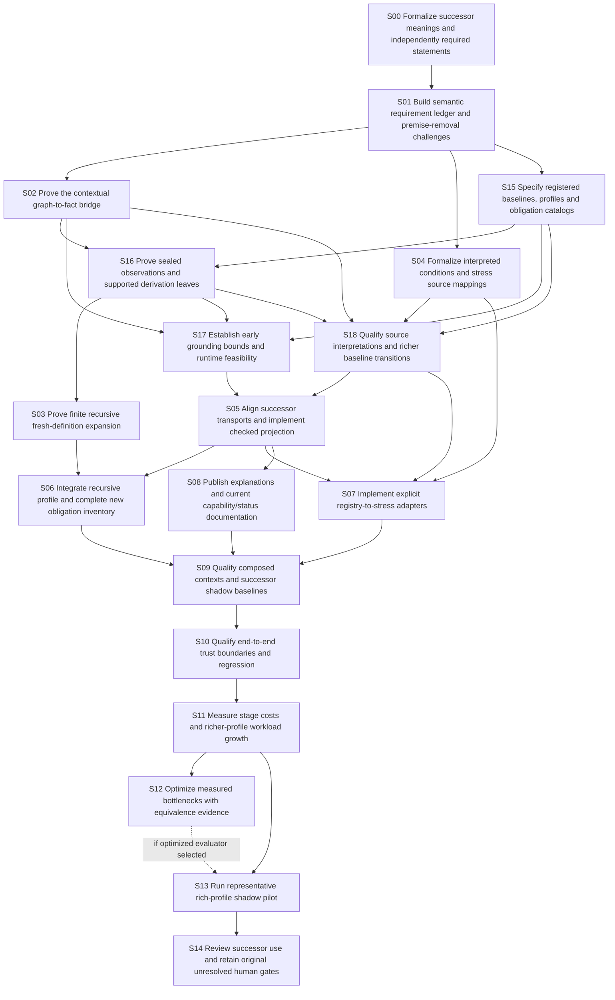

# Revised implementation plan

Status: proposed, not executed. This revision refines the earlier 15-task proposal into 19 tasks, 30 required edges and one conditional optimization edge. Original 33 accepted tasks and pending human R06/G4 remain unchanged.

Formalization remains first. Four new prerequisite tasks establish registered baselines/profiles, sealed observations, early resource feasibility and explicit source/data transitions before runtime integration. Optional optimization no longer blocks the reference pilot.

## Corrected task scopes

| Task | Prerequisites | Concrete revised boundary |
|---|---|---|
| S00 Formalize successor meanings and independently required statements | First step | Define candidate validity versus member observation, potential/active/fulfilled norm meanings, exact evaluation keys and conflicts. Fix checked text encoding for node kinds, sealed producer policy and exact model/claim scope. |
| S01 Build semantic requirement ledger and premise-removal challenges | S00 | Keep every inherited unsupported item until its own source/meaning evidence exists. Classify every individual source review and select/defer each improvement against literal source text. |
| S02 Prove the contextual graph-to-fact bridge | S01 | Prove soundness, completeness, support validity and exact existential correspondence. Prove independent node-kind projection and kind-vocabulary/domain membership; nonmember validity cannot create a source fact. |
| S04 Formalize interpreted conditions and stress source mappings | S01 | Fix evaluation keys and consistent selected statuses; contradictory holds/does-not-hold blocks positive projection. Prove potential inheritance independently of condition evaluation; active norms/conflicts require exact holds evidence. |
| S15 Specify registered baselines, profiles and obligation catalogs | S01 | Define producer-aware profiles, exact independent theorem catalogs and change-to-required-obligation selection; counts are generated, not caller-selected. Specify stronger executable profile versus generic theory mapping and unsupported/mixed change handling. |
| S16 Prove sealed observations and supported derivation leaves | S02, S15 | Prove source observation membership/derivability corresponds to independently defined member-source meaning with valid support leaves. Preserve root lineage separately; allow derived informational heads only under the selected producer policy. |
| S03 Prove finite recursive fresh-definition expansion | S16 | Check all producer roles and reject old/protected heads or changed domain/roots. Preserve old rules/facts exactly; allow only declared fresh derived ordinary heads and retain sealed observation producer restrictions. |
| S17 Establish early grounding bounds and runtime feasibility | S02, S15, S16 | If the reference exceeds the intended envelope, select a smaller explicit profile or bring necessary equivalence work forward before broadening runtime. Define unknown resource-exhaustion outputs; partial closure cannot supply absence or readiness. |
| S18 Qualify source interpretations and richer baseline transitions | S02, S04, S15, S16 | Prove the declared initial projection/view relationship for richer migration; do not claim fixed domain or every-old-model expansion when hypotheses differ. Qualify selected richer baseline and source/interpretation bindings; preserve unselected semantics as unsupported. |
| S05 Align successor transports and implement checked projection | S17, S18 | Use earlier baseline/profile/catalog, sealed producer checks, qualified mappings and early work ceilings. Version transport mapping and trusted import/statement catalog together; do not conflate tested decoder with proved equivalence. |
| S06 Integrate recursive profile and complete new obligation inventory | S03, S05 | Aggregate only allowed current evidence methods; preserve unknown/unsupported/stale outcomes. Consume registered nonempty baselines/generated catalogs; replace captured ReviewSignal/CORE assumptions only in the new selected profile. |
| S07 Implement explicit registry-to-stress adapters | S04, S05, S18 | Expose PotentialNorm, ActiveNorm and ActiveConflict distinctly; keep inheritance and conformance independent. Select exact contextual evaluations; block contradictory/mismatched evidence without executing arbitrary condition strings. |
| S08 Publish explanations and current capability/status documentation | S05 | Describe main and stress exit conventions and optional future HTTP design accurately. Label observed/candidate, supplied/proved, potential/active/fulfilled and exact model classes; distinguish complete versus partial evidence. |
| S09 Qualify composed contexts and successor shadow baselines | S06, S07, S08 | Apply a second supported edit only after the successor baseline is independently qualified. Consume previously specified baseline/profile schema; qualify two-step application with fresh evidence after each transition. |
| S10 Qualify end-to-end trust boundaries and regression | S09 | Record tested versus proved decoder/evaluator boundaries and remaining unsupported semantics. Include sealed producer attacks, contradictory context status, inactive potential norms, model-class mismatch and limited certificate claims. |
| S11 Measure stage costs and richer-profile workload growth | S10 | Select declared budgets/optimization target from measured dominant stages. Extend early S17 feasibility measurements to full qualified end-to-end costs. |
| S12 Optimize measured bottlenecks with equivalence evidence | S11 | Retain uncached full replay and fresh pre/post application checks; no readiness cache. Optimize only a measured need; retain qualified reference fallback inside the declared envelope. |
| S13 Run representative rich-profile shadow pilot | S11 | Request actual human meaning, diagnostic and bounded-use assessment only after concrete evidence exists. Include producer attacks, conflicting conditions, inactive potential norms and richer baseline transitions in pilot. |
| S14 Review successor use and retain original unresolved human gates | S13 | Keep original human gates pending unless a direct response expressly assesses their reviewed artifacts. Keep source-meaning decisions, proof validity and actual human feedback separately assessed. |

## Delivery and scheduling

The contextual observation/explanation milestone requires S00, S01, S02, S15, S16, S17, S18, S05, S08 and all their ancestors. The shared S04/S18 work fixes selected interpretation and transition contracts, not a universal condition language. Runtime recursion and stress integration follow their own S06/S07 tasks.

S17 establishes early feasibility. S11 measures the full qualified workflow. S12 executes only for a measured optimization need; a qualified reference implementation can proceed from S11 to S13 within declared limits. If S17 already shows the reference cannot fit the intended envelope, bring necessary equivalence work forward in a separate revision before widening runtime guards.

No duration or throughput promise follows from this DAG. Each completed task needs real independent predecessor evidence. A plan receipt is not implementation evidence and a machine pass is not human assessment.

See [WORK-PACK.md](/home/vlad_/projects/CyberAlchemy-lab/docs/plans/relational-theorem-checker/reviews/2026-10-09/implementation-analysis/WORK-PACK.md) for inputs, algorithms, edge cases, acceptance criteria, verification and owned working unit for each task.
