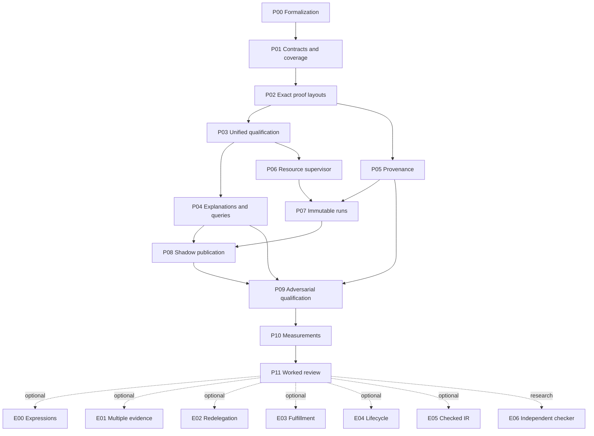

# Step-by-step successor implementation plan

The completed revised v2 is the baseline: 18 required tasks are accepted and optional S12 is resolved as not-needed. The next work is to consolidate its public paths and strengthen operational bounds. This package plans that work and reviews the plan; it executes no successor runtime changes. Every new implementation output belongs in a fresh v3 candidate namespace.

Formalization is the first task, P00. New semantics in optional branches also begin with their own independent definitions and theorem targets. Source observations, supplied truth, logical consequences, complete finite closure, fresh application qualification and human use assessment remain separate.

The recommended sequence is P00–P11. E00–E06 are independently selectable extensions after core hardening. Finishing the core does not require implementing every deferred relation. No deployment or authority transition is part of this plan.

## Decision layers

| Layer | After this layer, we know whether… | Minimum slice | Operator outcome | Risk reduced | Main cost | Exit evidence / next decision |
|---|---|---|---|---|---|---|
| L0 | Can we state the successor’s guarantees before changing implementation? | One independent evidence/claim contract plus versioned schema/catalog/coverage | A concrete contract to implement and review | Ambiguous saved/fresh claims and hidden scope changes | Lean target/type review, schema design and cross-layer agreement | Independent definitions, counterexamples and exact contract coverage; Proceed to shared runtime only when each claim has explicit hypotheses |
| L1 | Can every public path qualify and explain the same bounded proposal? | One rich positive cycle and wrong-scope unseeded cycle through both layouts | One usable qualification/inspection/explanation interface | Pilot-only guard gaps and global patch state | Generator/layout consolidation, actual Lean replay and API integration | Semantic equality controls, full obligations and exact negative evidence rejection; Proceed to operational hardening only after public-path equivalence |
| L2 | Can local runs refuse safely, preserve evidence and recover publication? | A supervised run plus successful/refused/crashed local shadow publication | Repeatable bounded use with visible failures and recoverable state | Unbounded memory/wall time, evidence overwrite and crash ambiguity | Supervisor capabilities, provenance migration, durable state and fault injection | Resource/cancellation, immutable run, audit round-trip and crash controls; Proceed only within the measured writer/resource boundary |
| L3 | Does the consolidated checker merit a new bounded-use recommendation? | Full hostile suite, complete cold/warm workflows and a worked review packet | Evidence-backed public behavior and an understandable review | Consolidation regressions and performance/feedback overclaims | Full kernel runs, workload measurement and artifact-specific feedback | Exact regression outcomes, benchmark scope and separate machine/human records; Recommend bounded use only for the tested profile; repair failures first |
| L4 | Is one stronger semantic or trust profile worth its cost? | One independently defined profile through proof, adapter, runtime and review | One precise new capability rather than a blanket registry claim | Permission amplification, fulfillment conflation or unproved translation | New mathematical definitions/proofs, transport migration and user meaning review | Selected profile theorem, actual witnesses, negative controls and review; Select, narrow or defer each branch on its own evidence |

Each layer preserves the earlier semantic guarantees and exact-input evidence requirements. A boundary is a decision unlocked, not a collection of implementation components. Stop expanding a layer when extra work no longer helps its decision; select a separate semantic branch only when its value justifies new proof and integration costs.

## Dependency DAG

The graph defines eligibility for implementation, not permission to omit predecessor evidence. For sequential execution use the machine-validated topological order in validation-report.json. P05 and P06 are independent once their dependencies pass; they need no shared mutable runtime patching.

## Each completed step: implementation-informed assessment

| Step | Current outcome | What the implementation review changes | Next unit |
|---|---|---|---|
| S00 — Formalize successor meanings and independently required statements | accepted | Retain the independent semantic contract; add evidence/operational claim definitions without changing accepted meanings. | P00 |
| S01 — Build semantic requirement ledger and premise-removal challenges | accepted | Extend the premise-removal ledger to manifests, saved/fresh evidence, resource outcomes and publication states. | P01, P09 |
| S02 — Prove the contextual graph-to-fact bridge | accepted | Reuse exact contextual/kind/unary/support projection proofs. Multi-evidence is a separately defined option, not a needed repair. | P02, E01 |
| S04 — Formalize interpreted conditions and stress source mappings | accepted | Preserve exact condition keys and explicit source interpretations; expression execution and redelegation remain optional new semantics. | P00, E00, E02 |
| S15 — Specify registered baselines, profiles and obligation catalogs | accepted | Keep baseline shape distinct from registration; specify result/manifests and computed change-class catalogs. | P01, P03 |
| S16 — Prove sealed observations and supported derivation leaves | accepted | Preserve sealed observations and all source supports through facade/consolidation; test attempts to manufacture conformance. | P02, P09 |
| S03 — Prove finite recursive fresh-definition expansion | accepted | Retain universal arbitrary-old-model expansion; never replace it with a sampled least-closure comparison. | P00, P09 |
| S17 — Establish early grounding bounds and runtime feasibility | accepted | Keep early product bounds; add supervised aggregate memory, whole-run deadline, cancellation and output limits. | P06 |
| S18 — Qualify source interpretations and richer baseline transitions | accepted | Retain separate graph append/initial-view guarantees and all 41 dispositions; new lifecycle semantics need separate obligations. | P01, E01, E03, E04 |
| S05 — Align successor transports and implement checked projection | accepted | Reuse strict projection and actual typed witnesses; integrate versioned successor contracts without silently relabeling v2 inputs. | P01, P03 |
| S06 — Integrate recursive profile and complete new obligation inventory | accepted | Unify combined/staged qualification and eliminate global compiler patching; retain complete exact 20 rule-only obligations. | P02, P03 |
| S07 — Implement explicit registry-to-stress adapters | accepted | Reuse direct delegation and potential/active norm adapters. Unsupported chains/expressions stay explicit until independent profile proofs exist. | P04, E00, E02 |
| S08 — Publish explanations and current capability/status documentation | accepted | Route the public explainer through exact shared evidence validation and typed query classification for both layouts. | P04 |
| S09 — Qualify composed contexts and successor shadow baselines | accepted | Keep fresh registration per successor; add mediated-store transactions, crash recovery and explicit writer assumptions. | P03, P08 |
| S10 — Qualify end-to-end trust boundaries and regression | accepted | Replace documentary-path special handling with tagged provenance; extend hostile full-path regression without weakening trusted types. | P05, P09, E05, E06 |
| S11 — Measure stage costs and richer-profile workload growth | accepted | Isolate immutable cold/warm evidence and measure enforced resource behavior and complete qualification. | P07, P10 |
| S12 — Optimize measured bottlenecks with equivalence evidence | not-needed | Keep not-needed. Do not optimize grounding merely because optimization was once an optional task; require measured cost and equivalence. | P10 |
| S13 — Run representative rich-profile shadow pilot | accepted | Replace pilot-only guards/explainer with the shared public path and rerun representative examples in a new namespace. | P02, P04, P11 |
| S14 — Review successor use and retain original unresolved human gates | accepted | Retain actual v2 feedback and original R06/G4 pending status; review successor changes explicitly if implemented. | P11 |

Accepted task means the bounded v2 acceptance criteria were met. A successor improvement is not a retroactive assertion that the accepted theorem is false. The stronger saved-evidence guard already exists in S13; P02 makes it shared rather than claiming it still needs to be invented. Original v1 R06/G4 remain pending and are not reopened or closed by this planning review.

## Detailed implementation units

Sizes are relative planning costs, not duration estimates. All units below are planned and unimplemented. Proposed theorem names describe required targets; they are not claims that new proofs already exist.

### P00 — Formalize evidence, claim and operational boundaries

**Layer:** L0. **Dependencies:** none; first step. **Selection:** recommended-core. **Cost:** medium.

V2 proves the logical core, but the successor must independently define what unified verification, exhaustion and publication may claim before changing code.

Implementation order:

1. Write a delta semantic contract importing accepted meanings: MemberConformance, sealed producers, SourceFaithful, exact EvaluationKey, recursive fixed-frame expansion and potential/active norm separation.
2. Define EvidenceComplete against the independently selected change-class catalog and expected module inventory; define RecordedCurrent separately from FreshQualified. Require exact proposal/profile/toolchain identities.
3. Define UnknownResource and Cancelled as operational outcomes without closure/absence/readiness. Define local publication states prepared, committed and reconciliation-required under an explicit mediated-writer assumption.
4. Type-check independent statement targets and add premise-removal examples before implementing any new result serializer. Name host, decoder, hash and supplied-truth assumptions explicitly.

**Contract/API:** Claims carry model_class, query_scope, change_class, source_profile, truth_assumptions and evidence_mode. The v3 transport wraps a named, byte-bound v2 baseline through an explicit adapter; it does not rewrite v2 identities.

**Proof and claim targets:**

- proposed: EvidenceComplete implies all independently required artifacts and obligations are present
- proposed: RecordedCurrent does not imply FreshQualified
- retained: every old model expands under CheckedExtension; source-faithful preservation is a separate claim

**Negative controls:**

- Delete one required module or obligation.
- Replace exact conformance with its unary summary.
- Treat exhaustion as absence or an active norm as fulfillment.

**Done when:**

- Every new claim has an independent definition, hypotheses and a claim ceiling.
- Required target types compile without custom axioms or admitted proofs.
- No accepted v1/v2 definition or human assessment is reinterpreted.

**Outputs:** `semantic-delta.md`, `EvidenceSemantics.lean`, `RequiredEvidenceStatements.lean`, `assumptions.json`, `decisions.json`. Write only beneath `craft/formalization/candidates/relational-theorem-checker/v3/p00/`.

### P01 — Specify versioned contracts and requirement coverage

**Layer:** L0. **Dependencies:** P00. **Selection:** recommended-core. **Cost:** medium.

The current catalogs distinguish 17 registration and 20 rule-only obligations; shared clients must not select or shrink the required inventory.

Implementation order:

1. Create v3 request, result, evidence-manifest, resource-policy and run-record schemas with closed fields and explicit tagged variants.
2. Compute obligations from change class using a trusted catalog; retain the actual stronger 20-obligation identity-extension registration path until a separately proved replacement exists.
3. Map each v2 task, 17 concepts and 41 relation dispositions to preserved guarantees or a named successor unit. Freeze the 176 retained declaration inventory as a scoped input, without claiming it inventories every Python utility.
4. Define CLI exits and evidence compatibility: successful process exit and semantic yes are distinct; saved inspection never authorizes application.

**Contract/API:** QualificationRequest{schema,operation,proposal,resource_policy,build_mode}; QualificationResult is a tagged qualified/invalid/unsupported/unknown-resource/cancelled union. ProofManifest contains proposal_identity, baseline_identity, catalog_identity, profile_identity, toolchain_identity, layout, ordered modules, exact obligation IDs and source/olean bindings.

**Proof and claim targets:**

- proposed: requiredInventory(changeClass) is independent of caller-supplied evidence
- retained: RuleOnlyFrame versus InitialViewRelation

**Negative controls:**

- Caller removes one hard obligation.
- Duplicate JSON keys/nonfinite value/unknown field.
- V2 baseline mislabeled v3; register receipt reused for another snapshot.

**Done when:**

- All 19 predecessor tasks and all 17 concepts have dispositions.
- Schemas and producer/result variants agree with the fixed targets.
- Compatibility and unsupported paths are explicit and testable.

**Outputs:** `contracts/*.schema.json`, `catalog.json`, `coverage.json`, `API-contract.md`. Write only beneath `craft/formalization/candidates/relational-theorem-checker/v3/p01/`.

### P02 — Build a shared exact proof-layout verifier

**Layer:** L1. **Dependencies:** P01. **Selection:** recommended-core. **Cost:** high.

S09 partitions source through string markers and checks compiled parts using zip; S13 adds the exact-length and bound-evidence guards. Consolidation should preserve those stricter checks.

Implementation order:

1. Generate ordered declaration blocks from structured witness sections, then render either combined or staged modules with explicit dependencies. Avoid identifying proof boundaries by mutable source substrings.
2. Implement validate_manifest(manifest,request): check exact module counts, uniqueness, order, source/olean hashes, generated values, imports, obligation identities and bound evidence equality before reporting currentness.
3. Route legacy split-independent-stages-v2 through an explicit read adapter that retains S13 exact four-part checks; retain combined layout validation separately.
4. Check required theorem types and transitive definition/axiom closure during fresh replay. A compiled file hash alone is not a proof of the requested theorem.

**Contract/API:** proof_layout.render(witness,layout) -> modules; evidence.validate(request,result,manifest) -> recorded-current inspection. No function returns application authority. The original combined source remains a bound documentary representation when only stages compile.

**Proof and claim targets:**

- proposed: each required statement/value occurs in the expected compiled inventory
- retained: exact trusted closed-type and definition-value replay policy

**Negative controls:**

- Truncate actual modules to zero/three.
- Duplicate/reorder stages; alter imports or source while preserving stale olean.
- Attach genuine evidence for a different closure/proposal; inject a custom axiom.

**Done when:**

- Both supported layouts validate through one exact checker.
- All truncation/transplant controls reject.
- Fresh replay still discharges the original theorem requirements.

**Outputs:** `proof_layout.py`, `evidence.py`, `manifest-controls.json`, `layout-equivalence-report.json`. Write only beneath `craft/formalization/candidates/relational-theorem-checker/v3/p02/`.

### P03 — Unify qualification APIs without global patching

**Layer:** L1. **Dependencies:** P02. **Selection:** recommended-core. **Cost:** high.

The bounded facade temporarily patches compile_modules/r.qualify, while the public S06 CLI uses the combined witness. Shared mutable imports make concurrent or repeated calls harder to reason about.

Implementation order:

1. Introduce explicit QualificationContext carrying pinned compiler, catalog, source resolver, stage compiler, run directory and resource policy.
2. Implement qualify(request,context) with injected layout/compiler services. Use the staged witness as the documented default after equivalence controls; preserve the combined path as a comparison profile.
3. Expose inspect_saved(request,result,context) separately from qualify_fresh. Route CLI and shadow callers through the same implementation.
4. Retain exact before/after normalization, sealed producer checks, complete closure, component-local old rule identities and fresh general replay; do not cache a qualification decision.

**Contract/API:** qualify_fresh(request,context) -> QualificationResult; inspect_saved(request,result,context) -> InspectionResult{recorded_current,checked_bindings,application_authorized:false}. Dependencies may be reused only after full binding checks; actual witnesses and fresh theorem replay remain request-specific.

**Proof and claim targets:**

- retained: 20 required rule-only obligations and arbitrary-old-model expansion
- proposed: all transports select the same catalog and layout policy

**Negative controls:**

- Concurrent calls with different contexts/build roots.
- Exception during stage compile then a subsequent call.
- Stale imported proof/policy; caller-selected reduced catalog.

**Done when:**

- CLI, Python and shadow paths agree on the same request.
- No process-global function replacement or ambiguous module import state is required.
- Failure cannot leave a later call using another request’s compiler policy.

**Outputs:** `qualification.py`, `context.py`, `cli.py`, `integration-controls.json`. Write only beneath `craft/formalization/candidates/relational-theorem-checker/v3/p03/`.

### P04 — Unify explanations and typed query outcomes

**Layer:** L1. **Dependencies:** P03. **Selection:** recommended-core. **Cost:** medium.

S08 explanations expect a combined witness, while the rich S13 pilot has a separate split-aware explainer. Query absence also needs exact predicate, arity, sorts and domain checks.

Implementation order:

1. Make describe call P02/P03 saved-evidence inspection before reading closure or certificates.
2. Define QueryOutcome as present, absent-in-complete-profile, outside-profile, invalid-query or incomplete; validate predicate key/version, arity, sorts and finite-domain values first.
3. Share certificate traversal using earlier-premise indices and retain all source supports. Show exact target/scope/kind, supplied truth and the model class.
4. Render recursive and mapped stress results through typed variants; show potential, active, conflict and fulfillment claims separately. Bound trace expansion and output size.

**Contract/API:** describe(request,result,query=None) -> Explanation{outcome,claim_scope,trace,supports,truth_assumptions,application_authorized:false}. Explanations for exhausted/cancelled searches have no complete absence claim.

**Proof and claim targets:**

- retained: Derivable iff checked complete closure membership for the selected finite profile
- proposed: absence diagnostic requires a well-typed query within that profile

**Negative controls:**

- Unknown predicate/wrong arity/out-of-domain scope.
- Wrong-scope complete empty cycle versus timed-out search.
- Cyclic/forward trace index; truncated split witness; changed support leaf.

**Done when:**

- The public explainer describes both actual witness layouts.
- Malformed/outside-profile queries cannot be called proved absent.
- Positive examples show exact rule substitutions and source/supplied leaves.

**Outputs:** `explain.py`, `query.schema.json`, `explanation.schema.json`, `worked-examples.md`. Write only beneath `craft/formalization/candidates/relational-theorem-checker/v3/p04/`.

### P05 — Make provenance reports strict and safe to reread

**Layer:** L2. **Dependencies:** P02. **Selection:** recommended-core. **Cost:** medium.

S13 wraps the S10 reader to distinguish checked toolchain-relative documentary copies from actual bindings. A schema distinction should replace this special reader behavior.

Implementation order:

1. Create a tagged Binding type with repo, pinned-toolchain and documentary variants; resolve toolchain paths only beneath the exact compiler root.
2. Separate authoritative source/proof bindings from documentary copies and historical exceptions. Recheck originals and resolved hashes; never turn a failed binding into a harmless documentary entry automatically.
3. Implement auditable serialization/round-trip reading with cycle detection and memoization by canonical path plus expected digest.
4. Keep the existing 24 exact metadata exceptions as explicitly scoped legacy inputs. New v3 proof obligations have no inherited blanket exception.

**Contract/API:** audit_closure(inputs,policy) -> AuditReport{verified_bindings,documentary_entries,scoped_legacy_exceptions,failures}. Reports use tagged fields rather than treating every path/sha pair as authoritative evidence.

**Proof and claim targets:**

- operational invariant: every authoritative binding is verified and every exception has exact scope
- claim limit: hash/currentness checks do not authenticate issuers or prove external governance histories

**Negative controls:**

- Read an audit report as an audit input.
- Path traversal/alternate toolchain root; mismatched original/resolved hash.
- Relabel a missing proof binding as documentary; expand an exception by filename pattern.

**Done when:**

- Self-report reread succeeds without global reader patching.
- Missing/current proof sources remain hard failures.
- External governance documents remain explicit input leaves.

**Outputs:** `bindings.py`, `audit.py`, `audit-report.schema.json`, `provenance-controls.json`. Write only beneath `craft/formalization/candidates/relational-theorem-checker/v3/p05/`.

### P06 — Enforce end-to-end resource and cancellation budgets

**Layer:** L2. **Dependencies:** P03. **Selection:** recommended-core. **Cost:** high.

Preflight work ceilings and 60-second Lean stages do not cap whole-run time, aggregate memory or compiler output. Qualified local measurements peaked near 2.3 GiB.

Implementation order:

1. Run all expensive decoding/normalization/evaluation/proof preparation/compilation/replay within a supervised worker process group; include descendants.
2. Retain current pre-allocation bounds. Add explicit whole-run deadline, output-byte limit, cancellation token, process/concurrency limits and memory policy. Do not substitute per-process RLIMIT_AS for an aggregate RSS guarantee.
3. Capability-probe a per-run cgroup v2 memory.max/pids.max where available. A required unavailable enforcement policy yields unsupported-policy; an explicitly selected advisory mode reports enforcement unavailable.
4. On cancellation, timeout, OOM or output overflow, terminate/reap descendants, retain diagnostic evidence in a nonqualified run and leave HEAD unchanged. Record actual backend and events.

**Contract/API:** ResourcePolicy{work_limits,stage_deadline,run_deadline,memory_bytes,memory_mode,output_bytes,max_parallel_workers}; outcomes include unknown-resource, cancelled and unsupported-policy. Numeric defaults are selected from new measurements, not guessed from one successful run.

**Proof and claim targets:**

- retained: finite termination/complete closure is conditional on completion
- operational invariant: incomplete resource outcomes have no closure, absence or readiness authorization

**Negative controls:**

- Timeout across several individually short stages.
- Parent/child aggregate OOM; output flood; explicit cancellation.
- Missing cgroup capability; forced worker termination; simultaneous expensive jobs.

**Done when:**

- Every expensive stage is covered by the supervisor.
- Actual enforcement mode and observed reason are recorded.
- Killed/incomplete work produces no qualified receipt or application.

**Outputs:** `supervisor.py`, `resource-policy.schema.json`, `resource-controls.json`, `host-capabilities.json`. Write only beneath `craft/formalization/candidates/relational-theorem-checker/v3/p06/`.

### P07 — Isolate runs, caches and execution evidence

**Layer:** L2. **Dependencies:** P05, P06. **Selection:** recommended-core. **Cost:** medium.

Current fixed build filenames can be rewritten between cold/warm runs; execution support sync includes optional not-needed tasks in remaining. Successor repeatability should avoid mutating accepted evidence.

Implementation order:

1. Allocate unique run directories and write immutable run-specific submissions, proof manifests, timings and results; publish a final run record only after closure checks.
2. Make dependency cache keys include source closure, compiler/kernel, catalog, generator and layout policy. Verify bytes before reuse and never treat warm cache presence as fresh proof replay.
3. Normalize execution state explicitly: accepted required work and resolved optional work have separate lists; remaining excludes both. Permit resume only from validated phase records.
4. Add deterministic cleanup ownership metadata, but do not delete historical accepted runs or unrelated build directories.

**Contract/API:** RunRecord{run_id,request_identity,phase,inputs,outputs,resource_events,timings,cache_checks,result}; status uses remaining_required and resolved_optional. Same request may have multiple distinct runs.

**Proof and claim targets:**

- operational invariant: accepted evidence is immutable and run outputs cannot be transplanted
- retained: byte-current dependency reuse is distinct from fresh actual qualification

**Negative controls:**

- Two requests sharing a cache; interrupted write and resume.
- Warm run rewrites cold evidence; stale cache; optional not-needed appears remaining.
- Proposed cleanup targets another run or accepted evidence.

**Done when:**

- Independent runs cannot overwrite one another’s qualifying evidence.
- Resumes revalidate source/request/policy and preserve phase provenance.
- Status is consistent without manual completion normalization.

**Outputs:** `runs.py`, `run-record.schema.json`, `execution-state.schema.json`, `repeatability-controls.json`. Write only beneath `craft/formalization/candidates/relational-theorem-checker/v3/p07/`.

### P08 — Harden local shadow publication and crash recovery

**Layer:** L2. **Dependencies:** P04, P07. **Selection:** recommended-core. **Cost:** high.

S09 locks cooperating writers and postchecks HEAD, but a final read plus os.replace is not an atomic compare-and-swap. Directory durability and crash recovery also need explicit handling.

Implementation order:

1. Keep the supported scope an exclusively mediated local store with cooperating writers. Bind review identity, before-head generation and exact proposed successor; revalidate fresh qualification at the commit boundary.
2. Use a journal or transactional metadata store for prepared/committed publication; document snapshot-file versus metadata crash windows. Fsync immutable files and relevant directories before committing the durable head.
3. Recover prepared transactions by verifying immutable snapshot/registration bindings; return reconciliation-required on conflicting state. Never silently roll back a potentially committed successor.
4. If arbitrary external writers must be supported, require a separately designed writer boundary and enforceable transactional service. No file rename or advisory lock is claimed to defeat same-privilege external writers.

**Contract/API:** shadow.apply(review,request,store,context) -> applied-candidate-shadow | stale-head | unknown-resource | reconciliation-required. Store policy names cooperating/mediated writers and exposes expected_generation; candidate-only authority remains none.

**Proof and claim targets:**

- operational invariant under stated writer boundary: commit corresponds to one fresh qualified successor of the reviewed head
- claim limit: no proof of filesystem durability or hostile-host exclusion from Lean graph theorems

**Negative controls:**

- Two cooperating publishers from the same head.
- Crash after snapshot, registration, journal and head phases.
- External writer mutates HEAD; stale condition/context; cancelled registration.

**Done when:**

- One competing reviewed generation commits; stale peers reject.
- Crash outcomes are explicitly recovered or marked reconciliation-required.
- Every application separately registers its exact successor; no saved receipt authorizes apply.

**Outputs:** `shadow.py`, `transaction.schema.json`, `recovery.md`, `publication-controls.json`. Write only beneath `craft/formalization/candidates/relational-theorem-checker/v3/p08/`.

### P09 — Qualify the unified paths with adversarial regression

**Layer:** L3. **Dependencies:** P04, P05, P08. **Selection:** recommended-core. **Cost:** high.

Consolidation can weaken accepted checks accidentally; tests must challenge the proof and evidence boundary rather than mirror helper implementations.

Implementation order:

1. Reuse accepted source/proposal fixtures through read-only bindings; add successor runs rather than rewriting old receipts.
2. For both layouts, execute full qualification, saved inspection, explanation and two-step shadow application. Compare normalized theories, closure sets, source supports, required obligations and theorem statement types; proof bytes/timings may differ.
3. Run hostile type/axiom/producer/model-class, missing inventory/transplant, resource, stale context and crash controls from P00-P08.
4. Check registry structural validity separately from selected semantic profiles. Preserve unsupported chain/negation/domain-change behavior in the recursive rule-only entry point.

**Contract/API:** Qualification report names each executed control, exact input/output bindings, stage scope and author-review identity. A finite regression report is not a universal decoder theorem.

**Proof and claim targets:**

- retained: full exact trusted theorem replay with only permitted foundational axioms
- retained: generic Horn and source-faithful claims remain distinct

**Negative controls:**

- Weakened required theorem; empty invalid-graph stress certificate.
- Forge conformance through derived rule or caller fact.
- Use sampled least closure to claim every-old-model expansion; shrink selected catalog.

**Done when:**

- Every hard catalog obligation and all applicable hostile controls pass.
- The combined/staged paths agree on semantic outputs under the same selected profile.
- Failures retain diagnostic evidence and cannot publish a successor.

**Outputs:** `qualification-suite.json`, `regression-report.json`, `trust-boundary-report.md`. Write only beneath `craft/formalization/candidates/relational-theorem-checker/v3/p09/`.

### P10 — Measure proof costs before choosing optimization

**Layer:** L3. **Dependencies:** P09. **Selection:** recommended-core. **Cost:** medium.

The evaluator was sub-millisecond in recorded full runs; proof preparation/replay dominated. Grounding optimization should remain evidence-driven.

Implementation order:

1. Measure cold/warm full qualification, split stages, general replay, explanation and shadow registration in isolated run directories under P06 enforcement.
2. Record stage parentage and exclusive versus inclusive timing, aggregate memory backend and peak RSS, cache validation, workload and success scope.
3. Increase one dimension at a time within the declared envelope and distinguish evaluator-only completion from actual kernel qualification.
4. Choose no optimization unless a measured bottleneck justifies it. Any new optimized evaluator needs independently fixed extensional equivalence targets and actual closure/certificate checks before selection.

**Contract/API:** PerformanceReport{workload,mode,resource_policy,stage_tree,peak_memory,actual_kernel_completion,limits,selection}. Inclusive nested times are never summed as independent work.

**Proof and claim targets:**

- conditional if optimized: reference and optimized grounded inventory/closure agree under exact finite-profile hypotheses
- claim limit: measured workload results do not establish general throughput or latency

**Negative controls:**

- Large case passes preflight but exceeds proof deadline.
- Cached stale olean; overlapped timers incorrectly totaled.
- Optimized evaluator drops a typed instance or a valid source support.

**Done when:**

- Measured success/refusal envelopes are reproducible and correctly scoped.
- Selection targets the observed bottleneck and preserves fresh replay.
- No unsupported speedup or broader-profile guarantee is published.

**Outputs:** `benchmark-profile.json`, `stage-measurements.json`, `performance-decision.md`. Write only beneath `craft/formalization/candidates/relational-theorem-checker/v3/p10/`.

### P11 — Review the successor packet and bounded use

**Layer:** L3. **Dependencies:** P10. **Selection:** recommended-core. **Cost:** medium.

The user approved the exact v2 meanings/diagnostics/bounded use. Changed public APIs or visible diagnostics need a concrete successor assessment; original v1 R06/G4 remain separately pending.

Implementation order:

1. Prepare a worked positive rich-target/scope cycle, wrong-scope unseeded cycle, unknown versus active norm, missing-evidence refusal and resource/cancellation example through the new public commands.
2. Provide a change-focused comparison against the approved v2 packet, exact current source/proof closure and the measured envelope.
3. Run an author review against P00 requirements and P09/P10 evidence. Record actual human feedback only for the concrete changed artifact and use scope when it is supplied.
4. Keep original v1 gate assessment as a separate follow-up packet. No automatic transfer of v2 or successor feedback to R06/G4, deployment or admission.

**Contract/API:** ReviewRecord binds packet bytes, question, actual answer and assessment scope. Machine acceptance, author review and human use qualification remain distinct.

**Proof and claim targets:**

- claim limit: human meaning approval is not a kernel proof or externally authenticated assessment
- retained: authority_effect none

**Negative controls:**

- Reuse v2 feedback for a new packet silently.
- Treat author review as independent review or deployment approval.
- Mark original R06/G4 accepted without their actual artifact-specific assessment.

**Done when:**

- A complete reviewable packet explains meaning, theorem, operational envelope and remaining gaps.
- Machine/author completion is recorded separately from any pending human assessment.
- Human gates close only with actual in-scope feedback.

**Outputs:** `review-packet.md`, `plan-execution-review.md`, `feedback-record.schema.json`, `completion-audit.json`. Write only beneath `craft/formalization/candidates/relational-theorem-checker/v3/p11/`.

### E00 — Extend condition expressions through a bounded semantic profile

**Layer:** L4. **Dependencies:** P11. **Selection:** optional-separate-profile. **Cost:** high.

Current conditions are exact externally supplied evaluations, not an expression execution language.

Implementation order:

1. First define a finite expression AST, exact leaf EvaluationKey, total truth tables and how invalid evidence propagates; begin with a bounded positive conjunction/disjunction fragment.
2. Prove activation soundness/completeness against independent expression meaning and key preservation; specify missing/contradictory/revised-leaf cases.
3. Then add versioned expression/assessment schemas, evaluator and actual Lean witnesses, followed by mapped-norm integration and worked review.

**Contract/API:** New condition-expression profile; old atomic profile remains selectable. No arbitrary code execution or absence-as-false.

**Proof and claim targets:**

- proposed: evalExpr(expr,context)=holds iff the independent selected expression meaning holds under its supplied leaf assumptions

**Negative controls:**

- Unknown leaf; contradictory leaf; changed revision; shared-name/different-epoch leaf.
- Short circuit masks invalid evidence; nested expression exceeds bounds.

**Done when:**

- Independent truth tables are reviewed before runtime.
- Full bounded expression witness and tests precede norm activation.
- Unsupported operators stay explicit.

**Outputs:** `ExpressionSemantics.lean`, `expression.schema.json`, `evaluator.py`, `expression-review.md`. Write only beneath `craft/formalization/candidates/relational-theorem-checker/v3/e00/`.

### E01 — Introduce multiple conformance evidence references explicitly

**Layer:** L4. **Dependencies:** P11. **Selection:** optional-separate-profile. **Cost:** high.

The plural source field is currently one opaque token, not a parsed list. Multiple supports already exist across assertions; this extension changes within-assertion meaning.

Implementation order:

1. First choose independently whether one valid assessment suffices, all listed assessments must agree, or a specified quorum applies; define conflict, empty-set and revision rules.
2. Add an explicitly versioned typed evidence-reference collection or interpretation profile; never split legacy text by punctuation.
3. Prove support soundness/completeness and sealed projection correspondence; then implement strict decoder, mapper, projection witness and migration tests.

**Contract/API:** New evidence-collection profile with explicit legacy adapter; reference ordering/deduplication rules are normative and hash-bound.

**Proof and claim targets:**

- proposed: new collection projection iff independent selected assessment policy and exact assertion membership hold

**Negative controls:**

- Empty collection; duplicate token; wrong target/scope/revision.
- Mixed accepted/rejected assessments; legacy comma string accidentally treated as collection.

**Done when:**

- Evidence policy choice is explicit before code.
- All valid supports are retained and no evidence creates roots.
- Legacy single-token interpretation is preserved.

**Outputs:** `EvidenceCollectionSemantics.lean`, `evidence-collection.schema.json`, `mapper.py`, `migration-review.md`. Write only beneath `craft/formalization/candidates/relational-theorem-checker/v3/e01/`.

### E02 — Formalize and implement finite redelegation chains

**Layer:** L4. **Dependencies:** P11. **Selection:** optional-separate-profile. **Cost:** high.

Direct acts-for effectiveness is supported; a transitive chain can amplify scope/time/policy unless each hop has its own constrained meaning.

Implementation order:

1. First define bounded path membership, exact principal/agent transitions, scope/action restriction, half-open interval intersection, per-hop gate/policy and revocation checks; specify cycle/depth handling.
2. Prove that a successful chain has exact source support at every hop and cannot widen any ancestor permission. Missing required truth remains unknown.
3. Then introduce chain request/result schemas, enumerate bounded paths and emit actual checked witnesses; keep direct effectiveness a separate profile and review examples.

**Contract/API:** New redelegation profile with exact source/context identities, maximum depth and explicit action query. No chain implies independent admission or unrestricted authority.

**Proof and claim targets:**

- proposed: EffectiveChain implies each supported hop is effective and query scope/action/time satisfies all hop restrictions

**Negative controls:**

- Cycle; expired/revoked ancestor; wrong principal.
- Child widens scope; missing gate; unsupported depth; mismatched epoch.

**Done when:**

- Restriction/non-amplification theorem precedes transitive runtime.
- Complete bounded query or scoped unknown is explicit.
- Direct profile behavior remains unchanged.

**Outputs:** `ChainSemantics.lean`, `chain.schema.json`, `chain_adapter.py`, `chain-review.md`. Write only beneath `craft/formalization/candidates/relational-theorem-checker/v3/e02/`.

### E03 — Distinguish requested linkage from verified fulfillment

**Layer:** L4. **Dependencies:** P11. **Selection:** optional-separate-profile. **Cost:** high.

fulfills-request source wording mixes intended linkage and fulfillment; current candidate explicitly defers verified satisfaction.

Implementation order:

1. First define RequestLinked independently from Fulfilled, including exact requirement version, action/output evidence, selected evaluation context and completion criteria.
2. Prove fulfillment implies the named criteria hold under declared evidence assumptions; prove relation membership alone does not imply fulfillment.
3. Add a separate fulfillment schema/profile, source interpretation, actual witnesses and runtime adapter; review no-action and stale-requirement counterexamples.

**Contract/API:** Fulfillment evidence is supplied and provenance-bound; authenticity and real-world action truth remain assumptions. An active inherited norm is not sufficient.

**Proof and claim targets:**

- proposed: VerifiedFulfillment implies selected request criteria under exact bound action/evaluation assumptions

**Negative controls:**

- Intended link only; active norm without action; wrong requirement revision.
- Conflicting completion assessments; unrelated output.

**Done when:**

- Literal source ambiguity has an explicit versioned resolution.
- No stronger claim is enabled through relation name alone.
- Independent criterion evaluation is evidenced.

**Outputs:** `FulfillmentSemantics.lean`, `fulfillment.schema.json`, `fulfillment_adapter.py`, `fulfillment-review.md`. Write only beneath `craft/formalization/candidates/relational-theorem-checker/v3/e03/`.

### E04 — Give succession a separate lifecycle transition profile

**Layer:** L4. **Dependencies:** P11. **Selection:** optional-separate-profile. **Cost:** high.

successor-of records a succession effect, while actual currentness/replacement policy is deferred. This is distinct from both graph append and fixed-frame Horn extension.

Implementation order:

1. First define succession declaration, eligible lifecycle transition, exact predecessor revision, fork policy and active-head selection independently.
2. Prove permitted transitions preserve required reference/evidence identities and specify how conflicting successors are rejected or reconciled.
3. Then define lifecycle transition contracts, mapper and witnesses; integrate with mediated publication only under the explicitly chosen lifecycle profile.

**Contract/API:** New lifecycle-transition change class and obligations; successor relation alone cannot retire a predecessor or move HEAD.

**Proof and claim targets:**

- proposed: LifecycleTransition under its policy implies selected old/new currentness invariants, not rule-only model conservativity

**Negative controls:**

- Two successors; stale predecessor; cycle; missing lifecycle evidence.
- Reuse rule-only receipt for replacement or infer retirement from declaration alone.

**Done when:**

- Lifecycle policy and transition theorem are fixed before mutation code.
- Conflict/recovery states are reviewable.
- Rule-only and append guarantees retain their original scope.

**Outputs:** `LifecycleSemantics.lean`, `lifecycle-transition.schema.json`, `lifecycle_adapter.py`, `lifecycle-review.md`. Write only beneath `craft/formalization/candidates/relational-theorem-checker/v3/e04/`.

### E05 — Reduce the decoder and generator trust boundary

**Layer:** L4. **Dependencies:** P11. **Selection:** optional-separate-profile. **Cost:** high.

Strict/differential transport tests do not prove universal JSON decoder or source-to-Lean generation equivalence.

Implementation order:

1. First specify a narrow canonical typed IR and independent denotation with bounded encodings; keep raw JSON parsing as a named boundary unless explicitly included.
2. Implement a Lean-side checked IR importer/normalizer and prove successful import preserves the independent IR denotation and exact references/keys.
3. Compare all existing Python decoded values to the checked IR; version the transport and integrate only after malformed/escaping/unicode/ordering controls and actual kernel witnesses.

**Contract/API:** A theorem about canonical IR is labeled IR-to-semantics, not byte-level JSON parser correctness. Proving the full parser would require an additional separate target.

**Proof and claim targets:**

- proposed: accepted canonical IR import denotes exactly the independently specified typed value

**Negative controls:**

- Escaping/unicode collision; duplicate/reference order ambiguity.
- Python/Lean normalization divergence; representational hash mismatch.

**Done when:**

- Proof scope and remaining parser/host assumptions are explicit.
- Universal theorem and finite differential tests are distinguished.
- Integration retains the original exact-input witness checks.

**Outputs:** `CanonicalIR.lean`, `ImportCorrectness.lean`, `ir.schema.json`, `transport-review.md`. Write only beneath `craft/formalization/candidates/relational-theorem-checker/v3/e05/`.

### E06 — Assess a genuinely independent proof checker

**Layer:** L4. **Dependencies:** P11. **Selection:** optional-separate-profile. **Cost:** research.

Fresh replay uses the same pinned Lean kernel. A second checker requires independently justified translation/coverage, not another process running Lean.

Implementation order:

1. Perform a feasibility study of export format, supported dependent-type constructs, foundational axioms and proof translation.
2. Select one representative theorem and its complete dependency closure; independently check it and compare exact statement/definition meaning.
3. Only propose broader implementation after translation soundness/trust and unsupported constructs are explicit. Retain same-kernel replay in the meantime.

**Contract/API:** Research spike only; no independent-kernel assurance is claimed from installation, subprocess isolation or sampled success.

**Proof and claim targets:**

- research target: an independently implemented checker accepts the exact exported statement and dependency meaning

**Negative controls:**

- Unsupported primitive/axiom; dropped universe constraint.
- Changed exported statement; translator silently trusts original kernel acceptance.

**Done when:**

- Feasibility, cost and remaining trust are documented.
- Any sample result is labeled a sample.
- No required core delivery depends on an unproved second-checker path.

**Outputs:** `feasibility.md`, `translation-contract.md`, `sample-check-report.json`. Write only beneath `craft/formalization/candidates/relational-theorem-checker/v3/e06/`.

## Execution and promotion rules

- Keep accepted v1/v2 source, proof and feedback bytes read-only; successor fixes import or adapt them explicitly.
- Run the smallest relevant tests while implementing a unit. Perform expensive full replay when the unit changes a proof/runtime boundary, then once in P09; do not repeatedly rerun accepted task runners.
- Unit completion requires its specific exit evidence. Layer promotion requires the layer’s decision evidence and no regression of earlier guarantees.
- Fresh proof replay remains mandatory for application; verified saved results support inspection/explanation only.
- Do not infer authenticated real-world truth from assessment bytes, full semantics from registry structure, every-model conservativity from closure samples, or full qualification from evaluator timing.
- Broader source meanings use the extension template in RELATIONS.md. A new relation is accepted into a declared profile only after independent meaning, theorem obligations, mapping and actual runtime evidence exist.

## Decisions resolved by this plan

Default to staged qualification after equivalence controls, share the stricter saved-evidence guard, and retain the reference evaluator until measurements show otherwise. Support a mediated/cooperating local writer boundary. Preserve the v2 atomic condition and single opaque evidence token profiles. Treat expressions, collections, chains, fulfillment and lifecycle as distinct optional profiles.

Exact memory/deadline defaults depend on P06 capability probing and P10 measurements. If required aggregate enforcement is unavailable, the corresponding policy cannot be qualified. An independent checker remains a feasibility branch. New source-meaning choices must be settled within each selected extension’s formalization before dependent runtime code begins.

See [the plan review](/home/vlad_/projects/CyberAlchemy-lab/docs/plans/relational-theorem-checker/reviews/2026-10-09/post-implementation-planning/REVIEW.md), [the concept-by-concept review](/home/vlad_/projects/CyberAlchemy-lab/docs/plans/relational-theorem-checker/reviews/2026-10-09/post-implementation-planning/DEFINITIONS.md) and [all 41 relation dispositions](/home/vlad_/projects/CyberAlchemy-lab/docs/plans/relational-theorem-checker/reviews/2026-10-09/post-implementation-planning/RELATIONS.md). The exact runnable unit data is [plan.json](/home/vlad_/projects/CyberAlchemy-lab/docs/plans/relational-theorem-checker/reviews/2026-10-09/post-implementation-planning/plan.json).
