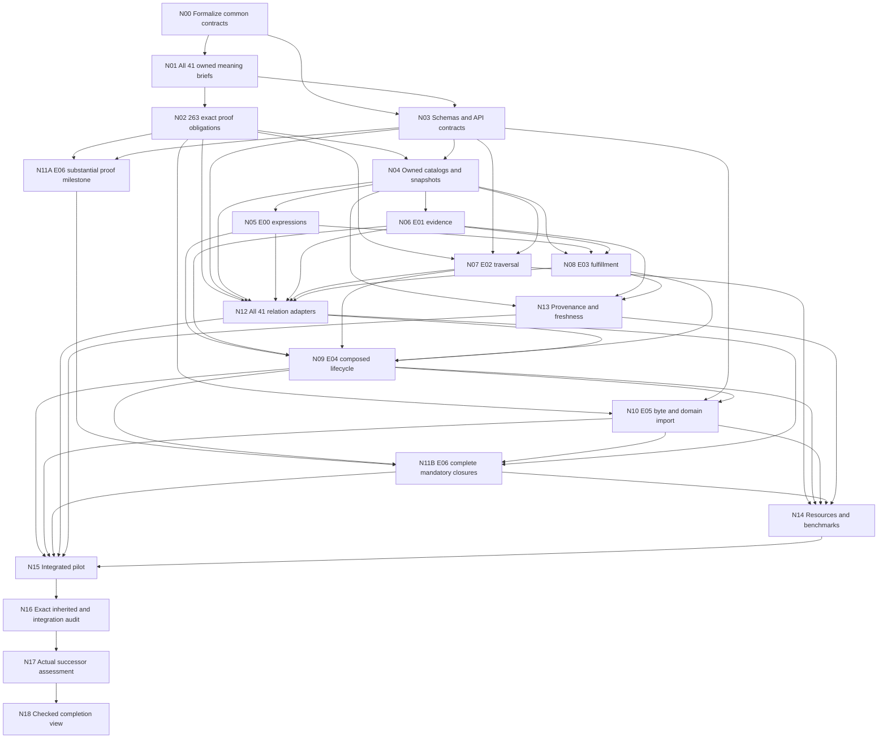

Proposed completion plan — formalization first

Status: proposed, not executed. Date: 2026-10-10. Scope: all seven extension integration gaps and all 263 inherited obligations under an owner-reviewed versioned bounded successor profile. No accepted v1–v4 evidence is changed.

The existing Track I is expanded with exact inherited coverage, explicit three-way verdict/well-formedness proofs, nonvacuous forbidden-inference models, pre/post-commit separation and whole mandatory independent-closure coverage. Original gate-hardening Track H is complete and is not repeated.

Start with N00. The smallest formal slice is an owner-bound expression and a two-criterion requirement sharing one frame; prove unique definition resolution, owner-complete criteria and complete qualification. Then instantiate the same contracts for all 41 source kinds. No new runtime adapter starts before its independent formal meaning, mapping/proof contract and versioned schema are reviewed.

| Task | Layer | Dependencies | Exit |
|---|---|---|---|
| N00 Formalize the shared meaning, ownership, frame and coverage model | L0 | none | Compile common definitions/proofs for exact identities, unique owner resolution, complete obligation sets and no self-seeding qualification. Use an owner-bound condition and two-criterion requirement as the smallest formal composition; exact replacement/omission counterexamples are stated. |
| N01 Specify and review all 41 relation definitions and source meanings | L1 | N00 | Account for all 263 IDs and retain 90 existing discharges. Each kind has an independent satisfiable meaning, exact source refinement and declared claim tier; actual assigned owners review choices and policy ambiguity. |
| N02 Prove all inherited semantic claims and mapping contracts | L1 | N01 | Every one of the 263 IDs maps to exact checked statement/definitions, owner-approved interpretation and required proof or satisfiable countermodel. Prove source mapping, qualifier agreement, effect equivalence and required closure/state invariants; no unchecked axiom hides an unresolved meaning. Account for semantic branches over all 550 declared ordered pairs; one exemplar per kind does not establish every role-sensitive case. |
| N03 Freeze successor schemas, APIs and proof-result contracts | L1 | N00, N01 | Closed versioned contracts bind definitions, criteria, evidence policy, exact frames, challenge inventories and allowed result states. Derivation of mandatory obligations is owned and independent of submitted results; migration retains old opaque tokens. |
| N04 Implement owned source catalogs and exact snapshot resolution | L2 | N02, N03 | Actual resolution matches reviewed formal contracts, including owner basis, immutable revisions and content conflict rejection. Unresolved owner/token/time/provenance stays unresolved; no fabricated authentication fixture can become actual evidence. |
| N05 Integrate owned expression definitions and norm activation | L2 | N04 | Only the resolved AST qualifies; full origin and frame survive activation. Unknown and conflict semantics match the reviewed policy and earlier bounded guarantees. |
| N06 Integrate versioned evidence and issuer/policy ownership | L2 | N04 | Exact assessment revision/issuer/policy supports are retained and independently checked. Legacy opaque-token and any-support meaning preserved; alternative policies are separately versioned. |
| N07 Replace edge-word enumeration with proved bounded traversal | L2 | N02, N03, N04 | Traversal agrees with bounded simple-path meaning, retains required support/unknown provenance and ancestor restrictions. Incomplete traversal or unavailable resource enforcement cannot establish no. |
| N08 Integrate owner-complete fulfillment and provenance | L2 | N04, N05, N06 | The requirement revision fixes the entire criterion universe and exact frame. All verdict rails have an independent meaning under proved well-formedness; action/output provenance and evidence policy are bound. |
| N10 Verify byte parsing and domain semantic imports | L3 | N02, N03, N09 | A raw-byte parse certificate or verified decoder establishes full consumption and IR denotation. Every composed domain importer preserves exact typed source meaning; finite differential controls supplement universal proofs. |
| N12 Implement and qualify all 41 semantic relation adapters | L2 | N02, N03, N04, N05, N06, N07, N08 | All 41 K-units execute their source-to-typed contracts with nonvacuous actual positive and negative evidence. All 263 inherited evidence candidates bind the correct profile/source/challenge; full completion awaits final acceptance/currentness audit. |
| N09 Compose qualification with lifecycle and public commit | L2 | N05, N06, N07, N08, N12 | Commit consumes complete current independently checked qualification and exact actual owner review. Prove state/semantic preservation and avoid requiring the future commit receipt as its own eligibility premise. Crash the complete public path before/after qualification, recapture, durable preparation and commit; recovery creates no new event. |
| N11A Integrate independent checking for substantial selected proofs | L3 | N02, N03 | Independently check at least one substantial core theorem and one semantic theorem with complete anchored closures. Expose feature/axiom/resource/disagreement states and retain mandatory Lean checks. This is an intermediate milestone. |
| N11B Complete independent coverage of every mandatory selected closure | L3 | N11A, N09, N10, N12 | Every mandatory theorem closure for the composed successor profile passes both required checking paths with anchored definitions. A missing/unsupported closure blocks the whole-profile claim; selected-sample progress cannot be relabeled full coverage. |
| N13 Implement freshness, recapture and owned evidence provenance | L3 | N04, N06, N08 | Every claim states as-of/source completeness and its live or recorded posture. Owner/issuer review capture or verified source adapters establish the claimed provenance; clock, cryptography and external truth premises remain explicit. |
| N14 Measure and enforce the composed resource envelope | L3 | N07, N09, N10, N11B, N13 | Measure actual composed workloads and separately account for each stage and aggregate memory/time. When a hard cap is required, exercise a real enforcement backend; cutoff/unavailability stays refusal/unknown, not a semantic negative. |
| N15 Run the composed seven-extension pilot | L4 | N09, N10, N11B, N12, N13, N14 | Expressions, assessments, delegation, fulfillment, transport and transition use one exact owner-bound frame and independently complete obligation set. Run legitimate completion and each missing/stale/substituted/cutoff case through the public API; no stage manufactures permission or fulfillment. |
| N16 Audit every inherited and new integration obligation | L4 | N15 | Exactly all 263 original pending IDs are discharged under their owner-reviewed scoped meanings with current evidence. All newly derived integration obligations pass, all 90 old discharges remain valid or explicitly versioned/requalified, and no retirement/exclusion is counted as a proof. |
| N17 Obtain actual successor meaning and use assessment | L4 | N16 | Humans review all new intended meanings, conflict/evidence policies, diagnostics and measured composed limits. Original R06/G4 and prior P11 feedback remain their original scopes; no automatic promotion. |
| N18 Publish the checked successor completion view | L4 | N17 | Every plan task, K-unit, inherited ID and required new integration/independent closure is accepted and current. Report exact supported profile, remaining irreducible assumptions and measured bounds; keep v1–v4 acceptance unchanged. |

Each task contract follows; outputs are proposed deliverables, not evidence that the task already ran.

**N00 — Formalize the shared meaning, ownership, frame and coverage model**

Owner: implementation/proof reviewer; actual assignment pending. Dependencies: none.

Deliver: SharedSemantics.lean, CoverageSemantics.lean, formal-contract.md, trust-premise-register.json.

Acceptance: Compile common definitions/proofs for exact identities, unique owner resolution, complete obligation sets and no self-seeding qualification. Use an owner-bound condition and two-criterion requirement as the smallest formal composition; exact replacement/omission counterexamples are stated.

Meaningful controls: Same revision/different AST, Removed criterion, Positive caller eligibility flag with no complete qualification.

**N01 — Specify and review all 41 relation definitions and source meanings**

Owner: relation-definition owners and semantic reviewers; actual assignment pending. Dependencies: N00.

Deliver: 41 owner definition briefs, 74 qualifier interpretations, 41 effect models, 148 exact conclusion definitions, owner-review/challenge manifest.

Acceptance: Account for all 263 IDs and retain 90 existing discharges. Each kind has an independent satisfiable meaning, exact source refinement and declared claim tier; actual assigned owners review choices and policy ambiguity.

Meaningful controls: Generic effect treated as complete meaning, Same label silently merged across roles, Physical/execution truth asserted from a supplied flag.

**N02 — Prove all inherited semantic claims and mapping contracts**

Owner: implementation/proof reviewer; actual assignment pending. Dependencies: N01.

Deliver: 41 formal relation packages, per-ID proof/challenge coverage, family theorem library.

Acceptance: Every one of the 263 IDs maps to exact checked statement/definitions, owner-approved interpretation and required proof or satisfiable countermodel. Prove source mapping, qualifier agreement, effect equivalence and required closure/state invariants; no unchecked axiom hides an unresolved meaning. Account for semantic branches over all 550 declared ordered pairs; one exemplar per kind does not establish every role-sensitive case.

Meaningful controls: False antecedent, Wrong conclusion/theory, Weaker predicate substitution, Countermodel with no valid relation instance.

**N03 — Freeze successor schemas, APIs and proof-result contracts**

Owner: implementation/proof reviewer; actual assignment pending. Dependencies: N00, N01.

Deliver: owned-definition/requirement/evidence schemas, snapshot and qualification contracts, semantic-coverage schema, typed profile import/API specification.

Acceptance: Closed versioned contracts bind definitions, criteria, evidence policy, exact frames, challenge inventories and allowed result states. Derivation of mandatory obligations is owned and independent of submitted results; migration retains old opaque tokens.

Meaningful controls: Extra/missing field, Duplicate ID, Cross-profile receipt, Client-selected incomplete obligation universe.

**N04 — Implement owned source catalogs and exact snapshot resolution**

Owner: implementation/proof reviewer; actual assignment pending. Dependencies: N02, N03.

Deliver: definition/requirement/evidence resolvers, immutable catalog store, snapshot resolver, source adapter contracts.

Acceptance: Actual resolution matches reviewed formal contracts, including owner basis, immutable revisions and content conflict rejection. Unresolved owner/token/time/provenance stays unresolved; no fabricated authentication fixture can become actual evidence.

Meaningful controls: Same revision/content substitution, Stale catalog/snapshot, Unassigned owner, Missing source content.

**N05 — Integrate owned expression definitions and norm activation**

Owner: implementation/proof reviewer; actual assignment pending. Dependencies: N04.

Deliver: E00 successor adapter, owned activation witnesses, conflict-policy evidence.

Acceptance: Only the resolved AST qualifies; full origin and frame survive activation. Unknown and conflict semantics match the reviewed policy and earlier bounded guarantees.

Meaningful controls: Atom versus negation under one root revision, Wrong condition revision, Unknown leaf, Opposing norms with no resolution policy.

**N06 — Integrate versioned evidence and issuer/policy ownership**

Owner: implementation/proof reviewer; actual assignment pending. Dependencies: N04.

Deliver: E01 successor adapter, assessment migration, aggregation policy witnesses.

Acceptance: Exact assessment revision/issuer/policy supports are retained and independently checked. Legacy opaque-token and any-support meaning preserved; alternative policies are separately versioned.

Meaningful controls: Wrong issuer/revision, Rejected support, Policy substitution, Comma token split, Missing required support.

**N07 — Replace edge-word enumeration with proved bounded traversal**

Owner: implementation/proof reviewer; actual assignment pending. Dependencies: N02, N03, N04.

Deliver: adjacency traversal proof, E02 successor adapter, path completeness certificates.

Acceptance: Traversal agrees with bounded simple-path meaning, retains required support/unknown provenance and ancestor restrictions. Incomplete traversal or unavailable resource enforcement cannot establish no.

Meaningful controls: Cycle/no seed, Unknown ancestor, Alternate valid path, Widening delegation, Dense cutoff, Sparse graph differential universe.

**N08 — Integrate owner-complete fulfillment and provenance**

Owner: implementation/proof reviewer; actual assignment pending. Dependencies: N04, N05, N06.

Deliver: E03 successor adapter, owned requirement/criterion certificates, positive/negative/unknown witnesses.

Acceptance: The requirement revision fixes the entire criterion universe and exact frame. All verdict rails have an independent meaning under proved well-formedness; action/output provenance and evidence policy are bound.

Meaningful controls: Dropped criterion, Stale requirement, Unaccepted negative evidence policy, Wrong action/output, Intent alone.

**N10 — Verify byte parsing and domain semantic imports**

Owner: implementation/proof reviewer; actual assignment pending. Dependencies: N02, N03, N09.

Deliver: ByteSyntax.lean, ParseCertificate.lean, DomainImport.lean, E05 successor adapter.

Acceptance: A raw-byte parse certificate or verified decoder establishes full consumption and IR denotation. Every composed domain importer preserves exact typed source meaning; finite differential controls supplement universal proofs.

Meaningful controls: Malformed UTF8, Duplicate key, Trailing bytes, Surrogate/escape mismatch, Boolean/natural coercion, Emitter substitute value.

**N12 — Implement and qualify all 41 semantic relation adapters**

Owner: implementation/proof reviewer; actual assignment pending. Dependencies: N02, N03, N04, N05, N06, N07, N08.

Deliver: 41 checked companion mappings, relation checker dispatcher, actual per-kind kernel cases, per-obligation acceptance candidates.

Acceptance: All 41 K-units execute their source-to-typed contracts with nonvacuous actual positive and negative evidence. All 263 inherited evidence candidates bind the correct profile/source/challenge; full completion awaits final acceptance/currentness audit.

Meaningful controls: Wrong endpoint/revision/role, Opaque unresolved qualifier, False effect inference, Missing exact inherited ID.

**N09 — Compose qualification with lifecycle and public commit**

Owner: implementation/proof reviewer; actual assignment pending. Dependencies: N05, N06, N07, N08, N12.

Deliver: ComposedEligibility.lean, E04 successor adapter, public commit/recapture harness, crash/recovery report.

Acceptance: Commit consumes complete current independently checked qualification and exact actual owner review. Prove state/semantic preservation and avoid requiring the future commit receipt as its own eligibility premise. Crash the complete public path before/after qualification, recapture, durable preparation and commit; recovery creates no new event.

Meaningful controls: Missing hard obligation, Saved event passed as fresh, Stale head/frame, Qualification mismatch, Two writers, Orphan preparation.

**N11A — Integrate independent checking for substantial selected proofs**

Owner: implementation/proof reviewer; actual assignment pending. Dependencies: N02, N03.

Deliver: trusted challenge/definition manifests, E06 bounded adapter, core and semantic sample evidence.

Acceptance: Independently check at least one substantial core theorem and one semantic theorem with complete anchored closures. Expose feature/axiom/resource/disagreement states and retain mandatory Lean checks. This is an intermediate milestone.

Meaningful controls: Valid proof under changed definitions, Changed statement, Missing inductive/recursor/universe, Unallowed axiom, Timeout/disagreement.

**N11B — Complete independent coverage of every mandatory selected closure**

Owner: implementation/proof reviewer; actual assignment pending. Dependencies: N11A, N09, N10, N12.

Deliver: complete required declaration inventory, feature support matrix, full independent coverage report.

Acceptance: Every mandatory theorem closure for the composed successor profile passes both required checking paths with anchored definitions. A missing/unsupported closure blocks the whole-profile claim; selected-sample progress cannot be relabeled full coverage.

Meaningful controls: Omitted theorem/dependency, Unsupported primitive/quotient/recursor, Replaced closure pin, Partial inventory marked complete.

**N13 — Implement freshness, recapture and owned evidence provenance**

Owner: implementation/proof reviewer; actual assignment pending. Dependencies: N04, N06, N08.

Deliver: snapshot/freshness policy, revocation and action provenance adapters, recapture/invalidation witnesses.

Acceptance: Every claim states as-of/source completeness and its live or recorded posture. Owner/issuer review capture or verified source adapters establish the claimed provenance; clock, cryptography and external truth premises remain explicit.

Meaningful controls: Wrong epoch/time domain, Revocation newer than snapshot, Forged owner flag, Old execution/output evidence, Missing authentic source.

**N14 — Measure and enforce the composed resource envelope**

Owner: implementation/proof reviewer; actual assignment pending. Dependencies: N07, N09, N10, N11B, N13.

Deliver: small/boundary benchmark matrix, hard enforcement backend contract, resource failure controls.

Acceptance: Measure actual composed workloads and separately account for each stage and aggregate memory/time. When a hard cap is required, exercise a real enforcement backend; cutoff/unavailability stays refusal/unknown, not a semantic negative.

Meaningful controls: Required backend absent, Worker escapes aggregate cap, Interrupted traversal, Parser/proof size boundary, Unfinished proof marked complete.

**N15 — Run the composed seven-extension pilot**

Owner: implementation/proof reviewer; actual assignment pending. Dependencies: N09, N10, N11B, N12, N13, N14.

Deliver: integrated pilot inputs/outcomes, cross-profile lineage report, worked diagnostic packet.

Acceptance: Expressions, assessments, delegation, fulfillment, transport and transition use one exact owner-bound frame and independently complete obligation set. Run legitimate completion and each missing/stale/substituted/cutoff case through the public API; no stage manufactures permission or fulfillment.

Meaningful controls: Correct separate results from different frames, Circular self-qualification, Unknown truth converted to permission, Meaning changed after qualification.

**N16 — Audit every inherited and new integration obligation**

Owner: implementation/proof reviewer; actual assignment pending. Dependencies: N15.

Deliver: successor semantic coverage ledger, 263 exact discharge receipts, new integration-obligation audit, retained 90-item regression audit.

Acceptance: Exactly all 263 original pending IDs are discharged under their owner-reviewed scoped meanings with current evidence. All newly derived integration obligations pass, all 90 old discharges remain valid or explicitly versioned/requalified, and no retirement/exclusion is counted as a proof.

Meaningful controls: 263 count with wrong ID set, Duplicate/shared receipt without exact applicability, Retired item counted discharged, Stale source/challenge.

**N17 — Obtain actual successor meaning and use assessment**

Owner: assigned semantic owners and human use reviewer; actual assignment pending. Dependencies: N16.

Deliver: successor review packet, actual artifact-bound human response, supported-use recommendation.

Acceptance: Humans review all new intended meanings, conflict/evidence policies, diagnostics and measured composed limits. Original R06/G4 and prior P11 feedback remain their original scopes; no automatic promotion.

Meaningful controls: Unrelated historical approval, Missing reviewed binding, Revisions/undecided converted to acceptance.

**N18 — Publish the checked successor completion view**

Owner: implementation/proof reviewer; actual assignment pending. Dependencies: N17.

Deliver: final current-source/coverage audit, successor acceptance receipts, completion readout.

Acceptance: Every plan task, K-unit, inherited ID and required new integration/independent closure is accepted and current. Report exact supported profile, remaining irreducible assumptions and measured bounds; keep v1–v4 acceptance unchanged.

Meaningful controls: Label-only completion, Outdated evidence, Overclaim of unbounded or external-world truth.

**Relation work waves.** The partition below covers all 41 kinds and 263 inherited pending IDs. It groups reusable theories, not semantic equivalence. Each K-unit still receives its own source interpretation, proof applicability and runtime evidence.

| Family | Kinds | Inherited pending IDs |
|---|---:|---:|
| definitions-identity-lineage | 8 | 45 |
| authority-governance-membership | 7 | 44 |
| evidence-conformance-assessment | 5 | 33 |
| execution-output-fulfillment | 5 | 30 |
| context-intent-views | 4 | 25 |
| research-learning-improvement | 8 | 57 |
| failure-response-control | 4 | 29 |

Prioritize carries-definition, acts-for, inherits-contract, conforms-to, produces, fulfills-request, declares-effect-on, materializes-consequence and successor-of because they connect owned meaning, obligation activation, evidence, fulfillment and state change. Follow with the remaining families; full completion requires all of them.

**API and evidence contract.** Plan the interfaces `resolveDefinition(owner,revision,snapshot)`, `resolveRequirement(owner,revision,snapshot)`, `resolveAssessment(issuer,revision,policy,snapshot)`, `deriveRequired(profile,before,proposal)`, `qualify(profile,source,proposal)`, `verifyParse(rawBytes,certificate)`, `checkIndependent(trustedChallenge,definitionClosure,proofClosure,policy)` and `commit(expectedHead,expectedGeneration,freshQualification,ownerReview)`. Every result binds exact inputs, selected universe, frame, policy/definition revisions, evidence lineage and result state. Caller booleans do not substitute for checked certificates. Details and theorem targets precede implementation in FORMALIZATION.md.

L2 qualifies the owner-bound typed semantics while retaining the declared existing parser/emitter boundary. L3 adds the byte-refinement assurance in a separately versioned contract; the final N15 pilot must use the stronger transport and recapture current qualifications. Independent checker engineering can begin from N02 proof packages, but L3 promotion requires the completed L2 workflow and N11B whole mandatory coverage. Each runtime task follows independent definition/challenge → reviewed proof contract and model/mapping proofs → adapter implementation → actual witnesses and failure controls → current acceptance.

**Full exit condition.** Every plan task and K00–K40 unit is accepted; the successor ledger contains the exact 263 inherited IDs with current scoped discharge evidence; 90 earlier discharges remain valid or explicitly requalified; all additional integration obligations pass; every mandatory selected independent closure passes; the integrated pilot and resource controls pass; actual successor-scoped human meaning/use assessment is recorded. Claims remain limited to the owned profile and explicit trust premises.

**Real blockers to resolve during implementation.** No actual owners, source credentials, role enums or external clock/receipt authenticity can be invented. Definition ambiguity may require a new versioned companion interpretation or a source-owner revision. Such a revision needs explicit correspondence and does not silently prove the original broader claim. If a conclusion is entailed by the intended full theory, its forbidden-inference obligation needs an owner decision or model repair; do not manufacture a countermodel by weakening the theory. If an independent kernel cannot support a mandatory closure, N11B and the corresponding whole-profile assurance remain incomplete.

No calendar estimates are assigned before N01 exposes the semantic decisions and N11A measures real independent-checking costs. Advance by checked milestones and family batches, not by relabeling the 263-item count.
