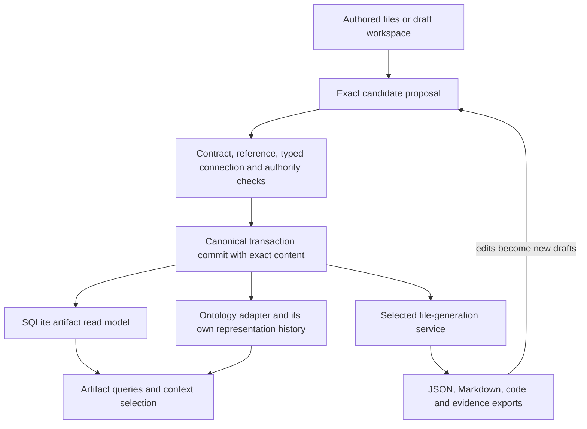

# Artifact handling and file materialization design

## Authority and storage responsibilities

There is one canonical commit path for each selected authority scope. Repository admission and owner-local runtime transactions remain distinct scopes. Physical packaging or a shared query database does not merge their ownership or histories.

Current admitted/source files retain their existing role. A selected migration can add a new canonical package store and exact source-profile mapping; it cannot silently declare old files generated or disposable. New runtime-created content can use packages when that protocol is adopted for its explicit scope.

## Layers

| Layer | Responsibility | Outputs |
| --- | --- | --- |
| Contract catalog | Exact carrier/schema/version/selector and identity extraction; declared Relation Kind signatures | Versioned validation bindings |
| Artifact command handler | Draft/admit/revise/withdraw proposals; base checks; independent cores and authorized effects | Closed exact proposal and validated postimage |
| Content/package store | Exact original bytes, immutable revisions, schema/evidence/dependency closure | Complete review package and committed transaction inputs |
| Transaction coordinator | Canonical commit point, idempotency, expected head, recovery and receipts | Durable commit receipt |
| SQLite projector | Artifact/revision/reference/relationship/authority-evidence lookup at a named cut | Disposable complete generation |
| Ontology adapter | Representation mapping and exact semantic/governance joins | Ontology events/cuts/views with Lab input provenance |
| File materializer | Selective byte-exact extraction and pinned deterministic rendering | Immutable file generation and manifest |
| Product interface | Logical diff, independent status facets, gaps and bounded queries | CLI/Agent/user inspection surfaces |

The command handler validates the heterogeneous domain carriers. It does not force Definition, Work, Product, Schema and Ontology Node into a universal `payload` or identity field. The envelope indexes their identity and contract while retaining the unchanged original body bytes.

## Write protocol

1. Select the exact branch/source profile and expected canonical head; establish the actual authority scope.
2. Read edited/authored content as candidate inputs. Preserve the base revision and original bytes.
3. Stage the whole closure: artifact revisions, schemas/selectors, exact reference targets, typed connection rules and selected evidence.
4. Independently validate applicable contracts, pair-specific qualifiers and semantic extension review. Database constraints alone do not satisfy these obligations.
5. Create stable independent Decision cores. Present existing exact targets/evidence for the selected checkpoint and obtain actual authorization.
6. Stage immutable content/package material and transaction records. Bind package hashes from outside their hashed manifest; verify the expected head again before the commit point.
7. Commit canonical history once. Publish a canonical commit receipt independent of whether a query projection or export succeeds.
8. Build or catch up SQLite, ontology and file generations from that committed cut. Projection/export failure records lag and recoverable residue; it does not reverse authority or repeat the admission.

Idempotency binds the command identity, scope, base and exact input digest. An identical committed retry returns the existing commit result. Reusing an identity with changed inputs is rejected. Unknown completion requires head/history inspection before retry.

The final single-checkpoint package can include these exact protocols and their implementation. Deterministic projection/export consequences already declared by the package need no bookkeeping approval. Unknown future semantic targets and external effects retain their own authority boundaries.

## Content and hash boundaries

- Store original byte sequences and their SHA-256 digest. Parsed JSON is useful for validation and indexing but cannot reproduce arbitrary original whitespace, ordering or binary content.
- Keep semantic/value digest and byte digest distinct. A semantic digest requires an exact algorithm binding; until selected, it may be null. A generic normalization claim across Python/Rust is not established.
- Preserve exact schema bytes, schema selector, identity selector, authorization/Decision material, evidence and dependencies required for replay. Referenced external dependencies must be pinned, available and verified; otherwise the package is not self-contained.
- Candidate artifact domain status and effective admission are independent facts. The database records effective posture from authority evidence instead of rewriting immutable body labels.
- The manifest's source cut denotes its input/predecessor cut. A logical commit reference can identify its enclosing transaction; it must not contain the digest of the transaction hashing that manifest.
- Stable review cores bind exact input targets. Generated consequences and output receipts bind the final postimage through the declared acyclic policy. Receipts do not include a digest of themselves or their enclosing hash cycle.

The draft `content.jsonl` format packs base64 byte envelopes in one file. It favors simple exact extraction over space efficiency. Future chunked binary packs/compression require an exact versioned decoder and closure proof; they are not implied by this candidate schema.

## SQLite read protocol

The database is a disposable projection. Its rows carry a generation, scope, exact revision and source entry; metadata includes source cut, source-profile hash, projector hash and contract-catalog hash. Indexed status facets remain separate.

Build a full generation inside a database transaction and publish `active_generation` only after complete validation. Readers pin one ready generation for the query. Never mix artifact rows at one Lab cut with ontology joins at another unreported cut. Support historical generations by explicit selection.

The canonical commit head and independently trusted source expectations establish currentness. A database's self-reported digest or `ready` row is not proof of authority or integrity. Corruption invalidates its generation; rebuild from canonical bytes/history. Any use that needs current authority revalidates the canonical inputs rather than trusting a cache.

The SQL foreign keys ensure selected structural joins. Application checks must also verify body hashes, exact carrier identity, Relation Kind revision/pairs/qualifiers, registry posture, owner authorization and source closure. Unknown references are explicit gaps; an inspection query may show them, while a use requiring closure is blocked.

Full-text search is optional and not yet part of the DDL. The SQLite index supplements the existing Rust graph read model; adopting SQLite as a replacement graph traversal backend requires parity and workload evidence. No database performance advantage is claimed.

## Ontology integration

Reuse the deterministic reducers, exact governance joins, immutable-generation discipline and transaction/recovery patterns where their contracts fit. Add a Lab adapter that maps committed artifact revisions to ontology representations with exact provenance.

Do not reuse ontology node mutation as artifact admission. Its representation lifecycle and imported source-record envelope do not supply every artifact's domain contract or authority. Project semantic/governance history and ontology representation history retain separate stream identities, cursors and event meanings.

The adapter's stable idempotency key includes the input artifact revision/commit, mapping version and selected ontology scope. Show its applied watermark and unresolved mappings. A governed ontology view cannot claim to represent a newer Lab cut than its verified input mapping permits.

## How files are created

### Byte-exact export

Resolve the exact subject revision and content entry at the selected source cut. Verify its canonical byte digest, decode original bytes and write them into a staged generation. The output byte hash must equal the original byte hash.

Examples: `work.json`, a Definition body, a schema, supporting code, a text document or binary evidence. These retain their original bytes; no universal reserialization is substituted.

### Rendered view

Select exact inputs and a pinned renderer/template. Render Markdown or another presentation. Bind input bytes, renderer digest, output path and output digest in the file-generation manifest. Expose generated status, source cut and limitations.

Examples: a readable Definition page, Product capability summary, relation endpoint table or current-state report. A generated view grants no authority beyond its inputs.

### Publication and editing

Write all selected outputs into a new immutable generation directory; verify the manifest; publish the selected generation pointer atomically. Readers resolve the pointer once and use that generation. Direct convenience copies are recoverable mirrors and may lag; they are not a globally atomic filesystem transaction with SQLite and the canonical store.

Use managed relative paths, prevent traversal and symlink escape, and reject unmanaged-file collisions. Never overwrite an authored source by treating it as a generated path. Export state remains recoverable if publication fails after canonical commit.

An edited generated file enters a draft workspace with its exact base revision, renderer/selection provenance and input hash. The command handler proposes the changed artifact; no watcher silently writes both DB and files. Only selected portable packages/exports enter repository publication scope; local DBs/cache generations belong under ignored runtime state.

## Recovery and storage management

Canonical commits survive deletion of SQLite and generated files. Recover the canonical store under its exact transaction protocol, then replay or rebuild projections. Lost canonical packages/dependencies require restoration from retained complete source/backup material; a query cache cannot be promoted to authority to fill the gap.

File count is controlled by packaging new operational records and exporting selected subsets. Byte growth, package rotation, cumulative-history deltas, deduplication and archival need measured policies. Initial protocols preserve exact complete materials and do not claim a storage bound. Existing admitted packages, committed events, source files and rollback branches are retained.

## Readiness

Proposed architecture fit: **flag, selected with named implementation conditions**. SQLite is suitable to evaluate for the local read model. Actual publisher/package integration, exact-content closure, deterministic recovery, graph parity and workload results are not yet established by this schema draft.
