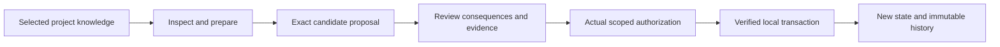

# Operate the Lab — proposed opening

Review sample. The routes and organization illustrated here are proposed. Runtime standing and the read-only command observation were checked on 13 October 2026.

The Lab runtime lets you inspect project knowledge, prepare changes for review and record exact authorized changes in an owned local branch. Temporary agent sessions recover checked context from saved state; their short memory ends when the session closes.

Start by choosing the implementation that fits the task:

| You want to… | Start with… | What to expect |
| --- | --- | --- |
| Inspect the admitted local foundation | Runtime v1 CLI | Checked results from its D74 source selection. Reads need no store or key. |
| Inspect the later D75 source selection | Runtime v2 CLI | A candidate successor with its own profile and evidence. |
| Integrate tools with the wider work/ontology/learning API | Integrated candidate API | 34 declared operations, with separate reader/action/governance channels and incomplete full qualification. |
| See Paperclip launch a Lab reader | The selected Paperclip process integration | The observed setup reads preserved engineering history. Its recorded temporary grant has expired; a currently authorized policy is needed for another run. |

## Your first inspection

From the repository root, with the selected v1 Python dependencies installed, run:

```bash
python3 -B implementation/lab-runtime/v1/lab.py status
```

The response reports the source selection, its freshness, the selected Project State and whether a local store is initialized. The admitted v1 profile reports `decision:0074`; this describes the foundation it reads. Decision 0075 separately records the implementation's admission.

A read-only invocation with an explicitly nonexistent store was checked for this proposal. It exited 0, reported 468 selected subjects and `store_initialized: false`, and did not create a store. The subject count belongs to that selected foundation; it is not a promise that every later repository artifact appears in this version.

Read the output before provisioning anything. A source drift warning means the selected source bytes no longer match the implementation's profile; follow the source-selection troubleshooting guide. Creating a key or local store is a separate step.

## How a change reaches state



The local transaction path exists in the admitted runtime. The wider candidate API connects more services, but its complete session/lesson journey still has a failing witness. The documentation should show those limits beside the affected procedures.

Next, choose one task: inspect a Definition; prepare a local Work proposal; understand an existing transaction; or inspect a Paperclip reader result. Instructions for each task should state the implementation, source cut, current permission, expected output and what changes.

For architecture, continue to the runtime component map. For exact field names and error behavior, use the API reference. For the reasoning behind definitions, evidence and owner decisions, return to the existing Lab model guide.
