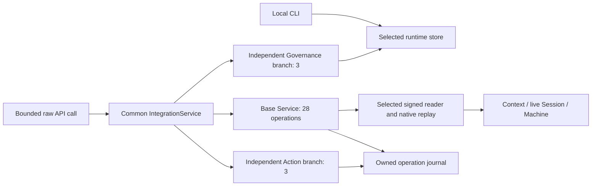

# Runtime architecture research for the documentation proposal

Research date: 2026-10-13. Scope: static code and documentation inspection, covering the ten `implementation/lab-*` areas and the selected `api-integration-v16` family. This note proposes handbook content; it supplies no new admission, qualification, installation, or service activation. No tests, private credentials, live databases, or runtime stores were opened for this research.

Links below resolve from this research directory to repository sources. `API16` denotes `product/lab/release-candidates/v1/interface/api-integration-v16`; it is a candidate integration, distinct from the admitted executable.

## 1. Establish the version and authority before explaining the runtime

| Surface | Implemented meaning | Primary evidence |
| --- | --- | --- |
| Operational Runtime v1 / D74 | Executable admitted by Decision 0075, operating against its frozen D74 source profile. Admission does not provision an operator, key, store, service, or consumer. | [ADMISSION.md](../../../../implementation/lab-runtime/ADMISSION.md), [Decision 0075](../../../decisions/0075-lab-operational-runtime-v1-admission/DECISION.md) |
| Operational Runtime v2 / D75 | Separate candidate source profile including the D75 admission overlay. Default store is `.local/lab-runtime/v2/store`; a v1 store is not silently rebased. | [v2 REVIEW.md](../../../../implementation/lab-runtime/v2/REVIEW.md), [v2 profile.json](../../../../implementation/lab-runtime/v2/profile.json) |
| Repeatable-operation and domain implementations | Additive candidates with explicit profile, executable, branch, and policy pins; they reuse guarded legacy replay and build additional operations around it. | [profiles.select](../../../../implementation/lab-runtime/candidates/repeatable-operation/lab_runtime/profiles.py), [replay.full_replay](../../../../implementation/lab-runtime/candidates/repeatable-operation/lab_runtime/replay.py) |
| API16 common interface | Selected integration of 34 contract operations and independently authenticated branches. A selected source/profile or an implemented route does not establish that every current fixture or operation has passed qualification. | [protocol.SUPPORTED / Schemas](../../../../product/lab/release-candidates/v1/interface/api-integration-v16/protocol.py), [integration-members.json](../../../../product/lab/release-candidates/v1/interface/api-integration-v16/integration-members.json) |

API16's selected source-manifest SHA-256 is `8ac40a51e23b8e528178807792b8ae477aa9c46cd50d92a5b1522c82945413c7`; its contract-profile SHA-256 is `8cc29da16d3881d8816cdc45c55358d9229fcaf226d1b9a757402ebc8675d18c`. These identify the researched candidate, not a qualification verdict. Copied candidate-era labels are insufficient: API16's [DESIGN.md](../../../../product/lab/release-candidates/v1/interface/api-integration-v16/DESIGN.md) still describes successor 14. Conversely, v1's original candidate notice is deliberately preserved underneath its external admission overlay.

## 2. Inventory of the ten implementation areas

| Area | Concrete entrypoints and symbols | Role in the composed runtime |
| --- | --- | --- |
| `lab-runtime` | [v1 lab.py](../../../../implementation/lab-runtime/v1/lab.py), [v2 cli.main](../../../../implementation/lab-runtime/v2/lab_runtime/cli.py), [Store](../../../../implementation/lab-runtime/v2/lab_runtime/store.py), [operations.prepare](../../../../implementation/lab-runtime/v2/lab_runtime/operations.py) | Local CLI, source capture, schema validation, signed authorization, deterministic transactions, replay, graph queries, recovery, ephemeral Session. |
| `lab-provisioning` | [provision.CandidateScope / CandidateBranch](../../../../implementation/lab-provisioning/candidates/v1/provision.py) | Constructs a disposable, explicitly scoped branch using pinned runtime replay and independently selected baseline/configuration/HEAD. Candidate initialization is separate from canonical repository admission. |
| `lab-bootstrap` | [bootstrap.compose / replay / prepare / sign / apply](../../../../implementation/lab-bootstrap/candidates/v1/bootstrap.py), [build_package.write_package](../../../../implementation/lab-bootstrap/candidates/v1/build_package.py) | Packages seed material and rehearses controlled catalog/governance changes with an explicit policy and response. |
| `lab-integration` | [freeze.py](../../../../implementation/lab-integration/candidates/v1/freeze.py), [validate.py](../../../../implementation/lab-integration/candidates/v1/validate.py) | Freezes and checks the selected composition, including adapters and dependent implementations. Integration evidence does not automatically admit all components. |
| `lab-review` | [review.py](../../../../implementation/lab-review/candidates/v1/review.py), [prepare.py](../../../../implementation/lab-review/candidates/v1/prepare.py) | Prepares bounded review material and checks review inputs; preparation and an actual accountable review outcome are different stages. |
| `lab-context` | [native_reader.NativePins / NativeReadStore.read](../../../../implementation/lab-context/candidates/v1/native_reader.py), [context.ContextSession](../../../../implementation/lab-context/candidates/v1/context.py), [native main.rs](../../../../implementation/lab-context/candidates/v1/native/src/main.rs) | Produces source-bound Context using the actual native ontology reducer. Read pins cover executable, event files, request, cursors, and projection digest; results grant no new authority. |
| `lab-ontology` | [native EventStore implementation](../../../../implementation/lab-ontology/candidates/v1/adapters/native/src/lib.rs), [context_adapter.rs](../../../../implementation/lab-ontology/candidates/v1/adapters/native/src/context_adapter.rs), [governance_context_adapter.rs](../../../../implementation/lab-ontology/candidates/v1/adapters/native/src/governance_context_adapter.rs) | Replays separate semantic and governance event families and derives cuts, governed views, and projections. Representations retain bindings to original subjects and relations. |
| `lab-continuity` | [v2 custody.ReadCustodian](../../../../implementation/lab-continuity/candidates/v2/custody.py), [local_context.ContextSession](../../../../implementation/lab-continuity/candidates/v2/local_context.py) | Carries durable read/custody evidence across processes while keeping actual Session memory ephemeral. A receipt cannot reconstruct a lost live resource. |
| `lab-work` | [episode.perform](../../../../implementation/lab-work/candidates/v1/episode.py), [execute.py](../../../../implementation/lab-work/candidates/v1/execute.py), [verification.verify_audit_exact / decode_archive / restore_archive](../../../../implementation/lab-work/candidates/v1/verification.py) | Executes bounded work episodes, checks current membership and Context sources, and verifies archived evidence/restoration. An archive and genuine runtime work have separate provenance. |
| `lab-workflows` | [authority.evaluator.HostAuthority](../../../../implementation/lab-workflows/candidates/v1/authority/evaluator.py), [dispatch.LocalDispatcher](../../../../implementation/lab-workflows/candidates/v1/authority/dispatch.py), [engineering.EngineeringWorkflow](../../../../implementation/lab-workflows/candidates/v1/workflows/engineering.py), [research.ResearchWorkflow](../../../../implementation/lab-workflows/candidates/v1/workflows/research.py), [learning](../../../../implementation/lab-workflows/candidates/v1/learning/) | Binds Actor, delegation, tool, inputs, budget, and actual Session lease; journals local effects and uncertainty; provides engineering/research workflow, evidence, failures, challenges, and reviewed Lesson mechanisms. |

## 3. Two entrypaths and their execution flow

The CLI enters `lab.py → lab_runtime.cli.main`. `read_data` can derive repository inspection when a selected store does not exist; this does not initialize a store. Explicit `init` chooses owner/key/local scope. `review → authorize → apply` prepares the entire proposed projection, signs the selected proposal, then publishes a transaction under a writer lock. `verify/rebuild` replay committed history; `recover --expected-head` handles recognized uncommitted residue. `session` creates an ephemeral source/HEAD-bound view. See [cli.py](../../../../implementation/lab-runtime/v2/lab_runtime/cli.py), [sources.capture / freshness / resolve](../../../../implementation/lab-runtime/v2/lab_runtime/sources.py), and [Store.replay / apply / recover](../../../../implementation/lab-runtime/v2/lab_runtime/store.py).

The stdio API enters [serve.main](../../../../product/lab/release-candidates/v1/interface/api-integration-v16/serve.py): independently supplied source/profile/policy hashes → source verification → `Schemas` → `ReaderChannel` challenge → signed proof → selected source replay → `Service.call` for each bounded JSON line. This entrypoint constructs **the base service**, not the common three-branch facade.

The common catalog has **34 operations**: 28 base operations, three Action operations, and three Governance operations. [IntegrationService](../../../../product/lab/release-candidates/v1/interface/api-integration-v16/integration_dispatch.py) composes the actual base, `ActionService`, and `GovernanceService`, verifies their module/source/profile origins, and requires the same selected `Schemas` object. It routes the **unchanged request bytes** to a branch, including branch-specific `operation.inspect`. An opaque Context reference is a locator; each branch repeats authentication and permission checks. Catalog membership does not grant access, and one base connection is not an all-operation Operator.

The base [Service._call](../../../../product/lab/release-candidates/v1/interface/api-integration-v16/service.py) checks channel, byte bound, envelope, allowed operation, unique call ID, selected profile, captured code, Actor, strictest deadline, action/byte budgets, source cut, and domain schema. Effectful calls use an exact idempotency key and control-input fingerprint. A completed retry returns guarded historical evidence; a pending key requests inspection/recovery rather than redispatch. [Vault.claim / finish / lookup](../../../../product/lab/release-candidates/v1/interface/api-integration-v16/workspace.py) own this evidence journal.

Proposed overview diagram:

## 4. Source selection and storage boundaries

Source selection is an implementation contract. [source_bridge.source_selection / replay_source / reader_factory](../../../../product/lab/release-candidates/v1/interface/api-integration-v16/source_bridge.py) choose explicit native source, reader class, package, Context producer, and profile bindings. Original custody, integrated participation, workflow, history, Source8 Context, controlled Lesson fixture, and fresh legacy Session fixture are separate selections. A reused internal adapter nickname such as `custody-participation` must not substitute for public source identity, Principal, period, class origin, or authority.

| State | Persistence and authority | Recovery/documentation implication |
| --- | --- | --- |
| Runtime baseline/configuration/transactions/HEAD | Durable local committed history. `Store.replay` rechecks chain, proposal semantics, approvals, consequences, cores, and projection digests. | HEAD publication is the commit point. Inspect before recovery; preserve committed history and unknown residue. |
| Native semantic/governance files and original transaction bytes | Exact inputs to independent native replay and source adapters. Semantic and governance cursors are distinct. | Cold replay verifies originals; a derived ontology/Context does not replace source authority. [NativeReadStore.read](../../../../implementation/lab-context/candidates/v1/native_reader.py) rereads pins before and after execution. |
| API workspace material, objects, operation journal | Explicitly selected private scope outside the repository, immutable input bindings and durable effect evidence. | Exact retries, conflicting controls, pending effects, and foreign-owner lookup need separate operator procedures. |
| API SQLite generation | Disposable derived query representation with row/content bindings. | [Generation.verify / query](../../../../product/lab/release-candidates/v1/interface/api-integration-v16/projection.py) checks the projection; refreshing it does not admit source changes. |
| Context, Session resource, Machine signer, notes | Live process-bound resources; RAM expires or is erased. | Close/revocation/expiry invalidate use. Durable journals are evidence, not credentials or memory restoration. [Session.context / close](../../../../implementation/lab-runtime/v2/lab_runtime/session.py) checks current source/HEAD and erases short memory. |

The original local store uses locked, staged, fsynced writes and an atomic HEAD replacement. Its recovery model addresses controlled local interruption; the handbook must not advertise multi-host consensus or unproved power-loss durability. Repeatable-operation [ReplayPins / full_replay](../../../../implementation/lab-runtime/candidates/repeatable-operation/lab_runtime/replay.py) additionally bind independently trusted executable/config/baseline/HEAD values, verify the complete legacy implementation closure in a fresh namespace, and reject persistent checkpoints as a substitute for full verification.

## 5. Context, Machine, domain operations, and effects

Context is a bounded source-backed selection with exclusions, lineage, freshness, and intended use. API Session runtimes are explicitly selected in [service.selected_session_runtime](../../../../product/lab/release-candidates/v1/interface/api-integration-v16/service.py): original custody, Source8, controlled fixture, and distinct legacy runtime paths. Opening a Session does not create Action authority.

[machine_transport.select / MachinePeer](../../../../product/lab/release-candidates/v1/interface/api-integration-v16/machine_transport.py) binds a new authenticated Machine peer to the actual still-live parent Session. [machine_auth_scope.py](../../../../product/lab/release-candidates/v1/interface/api-integration-v16/machine_auth_scope.py) batches selected pure read proofs; it cannot grant effects. An application Operator uses a separately authorized [SessionAttachment](../../../../product/lab/release-candidates/v1/interface/api-integration-v16/session_attachment.py). Closing the borrower must not dispose the parent's custody or credential owner.

The domain map should follow code rather than presenting every operation as a canonical write:

- Workflow/evidence/failure/challenge handlers prepare and check exact source-backed candidate records. [WorkflowTransition.preflight / apply](../../../../product/lab/release-candidates/v1/interface/api-integration-v16/workflow_transition.py) validates selected WorkflowRun/definition semantics; preparation does not by itself publish a governed admission.
- Lesson selection requires complete current inventory, reviewed use, applicability, scope, generator identity, and a real current Context/Session. Application and assessment are separate: [lesson_selection.py](../../../../product/lab/release-candidates/v1/interface/api-integration-v16/lesson_selection.py), [lesson_application.py](../../../../product/lab/release-candidates/v1/interface/api-integration-v16/lesson_application.py), [lesson_assessment.py](../../../../product/lab/release-candidates/v1/interface/api-integration-v16/lesson_assessment.py). [ApplicationJournal](../../../../product/lab/release-candidates/v1/interface/api-integration-v16/application_journal.py) can resolve an explicitly selected completed owned candidate Application; correspondence is not causal outcome evidence. Controlled fixture declarations are not human review or production learning success.
- [ActionService](../../../../product/lab/release-candidates/v1/interface/api-action-integration-v3/service.py) uses the actual `HostAuthority`/`LocalDispatcher` foundation, an independently selected action-capable Actor, Tool and Session lease, and private grant/nonce channel. Dispatch performs a real scoped local tool effect; reconcile inspects uncertainty without blindly repeating the tool.
- [GovernanceService.execute](../../../../product/lab/release-candidates/v1/interface/api-governance-integration-v4/service.py) separates checkpoint resolution, signed owned native admission, and capability adoption preparation. It checks current cut, signatures/material closure, lock/deadline, and a pending durable key before effects. These development-store operations do not imply repository-wide admission or an invented human decision.
- [installation_release.py](../../../../product/lab/release-candidates/v1/interface/api-integration-v16/installation_release.py) and [r02_installer.py](../../../../product/lab/release-candidates/v1/interface/api-integration-v16/r02_installer.py) govern bounded development installation/release preparation. Package import/export and file materialization retain independent filesystem/dependency guards; release preparation is not server activation or publication.

## 6. Proposed handbook chapters and missing explanations

Existing READMEs, DESIGN files, reviews, and construction receipts document individual candidates well, but leave the cross-component operator path fragmented. The handbook should add:

1. **Choose the runtime:** admission overlay, D74/D75 distinction, executable/profile/source pins, candidate qualification status, and how to detect stale copied labels.
2. **First local inspection:** repository-only CLI reads versus explicit store initialization; explain command outputs and ownership without embedding keys or live paths.
3. **Store transactions and recovery:** prepare/review/sign/apply, HEAD commit point, interrupted publication, exact replay, recognized residue, and expected-HEAD recovery.
4. **Sources and native replay:** independent pins, schema/carrier originals, semantic/governance timelines, cuts, projections, historical reads, and source-currentness refusals.
5. **The API operator path:** stdio handshake, base 28 versus composite 34, independent branch channels, raw request/result bindings, profile selection, budgets and operation-specific scopes.
6. **Context and Session lifecycle:** generation, exclusions, parent custody, Machine transport, Operator attachment, close/revoke/expire, and host restart without RAM reconstruction.
7. **Domain recipes:** workflow/evidence/failure/challenge, Lesson select/apply/assess, action evaluate/dispatch/reconcile, governance operations, package/files, installation/release; label each actual effect and its ceiling.
8. **Developer extension guide:** source/reader/mapper/Context/runtime composition; exact native class/module origins; original API schema registry; selected execution dependencies versus full provenance closure; contribution and facade wiring.
9. **Troubleshooting and evidence:** malformed versus unauthorized versus stale/integrity/deadline errors; idempotency conflict, pending/uncertain inspection, cleanup ownership, and qualification versus instrumentation.

Recommended additional diagrams: transaction state machine (`prepared → authorized → staged → HEAD committed`, with uncommitted residue); two-axis semantic/governance cursor join; source → native replay → mapper → Context → live Session → Machine sequence; branch handshake and raw-byte routing; persistent-store/workspace/cache/RAM ownership map; pending Action reconciliation; independent Lesson applicability/application/assessment evidence flow.

Operational constraints need to appear beside the relevant recipes: real UTC and strictest deadlines include lock/guard/compute time; source/Assignment periods are immutable selected inputs; expired originals require a distinct reviewed successor rather than renewal by relabeling; permission and nonce checks remain fresh; pure FactScope borrowing grants no effect authority; before/after source guards must discard outputs on drift. [auth.ReaderChannel](../../../../product/lab/release-candidates/v1/interface/api-integration-v16/auth.py), [guarded_candidate.selection / calculation](../../../../product/lab/release-candidates/v1/interface/api-integration-v16/guarded_candidate.py), and [guarded_reads.model_read_batch](../../../../product/lab/release-candidates/v1/interface/api-integration-v16/guarded_reads.py) are the implementation anchors. Describe exact selected execution dependencies separately from full historical qualification provenance, and never turn a candidate fixture PASS into product-wide or human acceptance.
