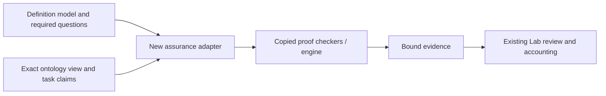
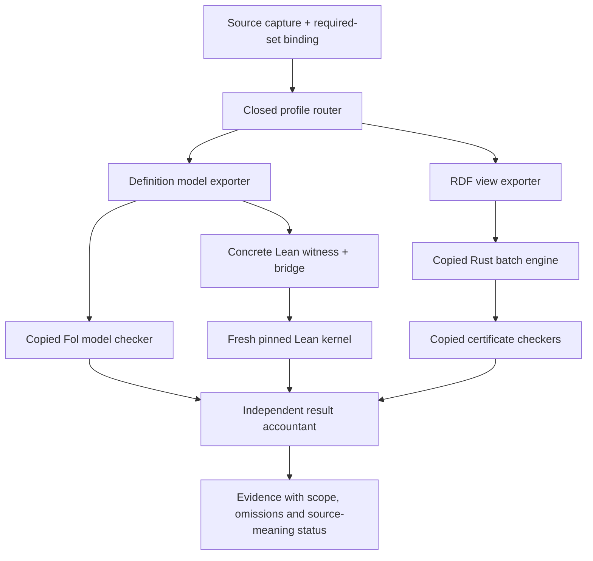
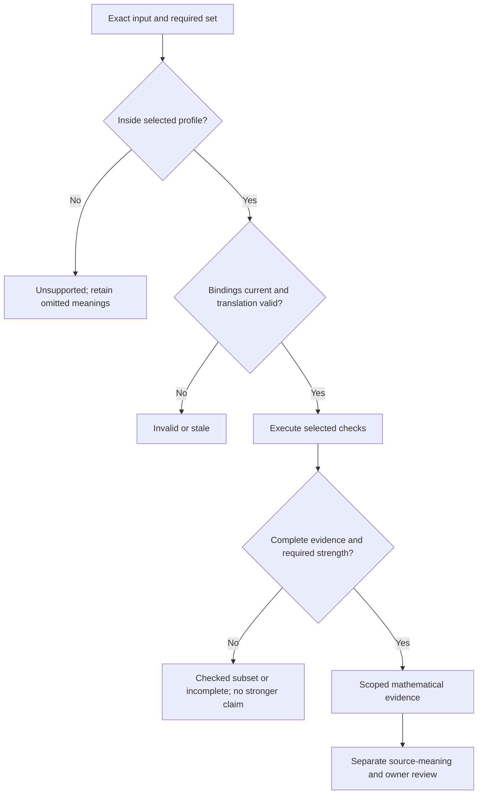

# Architecture: additional assurance providers

## Intent and source contracts

Add proof-backed model evidence and ontology analysis to existing Lab checkers,
maximizing unchanged source reuse. The input is an exact selected formalization
or ontology view; the output is bounded evidence for its required questions.

Source contracts are the user-requested reuse policy, the
[focused comparison](../../research/open-ontologies/2026-11-02/LAB-PROOF-COMPARISON.md),
[local source baseline](LAB-REUSE-BASELINE.json), current definition required-set
and verifier contracts, and the pinned upstream ABI/theorems. This is design
authorization, not proof of source fidelity, build readiness or live adoption.

## View 1: Context

The consumers are definition assurance, relational-checker experiments and
ontology-context preparation. A separate provider accepts their bounded input
and returns analysis or proof evidence. It owns temporary jobs and its own
builds. Existing owner decisions, global relation admissions and canonical
ontology events remain with their current Lab owners.

## View 2: High-level structure

Imported code lives below `craft/formalization/candidates/open-ontologies-assurance-v1/vendor/open-ontologies/c7fd75f9491253c56e4d4f408ceac179de343e48/`. New adapters and bridge proofs live
outside that tree under `craft/formalization/candidates/open-ontologies-assurance-v1/`. Generated jobs and build receipts have
separate create-only directories. The intended runtime is a local callable
provider, with an optional local CLI; no new service is required.

## View 3: Components

| Component | Responsibility and reuse |
| --- | --- |
| Source binder | Reuse Lab capture/IR/obligation logic; bind the full required set before evaluating results. |
| Profile router | Select a fixed supported profile; refuse unsupported constructs without dropping them. |
| Model exporter | Encode supported typed formulas and complete model tables; emit an injective symbol map. |
| Bridge and proof assembler | State independent source/target semantics, generate concrete model/goal data, and apply copied theorems. |
| Engine adapter | Generate fixed JSON batch operations; run the whole copied crate with no daemon connection. |
| Owned supervisor | Reuse a reviewed successor of Lab deadline/output/process ownership code. |
| Evidence inspector | Recompute hashes, compare expected statements, replay checkers/kernel, enforce coverage/strength. |
| Import/build registry | Bind source copies, local patches, toolchain/import closure and exact executables. |

## View 4: Workflow

1. Capture raw request, source/interpretation versions, goals/populations and
   resource policy. Validate currentness without treating it as source truth.
2. Recompute the required set independently. Select one exact profile.
3. Create a new owned job; materialize immutable input copies and export maps.
4. Check representability and source-to-export correspondence. Refuse losses.
5. Run the copied checker or engine on those copies. Retain raw artifacts.
6. For a kernel-level model result, generate and check a concrete Lean witness,
   audit its exact statement/import/axiom closure, and replay it freshly.
7. Inspect every required output and source binding again. Return separate
   mathematical, translation, coverage and source-fidelity statuses.
8. Inspect saved evidence as recorded evidence only. A later changed source or
   profile invalidates its applicability; saved JSON never creates a fresh run.

No failure path applies a graph change. Truncation, timeout, missing checker or
unsupported syntax produces a named incomplete/refused outcome. It cannot
become a negative theorem or be silently replaced with another provider.

## View 5: Decision flow

An imported compiled checker accepting bytes is a different strength from a
freshly replayed proof about a Lab IR statement. The latter also requires the
bridge. Neither supplies whole-definition owner acceptance automatically.

## View 6: Dependencies and interfaces

Public requests name fixed profile IDs and content-addressed inputs. They cannot
name a checker binary, shell command, environment override or alternate catalog.
The provider resolves those from an independently pinned build/profile record.
See [interfaces](INTERFACES.md) and [proof profiles](PROOF-PROFILES.md).

Use Lean 4.33.1 for the copied workspace and new bridge. Keep an exact import
closure separate from the old accepted `.olean` cache. Build the Rust crate as
its own root with the original lock and graph-store fork. Profile-specific
imports, compilers and binaries are included in cache keys and invalidation.

## Selected decisions

| ID | Decision | Reason |
| --- | --- | --- |
| D01 | Copy coherent source/build units unchanged. | Maximum useful reuse with minimal semantic drift. |
| D02 | Keep new glue and patches outside imported source. | Reviewable upgrades and direct source-digest comparison. |
| D03 | Use standalone JSON batch first, not a new Rust workspace/library worker. | Reuses the existing interface and preserves Cargo root patches. |
| D04 | Add a distinct provider successor. | Existing finite/v3 profiles and receipts are fixed and cannot be extended by relabeling. |
| D05 | Start with restricted model signatures, then separately prove richer lowering. | Existing Lab syntax is richer than copied Fol syntax. |
| D06 | Generate per-request Lean proofs for the kernel-level result. | A native executable exit code is not fresh kernel replay. |
| D07 | Use copied engine only on disposable exports. | Preserves concurrent agent views and canonical event history. |
| D08 | Treat missing evidence as incomplete; never fall back silently. | Protects the meaning of proof strength and failure. |

## Risks and follow-on work

The main risks are a wrong translation, incomplete required-set accounting,
untrusted checker selection, stale binary/import caches, missing fixture closure,
and overclaiming native report words. Each has explicit controls in
[validation](VALIDATION.md).

Build readiness, bridge proofs, platform resource behavior and performance must
be established during implementation. They do not prevent this design from
being reviewable. [Delivery layers](DELIVERY-LAYERS.md) are a design seed, not an
executed plan or a claim of completed work.
