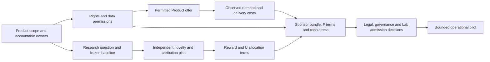

# Agentic Research Network — gap and open-question map

Date: 2026-10-30. Scope: all **material gaps identified in the current candidate package and its Engineer Assessment reference**. Status: analytical inventory, authority effect none. This is a decision map, not an accepted plan, Lab admission, offer, legal opinion, or claim that unknown evidence is absent everywhere. It separates source-backed design, synthetic behavior, measured results, owner decisions and live effects.

## What is established today

- The [candidate package](README.md) defines research objects, novelty checks, W work rewards, U durable-research participation, a hypothetical F sponsor instrument, governance roles and transaction formats. Its local schema/reference validator and economics tests check **internal consistency**.
- The [Product 001 term sheet](PRODUCT-001-TERM-SHEET.md) uses [Engineer Assessment](../../../../../../engineer-assessment/README.md) as a reference Product. It does not appoint that Product's owner, grant its IP/data rights, or establish a Product/Network commercial agreement.
- The [whole EA candidate](product-001-ea/MODEL.md) now pins 88 selected EA source files, maps the six Goals, seven Capabilities, ten Inquiries, fifteen Designs and 27 Roles, and tests five constructed research-to-payout paths. Its task families and Product decisions are proposals; no EA Research Run or Network award exists.
- The [loop](economics/LOOP-TEST-RESULTS.md) and [multi-sponsor](economics/MULTI-SPONSOR-RESULTS.md) results are deterministic examples in arbitrary C units. They demonstrate conditional arithmetic and refusal paths. They contain no observed Product demand, sponsor commitments, issued units or actual treasury cash.
- Engineer Assessment has substantial candidate research work, including an [E12 AI feasibility cut](../../../../../../engineer-assessment/research/PROGRAM-E12-FEASIBILITY-PACK.md). Its treatment-arm masking failed, and the method comparison remains unvalidated. Its three-session hiring thesis and Product unit economics are also unvalidated.

## Dependency order

A public-source synthetic research pilot can explore D while Product ownership is resolved. It cannot confer Engineer Assessment rights or support a paid Product claim. W/U/F implementation and open-network operation require later decisions and evidence.

## 1. Product, rights and participant boundary

| ID | Gap and exact open question | Current state | Evidence or decision that closes it |
| --- | --- | --- | --- |
| P1 | **Which first Product is in scope?** Does Engineer Assessment's owner permit it to be Product 001, and is the Network a research administrator, IP licensee, seller, or separate platform? Which research question is first? | The term sheet is a reference scenario. Network Product and EA Product are separate candidate identities. | Product-owner decision naming exact Product version, service, program and Product/Network relationship. |
| P2 | **Who can contract and promise each benefit?** Which entity signs sponsor, contributor, customer and treasury agreements, and who bears refunds and unpaid payouts? | Network contracting entity and Product owner are unassigned. EA's proposed pilot data controller does not establish sponsor/IP authority. | Entity and signer records, Product/Network agreement, accounting perimeter and liability allocation. |
| P3 | **What may be commercialized?** Who owns background cases/software/rubrics, new research outputs and improvements; which third-party licenses restrict use; may the Product retain selling rights after an exclusive sponsor license? | [Rights policy](records/rights-policy.json) leaves contributor license, IP steward and data commercialization open. F/U/W confer no IP title. | Asset-level chain of title, contributor agreements, sponsor license field/term, retained Product rights and permission audit. [WIPO guidance](https://www.wipo.int/en/web/technology-transfer/faq) identifies ownership and use-right issues for sponsored research. |
| P4 | **What data can each actor see or buy?** Are recordings, answers, ratings, employer outcomes or candidate leads ever available to sponsors or the Network? For which purpose, lawful basis and retention? | EA's [first MVP purpose model](../../../../../../engineer-assessment/software/PRIVACY-ACCESS.md) excludes employer access, training reuse and individual-score export. Product 001 excludes lead/data sales. | Purpose-specific controller/processor and recipient decisions, notices, permissions, minimization, retention/deletion and access audit. Brazil's [ANPD research-data guidance](https://www.gov.br/anpd/pt-br/assuntos/noticias/anpd-lanca-guia-orientativo-sobre-tratamento-de-dados-pessoais-para-fins-academicos) is a review input. |
| P5 | **Which Product claim is saleable?** Is the offering formative feedback, an assessment workflow, or a hiring decision aid; what evidence permits each? | EA is at a candidate claim level; no hiring validity or employer route is established. | Named role/population, reliable case/rater/mode measurement, independent work outcome, prospective comparator, access/fairness analysis and Product-owner use decision under the [EA scorecard](../../../../../../engineer-assessment/model/PRODUCT-SUCCESS-METRICS.md). |

## 2. Research, novelty, mining and credit

| ID | Gap and exact open question | Current state | Evidence or decision that closes it |
| --- | --- | --- | --- |
| R1 | **What is the first research object?** What is its exact baseline, closest dated prior, discriminating prediction, negative outcome and Product decision it could change? | [Novelty rules](records/novelty-rules.json) and [synthetic pilot](PILOT.md) are candidates; the first Program baseline is open. | Frozen object/prior packet, NR-01–NR-07 review criteria, comparator, data permission and preregistered test. |
| R2 | **Can independent reviewers apply the novelty boundary?** Can they separate duplicate/surface variants from useful mechanisms without author-style leakage or hindsight? | ARN's ten-case reviewer pilot is unrun. EA E12 generated 30 proposals; first AI reviews could infer every treatment arm, and normalization still revealed 29/30 per model. | Neutral/source-closed fixtures, independent first ratings, tested masking or declared unblinded analysis, disagreement/adjudication log and false-award table. No AI-only feasibility cut substitutes for human/domain adjudication. |
| R3 | **What counts as an observed durable advance?** Does a valid experiment resolve a registered uncertainty, improve a decision against a cheap rival or close a question through a controlled negative result? | Criteria are written, but no accepted ARN Research Run, Finding or independent usefulness result exists. | Replayed run with exact source/evidence, comparator, uncertainty, limitations and Product decision consequence; independent challenge and later replication for broader claims. |
| R4 | **How is U credit split causally?** Who receives what share for question, design, execution, review, reusable method and follow-up; how are duplicate teams, later improvements and appeals handled? | [Participation policy](records/participation-policy.json) leaves allocation rule, denominator, duration and dilution open. | Precommitted milestone pool, claimant graph and counterfactual contribution rules; blind attribution replay, inter-adjudicator stability, appeal outcomes and contributor acceptance of terms. |
| R5 | **What work earns W without gaming?** What is a valid null/negative run, task budget, reviewer evidence, anti-copy rule, one-operator identity and collusion response? | [Reward policy](records/reward-policy.json) has candidate identity checks; exact identity, mint authority and live supply are open. | Frozen task offers and budgets, reproducible acceptance criteria, independent reviews, duplicate/collusion fixtures, operator identities and observed false-award rate. |
| R6 | **Can research workers be selected and reviewed fairly at scale?** How are scarce tasks allocated, conflicts separated, model/provider provenance logged, sybil operators detected and challenges resolved? | Permissioned verified-identity/hash-lottery is a candidate; no open-network resistance or operated reviewer process. | Pilot assignment audit, independent reviewer availability, conflict/recusal evidence, appeals performance and adversarial identity/copy tests. |
| R7 | **Are prior and holdout assets controlled?** Which case/answer material has been exposed to agents, miners or reviewers, and what remains untouched for confirmation? | EA notes source and arm leakage, and its holdout enforcement/receipts remain work. | Versioned exposure ledger, sealed confirmation cut, access receipts and no reuse of inspected outcomes as untouched tests. |

## 3. Product demand and the cash loop

| ID | Gap and exact open question | Current state | Evidence or decision that closes it |
| --- | --- | --- | --- |
| E1 | **Who pays for which permitted service?** Employer, participant, IP licensee, sponsor or a mix; what do they value and renew? | No approved paid EA offering, customer contract, conversion or price. The [opt-in qualified-introduction branch](product-001-ea/LEAD-PLATFORM.md) is proposed for later; it is disabled in EA's current MVP. | Named offer and permitted payer, observed willingness/payment and renewal, engineer opt-in and buyer acceptance, acquisition path and refund behavior. |
| E2 | **What is actual Product net contribution `N` and distributable `D`?** Which receipts, taxes, refunds, fees, direct costs, shared costs and reserves count, and when are they recognized/restated? | `N=D` and 1,000 C in simulations are arbitrary; [revenue policy](records/revenue-policy.json) has no live fraction, cap, period or finality rule. | Product-specific statement reconciled to bank/custody and invoices, contract definitions, direct-cost allocation and independent audit. |
| E3 | **What does a delivered unit cost?** Inference, storage, human review, support, accessibility, W fulfillment, sponsor no-charge use, acquisition, incidents and fixed research/build. | Synthetic periods assume 200/400/100 C plus optional access. EA [PS-17](../../../../../../engineer-assessment/model/PRODUCT-SUCCESS-METRICS.md) has a metric definition but no observed value. | Cost and capacity ledger by eligible assessment and period, invoice/time evidence, variance, high-use stress and paid-offer cohort margin. |
| E4 | **Which funding regime can replenish research?** Product-supported, renewable sponsor support, hybrid, or finite runway; which receipt covers which restricted cost? | [Circular-loop review](economics/CIRCULAR-ECONOMY-RESEARCH.md) gives conditions, not evidence of repeatable closure. Sponsor and Product cases fail under no sales/withdrawal. | Choose a regime, measure its external receipts and lag, run downside paths with restricted cash/committed liabilities, set headroom floor and research-release stop rule. |
| E5 | **Can sponsor access and W redemption be fulfilled?** What services, prices, capacity, expiry, failed-fulfillment remedy and cash reserves apply? | [Service-redemption policy](records/service-redemption-policy.json) has no service, price, capacity or cost. Multi-sponsor runner reserves B access but does not model W advance reserve or service queue. | Service catalog, marginal/high-percentile cost, demand and queue test, reserve and refund policy, no double counting of W sale and redemption. |
| E6 | **Can the asset cycle continue?** With W burn, the fixed work pool empties; with fixed U cap, future durable advances eventually lack U. What prospective successor pays later work? | [Loop tests](economics/LOOP-TEST-RESULTS.md) expose W and U exhaustion. Recycling W is hypothetical and creates no cash. | Select finite campaign, disclosed recycle/reissue terms, new Product pools or direct C rewards; test long-horizon supply, service liabilities, incentives and existing-right protection. |
| E7 | **Can engineer supply and buyer demand finance each other?** What fraction of assessed engineers opts in, accepts a specific buyer, and becomes a paid introduction; how many repeat introductions remain welcome? | The [lead cohort probe](product-001-ea/LEAD-PLATFORM.md) exposes unsold-assessment cost and a synthetic volume threshold, with no observed demand or channel cost. | Measure full-cohort acquisition, assessment, opt-in, request, acceptance, payment, refund and repeat-use funnels by web/API channel; test engineer reward, unwanted contact and Product margin together. |
| E8 | **Does W search promotion help without misleading buyers or draining cash?** Which relevant queries, labeled slot, W price, impression cap, capacity and remedy apply; can organic profiles still be found? | The [visibility service](product-001-ea/VISIBILITY-REDEMPTION.md) is a disabled candidate. The synthetic cohort charges its cash cost and burns W but has no real search impressions or demand. | Run synthetic and permissioned search tests for relevance, organic displacement, buyer comprehension, engineer value, cash fulfillment and failed-service refunds. Resolve transferable W versus strictly earned-only benefit. |

## 4. Sponsor, contributor and customer rights

| ID | Gap and exact open question | Current state | Evidence or decision that closes it |
| --- | --- | --- | --- |
| S1 | **What instrument is F?** Grant, sponsorship, prepaid service, license consideration, revenue participation, or priced bundle; can it be a token, and where may it be offered? | [Funder policy](records/funder-instrument-policy.json) says `undecided`; F exists only in hypothetical scenarios. | Product/jurisdiction-specific agreement, issuer, offer/disclosure and tax/accounting classification review. Brazil's [CVM cryptoasset guidance](https://conteudo.cvm.gov.br/legislacao/pareceres-orientacao/pare040.html) is a primary review source; a token label does not settle classification. |
| S2 | **What exactly vests and survives exit?** Does “withdraw” mean stopping installments, refunding unspent cash, ending access, selling a claim or collecting a revenue distribution? What happens after Product failure, clawback or sponsor breach? | [Sponsor model](economics/SPONSOR-PARTICIPATION.md) separates those actions but fixes no live `k_F`, term, refund, expiration or loss waterfall. | Signed schedule by sponsor and Product: cleared funding, restriction, nonrefundability, F/access/IP election, term, pending refund, clawback remedy and dispute route. |
| S3 | **How much Product revenue is promised?** What are `alpha`, `beta`, U/F fixed caps, rounding, payout priority, audit rights, unpaid period treatment and Product fork/derivative coverage? | Simulations use 20% U/10% F and fixed caps only as stress inputs; live [revenue](records/revenue-policy.json) and [participation](records/participation-policy.json) records leave terms open. | Contracted denominator/share/term, Product scope and deduction schedule, independent revenue statement, restatement/appeal and funded payout controls. |
| S4 | **Which IP or service benefit accompanies F?** Can a sponsor choose a nonexclusive license, field exclusivity, assignment or free quota, and what is each bundle's full cost? | [Term sheet](PRODUCT-001-TERM-SHEET.md) offers candidate choices. The multi-sponsor test shows access reduces headroom and lost selling rights invalidate forecast revenue. | Rights-holder consent, exact asset/field/term/retained rights, access capacity/cost reserve, mutually consistent bundle schedule and Product cash stress. |
| S5 | **What does a customer or contributor actually receive?** Which Product claims, service-level promises, correction rights, revenue audit rights and remedies bind the entity? | Candidate policies have no signed customer, work or contributor agreement. | Versioned agreements matched to validated Product scope, accepted research policy, treasury capability and appeals route. |

## 5. Governance, implementation and evidence limits

| ID | Gap and exact open question | Current state | Evidence or decision that closes it |
| --- | --- | --- | --- |
| G1 | **Who holds each decision seat?** Product owner, Program Lead, rights/privacy, novelty/evidence reviewers, contribution adjudicators, auditor, treasury signers and appeals. Can independent seats actually be filled? | [Actor map](governance/ACTORS.md) and rules define roles, but no active Principal assignments or operating quorum. | Identity evidence, scoped appointments/delegations, conflict checks and demonstrated separation on a bounded case. |
| G2 | **What is admitted into the Lab?** Which of 41 candidate definitions and 36 candidate types are genuinely new, compatible and owner-accepted; which records become operative? | [Admission path](ADMISSION.md) remains open. Local validation checks structure and references only; all 20 records remain candidate. | Semantic/type owner review, canonical carrier and schema bindings, exact evidence, accepted Product/Project/Goal/Policy/Decision routes and post-admission drift check. |
| G3 | **Can a valid decision cause exactly one effect?** How are reviewer judgments, rights checks, task budget, signing, ledger reconciliation, appeal correction, emergency pause and prospective policy changes enforced? | [Governance design](governance/GOVERNANCE.md) and guard are candidate, with no assigned actors or real asset movement. | End-to-end permissioned dry run, hostile authorization/duplicate/replay fixtures, separated signatures, ledger reconciliation and observed appeal/pause controls. |
| G4 | **Where does the network run?** Which identity service, off-chain evidence store, on-chain/off-chain W/F/U representation, stablecoin/custody rail, oracle, key recovery, privacy boundary and incident response are used? | Reference Python models are in-memory simulations. No deployed network or chain is selected. | Bounded architecture with threat model, product-specific data boundary, exact contract interfaces, custody and recovery tests, independent audit. |
| G5 | **What do simulations still omit?** Do results survive more sponsors/products, staggered and negative net receipts, long terms, clawbacks, correlated downturns, intraperiod liquidity and multi-period obligations? | The two-sponsor model uses fixed full U; the [EA integrated probe](product-001-ea/MODEL.md) links one synthetic research task to W/U/F and Product cash. Both use a single Product, period-end checks and assumed rights/receipts; holder-level U and a unified multi-sponsor ledger remain absent. | Integrated stock-flow and transaction-level model calibrated from observed distributions, scenario coverage for correlated failures, independent reconciliation and sensitivity analysis. |

## Decision sequence and first evidence package

1. **Scope and rights:** obtain the Product 001 owner decision, named contracting entity, Product/Network boundary and initial rights inventory. A synthetic public-source pilot can proceed as a separate research diagnostic while these are open.
2. **Research credibility:** freeze the first research object and run the [ten-case novelty/credit pilot](PILOT.md), with independent source/fixture adjudication and an explicit solution to E12-style reviewer leakage. Record every first rating, false award, uncertainty, disagreement, time and correction.
3. **Real costs and demand:** capture actual inference/reviewer/service unit costs; test a permitted named offer and payer. Recalculate `N`, `D`, sponsor access reserve, research budget and downside runway from observed receipts and costs. If no paid offer is authorized yet, report the result as a cost/runway study rather than Product-supported closure.
4. **Rights and economics:** choose prospective U/W successor and sponsor bundle terms only against the measured research and Product evidence. Review IP, privacy, legal classification and custody for the selected jurisdictions before a funding offer.
5. **Admission and pilot:** appoint independent Principals, admit only accepted definitions/types/records, and authorize an exact bounded pilot with budgets, stop conditions, audit and appeal routes.

The **nearest testable question** is whether the novelty and attribution process can reject duplicates and credit useful negative results reproducibly at tolerable review cost. The **nearest commercial question** is who would pay for the first permitted Product service at a margin that covers delivery, access promises, U/F participation and another research cycle. Both need evidence before the live token parameters can be chosen.
