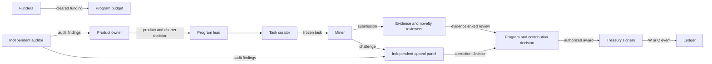

# Actors, roles and standing

The first pilot uses named human or organization Principals. A machine miner is associated with a recognized operator Principal, scoped Role Assignment and bounded Delegation where needed. Model/provider identity, tool versions and session provenance stay visible. No anonymous address, W balance or U balance is accepted as a governance appointment.

| Actor / role | Can do | Cannot do alone |
| --- | --- | --- |
| Product owner | Own product thesis, intended service, product claim and adoption decisions | Certify its own research result or bypass rights/treasury review |
| Program lead | Propose charter, select research priorities, authorize bounded tasks and work outcomes | Self-review a task it authored or move treasury funds |
| Task curator | Draft task offer, baseline, criteria, budget request and assignment packet | Settle their own W award or change a frozen task after commitments |
| Miner / contributor | Apply, commit, reveal, run, reproduce, submit a claim and appeal | Judge or pay their own work; obtain U by holding W |
| Evidence reviewer | Independently review work validity and decision resolution | Author the reviewed submission or approve its own review fee |
| Novelty reviewer | Compare exact object against dated local and external prior work | Declare global scientific priority or product readiness |
| Contribution adjudicator | Assess causal claimant shares for one canonical advance | Change a precommitted U milestone cap or issue U alone |
| Rights steward | Inspect licenses, IP, consent and data-use scope | Treat token ownership as data or IP permission |
| Treasury steward | Prepare budgets, reconcile receipts and propose payouts | Be the sole signer or audit their own statement |
| Treasury signer | Execute an authorized asset movement under a current signing policy | Select who deserves an award or change recipient/amount |
| Appeals adjudicator | Hear challenges with a fresh evidence cut and order a bounded remedy | Sit on the appeal of a decision they reviewed or approved |
| Governance steward | Maintain rule versions, decision rights, monitoring and scheduled reviews | Make retrospective policy changes or override owner rights alone |
| Security guardian | Propose a narrow emergency pause with incident evidence | Confiscate units, rewrite history or indefinitely extend a pause alone |
| Independent auditor | Verify source cuts, ledgers, allocations, revenue statements and control operation | Authorize payments or replace a Product owner decision |

Funders and customers are **stakeholders** with disclosure, contractual and challenge rights only as their agreements specify. A funder can propose or challenge a program condition; a customer can report a service or data issue. Neither obtains a governance vote by acquiring W, U or a possible funder instrument. The contracting entity is a separately identified organization Principal responsible for agreements and payments; its identity remains unassigned.

The candidate [role records](roles/) express functions and exclusions. `assignment_state=active` requires a separate admitted Role Assignment and identity evidence. There are **no such assignments** in this package. A role record by itself is never a credential.

## Separation map

The arrows show intended accountability, not automated authority. Every edge needs an exact record and policy version before operation.
