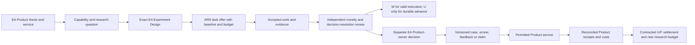

# Engineer Assessment as a whole candidate Product program

Date: 2026-10-30. Status: **candidate cross-Product model; authority effect none**. This maps the separate Engineer Assessment (EA) Product into the Agentic Research Network (ARN) without changing EA's source workspace or claiming a Product decision. The exact selected EA source cut is [pinned by file hash](source-manifest.json), because the EA workspace currently has no Git HEAD. The cut covers **88 selected source files**, not every file in that workspace. A changed source byte requires rebuilding and reviewing this crosswalk.

## Identity and scope

| Identity | Role in this model | State |
| --- | --- | --- |
| `EA-PRODUCT-001@0.1.0-candidate.2` | Continuing assessment/feedback Product | EA candidate identity; no validated hiring claim |
| `project:ea-research-001` | EA's research Project, six Goals, ten Inquiries and fifteen Experiment Designs | Candidate records, no accepted Lab runs/findings |
| `project:arn:research-network-001` | Generic research coordination, evidence, contribution and reward model | Separate candidate Network Project |
| `Product 001` | Scenario label for applying ARN rules to the EA Product | This source-pinned crosswalk, not a new Product identity |

The initial Product branch is an invited mixed-developer, three-session challenge with provisional evidence-linked feedback. Each session has a maximum ten-minute recorded answer. Session 1 concerns creativity, analysis and ingenuity through unusual problems; Session 2 concerns technical/product design; Session 3 concerns cooperation and communication. The first branch can study journey, case and feedback quality. Named-role measurement, prospective selection utility and employer service are **later conditional branches** under EA's [Product model](../../../../../../../engineer-assessment/model/PRODUCT-MODEL.md) and [roadmap](../../../../../../../engineer-assessment/model/ROADMAP.md). The [Product 001 term sheet](../PRODUCT-001-TERM-SHEET.md) records the Network's hypothetical funding and service boundary.

## Complete layer map

| Layer | Existing EA source | ARN model connection | Current ceiling |
| --- | --- | --- | --- |
| Product and claims | Candidate thesis, six Goals, seven Capabilities, claim ladder and `PS-01`–`PS-17` scorecard | One named Product and Product-specific Program, milestone and revenue scope | No observed capability or Product success value |
| Experience and service | Three-session journey, case bank, report/feedback and participant controls | Named deliverable service and future W/sponsor access catalog | Software design; one local synthetic Session 1 runtime only |
| Research portfolio | Ten Inquiries, fifteen Designs covering E01–E13, Product–research trace | Fifteen candidate miner task families, each tied to an exact EA Design | Designs and development diagnostics; no accepted ARN Run/Finding |
| Evidence path | Case/prior search, protocols, independent rating, uncertainty and owner decisions | `object → prior → review → design → run → evidence → finding → contribution → Product decision` | No U allocation from an observed durable advance |
| Operation | API/state, data and access models, L0 runtime | Event identities, source pins, signed receipts and later cash/asset ledger | L0 demonstrates one synthetic path, not the complete Product |
| Economics | EA `PS-14/15/17` definitions; ARN W/U/F/C candidate models | Task cost, Product service margin, sponsor terms, Product revenue and settlement | All Product sales, costs and benefit values in current Network scenarios are synthetic |
| Governance | EA draft roles/policies plus ARN actor and decision matrix | Separate Product adoption, research award and treasury decisions | No appointed EA/ARN Principals in this package |

The [crosswalk](crosswalk.json) carries the exact 6/7/10/15/27 EA Goal, Capability, Inquiry, Design and Role refs. It imports **124 candidate, unapplied relation proposals** as provenance. Every Design also has an ARN task-family ref and a separately labeled capability hint for Network planning. E09–E11 have no Goal/Inquiry/Capability relation proposals in that source manifest, and E12–E13 have no direct Capability proposal; the hints are author synthesis, not applied Lab edges. The [task catalog](task-catalog.json) preserves those gaps rather than filling them silently.

The proposed [qualified-introduction branch](LEAD-PLATFORM.md) adds an engineer-facing marketplace and buyer web/API/SDK distribution path. It treats the engineer as a Product participant who may receive a direct stablecoin-denominated **E** reward when a buyer-specific introduction is delivered and final. E is accounted for before Product U/F revenue sharing; taking the assessment alone never enrolls an engineer or grants a buyer access. This is a candidate later branch, separate from EA's first MVP and its current employer-use evidence gates. The [cohort probe](fixtures/lead-loop-results.json) makes the unsold-assessment cost visible.

The optional [W visibility service](VISIBILITY-REDEMPTION.md) lets an opted-in engineer use W for a clearly labeled promoted slot on relevant searches. It changes placement only, never the organic score, assessment claim or buyer's contact permission. W is transferable, so promotion is a purchase of visibility rather than proof that the engineer earned research credit. Its fulfillment cost comes from Product cash; W burn itself supplies no cash.

## Research to Product decision

These arrows are **proposed trace requirements**, not automatic authority. A valid experiment can receive a budgeted W award even if the result is null or negative. U requires a separately accepted durable advance: a controlled improvement or a decision-resolving negative result at a declared scope, with causal claimant shares and appeal. EA adoption is another decision. Sponsor F comes from cleared eligible funding under its own terms. Product receipts, not research activity or W trading, fund the U/F Product share. [VALUE-FLOW.md](VALUE-FLOW.md) specifies these different flows.

## Synthetic full-path probe

The [integrated scenario](integrated_scenario.py) uses **E03 scoring calibration** only as a constructed example. Period 1 freezes a scorer baseline and candidate repair on 20 authored synthetic answers, with a stipulated valid W task. Period 2 stipulates a controlled comparison, two independent synthetic reviewers and a separate Product-owner disposition; another valid W task receives a bounded award. A controlled improvement may adopt a scorer variant; a useful local negative result may retain the baseline and still resolve the predeclared question; an inconclusive result earns W for valid execution but no U. These verdicts are **scenario inputs**, not outcomes measured by this model. In periods 3–5, an explicitly assumed Product sale can produce D and U/F distributions, while two hypothetical W practice-service redemptions consume a reserved cash budget. No participant answer, live scorer, sponsor money or customer sale is involved.

| Constructed case | Research/Product decision | Cash and asset result |
| --- | --- | --- |
| Controlled scorer improvement; Product receipts `1,000 C` in each sale period | Adopt variant; `100 U` assumed for a separately accepted durable advance | Five periods complete; `200 W` awarded and later burned; U pays `198 C`, F `300 C`; end cash `1,802 C` |
| Decision-closing negative at the same local authored-fixture scope | Retain baseline; same **hypothetical** U milestone | Same cash arithmetic; negative result can have research value without Product variant adoption |
| Valid but inconclusive execution | Hold scorer change; no U | W can still reward execution; U pays zero; end cash `2,000 C` under assumed sales |
| Improvement but no Product receipts | Research award remains; no U/F payout | Three periods complete; period 4 spending is refused after cash headroom is exhausted |
| Product selling right unavailable | Forecast Product receipt is excluded | After two sponsor-funded periods, period 3 sale/settlement is refused |

Exact traces and policy values are in [integrated-results.json](fixtures/integrated-results.json). They use arbitrary C/W/U/F units. The positive cash result depends on assumed Product receipts and partial U issuance; it is neither a margin estimate nor evidence of a sustainable Product. The existing [multi-sponsor stress](../economics/MULTI-SPONSOR-RESULTS.md) separately tests holder-level F payouts and access reserves. The integrated scenario uses one aggregate sponsor F pool; it does not replace that holder-level test.

## What this candidate makes ready for a next cut

1. **Choose the first real EA research object:** one exact case, scorer, simulator or feedback uncertainty with a source-pinned baseline and a decision it could change. The synthetic E03 probe does not choose it for EA.
2. **Turn task families into offers:** select a permitted source/data class, exact deliverable, budget, reviewer seats and W acceptance criteria. Separate execution from durable-credit assessment.
3. **Calibrate value:** observe actual task/review/inference/service costs and a permitted customer or sponsor demand path; then replace scenario C units and Product receipt assumptions.
4. **Integrate the ledgers:** add holder-level U and F, longer terms, multiple Products, Product versions, W service capacity and intraperiod liabilities to one reconciled state model.
5. **Close source relations:** review EA E09–E13 relation gaps and any new Product/Network bridges on exact carrier versions before describing them as applied relations.

The package is a **whole candidate map**: it represents the Product's experience, research, operation, evidence, economics and governance layers together. It does not assert that those layers are implemented or empirically validated.
