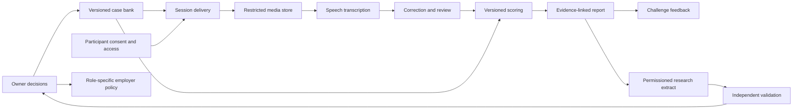

# Logical architecture and evidence boundaries

Status: design; no implementation or security qualification is claimed.

`Delivery` enforces three session attempts and ten minutes of answer per session under an explicit pause/retry/accommodation policy. It logs prompt/version, start/end, interruptions and participant-visible state. A rehearsal is distinguished from a scored administration. The client never receives the full bank or hidden rubric. The bank records generator, reviewer, release, exposure and retirement provenance.

Raw media and personally identifying contact data have separate access domains. Transcription emits time-aligned words, confidence/error markers and a version pin; participant correction creates a new transcript version while preserving the original under governed retention. Scoring inputs include exact case, response, transcript, rubric, model/prompt and reviewer versions. The score report includes criterion evidence spans, uncertain/unsupported ratings, human corrections and an appeal route. Deterministic replay reconstructs a past score under its pinned inputs; a new model produces a new scoring run, never overwrites history.

The public challenge projection omits selection ranking and research-only fields. The research extract is purpose-filtered and pseudonymized; it carries consent and withdrawal state. The employer integration is a later separate boundary with role-specific validation and decision rights. No general-purpose employer API should expose a score before that gate.

Minimum operational observability: administration completion and timeout, recording corruption, ASR word-error samples, consent version, item exposure, scoring disagreement, evidence citation failures, correction/appeal events, access/export/deletion receipts, subgroup performance where authorized, and model/case drift. Alerts pause affected score use. Logs contain references and minimal metadata, not unredacted answers by default.

Threats to design against include prompt leakage, memorized solutions, impersonation, collusion, synthetic video/voice, covert external help, adversarial transcripts, model prompt injection in answers, scoring-model drift, reviewer bias and reidentification. Controls should be proportional and accessible; cheating detection is an investigation signal, never an automatic rejection. Record what assistance is allowed, including assistive technology and normal engineering tools, before each session.
