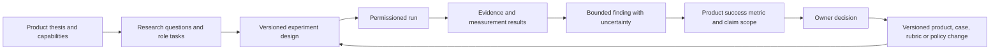

# Product ↔ research evidence trace

Status: **candidate connection map**, 2026-10-26. It links product value hypotheses, capabilities and claims to the studies that could test them, the measures those studies produce, and the decisions that may follow. It records no completed experiment, validated score, accepted Lab carrier or owner decision. The [product model](PRODUCT-MODEL.md), [experiment matrix](EXPERIMENTS.md), [product success scorecard](PRODUCT-SUCCESS-METRICS.md), [full protocol](../research/full-protocol.md) and [authority model](AUTHORITY.md) supply the detailed contracts.

The [Lab connection review](../integration/lab/PRODUCT-RESEARCH-CONNECTION-REVIEW.md) and [candidate preparation result](../integration/lab/PRODUCT-RESEARCH-CONNECTION-RESULT.md) translate this task-local trace into exact existing Lab endpoint/relation pairs and a prepared meaning Pack. The arrows below are conceptual until those exact carriers and typed relations are prepared and accepted.

## The connection

The arrows are **required trace links**, not automatic promotions. A design is not a run. A result is not a finding. A favorable finding is not authority to collect recordings, advertise predictive validity or provide an employer score. An owner decision names an exact product/role/use version, its evidence and expiry or refresh condition. A changed case, rubric, model, population or purpose starts a new versioned evidence path; older studies do not silently validate it.

## Capability and claim map

| Product promise / claim | Research question and experiment | Product measure and independent evidence | Finding needed and decision if it fails |
| --- | --- | --- | --- |
| `EA-CAP-01` Developers can complete three recorded cases within policy. Candidate value: brief, usable challenge. | E08 formative journey; E07 access; E02 ten-minute case trials. | `PS-01/02/03/06`; server session receipts, failures and participant burden, including starters who drop out. | P2: continue only if completion, burden and access are acceptable under predeclared criteria; otherwise repair journey, case burden or response mode. Supports at most a bounded C1 challenge claim. |
| `EA-CAP-02` Developers receive useful, evidence-linked feedback. | E03 rating/evidence calibration; E08 comprehension/actionability comparison; E07 mode error; E10 synthetic-answer scorer stress test. | `PS-04/05/07`, [FM-01–FM-06](../software/PARTICIPANT-METRICS.md); blind rating, transcript audit, human-only scorer holdout and fixed comprehension questions. | P2: revise anchors, transcript review or feedback wording if people misunderstand or cannot act on it. Synthetic-case gains alone do not advance C2 or predict work. |
| `EA-CAP-03` The bank supplies fresh, fair and role-relevant case versions. | E01 named-role job analysis; E02 generation, similarity, expert review and trials; E07 access. | `PS-08`, role-to-case [trace](../research/cases/role-business-trace.md), exposure ledger, alternative-valid solutions and case dispositions. | Hold/retire exposed or ambiguous cases; repeat E01 when role/business context changes. A released form is not yet an equated or predictive form. |
| `EA-CAP-04` A score can be reconstructed and the one-case design is precise enough for its intended use. | E03 scoring/ASR calibration; E04 case-rater-mode generalizability; E07 error audit; E09 known-assistance benchmark; E10 scorer stress test. | `PS-07/09/13`; cold replay, independent ratings, human false-positive and scorer-error intervals, variance components and D-study for one case/session. | Repair provenance or scoring if replay fails; narrow or stop score interpretation if one-case error is too large. E09 is research-only and grants no detector penalty. |
| Session 1 claim: unusual problems reveal useful creative engineering reasoning. | `EA-RQ-01`; E05A, with E01 task link, E02 form review, E04 stability and E10 unusual-valid-answer stress. | `PS-10` Session 1; blind, unseen creative engineering artifact, exposure and fluency rivals. | If transfer fails, keep it as an interesting case challenge or narrow the claim to situated reasoning; do not call it workplace creativity. |
| Session 2 claim: short verbal architecture case reveals technical/product design judgment. | `EA-RQ-07`; E05B, with E01/E02/E04. | `PS-10` Session 2; blind unseen design work sample and later design artifacts where opportunity exists. | If it predicts interview polish rather than independent design, revise the case/mode or remove its selection claim. |
| Session 3 claim: dilemma response reveals cooperation and communication judgment. | `EA-RQ-05/08`; E05C, with E01/E02/E04 and E11 social-script preparation experiment. | `PS-10` Session 3; observed pair/team coordination, script-priming and prompt-instruction comparisons. | If preparation raises scores without behavioral transfer, revise or narrow the rubric to stated knowledge; do not infer teamwork or personality. |
| `EA-CAP-05` and strong `3×10` thesis: identify later high performers for a **named role** at capacity `C`. | `EA-RQ-02/03`; E01 role/outcome map, E04/E05 prerequisites, E06 prospective comparison, E07 fairness. | `PS-09/10/11/12/13`; independent future outcomes, longer-pipeline `L` and equal-time `Q` at the same capacity, employer/time/case holdouts. | P4: accept, reject or narrow the C3 predictive claim from preregistered absolute/non-inferiority/superiority tests. Failure may produce a useful incremental aid, but that requires its own claim and analysis. |
| `EA-CAP-06` Participants can understand purpose, access the challenge and exercise data rights. | E07 access and error; E08 comprehension/burden; pilot rights exercises. | `PS-06/16`, notice comprehension, accommodation and rights receipts. | Stop collection on severe custody/access failure; repair mode, notice or rights path. Engagement cannot override this guardrail. |
| `EA-CAP-07` and employer value: a role-specific decision aid has acceptable outcomes and operating value. | E06 outcome study and E07 fairness precede E08 employer workflow/value study. | `PS-11–PS-17`; decision quality plus candidate/employer time, total cost, actual continued use and variable margin. | P5: product owner may choose challenge-only, decision aid, bounded hiring use or no product. C4 needs an exact employer/jurisdiction decision; C5 needs observed value. |

`EA-RQ-04` (ASR/video evidence loss) and `EA-RQ-06` (benefit versus burden/cost) cut across the map: E03/E07 feed `PS-07/13`, while E08 feeds `PS-03/04/05/14/15/17`. A failure on a cross-cutting guardrail can constrain every product promise that depends on it.

## Evidence and decision flow in this workspace

| Stage | Current artifact | Current state / missing link |
| --- | --- | --- |
| Product identity and thesis | [candidate Product identity](../product/product.json), [product model](PRODUCT-MODEL.md) | Candidate Lab-shaped thesis authored; product owner principal and accepted thesis absent. |
| Research inquiry and experiment design | [central Research Inquiry and E06 design](lab-records/README.md); [E01–E11 matrix](EXPERIMENTS.md); [E05 study register](../research/session-studies.json); [AI assistance protocol](../research/AI-ASSISTANCE-AND-SCORER-STRESS-TEST.md) | All thirteen designs and eight inquiries have candidate Lab-shaped records; no design is admitted or run. |
| Administration and source lineage | [MVP software model](../software/README.md), [question lifecycle](../software/QUESTION-LIFECYCLE.md) | Logical contracts only; no deployed app, participant, released case or recorded run. |
| Run, measurement result and finding | [run-package requirements](../research/full-protocol.md), [scoring model](../research/scoring-model.md) | No Experiment Run, Research Run, Measurement Result, Evidence Set or Finding instance. No `PS-*` outcome value exists. |
| Decision and product change | [authority gates](AUTHORITY.md), [roadmap](ROADMAP.md) | Roles proposed, principals unassigned. No owner Decision or validated Product Capability realization. |

The [Lab carrier audit](../integration/lab/CARRIER-CAPABILITY-AUDIT.md) describes which carriers exist only as candidate files. When an authorized run occurs, its protocol and exact product capability/metric IDs should be pinned before data collection; its result and finding should cite both supporting and contrary evidence; a subsequent owner decision should identify which capability, claim tier, case/rubric version or product posture changes. Negative and inconclusive results remain linked to the same product question.

## Decisions that must be registered before results

1. **Pilot (P2):** owner selects acceptable completion, burden, feedback-comprehension/actionability and guardrail thresholds, plus sample precision and pause conditions for `PS-01–PS-08/16`. This supports a challenge continuation decision, not a hiring decision.
2. **Named-role measurement (P3):** E01 selects actual role/tasks; measurement owner sets acceptable `PS-09/10` precision and E07 limits. Failure can reduce the session count, change the case family or narrow claims.
3. **Selection thesis (P4):** E06 freezes `Y`, horizon, capacity `C`, `L`, `Q`, absolute floor and margins, missing-outcome strategy and `PS-12/13` guardrails. No strong thesis finding from a convenience challenge cohort.
4. **Product posture (P5):** product owner examines E06/E08 evidence, time/cost and actual employer use, then records a separate bounded decision. Scientific support alone does not authorize employer use or an external claim.
