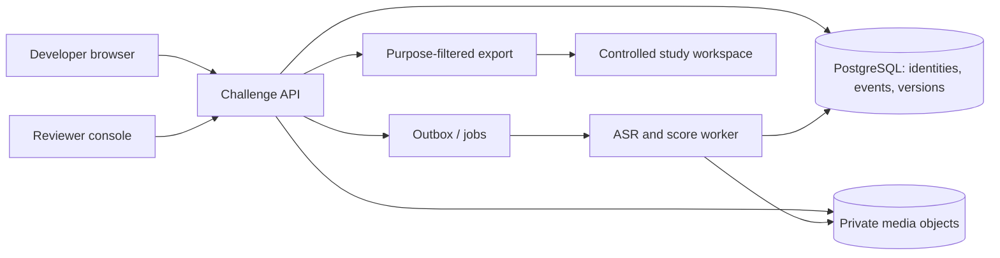

# MVP system architecture

Status: candidate build design. The smallest real-user deployment is a browser app, one modular application API, one relational database, one private media store and one background worker. The proposed stack is TypeScript/React, a TypeScript server, PostgreSQL and an S3-compatible private object store. The design does not depend on a specific cloud or AI vendor; region, subprocessors and retention must be approved before collection. Start as a modular monolith to keep identity, consent and session transitions transactional.

## Bounded modules

| Module | Responsibility | Hard boundary |
| --- | --- | --- |
| Identity and invitation | Private invite redemption, participant pseudonym, session tokens, contact vault. | Contact identifiers never enter scorer prompts or research exports. |
| Purpose and rights | Notice versions, choices, withdrawal, export/deletion jobs and exception record. | Research eligibility is evaluated at export **and** at downstream use, not inferred from challenge access. |
| Case bank | Candidate/released/retired immutable cases, family/mechanism lineage, rubric compatibility, exposure state. | Only released assigned prompt slices reach browsers; no hidden key/bank download. |
| Assignment | Freeze study arm, case version, order, mode and allowed help under one allocation manifest. | A later generator/model update cannot alter a started attempt. |
| Session delivery | Server-authoritative state/timer, reveals, pause/retry rules, media receipts and technical failures. | The browser clock is display only; server timestamps and signed events govern. |
| Media/transcription | Private upload, digest/duration checks, ASR job, raw and corrected transcript versions. | Raw video is segregated; scorer reads transcript and case evidence unless a separately approved direct-media study requires it. |
| Scoring/review | Versioned rubric, scorer configuration, evidence spans, double human rating and adjudication. | Automated ratings are provisional; no employment policy endpoint. |
| Feedback | Purpose-limited report with missingness/uncertainty and explanation. | A report cannot expose research-only fields or imply universal ranking. |
| Research operations | Cohort flow, audit event stream, allocation balance, controlled extract, outcome linkage. | Research extract excludes people or purposes without current eligibility. |

## Processing sequence and invariants

1. An invitation points to a **study protocol version**. The API records necessary challenge purpose and optional research/follow-up/subgroup choices before creating a scored attempt.
2. Assignment commits `{participant, protocol, case_version, rubric_version, response_mode, arm, order, allowed_help}` transactionally. A case version is immutable. A reassignment is a new attempt linked to a reason, never an in-place edit.
3. The client records one bounded video answer for each case. Upload uses short-lived grants, resumable chunks, checksum and private object key. A disconnected upload with intact finished bytes resumes under the same assignment; corrupt or lost bytes enter the [recovery protocol](RECOVERY-PROTOCOL.md), not a score. Server verifies media MIME, size and duration against the published policy. These checks bound the submitted clip but cannot prove when the participant formed the answer or that no external help was used; assistance rules and any verification study remain separate.
4. An outbox event schedules transcription. A worker writes a new ASR transcript with model/version and time alignment. Participant correction writes a successor version. Source and corrected text remain distinct under retention rules.
5. A pinned scorer extracts evidence and proposes ratings. Two blind human raters cover the calibration/pilot subset or all answers while the sample is small. Reports wait for the declared review policy. Each run stores source digests, scorer/prompt/rubric/case versions and errors.
6. The feedback report is a projection from immutable scoring records. A later correction or model change creates a successor run/report with a visible reason.
7. Research export resolves current purpose choices, withdrawal, retention and study eligibility at export time; manifests list versions and exclusions. Outcomes from independent tasks are linked through a protected study key, not the public report.

## Data stores and access

- PostgreSQL holds versioned structured records, event/outbox rows and pseudonymous study IDs. Encrypt in transit and at rest; maintain migrations and backups with retention rules.
- Private object storage holds video/audio only; no public URLs. Signed upload/download grants have narrow scope and short expiry. Object deletion and backup expiry are tracked by a rights job.
- Contact information and reidentification mapping are in a separate schema or service with narrower access than reviewer/research data. Optional subgroup responses have an even narrower purpose and access path.
- Logs contain IDs, event type, timing, digests and failure codes; avoid answer text, contact details, raw tokens and media URLs. Preserve an append-only audit trail of access, export, scorer version and rights actions.

## Security and reliability design

Server-side authorization checks participant ownership and purpose on every media, transcript, report and rights endpoint. Staff roles are `case_editor`, `case_reviewer`, `rater`, `adjudicator`, `researcher`, `privacy_operator` and `system_operator`; least-privilege rules are in [DATA-MODEL.md](DATA-MODEL.md). Separate environments and secrets. Do not send participant identifiers or unnecessary video to ASR/AI vendors. Treat response content as untrusted text: it can include prompt injection, so scorer instructions and output schema remain isolated and evidence-checked.

Use transactional outbox and idempotent jobs for uploads, ASR, scoring, export and deletion; retries must not produce duplicate ratings or reports. An unavailable AI service leaves the response pending human handling. An unavailable media store stops new recording before the participant begins. Exercise restoration of database plus media **together**, including tombstones, or replay and deletion lineage may disagree. No prototype result is advertised as security qualification.

## Lab boundary

Operational tables are product records. They do not become Lab artifacts merely because their names match Lab concepts. Export an exact, source-pinned [Experiment Run / Measurement Result / Evidence package](../integration/lab/CARRIER-CAPABILITY-AUDIT.md) only after its Lab carrier contract, owner and purpose are resolved. The Lab does not sit in the critical path of the participant recording journey.
