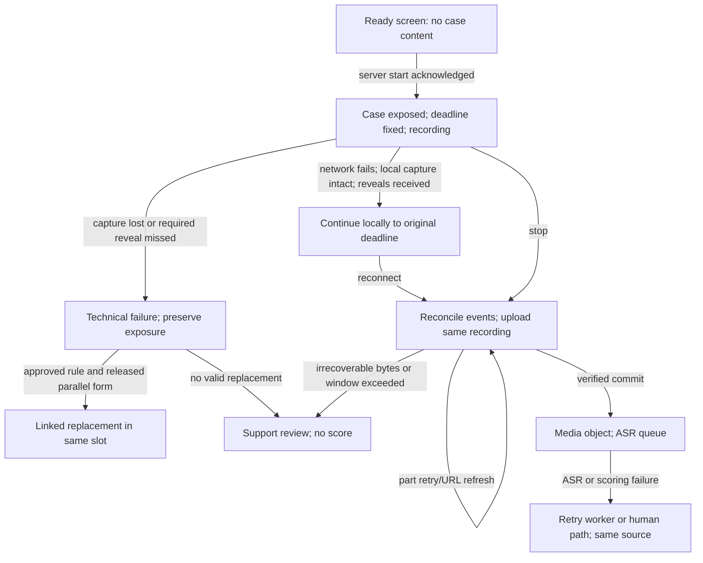

# Session failure and recovery protocol

Status: **candidate administration-policy extension** for the invited, mixed-developer pilot. The machine [rule index](../model/recovery/index.json) holds one source-bound candidate record per mapped failure. The [definitions](../model/definitions.json) for `ea.recovery-rule`, `ea.recovery-decision` and `ea.upload-attempt` are project-scoped and unadmitted. No live incident or participant decision is represented by the synthetic fixtures. This protocol is subject to study, assessment, privacy and engineering owner review before enrollment.

## Core decision

**A lost internet connection does not itself restart the case or create a new case.** The original Case Version, reveal schedule and server deadline remain pinned. The browser may continue recording locally while disconnected if the capture process is alive, storage is working and every required reveal has already arrived. Reconnection resumes transfer and event reconciliation under the same assignment. A missed required reveal, crashed capture or irrecoverable media makes that administration technically invalid; the slot may receive a linked replacement only under the approved retry rule and from a **previously released, comparable form**. The generator never supplies an immediate replacement.

**The case prompt must first become visible at `start`.** The earlier `shown` state is a ready screen with instructions, consent and device checks, not the substantive case. Otherwise the participant could inspect a case indefinitely before the clock starts. Once any scored prompt is exposed, a failed administration consumes an exposure record even if it yields no score.

## Time and recovery parameters to freeze in Administration Policy

| Parameter | Candidate pilot value | Meaning and evidence limit |
| --- | --- | --- |
| Recorded answer cap | 600 seconds per scored slot | Server `start` fixes a deadline; a local timer stops capture. Browser time is diagnostic and cannot prove capture time by itself. |
| `T_reconnect` | No extra answer time | Reconnection restores transport and state view, never adds minutes to the answer. |
| `T_upload` | 60 minutes after the original deadline, **candidate value to test** | A finished local recording may finish uploading during this window. Slow-network trials must determine whether this is usable. Expiry enters support/technical review, not an automatic zero. |
| Critical reveal grace | 0 seconds for primary comparable scoring | If a required timed reveal was not delivered on schedule, the administration is marked compromised. A separate research protocol may study late reveals; it cannot silently join the primary cohort. |
| Replacement allowance | At most one technical replacement per slot, **candidate value** | Requires a documented failure, no scored response for predecessor, available released compatible form, and the approved protocol. Same slot, linked assignment, preserved exposure. No fourth scored session. |
| Recovery lease | One active capture tab per assignment | A second tab can inspect status but cannot capture or complete a competing upload. Lease expiry requires reconciliation before any new capture. |

The upload window and replacement allowance are defaults for design and testing, not a live policy. The exact value, browser modes, case-form availability and treatment of timing uncertainty must be frozen before real use. “Wait until the connection is stable” is only an instruction when a server probe and an actual upload request succeed; `navigator.onLine` is a hint, not a reliable test. [MDN connectivity](https://developer.mozilla.org/en-US/docs/Web/API/Navigator/onLine)

## State and recovery flow

An interrupted **upload** is recoverable without a new response when the exact captured bytes remain available. An interrupted **recording** is not stitched from separate clips in the first pilot. Browser IndexedDB is a recovery aid with quotas and possible eviction; do not promise that a tab or device crash preserves an unfinished answer. [MDN storage](https://developer.mozilla.org/en-US/docs/Web/API/Storage_API/Storage_quotas_and_eviction_criteria). MediaRecorder timeslices can be delayed, so neither their count nor their intended interval establishes elapsed time. [MDN data events](https://developer.mozilla.org/en-US/docs/Web/API/MediaRecorder/dataavailable_event)

## Failure map and residues

The [20 rule records](../model/recovery/index.json) cover preflight connectivity and storage, offline capture and missed reveal, reconnection, upload interruption or corruption, tab/device failure, API/database/object-store failure, ASR/scoring failure, duplicate tabs, withdrawal and case exposure. Each rule states detection, surviving state/evidence, timer behavior, permitted disposition and user message. This map is intentionally revisable; unknown failures go to `human_review` with a safe hold and a new rule version after diagnosis. Shared vulnerability clusters are **client continuity**, **server/case timing**, **media custody**, **asynchronous processing**, and **purpose/assignment authority**.

| Failure boundary | What must survive | What may stop | Participant-facing outcome |
| --- | --- | --- | --- |
| Before start | Invitation, choices and prepared slot; no prompt exposure | New starts | Wait; retain slot and case allocation. |
| While recording, transport only | Case pin, original deadline, local bytes, event sequence | Live server updates | Continue locally only when no reveal is due; upload on reconnect. |
| While recording, capture/reveal integrity lost | Failure evidence, case exposure, slot identity | Scoring of that administration | Explain technical issue; authorized replacement or support review. |
| After recording, transfer fails | Finished bytes, part receipts, original deadline | ASR and scoring | Resume upload within policy window; no new case. |
| After media commit, worker fails | Verified object and source versions | Transcript/report | Pending status; idempotent retry or human path. |
| Rights or security failure | Audit and rights lineage | Collection, new assignments, downstream jobs | Clear hold/support route; no scoring or silent retry. |

## Recovery decision contract

Every significant failure creates a `session_event` with a failure class and observed evidence, followed by a separate [Recovery Decision candidate](../model/carriers/recovery-decision/v1/artifact.json) receipt. Offline client observations are queued locally and accepted as *reported observations* only after reconnect; their timestamps never become server facts. The evaluator pins the rule/policy version and checks **server state**, source bytes, reveal delivery, elapsed deadline, prior scored result, exposure and replacement inventory. Possible outcomes are `wait_same_assignment`, `resume_upload`, `continue_offline_capture`, `technical_void`, `replace_same_slot`, `human_review`, or `withdrawn`. A decision has an accountable system or human actor, reason, evidence refs, timing assurance, analysis posture and an idempotency key. Re-evaluation creates a successor receipt; it does not erase the first.

Only a verified media commit can progress to ASR. `NA/UNK` or no report is used when evidence was not fairly elicited or is unusable under the scoring specification; a failure cannot be converted into a score of zero. Research exports include failure and retry denominators, source-assignment lineage and timing uncertainty. The primary comparable cohort excludes compromised reveal/capture runs; replacement administrations and client-only timing stay in a separate sensitivity stratum until their comparability is tested and registered.

## API and custody changes

- `GET /v1/sessions/{id}/recovery` returns server state, original deadline, delivered reveal cursor, active upload attempt/parts, upload-window expiry, allowed actions and message code. It never returns hidden future case content.
- `POST /v1/sessions/{id}/reconcile` submits the client event cursor, capture lease, local media digest/size and observed failure code. The API returns one idempotent Recovery Decision, never a new assignment merely because a client says it was offline.
- `POST /v1/sessions/{id}/replacement-request` creates a support/research review request. The server issues a successor assignment only after policy, exposure, form compatibility, slot and replacement-count checks; the predecessor is voided with reason.
- Multipart upload part receipts and `upload_attempt` survive reconnect. The API lists authoritative parts, issues fresh short-lived URLs and completes once. Orphans are aborted under lifecycle policy. [S3 multipart](https://docs.aws.amazon.com/AmazonS3/latest/userguide/mpuoverview.html)
- On startup after a crash, the browser shows **Recover saved upload** only if finished local bytes can be opened and matched to the server assignment/digest; otherwise it shows technical review. Do not automatically start a recorder or display a replacement case.

## Verification before pilot

Use a fake server clock and synthetic media to test every rule ID, especially at `deadline − 1s`, deadline and upload-window expiry. Cut connectivity to API and object store independently; close/reopen tabs during capture and after stop; revoke camera/mic; exhaust IndexedDB; expire part URLs; duplicate/reorder commits; lose a reveal; retry ASR; process a withdrawal mid-upload; restore DB and storage with an orphan and a tombstone. Assert one scored slot, immutable case pins, no extra answer time, exact source-byte lineage, no zero for failure, and no replacement without a released compatible form. Measure technical-failure rate by device, network and response mode so recovery design itself can be evaluated for unequal impact.
