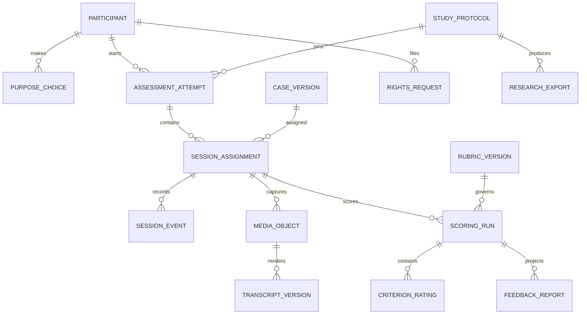

# MVP data model and provenance

Status: candidate logical schema. This is the contract to implement in PostgreSQL migrations and object-storage metadata; it is not a live database. IDs are opaque UUIDs or equivalent. Every mutable configuration has an immutable version ID and content digest. Every stored record carries creation time, source/actor and purpose scope. Deleting eligible personal data removes content while retaining only the minimal, approved audit receipt.

## Identity, purpose and study tables

| Record | Minimum fields and constraints |
| --- | --- |
| `participant` | `participant_id`, adult-eligibility assertion under selected protocol, created/status. No name or email in this table. |
| `identity_vault` | `participant_id`, encrypted contact/login and reidentification key; restricted staff access; separately backed up and deleted. |
| `notice_version` | immutable text hash, locale, purposes, controller/contact, vendors/retention references, effective period. |
| `purpose_choice` | `participant_id`, purpose enum, choice, legal-basis decision ref, notice version, timestamp, actor/source, withdrawal/supersession. Challenge processing and optional research/follow-up/subgroup uses are separate rows. An application toggle does not determine the lawful basis by itself. |
| `study_protocol` | protocol ID/version/hash, declared target population and optional role/level, inclusion rules, arms, case/rubric/scorer pins, analysis and retention refs, approved status/owner decision refs. The first pilot declares mixed developers and role/experience/stack strata; E05/E06 validation requires a named role/level. Draft protocols cannot accept live assignments. |
| `cohort_membership` | participant, protocol, recruitment source, eligibility/recruitment timestamps and status; no outcome-dependent reassignment. |
| `assignment_manifest` | protocol version, randomization algorithm/seed custody, strata, available case IDs, allocation ratio, generated hash and freeze timestamp. |
| `assessment_attempt` | participant, protocol, invitation, attempt number, purpose snapshot, start/finish state. Exactly up to three scored session slots; practice is separate. |

## Case, response and scoring tables

| Record | Minimum fields and constraints |
| --- | --- |
| `case_family` / `case_version` | family/mechanism IDs; immutable prompt/reveal schedule; construct/role tags; approved mode; release/holdout/retired state; content hash; reviewer and exposure refs. Only `released` versions may be newly assigned. |
| `rubric_version` | applicable case versions, dimension/anchor set, valid alternatives, `NA/UNK` rules, expert approval, hash and status. |
| `session_assignment` | one attempt/slot, case and rubric versions, response mode, experimental arm/order, allowed-help policy, server timing policy and assignment timestamp; unique active slot per attempt. |
| `session_event` | append-only ordered event ID, assignment, type (`shown`, `started`, `reveal`, `paused`, `resumed`, `stopped`, `upload_received`, `failure`, `retry`), server time, monotonic sequence and minimal payload. Browser time is diagnostic only. |
| `media_object` | assignment, object key, hash, MIME, verified duration/size, upload state, encryption/retention class, deletion state. Object key is never an unrestricted URL. Multiple chunks resolve to one committed media version. |
| `transcript_version` | assignment/source media hash, ASR engine/version, text/time alignment and uncertainty markers, candidate correction reference, status and digest. A correction creates a successor; original text is preserved only for its approved retention period. |
| `scoring_run` | assignment, exact media/transcript/case/rubric/scorer/prompt versions, status, model output and error ref, human review policy, run hash. Unique idempotency key for exact input tuple; a new input/version creates a new run. |
| `criterion_rating` | run, dimension, rater/scorer identity, anchor `0–4/NA/UNK`, evidence span IDs, uncertainty and independent/adjudicated status. Preserve both original human ratings. |
| `feedback_report` | participant/run/report version, purpose (`challenge_feedback`), delivery status, criterion explanations, missingness, caveat and correction route. No employer ranking field or hiring action in MVP schema. |

## Research, rights and operations tables

| Record | Minimum fields and constraints |
| --- | --- |
| `criterion_observation` | independent task/team exercise ID, blind rater, outcome dimensions, context/partner/opportunity, source digest and protocol version. Separate from challenge scoring records. |
| `research_export` | protocol and query/filter version, current purpose/withdrawal snapshot, pseudonymized file hash, fields included, exclusions, recipient/expiry and revocation state. No media or contact by default. |
| `rights_request` | participant, request kind, received/verified/completed timestamps, affected object IDs, exceptions and response receipt. Deletion job traverses media, transcripts, ratings, reports, extracts and backups under the approved schedule. |
| `retention_schedule` | versioned classes for media, transcript, score, research extract, contact and audit; owner/legal decision, trigger, expiry and exception rule. No default duration is invented by software. |
| `audit_event` / `outbox_job` | staff/resource/action/purpose/time/result and idempotent work intent. Audit metadata excludes answer text and secrets. |

## Lifecycle rules

`draft case → reviewed → released → retired` is monotonic for one case version; revision creates a new version. `assessment_attempt: invited → consented → in_progress → completed | withdrawn | technical_failure`. Each `session_assignment: assigned → shown → recording → uploaded → transcript_ready → scored → feedback_ready`, with explicit `technical_failure`, `withdrawn` and `voided` terminals. A retry is a linked successor assignment, never a mutation of an administered case. `scoring_run: queued → extracted → awaiting_human → adjudicated → reportable | failed`; a direct human-only path skips `extracted`. The [API contract](API-STATE-CONTRACT.md) specifies allowed transitions.

## Integrity and access invariants

1. No assigned case, rubric, protocol, scorer or purpose snapshot changes in place after `shown`; updates create new versioned records.
2. One scored session has one Case Version; no more than three scored slots and ten minutes of recorded answer per slot under the pinned policy. Retried uploads do not create extra scored slots.
3. `NA` means a criterion was not fairly elicited; `UNK` means evidence is unusable; neither becomes a zero rating.
4. Scorer inputs exclude contact and subgroup attributes. Human raters receive pseudonyms and are blinded to other-session scores and outcomes.
5. A research export checks purpose, withdrawal, protocol and field allowlist at creation and at access. An earlier export never silently remains valid after an applicable withdrawal.
6. Original media, transcript versions, scoring runs and reports have distinct IDs. A correction or rescore has a lineage link, not an overwrite.
7. A score report has no authority effect. No employer API or selection action exists in the MVP data model.

## MVP access matrix

| Actor | Allowed data/action | Denied by default |
| --- | --- | --- |
| Participant | Own invitation, assigned visible case, media/transcript, report, purpose choices and rights requests. | Other participants, hidden bank/key, study allocation details and staff ratings before release. |
| Case editor / reviewer | Draft or review case/rubric versions, exposure and release decision. | Participant identity, contact and response media unless separately assigned to a study role. |
| Rater | Assigned pseudonymous answer, visible case/rubric and evidence-span/rating write. | Contact, subgroup attributes, other raters' unsubmitted judgments, other sessions and outcomes. |
| Adjudicator | Submitted rating pairs and pseudonymous source needed to resolve discrepancies. | Contact vault and optional subgroup data. |
| Researcher | Approved pseudonymous extract, assignment/quality metrics and independent criteria. | Contact key, unapproved media and withdrawal-excluded rows. |
| Privacy operator | Purpose/rights/retention records and minimum identity data to fulfill requests. | Editing ratings, case keys or research outcomes. |
| System operator / worker | Narrow operational metadata or short-lived job-scoped media/transcript access. | Bulk answer export or permanent human access by infrastructure role alone. |

Every cross-boundary access requires a named purpose, least-privilege grant and audit event. A person can hold multiple roles only through a recorded assignment; role names in request bodies confer nothing.

Implement row-level authorization and test each invariant with generated synthetic records before real participant data. A relational schema pass alone does not prove privacy, deletion or research validity.
