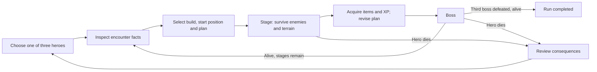

# Proposed game design: one hero, three stages, two ways to execute a strategy

Date: 11 October 2026. Status: design candidate after bounded critique; no implementation, balance simulation or playtest. The numerical ceilings below are starting hypotheses.

## 1. Identity and complete loop

The player chooses **one hero from a roster of three**, places that hero in a disclosed starting zone, builds a strategy and tries to survive **three stages, each with a boss**. The same hero and acquired build continue through the run. Death ends the run; defeating the third boss while alive completes it.

Proposed viewpoint: top-down arenas with continuous movement. Use a compact expedition for the first prototype. Run duration, difficulty and exact timings remain tunable. Initial persistence unlocks information and authored-plan templates rather than assuming permanent stat growth.

Before a stage, show its hazard families, enemy routing capabilities, boss objective categories and a limited intelligence card. Exact random locations remain uncertain. The player may adjust available skills/items and waypoints before commitment. No later enemy secretly gains an immunity simply because the player chose a strong build.

## 2. Three characters with different costs

Names are working names, not final lore.

| Hero | Strength and initial vocabulary | Weakness that the strategy must address | Two skill directions |
|---|---|---|---|
| **Bastion** | Guard, direct-contact retaliation, damage reduction, short knockback. Holds a profitable melee window. | Limited range and mobility; guard drains stamina; poison and terrain damage do not finance retaliation. | **Endure:** reserve/sustain a contact window. **Release:** spend stored retaliation in a timed burst. |
| **Mason** | Temporary walls, poison crossings, slowing fields and a directed shove. Creates a funnel and a second route. | Fragile; finite wall count/lifetime; placement has recovery; own maze can block escape. | **Route:** change gate/corridor timing. **Collapse:** sacrifice a wall for a bounded effect. |
| **Veil** | Mobile magic, delayed poison mark, quick reposition and a visible echo anchor. Reaches exposed targets. | Low health; casting commits movement/resources; repeated escape routes invite a declared counter. | **Corrode:** sustain poison while moving. **Displace:** alter anchor/escape timing for magic windows. |

Basic survival commands exist for all three; affinity changes the affordable tradeoff. An item can supply a weaker version of another vocabulary, so a hero choice need not ban every other build family. Choosing Mason's barriers does not give Bastion's durability for free.

Start the first slice with one branch choice at each planned XP milestone. Branches have explicit opportunity costs and limited slots; the first prototype does not need an enormous permanent tree.

## 3. Manual execution and authored autoplay

Both controllers use the same world state, action rules, costs, collision, cooldowns, recovery, status effects and visible attack facts. Equal world rules do not imply equal success rates.

| Layer | Manual mode | Autoplay |
|---|---|---|
| Build and position | Player chooses them. | Player chooses them. |
| Movement | Direct input; may execute an authored route command. | Named route segments, explicit alternate segment or stop condition. |
| Attacks/skills | Timing, facing, aim, guard/dodge and recovery matter. | Ordered predicates choose the same legal commands. |
| Deliberate risk | Player decides when to take contact or sacrifice a wall. | Player authors a condition and resource reserve for accepting that risk. |
| Recovery | Player adapts locally. | An explicit recovery rule/fallback must exist. |
| Mid-stage acquisition | Player picks from a paused offer. | Player may pick, or an authored ranked choice/fallback picks. |
| Information | Public geometry, resources, warnings and observed enemies. | Same public observation classes; no future seeds or hidden opponent state. |
| Evaluation | Record manual execution and plan choices. | Record policy decisions and triggered rules. |

The first slice chooses a mode at run start and permits handover only at paused acquisition or stage transitions. Handover retains resources, pending effects and recovery; it grants no cooldown reset, extra life or invulnerability. Record hybrid runs separately from full-auto and manual runs.

Manual play should reward reading windups, stamina management, spacing, commitment, dodge direction and exploiting the build's window. A strong build does not remove every execution decision. Autoplay's skill is expressible preparation, including a deliberate risk and recovery; a hidden optimizer that rewrites the plan would undermine that purpose.

### Policy editor

Proposed limit: six ordered tactical rules, each with a small set of named predicates, an action template and an explicit fallback. A composed condition may contain a resource threshold plus a warning or target condition. Show which rule is active and which responsibility an edit replaces.

A terrain exclusion means choosing an **authored alternate segment**, stopping, or using a declared local avoidance command. It does not authorize an invisible new global route. Normal path following cannot dodge, heal, pick upgrades or reinterpret the strategy without a rule.

Example Bastion plan, in player-facing terms:

1. On a lethal warning, take the marked escape segment.
2. Below the stamina reserve, leave contact along the recovery segment.
3. During a safe melee window, guard and hold the contact position.
4. When the ranged boss's approach window opens, spend stored retaliation and close distance.
5. If poison exceeds the declared reserve, use the antidote.
6. Otherwise follow the hazard-safe perimeter route; target the nearest reachable opponent.

Example Mason plan: retreat through the second exit before a sweep; place a barrier only when its reserved exit stays open; poison the chosen crossing; shove during a funnel window; sacrifice a charged wall before an announced breaking charge; otherwise follow the inspected route.

These are candidate plans, not successful tested policies. A competent generic baseline—avoid warned terrain, preserve resource reserves, attack an exposed target—must be included in comparisons.

### Input and action disposition

Responsiveness is a separate tuning problem from world-rule parity. Simulation step, observation cadence, input buffering and cancel windows must be measured in a prototype. Earlier rounds considered 50/100 ms placeholders; those are not production timing requirements.

Each channel has one pending request. New movement or discrete-action requests replace the pending request in that channel; it expires after the next admission attempt. An illegal or recovery-incompatible action is rejected visibly, without a backlog waiting to fire later. An admitted action finishes unless a declared cancel window permits interruption. A selected movement segment continues until completion, stop or replacement.

Autoplay reevaluates at declared observation boundaries and rechecks a pending rule before admission; a false predicate cancels that request. A false continuation emits stop at the next admission. Manual stop/release uses the same action channel; held guard renews its request. Both command sources must issue a fresh request after rejection. Timing values remain tunable; these state rules do not establish input feel.

## 4. Items, XP and effects

Acquisition occurs **during each stage**, not only after a boss: survive a disclosed cache encounter, collect its reward, then pause to choose one of up to three offers. In full autoplay, an authored item/skill ranking and a deterministic fallback can resolve the offer. Offers and enemy budgets are bounded; missing a particular drop must not secretly make the stage unwinnable.

First six item modifiers:

| Item | Gain | Cost / reason not to select it automatically |
|---|---|---|
| Hazard Boots | Better movement recovery on affected terrain. | Equipment slot replaces an offensive item; no immunity to every lethal zone. |
| Contact Mirror | Converts qualifying hostile direct HP loss into capped retaliation. | Requires exposure; no resource from poison, terrain, self-damage or recursive reflection. |
| Wall Spool | Extra wall duration or one reserved segment. | Longer geometry can trap the hero and consumes capacity. |
| Antidote Kit | Limited cleanse/poison protection. | Finite charges; replaces burst power or another utility item. |
| Magic Prism | Changes a magic attack's channel or trajectory. | Cast/recovery or resource cost; poor positioning still misses. |
| Study Seal | XP multiplier from finite eligible encounters. | Reduces immediate offensive budget; greater later growth is contingent on surviving. |

XP comes once from eligible encounter/reward records. No repeated spawn, reflected self-damage, shield cycling or infinite wall collision can farm it. Stage encounter budgets bound total available XP. Show the next skill threshold so players can plan a growth route.

### Effect rules

- **Reduction:** ordered mitigation by damage type; temporary shields absorb after mitigation. A starting reduction ceiling is tunable rather than evidence of balance.
- **Magic:** a distinct damage channel with explicit resistance; terrain and enemy hit attribution remain visible.
- **Poison:** stacks or refreshes according to the named skill, with a finite cap and clear tick timing. It is damage over time, not a direct hit for retaliation.
- **Slow:** bounded movement impairment; it cannot silently reduce movement to zero indefinitely.
- **Knockback:** displacement determined by direction, resistance and collisions. Boss resistance changes magnitude, rather than requiring universal immunity.
- **Reflection:** only specifically credited hostile hits generate a capped response. Bastion's guard skill credits a blocked portion at an explicit stamina cost; Contact Mirror credits qualifying actual HP loss. Keep those accounts separate and bounded. Secondary reflected damage never reflects again. Environmental kills do not create retaliation income.
- **Walls:** finite count, life and placement recovery; path updates have deterministic tie-breaking. Placement previews both enemy routing and the hero's exit.
- **Invulnerability:** affects accepted-hit events consistently. A weapon graphic overlapping an invulnerable dodge is not automatically a successful touch.
- **Lethality:** a lethal terrain event bypasses ordinary attrition only under its disclosed rule. It cannot be funded as a reflect resource.

Each effect needs a definition and event order before combinatorial balance claims. Avoid multiplying many hidden percentages: useful strategy should emerge from interacting states and costs.

## 5. Three stages, each ending with a boss

These fixtures illustrate the proposed progression. Difficulty and timings remain untested.

| Stage / boss | Prior assumption pressured | Warning and counter | Remaining build opportunities |
|---|---|---|---|
| **Foundry — the Bellows Keeper** | Every hit is equally bad; every open route is equally safe. | Guardable melee, a heavy windup and a warned floor sweep. | Bastion guards selected contact; Mason funnels walkers while preserving an exit; Veil uses mobile magic/poison windows. |
| **Marsh — the Dredger** | Reduction/reflect solves every damage source; every enemy follows a long wall path. | Poison pools, ranged lanes and an announced wall-breaking charge; a flanking enemy approaches visibly. | Bastion buys cleanse/approach and retains direct-contact windows; Mason sacrifices one wall and keeps a second route; Veil changes line of attack and timing. |
| **Court — the Examiner** | Repeating the same successful reaction defeats every objective. | A pursuit/leap cycle, sweep and public touch/wound/arrival commitments. | Guarding, dodging, body interception and geometry have different costs; each hero retains ordinary damage and escape windows. |

Each boss must have more than one viable approach in the future prototype. Do not make all three hero families depend on one mandatory item. Boss progress and adds are bounded; a maze cannot permanently imprison the encounter while granting unlimited XP.

### Counter the assumption, then permit adaptation

For retaliation, ranged pressure and poison reduce the supply of qualifying contact. Preserve some melee phases, announce the shift and offer a meaningful choice between approach, cleanse, hybrid damage or delaying a release. A blanket reflect immunity supplies little constructive material.

For a maze, disclose flyers, wall breaking or a short tunnel. Preserve routes for ordinary enemies and telegraph the bypass. A player can reserve a second exit, poison the landing, sacrifice a wall or time a shove. A counter is not fair merely because it has an animation: under its declared conditions, at least one affordable response must exist, or taking the commitment must be an explicit voluntary risk.

For repeated movement, a future visible finite-memory enemy can cover a learned route. Show what it remembers and how the player can change it. Hidden perfect adaptation is outside the first slice.

## 6. Random map events and instant kills

Randomness chooses from disclosed hazard families and eligible locations. Every lethal event has a clear zone, warning interval and committed activation rule. Before issuing it, the world must have a temporally reachable escape accounting for current recovery, command latency, known compulsory displacement and existing walls.

Later voluntary casts, wall placements or bad route choices can lose that escape. Attribute the defeat to the later action. A newly scheduled compulsory event cannot secretly remove the only route before activation; delay or relocate that event. Do not cancel every dangerous situation merely because the player made a mistake.

Finite hazard budgets and independent encounter/item/hazard random streams support comparison and explanation. Identical starting seeds do not ensure identical trajectories after different actions; log enough event provenance to distinguish those cases.

An example legitimate tradeoff: the perimeter avoids terrain warnings but crosses a crowded melee region. Bastion's retaliation can profit from that exposure until stamina drains; Veil may prefer a riskier terrain crossing during a damage window. “Avoid all map effects” is a strategy hypothesis that can cost contact risk, distance and lost acquisition opportunities.

## 7. One unusual core: bind the enemy's stated objective

The first slice adds one finite commitment mechanic, rather than requiring every rhetorical idea at once.

A highlighted boss attack announces a target, deadline and measurable objective. **Touch** means an accepted hostile hit event; **wound** means direct HP loss from that attack within its disclosed resolution window; **arrival** means the enemy reaches a marked seal before deadline. Delayed poison remains dangerous but cannot retroactively change a closed direct-wound verdict.

Binding spends a catalyst before lock and empowers the attack. A capped payoff is earned if its objective fails and the hero survives resolution. Proposed starting economy: capacity two; start with two; one refill cache per stage, capped at two; one stored payoff. Starting empowerment of 25% is a balance hypothesis. Adds are still dangerous but do not create competing bindable commitments.

| Situation | Touch objective | Wound objective | Decision tension |
|---|---|---|---|
| Fully guard the admitted hit | Touch succeeds: no failure payoff. | Direct wound fails if HP stays intact. | Guard preserves position but spends stamina; dodge can lose a useful contact window. |
| Dodge through the strike without an accepted hit | Touch fails. | Wound fails. | Dodge spends its resource and changes position; it is not always the cheapest response. |
| Stop a charge before a seal using a body interception | Contact can occur. | Direct HP loss can occur. | Arrival fails, but the hero may pay health to preserve a timed route. |
| Break a wall and enter the seal before deadline | Depends on contact. | Depends on HP loss. | Arrival succeeds; a wall collision alone is not a defeated arrival promise. |

Bind only an eligible highlighted token. A token is bound to one attack instance, resolves once and has explicit cancellation/death rules. Payoffs never retroactively prevent damage, restore a dead hero or recursively generate another payoff. Storage cannot silently overwrite a previous reward.

| Transition | Required outcome |
|---|---|
| Issued → bound | A valid bind spends one catalyst before lock; occupied payoff storage rejects binding before cost. |
| Bound → locked | Freeze attack ID, goal, target and payoff ceiling. |
| Pre-lock player interruption | Cancel without payoff; the spent catalyst stays spent. |
| Issuer invalidation | Cancel without payoff and refund a spent catalyst, capped at capacity; report a contract fault. |
| Locked completion, deadline or player interruption | Evaluate the recorded objective once; failure can pay if the hero survives the full resolution. |
| Hero death | Close without payoff or refund. |

Resolve physical hits, prevention, guard break and displacement; apply same-boundary hazards/status; evaluate the token; then create the new payoff. Touch records accepted blocked contact; direct wound excludes poison ticks. Arrival records the enemy center entering the seal before deadline. Later damage or death of the enemy does not reverse a recorded entry. A shield/retaliation payoff must exhaust, expire or be spent before another binding.

The complete state and command tables in [PROPOSER-R3.md](/home/vlad_/projects/CyberAlchemy-lab/docs/proposals/hammer-bias-strategies/novelty/rhetoric-game-design/2026-10-11/design-trace/PROPOSER-R3.md) accompany this contract. If a matched goal-independent effect produces identical decisions, the novelty finding should be equivalence. The rhetorical identity may still be attractive, but that is a separate presentation question.

## 8. Singing and the broader portfolio

Preserve the user's singing example as a second input slice: calibrated relative pitch and rhythm conformity can raise a bounded magic burst. High conformity may also increase listener detection; silence suppresses detection while charge decays. An intentionally shown alternate pitch band can create a decoy instead of the burst.

That preserves a strategic reason to perform, detune or stop. “Beautiful singing” is not an implementable score specification. No increased damage from microphone volume, no assumed universal vocal range, and no mandatory live voice input. Equivalent timing/phrase controls expose the same game effects.

Full autoplay authors phrase selection, timing, interruptions and reserves under the same action costs. It need not pretend to have a human's inaccurate singing. Voice reliability, latency, fatigue, alternative-input comparability and musical expression need separate tests. No microphone was used here.

The [twenty-four-mechanic portfolio](/home/vlad_/projects/CyberAlchemy-lab/docs/proposals/hammer-bias-strategies/novelty/rhetoric-game-design/2026-10-11/WILD-MECHANICS.md) includes empowering a charge sarcastically, healing a boss to overgrow its armor, making a monster draw a spell, converting wall destruction to energy, teaching and betraying an exit pattern, and turning hostile knockback into an escape.

## 9. Smallest coherent starting slice

Select one complete expedition: three hero choices with one deployed; three stages and bosses; manual and full-auto commands; six item modifiers; bounded XP branch choices; reflect/maze/mobile-magic plans; warned hazards; and one goal-dependent commitment operation.

This is the smallest **selected unit that preserves this user's run context**, not a proof that every game needs three bosses to demonstrate adaptation. A one-boss sandbox can validate timing and effects; it does not complete this requested expedition design.

Named responsibilities:

| Unit | Inputs → outputs | Why it belongs |
|---|---|---|
| Run/progression | Hero, offers, XP and stage outcome → build and next stage or terminal result. | Carries choices and weaknesses across three stages. |
| World/action resolution | Geometry, status, commands and warnings → physical events and resource changes. | Gives both command sources the same causal contract. |
| Behavior authoring/execution | Public observations, ordered rules and routes → admitted commands and an explanation. | Makes creative planning inspectable. |
| Encounter/commitment | Disclosed pattern, eligible warning and attack instance → token, physical attack and one verdict. | Supplies contextual pressure and the unusual operation. |
| Feedback/review | Event and decision records → visible failure/success explanation. | Enables informed revision and future investigation. |

These units recompose through explicit observations, commands and events. A hidden “strategy manager” that chooses missing plans would violate the authoring responsibility. Audio later supplies a bounded action input; it must not replace world resolution or invent unobserved enemy state.

Defer a large campaign, multiplayer, unrestricted programming, free-text spell interpretation, permanent stat economy, procedural material simulation and the whole audio portfolio. Their return requires a concrete pressure or a successful probe, not merely a desire for more features.

## 10. Validation plan and material risks

No checks below have been run as gameplay tests.

Start with command/token lifecycle fixtures, event-source attribution and reachable-hazard cases. Build the complete slice, then observe policy expression, manual responsiveness, explanation accuracy, viable alternative builds and enjoyment. Compare authored plans with a competent generic policy; compare commitment with equivalent ordinary effects. Use unseen stages/seeds and delayed unaided construction only if claiming retained creative learning.

Premortem: six months later, players have a long editor session and an ordinary survival game underneath. The main risk is not too few effects; it is insufficient player agency per rule. Guardrails are a six-rule limit, visible consequences, a competent baseline, one commitment at a time and retention of distinct player-authored alternatives. A second risk is that deliberate exposure dominates; costs, finite rewards and multi-source counterpressure must be tuned from evidence.

Readiness is **flag for gameplay knowledge**: implementation, feel, balance, strategic advantage and originality are open. The next route is a scoped prototype project and focused tests. The frame expires if the editor cannot express risk plus recovery, manual control feels delayed, the commitment rule is equivalent, or the deployment/run requirement changes.
