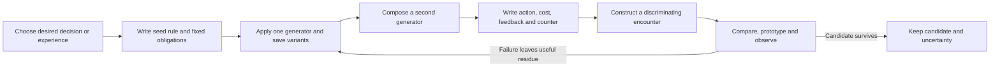

# Sixteen strategies for generating game mechanics

**Date:** 11 October 2026. **Catalog:** MG01–MG16.  
**Purpose:** Generate candidate game mechanics, including wild ideas, through explicit transformations of rules and desired experiences.  
**Status:** Prepared methods with authored examples. Their comparative efficacy, balance and worldwide originality have not been tested.  
**Worked outputs:** [Four composed candidates and their construction steps](/home/vlad_/projects/CyberAlchemy-lab/docs/proposals/hammer-bias-strategies/novelty/rhetoric-game-design/2026-10-11/MECHANIC-GENERATION-EXAMPLES.md).

## 1. The output we want

The game research has two creative targets: inventing rules for players to explore, and creating conditions in which players can construct strategies. This catalog addresses the first. An MG strategy is a method for producing mechanics; an MC/WM candidate is a proposed mechanic produced or illustrated by that method. Their counts should remain separate.

For a candidate, write a small rule contract:

> Under **condition C**, actor **A** can perform **action V** on **target T**, changing **state S** by **effect E**, while paying **cost K**. The player sees **feedback F**, chooses between **alternatives X/Y**, and encounters **counter Z**.

This is our authoring template, not a formal implementation or a sufficient definition of fun. A new name is a presentation change until its rule or experienced purpose is specified. An ordinary effect combination can still produce a valuable new interaction; finding overlap is a reason to refine the claim rather than abandon every candidate.

The methods can be applied to other games. For the user's game, preserve one character chosen from three, three boss stages, mid-stage acquisitions, manual execution and authored autoplay. An idea that needs simultaneous party control or changes the run structure belongs in a separately labeled alternative concept.

## 2. Research grounding

Mechanic generation has existing research precedents. *Mechanic Miner* searches a restricted space of two-state platform-game mechanics and uses simulation to evaluate usefulness and generate associated levels. Its small pilot also illustrates why reaching a goal does not establish an understandable or enjoyable mechanic. [Cook, Colton, Raad and Gow, 2013, AR17](https://soundandcomplete.org/papers/EVO2013/MechanicMiner-EvoGames-2013.pdf).

Zook and Riedl describe composable mechanics based on planning representations, constraint-based generation and playability checks in several modeled game domains. That supports distinguishing requirements on a rule's form from requirements on its possible consequences. [*Automatic Game Design via Mechanic Generation*, inspected arXiv version posted in 2019, AR18](https://arxiv.org/abs/1908.01420).

These are prior systems and bounded demonstrations. We have not run them, implemented a generator or established that the MG catalog matches their performance. The catalog is an authoring adaptation informed by the existing principles, mechanic vocabulary and generation literature. It should be compared with ordinary ideation and existing techniques.

## 3. Generators

### MG01 — Reverse the useful effect while keeping its cost

**Prompt:** When might an apparent benefit become a liability, or an apparent harm become useful?

**Transformation:** Change who benefits from an effect or what the effect enables. Keep the original expenditure and physical consequence. Add a situation where choosing the reversal makes sense and one where it fails.

**Example:** Heal a boss so that overgrown armor slows its recovery, while retaining the extra health the player must later defeat. This illustrates the existing WM05 seed rather than adding another counted mechanic.

**Required test:** Compare with a normal stun plus the same healing cost. Equivalent choices mean a combination or presentation claim, not a new primitive.

### MG02 — Turn an ironic promise into a rule

**Prompt:** What confident promise could the player make true, false or costly?

**Transformation:** Identify the expectation behind the irony, translate it literally, then make its condition observable and manipulable. The rule must work after removing the ironic name.

**Example:** “A wall solves every problem” becomes a wall that blocks one selected passage while opening another. The player chooses the pair and pays for the newly opened route. Sarcasm supplies a prompt; the paired geometry carries the mechanic.

**Required test:** Compare with independent wall and gate placement under matched costs. Ask whether the coupling adds a choice or only inconvenience.

### MG03 — Give failure a usable residue

**Prompt:** What does a missed, broken or interrupted action leave behind?

**Transformation:** Preserve the loss, then convert one consequence into a temporary resource, object or condition. Let the player deliberately exploit it without making failure always preferable.

**Example:** Direct hostile hits leave a limited set of location marks; connecting those marks creates a temporary route constraint. The hero still loses health. The opportunity concerns where to accept damage, not free healing.

**Required test:** Compare with a paid placed marker. Check lifetime, farming, self-damage triggers and whether the player can intentionally shape the residue.

### MG04 — Move the work to another actor

**Prompt:** Who else could perform the action that currently belongs to the hero?

**Transformation:** Give construction, transport or activation to an enemy or world process. Give the player a way to influence it, a risk while waiting, and feedback on the intermediary.

**Example:** An enemy's pursuit path completes a spell instead of the player drawing it directly. WM04 already supplies a concrete seed; investigate variants based on enemy class or interrupted pursuit.

**Required test:** Replace the intermediary with a direct cast at equal power. If the intermediary changes no useful choice, simplify the design.

### MG05 — Couple a strength to a relevant liability

**Prompt:** What problem does doing this very well create?

**Transformation:** Attach a second consequence to the same controllable variable, so maximizing one benefit increases a context-dependent cost. Give the player alternatives along that variable.

**Example:** A fast completed musical phrase produces a stronger burst but sets a faster rhythm for the next visibly announced enemy combo. A slower phrase buys time while sacrificing burst power.

**Required test:** Compare separate damage and enemy-speed modifiers. Look for deliberate selection among tradeoffs rather than one permanently dominant setting.

### MG06 — Resolve a contradiction through timing or position

**Prompt:** How could the same object protect and endanger, open and close, or help different actors under different conditions?

**Transformation:** Assign the effects to explicit times, locations, orientations or actors. Retain a meaningful boundary the player must manage.

**Example:** A barrier closes one route while a linked gate opens another; a scheduled return reverses both. The arrangement can help escape now and create a later pursuit route.

**Required test:** Compare with an ordinary timed gate. The player must control or predict the boundary, and warned lethal escapes must account for scheduled transitions.

### MG07 — Make information physically contestable

**Prompt:** Could knowledge be carried, spent, stolen, altered or placed?

**Transformation:** Convert a relevant information advantage into an observable object or commitment. Specify who can read it, what is known before spending it, and how uncertainty remains.

**Example:** A scouting token reveals a hazard family; installing it in a beacon lets nearby enemies read that route choice too. The player may relocate the beacon to divert them.

**Required test:** Compare the same information reveal without the physical token. Test whether exposure and placement change decisions rather than merely adding interface work.

### MG08 — Let an opponent learn a bounded expectation

**Prompt:** What could the player teach an enemy and then exploit?

**Transformation:** Give the opponent a small visible memory and update rule. Let the player influence that memory through actions, then violate the resulting prediction at a cost.

**Example:** An opponent covers the last two successful exit choices; deliberate repetition prepares a later switch. WM11 supplies the existing seed.

**Required test:** Compare a fixed response and equally strong randomness. Arbitrary adaptation is not player-authored expectation; hidden perfect counters defeat the premise.

### MG09 — Convert geometry into a resource process

**Prompt:** What can a route, wall, opening or enclosed region accumulate or exchange?

**Transformation:** Connect topology to a finite resource with an input, capacity and release rule. Using the resource must change the geometry or cost an alternative use.

**Example:** A wall absorbs hostile impact and releases that energy only when sacrificed, opening the corridor. WM07 is the existing seed. Another variant can exchange a closed passage for an open one rather than create net wall capacity.

**Required test:** Compare normal traps and barriers with matched budgets. Check whether the geometric commitment matters and whether cycles generate unlimited resources.

### MG10 — Import the structure of an expressive input

**Prompt:** Which controllable feature of singing, tapping, drawing or another input could govern a strategic relation?

**Transformation:** Select measurable features, map them to bounded effects and feedback, then connect those effects to the world. Specify equivalent non-specialized input and full-auto authorship.

**Example:** A three-beat phrase determines the intervals of one future enemy combo; phrase conformity controls a bounded player burst. Manual timing and planned tempo differ without separate world rules.

**Required test:** Compare ordinary timing buttons and a simple damage multiplier. Assess tactical choices and input reliability separately; vocal beauty or loudness is not a damage measurement.

### MG11 — Give withholding an active consequence

**Prompt:** When could waiting, silence, refusing an attack or leaving a space empty be a deliberate move?

**Transformation:** Define what changes while an available action is withheld, and what is lost through that delay. Keep observation and timing demands visible.

**Example:** The hero's silence preserves concealment but lets a stored phrase decay; initiating it attracts listeners. WM20 illustrates the existing seed. A variant can make a held gap in a combo lure an enemy into a marked interval.

**Required test:** Compare an ordinary cooldown or stealth toggle. Waiting forever must not provide free progress or an unbeatable state.

### MG12 — Borrow a causal relation from another domain

**Prompt:** What process outside combat has a useful tension: fermentation, negotiation, insurance, tides or rehearsal?

**Transformation:** Transfer one relation, not an entire subject or visual theme. Translate its stages, thresholds and losses into a legible game action.

**Example:** A poison charge “ferments” while kept in a vulnerable stationary vessel; moving it early preserves mobility but loses potency. Overholding consumes the charge. The player manages maturation, exposure and release.

**Required test:** Compare a standard charged attack. If only the label changes, classify it as a theme; retain distinct decisions only if the translated process supplies them.

### MG13 — Remove a staple and construct another route to the goal

**Prompt:** What would this game need if the hero could not directly damage the boss, heal, move or choose an item?

**Transformation:** Remove one default temporarily and identify which alternative action can still produce a feasible success path. Preserve the run's required outcome or label a changed game concept explicitly.

**Example:** For one disclosed encounter, the hero cannot damage the boss directly but can redirect its attacks into destructible armor supports. Defeating the boss still completes the stage.

**Required test:** Restore the staple. Check whether the alternative changes play meaningfully, and whether the restriction is simply tedious or removes the promised hero strategy entirely.

### MG14 — Attack an idea to produce its next version

**Prompt:** What enabling assumption could fail, and what material remains afterward?

**Transformation:** Write one counter that attacks a dependency, retain useful residue and require a rebuilt version. A counter is an input to invention before it becomes proposed level content.

**Example:** A flyer ignores corridors. Reconstruct a maze tool as elevated gates or timed cover only if those new states remain readable and costly; alternatively abandon the maze and use the flyer's approach to activate anchors.

**Required test:** Compare with blanket immunity or numerical difficulty. The redesign must offer an actual operation rather than restore the old ability under a new name.

### MG15 — Mutate one field in a typed rule grammar

**Prompt:** Which actor, trigger, target, condition, effect or cost can be replaced while the rule remains meaningful?

**Transformation:** Generate several type-compatible substitutions. Reject invalid constructions, then build a miniature situation where each surviving rule creates a distinct choice. Permit expanding the grammar when every substitution reproduces familiar patterns.

**Example:** An item couples an eligible guard event to a gate-opening effect instead of damage. Choosing that connection uses the same finite coupling slot that could support offense.

**Required test:** Compare ordinary independent upgrades. Type compatibility is a construction check, not proof of playability, fun or originality.

### MG16 — Make an absurd premise playable

**Prompt:** What unexpected actor, purpose or quality criterion can become an action with consequences?

**Transformation:** State the surprising premise, specify a controllable rule that sustains it, and test the experience after the initial joke. If rules stay identical, retain an experience claim rather than inflate a mechanic claim.

**Example:** “You are the boss's unpaid architect” becomes a rule in which enemy attacks move signed construction blocks that the hero routes into a temporary refuge. The blocks, permitted movement and exposure costs must be explicit.

**Required test:** Compare the same actions with straightforward framing, then compare a direct-build version. This uses the Goat Simulator lens without assuming absurdity causes virality.

## 4. Use the generators in a repeatable sequence

Start with a generation budget, for example three variants each from two generators, then compose two candidates from different families. This is a suggested exploration budget, not an empirically optimal number. Keep a strange candidate long enough to specify its rule before choosing the smallest feasible version. Do not quietly converge every idea back to damage, cooldown and HP upgrades.

An evidence lane records facts, frame, precedents and constraints. A construction lane varies a permitted rule field and predicts its consequences. Use an explicit handoff between them. Distill can preserve the smallest workable action/tradeoff while retaining the unusual dependency; a future Robot Talks investigation can examine real tensions across controls, combat, world simulation and player understanding when applicable. These are proposed compositions; no new skill invocation or agent dialogue occurred in this update.

## 5. Judge the method and its output separately

For the generator, compare with ordinary ideation using equal seed information, time/output budget and domain knowledge. Compare the component generators with their composition. Count valid different constructions and source-equivalent ideas separately; more proposals or more words are not an earned creativity result.

For a mechanic, inspect its written coherence, possible play sequences, understandable choices, experience and precedent overlap. A small test may use abstract states before a full arena. Later manual and autoplay prototypes must use the same legal effects and show their distinct execution demands. Shared rules do not guarantee equal difficulty or accessibility.

A standard effect can reproduce a proposed rule and still leave an experience or interaction question worth studying. Keep that claim scoped. The [four worked constructions](/home/vlad_/projects/CyberAlchemy-lab/docs/proposals/hammer-bias-strategies/novelty/rhetoric-game-design/2026-10-11/MECHANIC-GENERATION-EXAMPLES.md) demonstrate authored generation only; prototypes, player outcomes and claims of worldwide originality remain open.
