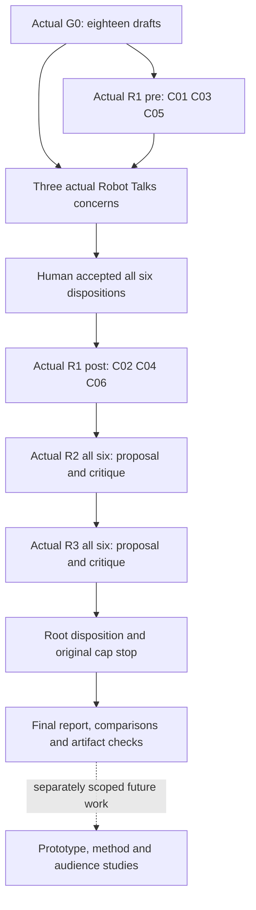

# Actual execution map

Both Robot Talks gates fulfilled. All six compositions completed three Deep conversations; original finite cap fires. Twelve actual role turns: G0 + eight Distill proposal/critique turns + three Robot Talks investigators. Root synthesis/reconciliation does not add role turns.

The real first-round orders and differing seeds are retained; they do not form a controlled method comparison. Concept track A covers C01–C03; track B covers C04–C06. The three investigator concerns cross those tracks. [Exact trace](DISTILL-TRACE.json), [final independent verdict](BALANCER-R3.md), [root closeout](RECONCILIATION-R3.md).
