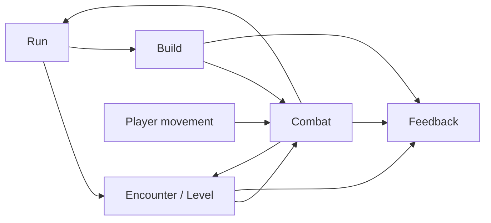

# Gameplay system model · first draft

Date: 8 November 2026. Status: local design model, not implemented or playtested. This package extends the [one-character game revision](../GAME-DESIGN-REVISION.md) and [mechanics inventory](../MECHANICS-INVENTORY.md). It uses the Lab's modeling vocabulary as a method; it does not claim that these game concepts have been admitted into the Lab ontology.

## Source and meaning boundary

The Lab's [Bounded Context](../../../../../../lab/reference/records/def-cal-definition-bounded-context.md), [Definition](../../../../../../lab/reference/records/def-cal-definition-definition.md), [Classification Scheme](../../../../../../lab/reference/records/def-cal-definition-classification-scheme.md), [Classification Orthogonality Invariant](../../../../../../lab/reference/records/def-cal-definition-classification-orthogonality-invariant.md), [Ontology](../../../../../../lab/reference/records/def-cal-definition-ontology.md), and [Invariant](../../../../../../lab/reference/records/def-cal-definition-invariant.md) motivate this structure. Their accepted Lab meanings remain scoped to the Lab. The gameplay definitions below are candidate meanings within this game's own bounded context.

The Lab's [Effect](../../../../../../lab/reference/records/def-cal-definition-effect.md) includes changes to rights, obligations and interpretation. A **gameplay effect** below means a change to simulated game state. Reusing the word does not silently reuse the Lab Effect record or its governance authority.

## Game vocabulary and system ownership

| Term | Meaning in this game model | Owning system |
| --- | --- | --- |
| Gameplay system | A coherent owner of state, rules and events for one purpose. | System map |
| Mechanic | A rule that responds to a trigger under eligibility and cost conditions, then produces a declared state transition and observable result. | The system that resolves it |
| Attack definition | The reusable rule for automatic activation, target acquisition, delivery, propagation, payload, timing and cooldown. | Combat |
| Attack instance | One execution of an attack definition, with source, committed parameters, target history and event identity. | Combat |
| Delivery component | One part of an attack that tests a target or spatial footprint and produces hit attempts. | Combat |
| Attack leap | Propagation of an attack from a hit target to another eligible target, as in chain lightning. The hero does not move because of this term. | Combat |
| Gameplay effect | One declared change to health, status, resource, position, geometry, information or progression after resolution. | The system owning that state |
| Modifier | A change to a named parameter or rule, with scope, operation, stacking and lifetime. Cooldown reduction is a modifier. | Build supplies it; target system applies it |
| Upgrade choice | One gain bound to exactly one of three offered drawbacks, recorded as one build decision. | Build |
| Challenge | A level's distinct pressure on movement and build choices, expressed through encounters, hazards and objectives. | Encounter/Level |
| Invariant | A condition the model must preserve across transitions, including retries and automatic effect chains. | Declared by the owning system |

## System boundaries

| System | Owns | Consumes | Publishes |
| --- | --- | --- | --- |
| **Run** | Character identity, current level, hardcore/lite rule, rebuild/locked rule, entry snapshot and terminal outcome. | Level result and character death. | `LevelStarted`, `LevelRetried`, `RunReset`, `RunCompleted`. |
| **Build** | Earned budget, selected upgrades and their drawbacks, resulting modifiers and legal rebuilds. | Level rewards and mode constraints. | `BuildCommitted`, effective modifier set. |
| **Encounter/Level** | Level challenge, enemy/hazard schedule, objective and reward eligibility. | Run level and effective build constraints. | Enemy/hazard facts, `LevelCompleted`, reward offer. |
| **Combat** | Auto attack instances, target selection, delivery, hit resolution, effects, cooldowns and combat state. | Character movement, effective build, encounter facts. | `AttackCommitted`, `HitResolved`, `EffectApplied`, `CharacterDied`. |
| **Feedback** | Player-facing explanation derived from events. It does not change combat results. | Events and public rule definitions. | Why an attack fired, chained, missed, stopped or stayed on cooldown; why an upgrade mattered. |

The [classification scheme](CLASSIFICATION.md) names independent questions about each model object. The [attack and effect model](COMBAT.md) defines single-target, area and target-leap behavior. The [build and run model](BUILD-AND-RUN.md) defines gain/drawback binding and the four mode combinations. Classification describes a versioned object; it does not itself execute an effect or prove a mechanic useful.

## Candidate relationship vocabulary

The Lab's [Relation Kind](../../../../../../lab/reference/records/def-cal-definition-relation-kind.md) and [Typed Relation](../../../../../../lab/reference/records/def-cal-definition-typed-relation.md) show why a connection needs a declared direction and allowed source/target kinds. The following are **game-local design relations**, not accepted Lab relation records.

| Relation | Allowed source → target | Cardinality / rule |
| --- | --- | --- |
| `resolves` | System → mechanic or state domain | Each runtime transition has one resolving system. |
| `has-component` | Attack definition → delivery component | One or more ordered components per attack. |
| `applies` | Delivery component → gameplay effect | One or more declared effects; one component may apply them to several eligible recipients. |
| `propagates-by` | Attack definition → propagation rule | Zero or one; `target-leap` requires finite target count and selection rules. |
| `changes-parameter` | Modifier → exact attack/effect/character parameter | One exact parameter path per primitive modifier. |
| `installs` | Upgrade gain/drawback → modifier, effect or attack component | Each selected upgrade record installs its gain and one selected drawback together. |
| `pressures` | Level challenge → mechanic or build assumption | At least one declared primary question per level; a pressure does not prove the build fails. |
| `originates-from` | Runtime event → attack, effect, terrain or level rule instance | One attributable immediate source, with optional ancestry to the originating upgrade. |

These relations make the model navigable without making classification labels carry causal rules. For example, `attack.chain-lightning` **has-component** `component.arc-hit`, **propagates-by** `target-leap`, and its component **applies** a magic damage effect. A Quick Recast modifier **changes-parameter** on that attack's cooldown; none of those facts follows merely from the label “chain.”

## Shared event and identity rules

- Every definition and runtime instance has a stable ID and version or run-local identity. A changed definition version does not silently reinterpret an earlier build or attack log.
- Events identify their source, rule version, target or footprint, time/order and outcome. Damage caused by poison ticks, terrain, reflection and direct hits remains distinguishable.
- Only player movement is a combat input. Attacks, guards, casts, walls and commitment responses, if included, need automatic triggers declared by the build or encounter.
- Combat resolves facts; Feedback explains them from the event record. A visual effect never substitutes for a hit verdict.
- The four mode combinations share Combat and Encounter rules. Run and Build alter reset and respec behavior, not damage or target-selection semantics.

## Model status and next boundary

This package defines the initial concepts and structural contracts. It does not set balance numbers, choose the final upgrade pool or turn the 20-level challenge ladder into encounter data. The next concrete artifact should be a small versioned set of attack, effect and upgrade records (including chain lightning and an AoE attack), followed by a resolver fixture that checks target order, cooldown scope, effect attribution and mode resets.
