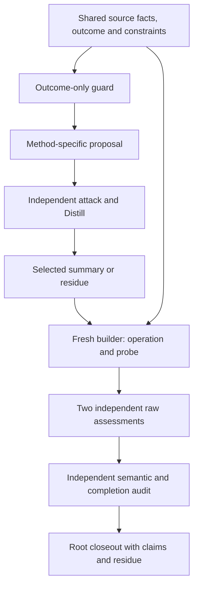

# Escaping the hammer-and-nail trap: research on novelty in analysis

**Research period:** 8–10 October 2026  
**Report date:** 10 October 2026  
**Status:** Consolidated research report from saved designs, experiments, independent assessments and final closeouts.  
**Research setting:** Synthetic cases, native agent workflows and deterministic finite models.  
**Primary completed investigation:** Ten composed strategies across two cases, followed by a separate two-strategy method-coverage study.
**Academic extension:** 26 academic references and 20 additional strategy cards, prepared on 10 October 2026; a separate native execution pilot is now in progress.

## Abstract

The research began with a concern: making hammers can lead a producer to interpret every problem as a nail. The user requested at least ten ways to escape that bias, combining Robot Talks, two-lane disciplines, Distill and Dispatch Spec. The scope then expanded to logical inversion, destructive-to-creative reasoning, and strategies that change the analysis process itself. The user rejected clever wording that supplied analysis without a sense of novelty.

The resulting research distinguishes a different explanation from a different feasible next action. Its central preparation rule is: **preserve the valued function, change a dependency, construct an operation, and name an observation or existing equivalent that could defeat the proposed addition.** Critique becomes generative when it identifies a changeable assumption and supplies material from which another role can construct an alternative. Distillation becomes useful when it preserves the inconvenient facts required for that construction.

The primary composition study compared ordinary analysis, ten component operators and ten compositions on two independently authored synthetic cases. All 132 scored native roles completed with structurally valid saved outputs. Independent semantic audit classified the twenty recipe/case attempts as nine applied, nine source-backed no-opening results, two not applied and zero unknown. Three recipe/case comparisons received the frozen final-builder-repertoire addition flag: R04 in both cases and R06 in the second case. Inspection of upstream component proposals narrowed those findings: the second-case R04 main schedule already existed in a component draft, while the exact R06 continuation was absent from the inspected ordinary and component chains.

A separate, prospectively bounded coverage study supplied controls missing from the original cases. Both R07 and R09 were applied in fresh chains, with agreement from two independent fidelity reviewers and a final completion auditor. This supplies two additional method-use attempts; the original study remains 18/20 semantically covered. The two primary studies used 155 actual native role invocations in total. Earlier studies have separate accounting and are not included in that number.

The supported outcome is a reusable strategy catalog and an evidence-based preparation process. The research does not establish ten original general methods, a universally superior reasoning workflow, physical effectiveness or improved human decisions.

A subsequent [academic extension](/home/vlad_/projects/CyberAlchemy-lab/docs/proposals/hammer-bias-strategies/novelty/academic-extension/2026-10-10/ACADEMIC-FOUNDATIONS.md) examines how creative performance develops, what can enable novelty to emerge, and how to distinguish immediate assistance from retained learning and transfer. It supplies 26 scholarly references and [20 successor strategy cards](/home/vlad_/projects/CyberAlchemy-lab/docs/proposals/hammer-bias-strategies/novelty/academic-extension/2026-10-10/STRATEGIES.md). Their preparation snapshots contain no experimental results. A separate bounded native follow-up is now in progress; its final results require closure and independent completion audits. Findings from the earlier completed studies remain unchanged.

## Contents

1. [Problem and research questions](#1-problem-and-research-questions)
2. [Research evolution and scope](#2-research-evolution-and-scope)
3. [Definitions and analytical distinctions](#3-definitions-and-analytical-distinctions)
4. [Roles of the requested techniques](#4-roles-of-the-requested-techniques)
5. [Component operators and ten compositions](#5-component-operators-and-ten-compositions)
6. [Primary study design](#6-primary-study-design)
7. [Audited results](#7-audited-results)
8. [Concrete constructions and novelty checks](#8-concrete-constructions-and-novelty-checks)
9. [Failures, refusals and handoff loss](#9-failures-refusals-and-handoff-loss)
10. [Separate coverage study](#10-separate-coverage-study)
11. [Findings across the research](#11-findings-across-the-research)
12. [Limitations and evidence boundaries](#12-limitations-and-evidence-boundaries)
13. [Preparing the next investigations](#13-preparing-the-next-investigations)
14. [Reusable worksheet and prompts](#14-reusable-worksheet-and-prompts)
15. [Research conclusions](#15-research-conclusions)
16. [Appendices and source register](#16-appendices-and-source-register)
17. [Academic extension: creativity, emergence and learning](#17-academic-extension-creativity-emergence-and-learning)

## 1. Problem and research questions

The initial problem concerns the direction of problem formation. A capability can legitimately solve a problem, but it can also shape the vocabulary, boundaries and rewards through which the problem is recognized. Once the tool becomes part of the success definition, alternatives have to compete on the tool's terms.

For example, “drive more nails” embeds hammering in the goal. “Keep these parts joined under the required load, movement and service conditions” preserves a function while permitting different mechanisms. The familiar tool can still win; the research seeks a defensible way to inspect its fit and generate alternatives.

The investigation addressed six questions:

1. How can analysis preserve the required outcome while removing an assumed tool dependency?
2. How can logical inversion generate testable alternatives without becoming an invalid inference?
3. How can an attack expand the design space rather than merely improve the incumbent?
4. What must survive distillation for a fresh role to construct a different operation?
5. When does composing techniques add something beyond ordinary analysis and either component?
6. How can valid execution, actual method application, local novelty and usefulness be judged separately?

No concrete organizational incident or physical hammer problem was supplied with operating data. Strategy design therefore proceeded without claiming that any method solved a real user's operational situation. The saved research subsequently used explicit synthetic cases to make controls, constraints and predictions inspectable. [Design trace][E02]

## 2. Research evolution and scope

The work progressed through several distinct studies. They have different contracts, identifiers, denominators and evidence standards. Their results must remain attributable to their own scopes.

| Stage | Research activity | Supported result or important boundary |
|---|---|---|
| Initial design | Fourteen anti-bias tactics, extended to sixteen with logical inversion and attack-to-expand; Deep preparation used two tracks and three bounded rounds. | A diverse portfolio of bounded decision operations, with explicit outcome and evidence obligations. |
| Sixteen-tactic execution | Forty-five executed stages and two direct-exit records; twelve native helpers contributed concerns, controlled exercises and audits. | All sixteen tactics were covered. Matched synthetic decision exercises found no added selection benefit from the richer procedure. |
| Generative-operator exploration | Twelve operators, N01–N12, explored with ordinary and generic-creativity controls; N08 and N12 advanced to four-case confirmation. | Specific locally qualifying constructions appeared in some cases. Transfer was uneven, and one missing ordinary output prevented exclusive credit in a case. |
| Process-stage investigation | P01–P10 separated generation, constructive attack, delayed convergence, compression and exposure. | One exclusive qualified raw backcasting proposal; no fully confirmed exclusive retention through compression. A delayed-convergence attribution error was corrected in a derived report and independently checked. |
| Thirteen follow-up studies | I01–I13 examined inversion, construction, interaction, backcasting, anomalies, preservation and exposure. | Mixed, negative and protocol-invalid findings. Source-bound compression preserved tested obligations; that did not establish invention or decision benefit. |
| First ten-operator attempt | Shared concern outputs violated the source-reference contract, gating all downstream generation. | A closed process failure, not evidence of zero novelty. |
| Reference-explicit study and fresh coverage | Original comparison retained fifteen invalid outputs and sixty-four gates; a separate case completed missing standalone delayed-convergence coverage. | Ten operators had full generation coverage across separate scopes, while original inferential contrasts remained unavailable. |
| Ten-composition study | Ordinary analysis, ten components and ten recipes on development and second-case tasks. | Complete structural execution; 18/20 semantic method coverage; three narrow final-repertoire addition flags. |
| Final method-coverage study | Fresh R07 and R09 chains on a case deliberately supplying the relevant controls. | Both methods applied; no novelty or benefit comparison was attempted. |

The initial matched exercise gave the same twelve model-best selections to capability-first, outcome-first and inversion-plus-expansion arms. A four-cell comparison of plain/structured process and capability/causal evidence also produced the same action selections at fixed evidence. The supplied discriminating evidence changed what could be justified; additional structure did not change choices in those cases. This was a useful negative result against assuming that a richer workflow necessarily improves decisions. [Initial synthesis][E04]

The N08/N12 confirmation study supplies a different kind of evidence. N08 generated exclusive qualifying families in fabric-cover and rehearsal-room cases, including repeated occurrences. N12 supplied a qualifying fabric-cover discriminator once. Neither finalist qualified in the caption-preview case. In the language-circle case, missing ordinary-control content prevented exclusive credit against the full pooled controls. These are local model judgments about proposed operations, not observed performance. [Four-case confirmation][E06]

The I01–I13 work recorded 556 actual native calls: 508 scored and 48 overhead turns. Its completion covered scheduled executions, failures and legitimate gates. It did not imply positive efficacy findings. A detailed study-by-study summary appears in Appendix B. [All-thirteen audit summary][E09]

For the latest primary studies, actual native accounting is separate:

| Primary scope | Scored roles | Overhead roles | Actual native role invocations |
|---|---:|---:|---:|
| Ten-composition study | 132 | 11 | 143 |
| Separate R07/R09 coverage study | 9 | 3 | 12 |
| Combined primary scopes | 141 | 14 | 155 |

Older work is excluded from these totals. A native role invocation is not a measurement of internal API requests, hidden reasoning, tokens or monetary cost. [Original closeout][E18], [Coverage closeout][E23]

## 3. Definitions and analytical distinctions

### 3.1 Four judgments that must remain separate

| Judgment | Question | What a positive result establishes |
|---|---|---|
| Structural execution | Were the required roles, fields, references, handoffs and terminal artifacts delivered? | The declared workflow produced valid artifacts under its mechanical contract. |
| Method application | Did the output perform the assigned move, or explain a source-backed reason it could not? | Application of the technique in the saved proposal workflow. |
| Local novelty | Is the operation or probe absent from the declared comparison repertoire? | A bounded distinction relative to inspected evidence. |
| Usefulness | Does the operation improve the valued outcome or provide worthwhile information within available resources? | A supported contribution within the assessed case; empirical benefit requires additional evidence. |

A valid JSON card can substitute an easier question for the requested operation. An applied strategy can recover an ordinary action. A distinct action can add burden without improving the required outcome. Reviewer agreement is an assessment, not ground truth.

### 3.2 Different meanings of novelty

The earlier generative studies assessed local families against case archives and ordinary/generic-creativity controls. Some additionally required retention through compression or recurrence across repetitions. The composition study used a narrower frozen measure: a qualified composition card distinct from every raw final-builder card in ordinary analysis and both components.

The latter measure does not inspect every operation a component might generate. In particular, an idea may appear in a component proposal and disappear from its single final card. Recovering it can pass a final-repertoire comparison without being new to the earlier component work. The independent completion audit therefore inspected upstream proposals and distillations separately, retaining the locked numerical grades while narrowing interpretation. [Composition contract][E12], [Composition audit][E15]

This report uses “local addition” with its comparison scope stated. It makes no claim of global originality, a new scientific theory or a newly invented general reasoning technique.

### 3.3 Logical inversion

Logical inversion was treated as a typed operation: necessity removal, role reversal, counterfactual exploration, causal reversal or formal inference. These moves have different obligations.

For a formal implication P → Q, neither the converse Q → P nor the inverse ¬P → ¬Q follows automatically. Contraposition preserves the implication, but an empirical premise still needs justification. Inverting a causal story therefore generates a hypothesis to test; it does not prove the reversed story.

Three operational questions were kept distinct:

- **Necessity:** Can the required function survive without the preferred dependency?
- **Return path:** Does using the tool create later demand for its own use, with initial demand held fixed?
- **Harm boundary:** Does more present intervention worsen the current outcome?

They require different controls and observables. A current duplicate count cannot substitute for evidence of later adaptation. [Analytical lenses][E03], [Frozen component instructions][E13]

### 3.4 Destructive-to-creative reasoning

The proposed conversion is:

```text
specific attack or counterexample
  → exposed assumption or boundary
  → changeable degree of freedom
  → alternative construction
  → separating prediction and defeat condition
```

The attacker must name what fails, what function survives and what may change. The builder must produce an operation that uses that opening. Invalid attacks, fixed constraints and unavailable replacement resources can close without a creative candidate. Option count is not the objective.

### 3.5 Distillation, residue and refusal

Distillation reduces a proposal while preserving the structure needed by its consumer. In these investigations, **summary** carried the selected operating account; **residue** retained inconvenient, omitted or unresolved source-bound material. Some builders deliberately received residue alone with common facts.

A source-backed no-opening result says which required control, intervention or resource is unavailable. It counts method execution at a boundary, not creative success. Missing artifacts and invalid or gated chains are different dispositions and cannot be counted as no-opening or zero novelty.

## 4. Roles of the requested techniques

### 4.1 Robot Talks

Robot Talks supplied independently attributable concerns and conflicting obligations. Its contribution was role separation and tension discovery. Assigning several agents the same task would not by itself provide meaningful opposition.

The scored proposal → attack/distillation → fresh-builder pipeline was a bounded local adaptation. It was not a complete benchmark of canonical Robot Talks, nor a proof that multi-agent execution improves reasoning. [Robot Talks skill][E27], [Composition contract][E12]

### 4.2 The different two-lane disciplines

| Use of “two lanes” | Meaning in the research |
|---|---|
| Active two-lane dialectic | Lane Z develops a hypothesis through critique and a concrete counterexample; Lane A proposes a genuinely different mechanism against the same outcome. |
| Candidate representation discipline | Human prose and machine structure preserve synchronized meanings for different consumers. |
| Composition-study lanes | An outcome-only guard preserves function and constraints; a separate invention role proposes the assigned method's construction. |
| Reusable workshop interpretation | A challenge lane exposes a changeable dependency; a construction lane builds from the resulting constraints and opening. |

These meanings were explicitly separated after early source inspection. The outcome guard is not an alternative-mechanism Lane A. The workshop interpretation is a practical arrangement of obligations, not a claim that all these disciplines are interchangeable. [Initial catalog][E01], [Design trace][E02]

### 4.3 Distill and Deep preparation

The user selected Deep rather than Standard depth. The initial design used two tracks and three finite proposal/critique rounds. The composition study also used three preparation Proposer/Balancer cycles before freezing its sources and instructions.

The scored three-stage pipeline was bounded separately; it did not repeat a complete canonical Deep process for every condition. Builders received the prospectively selected summary or residue, so handoff loss could be inspected rather than silently repaired. [Distill skill][E28], [Composition contract][E12]

### 4.4 Dispatch Spec

The requested sibling source was inspected at `../domainspec-core/arcanum/formulae/dispatch-spec/SKILL.md`, version 0.3.0. Dispatch Spec made steps, ownership, dependencies, gates, handoffs and lifecycle receipts explicit. Descriptive routes received structural validation in earlier stages.

A structural route pass does not establish runtime efficacy, native platform admission or canonical promotion. The later studies used custom native research adapters, immutable source manifests and observed role closeouts. They did not claim to execute a whole canonical Orchestrate capability-bound lifecycle. [Dispatch Spec source][E26]

### 4.5 Research execution route



The route's purpose is to make a changed action and its evidence requirements inspectable. Its artifact structure alone is not a finding of novelty.

## 5. Component operators and ten compositions

Identifiers are scoped to their source catalogs. The initial S01–S16 tactics differ from the later frozen S01–S10 operators. N08 and R08 also name different methods. Appendix A explains the namespaces.

### 5.1 Frozen component operators

| ID | Operator | Required move |
|---|---|---|
| S01 | Tool deprivation | Remove the actual preferred operating dependency and reconstruct the same function with available alternatives. |
| S02 | Causal return-path inversion | Keep initial demand fixed; test tool-induced versus independent later demand with interruption and a control. |
| S03 | Attack to fresh builder | Transfer a failed dependency, surviving function and constraints to a fresh construction role. |
| S04 | Carrier migration | Move the function into another available carrier, then attack its new dependency and account for work. |
| S05 | Delayed convergence | Retain incompatible predictions until a present action can distinguish them. |
| S06 | Residue-fed construction | Give a fresh builder source-bound inconvenient material rather than the selected main account. |
| S07 | Protected anomaly | Preserve the exact anomalous observation and derive opposing explanations and predictions. |
| S08 | Rival backcasting | Trace two successful futures with different dependencies to their earliest present divergence. |
| S09 | Interface ablation | Keep both parent operations functional while interrupting only their existing connection. |
| S10 | Objective boundary inversion | Predeclare a present regime in which more intervention harms the current goal, with a detector and rival. |

Exact instructions, including source and resource restrictions, are preserved in [methods.json][E13].

### 5.2 Ten composed strategies

| ID | Composition | Construction obligation | Builder handoff |
|---|---|---|---|
| R01 | S01 + S06: build from a forbidden dependency | Use an inconvenient surviving detail to reconstruct the function without restoring the forbidden dependency. | Residue |
| R02 | S02 + S05: interrupt the problem factory | Retain both later-demand accounts and build a return-link interruption with a sham/control. | Summary |
| R03 | S03 + S07: make failure the sensor | Turn a source-supported failure signature into an observation that selects where or when to act. | Summary |
| R04 | S04 + S03: put transferred work on trial | Transfer the function, independently attack the new carrier and construct a measurable burden ledger and failure test. | Summary |
| R05 | S07 + S06: give the anomaly a control | Preserve the anomaly in residue; make a supported suspected condition observable or manipulable. | Residue |
| R06 | S08 + S05: search backward for the first fork | Keep both successful futures through Distill and build a present probe of their earliest different dependency. | Summary |
| R07 | S09 + S04: move the connection, keep the functions | Transfer only the declared connection; compare original, transferred, broken, co-present and parent-alone conditions. | Summary |
| R08 | S10 + S01: make harm trigger an exit | Predeclare a matched harm test and a route without the preferred dependency; switch only under the fixed trigger. | Summary |
| R09 | S02 + S08: attack the escape's future failure | Break a later-demand loop, then probe a specific supported adaptation that could recreate dependence. | Summary |
| R10 | S09 + S07: let the anomaly identify the interaction | Interrupt only the link while preserving both functions; distinguish interaction from parent-only causes. | Summary |

R04 acknowledges that carrier migration already includes an attack on its new dependency. Adding a second attack label is insufficient: an extra operation or discriminator must appear. R08 uses the same portable rule in both cases: predeclare normal/higher doses and the exact goal metric; require both independently reset matched comparisons to show harm before switching. Missing resets cannot be supplied by copying a model in Python. [Frozen instructions][E13]

## 6. Primary study design

### 6.1 Cases and preserved outcomes

| Case | Required outcome | Important constraints and observables |
|---|---|---|
| DEV: carrier-transfer station | Twelve correct sealed releases by minute 13; among successful schedules, prefer fewer occupied transfer-clerk minutes. | Two clerks; five-place rack; two powered trips, each carrying up to four items and occupying three minutes; one-item manual trips taking one minute. B9 needs two-minute correction/inspection. |
| CONF: museum notice/receipt workflow | Eight registrations and eight distinct sender recognitions by boundary 9. | Six request actions; one FIFO delivery per tick; requests require prior registration. N1 is already recognized but remains displayed pending until boundary 4. N8 is unavailable before tick 6. |

The cases were authored independently of the old scored results. Their numbered facts specify resources, controls, anomalies and unknowns. No additional arrivals, resources or actor substitutions could be assumed. “CONF” is the saved second-case label: it assesses the same fixed methods in a fresh domain, not an identical operational threshold or a mechanism-blind causal confirmation. [Case registry][E14]

### 6.2 Conditions, roles and information boundaries

Each case had twenty-one conditions: ordinary analysis O; components S01–S10; and compositions R01–R10. Each condition used three separate native roles: proposal, source-bound attack/distillation, and fresh builder. A shared outcome-only guard and two independent whole-case reviewers brought the per-case scored count to 66; two cases yielded 132.

Each component comparator was run once per case and reused by recipes naming it. This controlled the native-call budget but made several comparisons share evidence. The comparisons are correlated; there is no statistical significance or independent-replication claim for each recipe.

The proposer saw common facts, the guard and its assigned method. Distill additionally saw only that condition's own proposal. The fresh builder saw common facts, the assigned method and the selected summary or residue. It did not receive other conditions' proposals or grades. S06, R01 and R05 used residue; other conditions used summary.

All conditions, including O, received the case's common hypothesized return/adaptation mechanisms. Isolation therefore applied to method instructions and generated content, not to mechanism-bearing source context.

### 6.3 Freeze, caps, assessment and phase barrier

Prospective preparation fixed the budget, instructions, sources, branch choices and comparison rules. The source freeze bound 183 files. Generation outputs were capped at 600 normalized JSON words, with at most one builder card per condition. Review capacity was checked before launch; the focused mechanics suite passed 30 checks. Word caps constrain saved artifacts, not hidden compute or equal context exposure.

The second case could begin only after both development raw-review locks were saved following actual native FINAL observations. That barrier held. No development proposals or grades entered second-case generation.

Reviewers received opaque administrative labels, the common source/archive and all raw cards. Each evaluated five axes: outcome anchor, resource fit, separating predictions, clear defeat and source support. Qualification also required an available-resource, valid generation chain and both reviewers' distinction from every supplied ordinary archive operation.

A composition addition required all four relevant chains to be valid: ordinary, both components and the recipe. It also required a qualified recipe card and both reviewers to distinguish it from every raw final-builder card in those three comparators. A valid zero-card comparator was an empty repertoire; invalid or missing comparisons would remain null. Unknown raw relations were preserved.

Independent completion audit added semantic recipe checks and inspection of upstream overlap. The locked mechanical grades were not rewritten. [Protocol][E12], [Numerical report][E16], [Independent audit][E15]

### 6.4 Execution integrity and departures

There were no scored retries, regrades or replacement outputs. All 132 scored roles had actual terminal FINAL witnesses, valid locked output and stable first-observed post-FINAL bytes. Four reviewer locks were valid. Pure fixtures and root deterministic replay were not scored native calls.

The coordinator admitted two jobs before separately spawning and registering them on four occasions, departing from the strict start→spawn→register sequence. Audit found the distinct actual handles, immutable prompts, dependency and concurrency checks, and phase barrier intact. The departure remains reported rather than erased. Unobserved pre-FINAL write history was not certified, and the original workers did not explicitly report their create-exclusive save mode in their FINAL messages. [Original closeout][E18]

## 7. Audited results

### 7.1 Structural coverage and candidate counts

| Measure | DEV | CONF |
|---|---:|---:|
| Structurally valid condition chains | 21 | 21 |
| Raw final-builder cards | 15 | 14 |
| Qualified cards across all conditions | 3 | 11 |
| Zero-card conditions | 6 | 7 |
| Raw reviewer disagreements | 11 | 35 |
| Recipe/case addition flags | 1 | 2 |

Qualified cards are proposal assessments, not successful executed interventions. Their counts do not measure distinct general methods or a cross-case effect size. The development qualified cards were S06, S10 and R04.

DEV disagreements comprised two archive relations and nine candidate pairs. CONF had two axis disagreements and thirty-three candidate-pair disagreements. All forty-six disagreements remain in the saved raw evidence. A false aggregate addition can coexist with an unresolved pair when another explicit failure or equivalence already defeats the aggregate.

### 7.2 Method application and frozen addition matrix

“No opening” below abbreviates the audited `explicit_no_opening` disposition. Addition is the frozen final-builder-repertoire result, not an upstream originality or empirical-benefit judgment.

| Recipe | DEV application | DEV addition | CONF application | CONF addition | Separate fresh coverage |
|---|---|---|---|---|---|
| R01 | Applied | False | No opening | False | Not required |
| R02 | No opening | False | No opening | False | Not required |
| R03 | No opening | False | Applied | False | Not required |
| R04 | Applied | True | Applied | True | Not required |
| R05 | Applied | False | Applied | False | Not required |
| R06 | Applied | False | Applied | True | Not required |
| R07 | No opening | False | Not applied | False | Applied |
| R08 | Applied as hypothetical formulation | False | No opening | False | Not required |
| R09 | No opening | False | Not applied | False | Applied |
| R10 | No opening | False | No opening | False | Not required |

The original semantic totals are nine applied, nine explicit no-opening, two not applied and zero unknown. Eighteen of twenty original attempts therefore performed the assigned method or a justified refusal. The follow-up adds two applied attempts, producing twenty faithful applications/refusals across twenty-two attempts; it does not turn the original study into 20/20. [Composition audit][E15], [Coverage audit][E22]

### 7.3 Interpretation of the pattern

Only R04 had the frozen addition flag in both cases. R06 had it in the second case only. All other recipe/case flags were false. These outcomes do not rank the general methods: cases supply different controls, refusals are meaningful, and the one-card cap samples only a bounded delivered repertoire.

The results instead identify particular constructions and particular missing controls. Upstream inspection is essential before describing an addition as a new operation. The next section shows why.

## 8. Concrete constructions and novelty checks

### 8.1 DEV R04: reconstruct a rejected migration selectively

The development case favored powered movement because it carries several items per trip. A full manual migration was feasible but consumed more transfer labor. The composed builder retained manual carrying as a single early-arrival bridge, then used powered batches for the remaining carriers.

| Schedule | Transfer plan | Correct releases by 13 | Occupied transfer minutes |
|---|---|---:|---:|
| Constructed bridge | Hand-carry B4 during 0–1; powered B5–B8 during 1–4; powered B9–B12 during 4–7. | 12 | 7 |
| Strong supplied rival | Powered B4–B7 during 0–3; powered B8–B11 during 3–6; hand-carry B12 during 6–7. | 12 | 7 |
| Delayed bridge probe | Delay the hand trip to 1–2, then powered trips to 2–5 and 5–8. | 11 | 7 |

Both successful schedules predict twelve releases by minute 13, zero transfer waiting and a peak rack occupancy of five. Their cumulative source-unload traces differ:

| Boundary | 1 | 3 | 4 | 6 | 7 |
|---|---:|---:|---:|---:|---:|
| Constructed bridge | 1 | 1 | 5 | 5 | 9 |
| Supplied rival | 0 | 4 | 4 | 8 | 9 |

The delayed bridge leaves an inspection gap and predicts eleven correct releases. Root deterministic replay confirmed these consequences of the stipulated model. It did not perform a physical trial or establish a ranking advantage over the strongest supplied rival.

The inspected component work already included manual migration, labor accounting and attacks on transfer timing. The exact selective early bridge differed from those inspected operations. The useful contribution was a concrete reconstruction from an exposed weakness, not the general idea of migration-plus-critique. [DEV deterministic replay][E17]

### 8.2 CONF R04: a distinct final card can recover an earlier idea

The R04 candidate validated N3–N8 in order during ticks 0–5 and requested N2, N3 and N4 individually at ticks 0, 1 and 2; idled at 3; used bulk at 4; and requested N7 and N8 individually at 5 and 6.

| Variant | Registrations by 9 | Distinct recognitions by 9 | Actions | Duplicate deliveries |
|---|---:|---:|---:|---:|
| R04 candidate | 8 | 8 | 6 | 0 |
| Change only the tick-0 request to bulk | 8 | 7 | 6 | 2 |
| Move the candidate's bulk request from tick 4 to tick 3 | 8 | 7 | 6 | 2 |

The second variant overexposes the already-recognized N1 while its display still appears pending. The boundary perturbation also consumes scarce server work and leaves one identity unrecognized within the window. These are finite-model predictions, confirmed by root replay after both raw review locks.

However, the main R04 schedule already appeared in the original S04 proposal and Distill summary; S03's final card also used that schedule. The locked final-repertoire reviewers judged the R04 card distinct, but that cannot support claiming a wholly new schedule or a new general mechanism. The specific tick-3 perturbation, comparator and joined ledger treatment supplied the narrower difference. This is the strongest example of why a final-card novelty measure needs an upstream audit. [CONF deterministic replay][E19], [Upstream audit][E15]

### 8.3 CONF R06: construct a viable early fork

R06 retained two successful futures. Future B used the late N8 validation order. Future A moved N8 validation to tick 2, then placed N8 behind N5 in the tick-4 bulk queue.

| Future | Validation order during ticks 0–5 | First N8 delivery tick | Registrations / recognitions | Actions |
|---|---|---:|---|---:|
| A: early N8 dependency | N3, N4, N8, N5, N6, N7 | 6 | 8 / 8 | 6 |
| B: late N8 dependency | N3, N4, N5, N6, N7, N8 | 8 | 8 / 8 | 6 |

The earliest present divergence is the tick-2 validation choice. Both futures satisfy the required overall outcome; the first target delivery differs by two ticks. Replay confirms the model consequences. The exact viable early continuation was absent from the inspected O, S08 and S05 upstream chains, supporting a local constructed addition. Backcasting and delayed commitment themselves were already component techniques. [Replay][E19], [Audit][E15]

## 9. Failures, refusals and handoff loss

### 9.1 CONF R07 substituted a different connection

The declared connection was P1 registration enabling P2 eligibility. Case constraints fixed that gate and excluded configuration access or alternate channels. R07 instead compared dashboard/ledger-guided coordination of dispatch choices while retaining the original eligibility connection.

That coordination test can be a legitimate hypothetical operation, but it did not transfer only the assigned connection. Distill residue acknowledged the immutable gate; the selected summary carried the substitute rather than a terminal method-specific refusal. Mechanically faithful transmission of the summary therefore coexisted with semantic failure. The audit classified the recipe `not_applied`, based on the missing requested operation rather than on lack of usefulness or novelty.

### 9.2 CONF R09 substituted present harm for later adaptation

The chain held demand fixed and retained hypothetical persistent escape and adaptation-driven recurrence. Its final card then compared current duplicate exposure and harm. Both later accounts accepted those current observations.

The card acknowledged that it could not distinguish the later accounts, but still delivered the positive substitute operation without a terminal method-specific refusal. The required probe of the specific adaptation link was absent. Honest hypotheses and a measurable antecedent did not complete that stage; the audit classified it `not_applied`.

### 9.3 R08 formulation did not create trial resources

DEV R08 predeclared a normal/higher-dose comparison, a fixed metric and the both-pairs exit trigger. It explicitly treated four independently reset physical windows as an untestable assumption. The instructions allowed that hypothetical formulation, so audit credited method application while both raw reviewers rejected physical resource/separation qualification.

The case supplied consumables and power for one window, not four physical resets. CONF R08 additionally lacked a viable individual-only exit: seven unrecognized identities exceeded six individual request actions. Its source-backed no-opening was faithful execution. No measured threshold, activated trigger or physical benefit was credited.

### 9.4 Empty comparators require evidence

Four zero-card component comparators were independently audited: DEV S09; CONF S01, S02 and S09. Their refusals were source-backed and method-appropriate. Material or eligibility connections could not be removed while preserving the required parent functions; the bulk-free route lacked sufficient actions; or later-demand observations were unavailable.

CONF S02 also contained an erroneous success-preserving sham forecast. That error was retained. Its refusal remained independently justified by missing later observations; the error did not become a successful comparator or repair its prediction.

The lesson is specific: an empty repertoire is credible only when its absence is supported. Otherwise, a composition could appear better simply because a component was incompletely applied. [Semantic and comparator audit][E15]

## 10. Separate coverage study

### 10.1 Purpose and prospective boundaries

The original 143-call scope was exhausted and closed. A new maximum of twelve actual native roles was declared before the fresh author was spawned. The study targeted method application for R07 and R09, with their instructions copied unchanged.

One independent author created a synthetic specimen-desk case that deliberately supplied the missing controls. This was a coverage case, not a mechanism-blind holdout. No ordinary or component scored arms were run, and no composition-addition grade was defined. [Coverage contract][E20]

### 10.2 Available case controls

Initial demand was fixed at four specimens, I1–I4, requiring four correct distinct tickets by minute 16. One actor performed serial costed actions within a forty-minute horizon.

- P1, MassRead, returned an exact identified mass in one actor-minute.
- P2, BandPrint, printed L below 25 grams and H otherwise, in one actor-minute.
- Relay transported the unchanged P1 record to P2 in half a minute with no actor labor.
- Paper could transport exactly the same record in half an actor-minute.
- Socket isolation interrupted only P1→P2 Relay transport; both functions, the inquiry interface and preset updater remained available.
- An emitter could be muted. A single retained-preset rejoin might re-enable it through a permitted write; a latch could block the write.
- A single diagnostic ping and a costed log snapshot could reveal newly created inquiries separately from old queued inquiries.

Escape and Recurrence were unresolved accounts, not observed findings. The source supplied their conditional rules and a finite horizon without declaring which held. Initial tickets and later diagnostic inquiries were explicitly different demands. [Coverage case][E21]

### 10.3 R07: move only the record connection

The fresh builder used Relay for two initial records and paper for two others, then proposed broken-link, co-presence, parent-alone and later matched-fixture carrier comparisons. Both functions retained their exact semantics. Its initial ticket schedule predicted completion by minute 9.

The full proposal accounted for 21.5 actor-minutes: nine for initial jobs and paper transfers, 8.5 for fixture comparisons, and four for controls/diagnostics; half a minute of idle time brought the proposed endpoint to minute 22. Source capacity and serialization supported the plan.

P2 alone explains correct band computation, defeating an interaction claim based on correctness alone. Record provenance therefore matters. Blocked-send restoration behavior was unspecified, and the builder preserved that uncertainty rather than claiming a replay rule.

Both fidelity reviewers and the independent auditor classified R07 `applied`, with source support, handoff fidelity and resource fit. They did not establish a useful interaction or novelty gain. [Coverage audit][E22]

### 10.4 R09: distinguish persistent escape from recurrence

The builder completed the first initial ticket, muted the emitter, declined optional inquiry service and retained Relay for the remaining initial work. Four correct initial tickets were predicted by minute 10.5.

It then proposed permissive rejoin during 12–13, diagnostic ping during 13–13.5, and a complete snapshot during 13.5–14. One earlier inquiry left seven of eight global inquiry slots unused.

| Account | Prediction after the eligible ping | Relevant evidence |
|---|---|---|
| Escape | No new inquiry at 13.5; cumulative inquiries remain one. | Confirm completed controls, permission, eligible ping and unused capacity. |
| Recurrence | One new ping-triggered inquiry at 13.5, due 17.5; cumulative inquiries become two. | Separate its trigger ID and timestamp from the old pending inquiry. |

The proposed actor burden was 10.5 minutes: eight for initial parent operations and 2.5 for mute, rejoin, ping and snapshot. The immediate discriminator had a costed observation. Passive continuation through minute 40 did not supply another free complete snapshot.

Both reviewers and the auditor classified R09 `applied`. Which account holds remains unknown. The study constructed a supported probe; it did not observe adaptation, lasting escape or reduced actor work. [Coverage audit][E22]

### 10.5 Verification and final closure

Nine pure mechanics checks passed before launch. Sixteen sources were frozen. All nine scored roles delivered valid saved outputs and actual FINAL witnesses; two raw fidelity reviews agreed. Three overhead roles—author, prelaunch reviewer and completion auditor—brought the total to twelve.

Root used fresh fork-none invocations, no helpers or followup role turns, and start→actual spawn→register before each next scored admission. The final audit supported coverage completion; root then observed its actual FINAL, rechecked stable evidence and closed all twelve roles. Exact native spawn timestamps were not separately persisted, and receipt write times were not treated as substitutes.

The original study remains 18/20. Across the original and coverage scopes there are twenty-two recipe/case attempts: eleven applied, nine explicit no-opening, two not applied and zero unknown. This completion establishes the authorized method-use coverage, with no ten-winning-methods claim. [Final root closeout][E23]

## 11. Findings across the research

The following are interpretations drawn from the saved studies, with their practical implications stated separately from efficacy claims.

### 11.1 Novelty needs a changed operation or discriminator

The user's rejection of clever sentences sharpened the research target. A metaphor or renamed framework does not show that analysis can now perform a different action. A candidate becomes investigable when it changes a variable, timing decision, carrier, interface or observation and states how the consequence differs from a rival.

The early manual bridge and early N8 validation are concrete examples. They change schedules with distinct model consequences. Their usefulness is bounded separately: the bridge ties its strongest rival on the stated ranking, and both R06 futures meet the overall target.

### 11.2 Attack is an input to construction

Critique becomes generative when it identifies a surviving function and a changeable dependency. A separate builder can then reconstruct selectively rather than defending the original or replacing it wholesale. An invalid attack adds no justified opening; a hard constraint may close the branch.

Earlier matched work also showed that ordinary critique can reach the same family as attack-to-expand. Requiring construction is a useful workflow obligation; attribution of an additional effect needs a comparator without that obligation. [Process-stage results][E07]

### 11.3 Preservation and invention are different capabilities

Source-bound compression retained all twenty-four protected obligations tested in I09. I13 recorded nine of nine retained under source-bound compression versus six retained, one lost and two uncertain under ordinary compression. These results concern preservation, not invention.

The composition study supplies the complementary failure: R07 transmitted its chosen summary accurately while omitting the exact refusal carried in residue. Mechanical projection cannot guarantee that the selected branch contains the indispensable meaning. [All-thirteen findings][E09], [Composition audit][E15]

### 11.4 Exposure is a separate stage

The earlier N08/N12 confirmation had thirty-three qualifying family-by-trial occurrences in available outputs, but only three appeared in the first-two view. Thirty remained outside it. This demonstrates a separation between generation and visibility under that ranking rule; it does not prove a better decision would result from changing the view.

Later exposure studies retained unavailable source pools and gates. Showing a distinct alternative can be partly guaranteed by a presentation rule when an eligible alternative exists. Human decision value must be measured separately. [Confirmation][E06], [Follow-up studies][E09]

### 11.5 Controls determine which strategies can be investigated

Link-only strategies require an independently changeable link. Later-demand strategies require later behavior or an eligible adaptation observable. Harm-trigger strategies require feasible doses, a metric and actual reset resources. The final coverage case enabled R07/R09 by supplying such controls; that does not prove general transfer to contexts without them.

### 11.6 More workflow is not automatically more progress

The initial matched decisions showed no procedure advantage at fixed evidence. Later comparative failures and upstream overlap further caution against equating roles, longer outputs or more alternatives with novelty. Select the smallest strategy that addresses a named uncertainty; escalate when a supported contradiction or missing discriminator warrants it.

## 12. Limitations and evidence boundaries

### 12.1 Synthetic evidence

Cases, quantities, timings and conditional mechanism rules were authored stipulations. Deterministic replay establishes consequences of those rules; it does not validate the rules against an organization, device or physical process. Proposed probes were not performed in the world. No actual account winner, intervention benefit or human decision effect was observed.

### 12.2 Model assessments and incomplete blinding

Independent roles provided separate outputs, but they came from one runtime family rather than independent human populations or a sampled population of reasoning systems. Administrative labels were masked in the main comparisons; operation content could still reveal the method. Reviewer agreement was not treated as truth, and disagreements and uncertain relations were retained.

### 12.3 Restricted and incomplete comparison repertoires

Archives were finite and case-specific. The composition study allowed only one final card per condition. Shared component comparators made several contrasts correlated. Upstream inspection narrowed apparent additions, but it cannot prove absence from every possible component output or from the wider world.

The coverage study intentionally supplied controls and had no ordinary/component scored arms. Its positive application verdict cannot support composition advantage, novelty confirmation or general transfer.

### 12.4 Missing trials, unavailable comparisons and protocol failures

Failed artifacts, invalid source references, missing outputs and legitimate gates remain evidence of delivery or protocol limits. They are not zero-effect observations. Earlier factorial and superiority claims remained null when their required sources or chains failed. This report does not combine those unavailable comparisons with valid ones to manufacture a ranking.

### 12.5 Cost and burden

Saved word counts and native role counts are observable proxies, not token accounting, hidden compute or monetary expense. Equal word caps do not ensure equal compute. Proposed actor ledgers are finite-model forecasts, not measured human labor. Reader workload, actual review time and maintenance cost were not comprehensively measured.

### 12.6 Provenance and lifecycle

The primary adapters bound immutable sources, literal prompts, actual handles, FINAL witnesses and first root-observed stable output bytes. Those checks do not authenticate native events independently of the root observations or certify unobserved pre-FINAL accesses and writes. Coverage receipt mtimes record file writes, not exact native spawn timestamps.

Earlier audit corrections and procedural departures remain in their original scopes. Historical “pending” fields are snapshots superseded by later closeouts, not files to overwrite. The consolidated report leaves all raw outputs, freezes, assessments and closeouts unchanged.

### 12.7 Scope of skill claims

The experiments used local adaptations of Robot Talks, Distill and lane separation, with Dispatch Spec route design and custom native mechanics. They were not efficacy evaluations of every canonical skill capability. Structural route validation, terminal role closure and source-linked prose do not establish a promoted discipline or universal method.

## 13. Preparing the next investigations

This section proposes future research; none of its additional trials was run as part of this report.

### 13.1 Define the addition before choosing the technique

Write the outcome without the preferred tool. Inventory ordinary operations, the strongest rival and upstream component ideas. Declare what kind of addition is sought: a new feasible action, an explanatory distinction, an available measurement, or a discriminator between dependencies.

Make the novelty claim explicit: “Compared with repertoire X, this construction adds operation Y or test Z.” Then declare what would defeat it. Finding an equivalent upstream operation rejects an originality claim; a resource failure rejects feasibility; identical rival predictions reject discrimination.

### 13.2 Use a strategy grammar

```text
preserved function
  + search operator A
  + constructive challenge
  + declared summary/residue handoff
  + construction operator B
  + closest rival and separating probe
  + burden and defeat condition
```

Possible successor combinations include inversion→residue reconstruction, migration→failure instrumentation and backcasting→link-only ablation. They are candidate recipes, not automatically new methods. Keep a combination only when the second operator changes the action or test, rather than merely adding another description.

For the hammer illustration, forbidding impact while preserving a required connection is a search mutation. The constructive obligation is an available alternative connection. An attack on service access or load sensitivity can then expose a variable for a second construction. Material, load and access facts must be supplied before any candidate earns feasibility credit; the illustration itself is not evidence of a working joint.

### 13.3 Match the case to the evidence question

Use coverage cases when the question is whether a method can be applied. Explicitly disclose that they supply relevant controls. For later novelty evaluation, prepare new cases independently of generated answers and grades, include adverse variants and avoid advertising a preferred solution. Hold common source information constant across arms and disclose any mechanism hints.

Select controls according to the method: independently alterable links for interface claims; fixed initial demand and later observables for feedback; supported adaptation routes for recurrence; genuine matched reset capacity for harm triggers. If a required control is unavailable, preserve that boundary rather than substituting a convenient proxy.

### 13.4 Separate causal questions about the workflow

| Proposed investigation | Contrast to prepare | Primary question |
|---|---|---|
| Construction from attack | Critique alone versus critique with a surviving-function and construction obligation. | Does the obligation change the action repertoire beyond ordinary critique? |
| Distill fidelity | Ordinary summary versus source-bound summary/residue, using fixed raw proposals. | Which exact source and discriminator obligations survive? |
| Upstream novelty | Final-card comparison versus full proposal/Distill lineage inspection. | How often does apparent addition recover an earlier idea? |
| Composition | Ordinary, component A, component B and composition on the same sources. | Does the combination add an operation unavailable in inspected comparators? |
| Visibility | Fixed candidates and judgments, with ordinary ranking versus a declared distinct-alternative slot. | What becomes visible, and what useful option is displaced? |
| Human value | Controlled exposure of the fixed evidence/alternatives to actual decision makers. | Does visibility change justified decisions, time, rework or burden? |

Each contrast needs its own denominators and unavailable-result policy. Fidelity, novelty, exposure and human value cannot stand in for one another. Actual cost measurement and broader reviewer/model diversity would strengthen interpretation, but neither should be inferred from saved word counts or role separation.

### 13.5 Keep prospective and retrospective work apart

Freeze outcome, instructions, source-reference grammar, available controls, branch selection, criteria and budget before scored generation. Pass realistic unscored source/handoff checks first. Preserve the first scored output and raw assessment, including failure. If later inspection reveals missing application, use a separately declared study with fresh sources; do not regrade the original into success.

The final R07/R09 coverage study demonstrates this separation as a research practice. It supplies fresh application evidence while preserving the original two missing applications.

## 14. Reusable worksheet and prompts

### 14.1 Strategy preparation card

```text
Strategy ID and exact source version:

Preserved function:
  What outcome must still hold, without naming the preferred tool?

Fixed constraints and numbered evidence:
  Which requirements cannot change? Which statements are observations,
  stipulations, hypotheses or unknowns?

Comparison repertoire:
  Ordinary operation, strongest rival, each component's outputs,
  and relevant upstream proposals/distillations.

Search mutation:
  What dependency, causal direction, carrier, interface, timing,
  anomaly or commitment rule changes?

Attack-to-opening conversion:
  What fails? What survives? Which degree of freedom is available?

Construction obligation:
  One concrete action, arrangement, connection or measurement.

Controls, observables and resources:
  What is actually available? What would require an unsupported assumption?

Handoff:
  Summary or residue, declared before execution. List indispensable
  facts, rival predictions, uncertainty and refusal conditions.

Probe and defeat:
  Candidate prediction, rival prediction, and observation or equivalence
  that would reject the addition.

Burden:
  Actor actions/time, displaced work, upkeep, consumables and dependencies.

Independent dispositions:
  Structural validity; applied/no-opening/not-applied/unknown;
  local novelty; usefulness; unmeasured outcomes.
```

### 14.2 Attacker prompt

> Attack a specific dependency in the proposal. Name the assumption that fails, cite its evidence or label the counterexample hypothetical, and state the valued function that must survive. Identify a source-supported variable that could change. Produce material a builder can use, with opposing predictions, displaced burden and any missing-control boundary. Do not invent a defect or change the required outcome.

### 14.3 Distiller prompt

> Produce the smallest handoff from which a fresh builder can reconstruct the requested move. Preserve the exact function, declared dependency, protected anomaly, rival accounts, available controls, burden and defeat condition. Keep summary and residue separate. When the move is unavailable, put the method-specific source-backed refusal in the branch the builder will actually receive. Do not strengthen hypotheses into observations.

### 14.4 Builder prompt

> Using only common facts and the selected handoff, construct one feasible changed operation and a probe that distinguishes its rival accounts. Identify what you retained and rebuilt, and account for actor work and resources. If the case supplies no opening, cite the precise missing control. Do not replace the assigned connection with another link or later adaptation with current harm.

### 14.5 Repertoire reviewer prompt

> Compare the operation and probe against ordinary analysis, both components and their upstream proposals/distillations. Identify the smallest actual delta. Treat recovered ideas as recovered ideas. Check method application, local novelty and usefulness separately. Preserve uncertain relations, negative findings and missing comparisons; agreement is not proof of truth.

### 14.6 Closure prompt

> Verify actual role execution, literal inputs, selected handoff, stable saved outputs, independent raw judgments and semantic application. Count actual invocations separately from gates and pure tooling. Keep original failed attempts and grades unchanged. State which claims the evidence supports, which remain unknown, and which proposed operations were never executed in the world.

## 15. Research conclusions

The research produced a preparation process in which a strategy must earn its place by changing an admissible next action or a discriminating observation. Logical inversion opens a counterfactual; constructive attack exposes a changeable dependency; a fresh builder turns the opening into an operation; source-bound Distill carries the facts that operation needs.

The strongest local examples were selective reconstruction of a rejected migration, an upstream-aware boundary attack, and a successful future split at an earlier present dependency. Their consequences were inspectable in finite models. They did not establish universally superior techniques, and one apparently new main schedule was already present upstream.

Method completion also required honest refusal. The final two failed applications showed that a measurable substitute question can pass structure while missing the assigned move. Fresh coverage addressed those methods with actual source-supported controls, without rewriting their original failures.

The practical outcome is a portfolio of ten investigable compositions, a reusable construction-and-defeat worksheet, and a research protocol that separates generation, preservation, visibility, application, novelty and usefulness. Evidence of broader efficacy would require new studies with appropriate controls and observed outcomes.

## 16. Appendices and source register

### Appendix A. Identifier namespaces

| Source scope | IDs | Meaning |
|---|---|---|
| Initial root catalog | S01–S16 | Anti-bias decision tactics, including tool-independent framing, dialectic, causal testing, method applicability, inversion and constructive expansion. |
| Generative catalog | N01–N12 | Function migration, endogenous demand, task removal, disturbance conversion, deprivation, representation change, analogy, interaction, affordance reuse, incentives, anomalies and future objects. |
| Process-stage study | P01–P10 | Separate generation, convergence, preservation and exposure interventions. |
| Follow-up program | I01–I13 | Research studies examining specific evidence and mechanism questions. |
| Primary frozen methods | S01–S10 | The ten component operators in section 5.1. |
| Primary compositions | R01–R10 | The ten recipes in section 5.2. |

Repeated numeric suffixes do not establish identity across catalogs. Exact instructions and source paths determine a method, not its short identifier.

The initial sixteen-tactic portfolio comprised: tool-independent need framing; incumbent/opposite dialectic; cross-layer investigation; distill-then-challenge; intervention-family tournament; a tool-free small case; causal-fork testing; failure residue; explicit analogy bridges; human/machine need comparison; operating-burden comparison; removal/reuse/delegation exits; bounded build/reframe alternation; method applicability and expiry; typed inversion; and attack-to-expand. These tactics are a portfolio, not sixteen independent intervention families. [Initial catalog][E01]

### Appendix B. Thirteen follow-up findings

| Study | Scored native calls | Audited finding |
|---|---:|---|
| I01: evidence/coverage calibration | 3 | Calibration covered; uncertainty retained. |
| I02: inversion versus feedback | 72 | One held-out necessity opening; feedback pilot opening did not repeat in confirmation. |
| I03: attacks producing options | 78 | Construction links recorded; no qualified confirmation novelty advantage. |
| I04: disturbance conversion/carrier migration | 28 | No qualified pilot opening; conditional held-out phase gated. |
| I05: coupling versus co-presence | 97 | One qualified component-B opening; intact hybrid had no qualified advantage. |
| I06: backcasting replication | 56 | Four-case confirmation preserved; zero qualified raw cards and unresolved possibilities. |
| I07: anomalies changing predictions | 20 | No qualified pilot opening; conditional held-out phase gated. |
| I08: convergence without misattribution | 22 | No qualified pilot opening; failed post-reviews and conditional gates retained. |
| I09: compression fidelity | 41 | All twenty-four tested protected-source obligations retained under source-bound compression. |
| I10: exposure versus decision value | 0 | Sixteen deterministic view dispositions; two evaluable and six gated source pools. |
| I11: inversion × attack × conversion | 50 | Protocol-invalid pilot chain; factorial effects unavailable. |
| I12: interface × deferred convergence | 21 | Protocol-invalid pilot; interaction/retention comparisons unavailable; 570 raw rows carried exactly. |
| I13: generation × compression × visibility | 20 | Source-bound 9/9 retention versus ordinary 6 retained/1 lost/2 uncertain; four evaluable and forty-four gated views. |

The scored sum is 508; forty-eight overhead turns bring this program's total to 556. A required second I11 completion-audit turn was separately amended as overhead, while its original failed audit was preserved. These counts are not part of the latest 155-call primary total. [Audited program report][E09]

### Appendix C. Earlier delivery failures and correction boundaries

The first ten-operator attempt closed 184 planned dispositions: sixteen actual scored FINALs and 168 gates. Eight common concerns placed case IDs rather than permitted numbered fact IDs in `source_refs`. The prompt and validator did not express that membership equally clearly. Eight whole-case reviewers still ran. Including seven overhead roles, the actual native total was twenty-three. No complete strategy generation chain was delivered; every inferential comparison remained null. [First-run closure][E10]

The separate reference-explicit comparison had 184 planned scored dispositions, 120 actual scored starts/FINALs, 105 valid outputs, fifteen invalid outputs and sixty-four gates. Eight overhead calls brought its actual count to 128. A separate fresh coverage case added ten scored and three overhead calls, thirteen total. Their combined actual count was 141. That pair completed standalone generation coverage across its separate scopes while leaving the original blocked comparison and null contrasts unchanged. [Reference-explicit final report][E11]

The process-stage report had a different correction: an attribution error in derived prose. Its first completion audit blocked; a separately recorded verification checked the bounded reporting correction. Scored evidence did not change. This is distinct from repairing a failed scored attempt. [Process closure][E08]

### Appendix D. Report verification and observability

This document consolidates existing evidence; no new scored research, comparison grading or native research roles were commissioned to write it. Both primary adapters were rechecked during report preparation. Their complete verification passed with the original 132 and coverage nine scored FINALs, respectively.

The primary studies each retain their own compatible run-local observer signal. Canonical `.arcanum/observability` was absent and was not installed for this report. No canonical knowledge, skill or discipline was promoted.

```text
PROFILE_ID: hammer-bias-research-synthesis.v1
LIFECYCLE_OWNER: root-native-orchestrator
ARTIFACT_TYPE: source-linked-research-report
CONTRACT_PATH: primary composition and coverage contracts, E12 and E20
PROMPT_SET: existing frozen study prompts; no new scored prompts
REGIME_SET: historical exploration; composition; method-coverage
PROFILE_VALIDATION: source-linked consolidation; both primary complete verifications pass
QUALITY_BAR_STATUS: pass for reporting; efficacy remains unestablished
ANTI_PATTERN_HITS_JSON: ["CONF R07 substituted a different connection", "CONF R09 substituted current harm for adaptation separation", "final-card novelty can recover an upstream idea"]
WORKFLOW_GAPS_JSON: ["synthetic evidence", "incomplete semantic blinding", "finite archives and correlated parent comparisons", "unmeasured human value", "unavailable exact compute/cost", "native authenticity rests on root witnesses", "pre-FINAL write history not certified", "canonical observer absent"]
```

### Appendix E. Source register

All evidence links point to saved local artifacts. Historical reports retain their original phase-specific language; later audits and root closeouts govern final completion. Full machine reports remain authoritative for raw dispositions and disagreements. Narrative interpretations do not replace them.

| Ref | Source | Use in this report |
|---|---|---|
| E01 | [Initial strategy catalog][E01] | Sixteen-tactic scope and lane distinctions. |
| E02 | [Deep design trace][E02] | User intent, source corrections and preparation history. |
| E03 | [Analytical lenses][E03] | Typed inversion and attack-to-expand contracts. |
| E04 | [Initial execution synthesis][E04] | Matched decisions, parity checks and sixteen-tactic conclusions. |
| E05 | [Generative strategy catalog][E05] | Twelve generative operators. |
| E06 | [Four-case confirmation][E06] | Case-local families, failed control and first-two visibility. |
| E07 | [Process-stage results][E07] | Separate invention, preservation and exposure findings. |
| E08 | [Process-stage final closure][E08] | Corrected attribution and independent repair verification. |
| E09 | [All-thirteen audited results][E09] | Follow-up findings and 556-call accounting. |
| E10 | [First ten-operator failed-run closure][E10] | Source-reference failure, gates and null comparisons. |
| E11 | [Reference-explicit final results][E11] | Preserved invalid comparisons and separate generation coverage. |
| E12 | [Composition contract][E12] | Frozen design, information boundaries and addition rules. |
| E13 | [Composition methods][E13] | Exact O/S/R instructions and selected branches. |
| E14 | [Composition cases][E14] | Numbered synthetic facts and resources. |
| E15 | [Composition independent audit][E15] | Semantic matrix, empty comparators and upstream checks. |
| E16 | [Composition numerical report][E16] | Locked counts, qualifications and disagreements. |
| E17 | [DEV deterministic replay][E17] | Manual-bridge schedules and consequences. |
| E18 | [Composition root closeout][E18] | Actual final joins, 143-call scope and original gaps. |
| E19 | [CONF deterministic replay][E19] | R04/R06 schedules and consequences. |
| E20 | [Coverage contract][E20] | Separate prospective scope and twelve-role limit. |
| E21 | [Coverage case][E21] | Available connection/adaptation controls. |
| E22 | [Coverage independent audit][E22] | Supported application and claim limits. |
| E23 | [Coverage root closeout][E23] | All twelve actual FINALs and aggregate coverage. |
| E24 | [Composition freeze][E24] | Immutable 183-source binding. |
| E25 | [Coverage freeze][E25] | Immutable sixteen-source binding. |
| E26 | [Sibling Dispatch Spec skill][E26] | Route-shape and lifecycle meaning. |
| E27 | [Installed Robot Talks skill][E27] | Independent cross-layer concern investigation. |
| E28 | [Installed Distill skill][E28] | Deep budget, reduction and role-based critique. |
| E29 | [Installed Experiment Harness skill][E29] | Reporting mechanics and evidence boundaries. |
| E30 | [Prospective recipe preparation][E30] | Historical transition from components to compositions. |
| E31 | [Final preparation guide][E31] | Completed reusable ten-strategy guide. |
| E32 | [Composition narrative closeout][E32] | Human-readable executed results and procedural departures. |
| E33 | [Coverage locked raw report][E33] | Both preserved fidelity reviews and role states. |

[E01]: /home/vlad_/projects/CyberAlchemy-lab/docs/proposals/hammer-bias-strategies/STRATEGIES.md
[E02]: /home/vlad_/projects/CyberAlchemy-lab/docs/proposals/hammer-bias-strategies/DESIGN-TRACE.md
[E03]: /home/vlad_/projects/CyberAlchemy-lab/docs/proposals/hammer-bias-strategies/ANALYSIS-LENSES.md
[E04]: /home/vlad_/projects/CyberAlchemy-lab/docs/proposals/hammer-bias-strategies/runs/2026-10-08-execute-all/SYNTHESIS.md
[E05]: /home/vlad_/projects/CyberAlchemy-lab/docs/proposals/hammer-bias-strategies/novelty/STRATEGIES.md
[E06]: /home/vlad_/projects/CyberAlchemy-lab/docs/proposals/hammer-bias-strategies/novelty/runs/2026-10-08-execute/reports/confirmation-results.md
[E07]: /home/vlad_/projects/CyberAlchemy-lab/docs/proposals/hammer-bias-strategies/novelty/runs/2026-10-08-process-all/RESULTS.md
[E08]: /home/vlad_/projects/CyberAlchemy-lab/docs/proposals/hammer-bias-strategies/novelty/runs/2026-10-08-process-all/CLOSURE.md
[E09]: /home/vlad_/projects/CyberAlchemy-lab/docs/proposals/hammer-bias-strategies/novelty/runs/2026-10-08-next-all/reports/ALL13-AUDITED-RESULTS.md
[E10]: /home/vlad_/projects/CyberAlchemy-lab/docs/proposals/hammer-bias-strategies/novelty/runs/2026-10-10-execute-ten/reports/RESULTS.v2.md
[E11]: /home/vlad_/projects/CyberAlchemy-lab/docs/proposals/hammer-bias-strategies/novelty/runs/2026-10-10-reference-explicit/RESULTS.v2.md
[E12]: /home/vlad_/projects/CyberAlchemy-lab/docs/proposals/hammer-bias-strategies/novelty/runs/2026-10-10-composed-ten/CONTRACT.md
[E13]: /home/vlad_/projects/CyberAlchemy-lab/docs/proposals/hammer-bias-strategies/novelty/runs/2026-10-10-composed-ten/inputs/methods.json
[E14]: /home/vlad_/projects/CyberAlchemy-lab/docs/proposals/hammer-bias-strategies/novelty/runs/2026-10-10-composed-ten/inputs/cases.json
[E15]: /home/vlad_/projects/CyberAlchemy-lab/docs/proposals/hammer-bias-strategies/novelty/runs/2026-10-10-composed-ten/reports/COMPLETION-AUDIT.v1.json
[E16]: /home/vlad_/projects/CyberAlchemy-lab/docs/proposals/hammer-bias-strategies/novelty/runs/2026-10-10-composed-ten/reports/report.json
[E17]: /home/vlad_/projects/CyberAlchemy-lab/docs/proposals/hammer-bias-strategies/novelty/runs/2026-10-10-composed-ten/reports/DEV-R04-DETERMINISTIC-REPLAY.v1.json
[E18]: /home/vlad_/projects/CyberAlchemy-lab/docs/proposals/hammer-bias-strategies/novelty/runs/2026-10-10-composed-ten/reports/ROOT-CLOSEOUT.v1.json
[E19]: /home/vlad_/projects/CyberAlchemy-lab/docs/proposals/hammer-bias-strategies/novelty/runs/2026-10-10-composed-ten/reports/CONF-DETERMINISTIC-REPLAY.v1.json
[E20]: /home/vlad_/projects/CyberAlchemy-lab/docs/proposals/hammer-bias-strategies/novelty/runs/2026-10-10-composed-coverage/CONTRACT.md
[E21]: /home/vlad_/projects/CyberAlchemy-lab/docs/proposals/hammer-bias-strategies/novelty/runs/2026-10-10-composed-coverage/inputs/case.json
[E22]: /home/vlad_/projects/CyberAlchemy-lab/docs/proposals/hammer-bias-strategies/novelty/runs/2026-10-10-composed-coverage/reports/COMPLETION-AUDIT.v1.json
[E23]: /home/vlad_/projects/CyberAlchemy-lab/docs/proposals/hammer-bias-strategies/novelty/runs/2026-10-10-composed-coverage/reports/ROOT-CLOSEOUT.v1.json
[E24]: /home/vlad_/projects/CyberAlchemy-lab/docs/proposals/hammer-bias-strategies/novelty/runs/2026-10-10-composed-ten/events/freeze.json
[E25]: /home/vlad_/projects/CyberAlchemy-lab/docs/proposals/hammer-bias-strategies/novelty/runs/2026-10-10-composed-coverage/preparation/FREEZE.v1.json
[E26]: /home/vlad_/projects/domainspec-core/arcanum/formulae/dispatch-spec/SKILL.md
[E27]: /mnt/c/Users/vlad_/.codex/skills/robot-talks/SKILL.md
[E28]: /mnt/c/Users/vlad_/.codex/skills/distill/SKILL.md
[E29]: /mnt/c/Users/vlad_/.codex/skills/experiment-harness/SKILL.md
[E30]: /home/vlad_/projects/CyberAlchemy-lab/docs/proposals/hammer-bias-strategies/novelty/runs/2026-10-10-reference-explicit/reports/NEXT-STRATEGY-RECIPES.v1.md
[E31]: /home/vlad_/projects/CyberAlchemy-lab/docs/proposals/hammer-bias-strategies/novelty/runs/2026-10-10-composed-coverage/development/runs/2026-10-10T17-13-08Z-NOVELTY-PREPARATION-REPORT.md
[E32]: /home/vlad_/projects/CyberAlchemy-lab/docs/proposals/hammer-bias-strategies/novelty/runs/2026-10-10-composed-ten/development/runs/2026-10-10T16-39-36Z-COMPOSED-TEN-REPORT.md
[E33]: /home/vlad_/projects/CyberAlchemy-lab/docs/proposals/hammer-bias-strategies/novelty/runs/2026-10-10-composed-coverage/reports/report.json

### Appendix F. Primary evidence fingerprints

SHA-256 values were calculated from the saved bytes while preparing this report. They identify the linked evidence snapshots; they do not create a new experiment or replace either original freeze manifest.

| Evidence | SHA-256 |
|---|---|
| [Composition methods][E13] | `572484ba814f86c4821a10932ee59c4162994556f92fb0c32e854922bb5d32c7` |
| [Composition cases][E14] | `5055c0b93d9a7c569f007ae97ad03033274e0e19645a74f0eb6a6a14a98494ec` |
| [Composition freeze][E24] | `02ca5be86d251cab62d0b849dde7ec9376016a4d037d2bf1b3ec18de6a951bb7` |
| [Composition audit][E15] | `f93314ed8fc7945435f74b34bbf9cf1ba0113e065c4aa717fb3e7b9d36ceae1c` |
| [Coverage case][E21] | `d14debb4b0539043fc0e4d5bba74698408044bfdc464bf6b4c4772a82cb8819d` |
| [Coverage freeze][E25] | `44647ba8e113b520345b450eb7348cebae559beea2af19ed916add24e421c38a` |
| [Coverage audit][E22] | `5d73bec839329ad24a47b97c97996c58d2f23c47a0fbf661cab0d44115fdd7b5` |
| [Coverage closeout][E23] | `6d6a6076d359b0af731c1f4fd280f18048712f3375478386918aa36c30430aad` |

## 17. Academic extension: creativity, emergence and learning

This extension responds to the question of whether creativity is learned, how novelty is created, and which conditions support its emergence. The [full academic synthesis](/home/vlad_/projects/CyberAlchemy-lab/docs/proposals/hammer-bias-strategies/novelty/academic-extension/2026-10-10/ACADEMIC-FOUNDATIONS.md) contains 26 references with evidence types and reading limits; the [new strategy catalog](/home/vlad_/projects/CyberAlchemy-lab/docs/proposals/hammer-bias-strategies/novelty/academic-extension/2026-10-10/STRATEGIES.md) prepares AC01–AC20 and six explicit combinations.

### 17.1 What the academic evidence adds

Creative performance can improve through training, but the estimated gain depends on measurement and study quality. A 2024 meta-analysis of 169 studies reported an unadjusted average of 0.53 standard deviations; publication-bias adjustments reduced estimates to 0.29–0.32. This supports investigating development while retaining uncertainty about durability and transfer. [Sio and Lortie-Forgues, 2024](https://eprints.whiterose.ac.uk/id/eprint/209749/)

Under the standard definition, originality and effectiveness are criteria for a creative result. They do not provide a guaranteed causal recipe. Domain knowledge, search processes, motivation, social conditions and resources are enabling influences whose effects depend on context. Amabile's componential theory proposes a specific set of necessary components within its model; that theoretical claim should not be generalized into a universally proven checklist. [Runco and Jaeger, 2012](https://www.tandfonline.com/doi/abs/10.1080/10400419.2012.650092), [Amabile, 2012](https://www.hbs.edu/ris/Publication%20Files/12-096.pdf)

The academic extension also distinguishes combining existing elements, exploring an existing conceptual space and changing its generative rules. This provides a vocabulary for investigating whether an analysis merely searches harder or makes a different class of construction possible. [Boden, 2009](https://ojs.aaai.org/aimagazine/index.php/aimagazine/article/view/2254/0)

### 17.2 More strategies, with testable changes

| Investigation target | Prepared strategies | Concrete change |
|---|---|---|
| Break tool fixation and open search | AC01–AC06 | Generic parts, relational mapping, rule transformation, provisional construction, representation translation and evidence-bound reframing. |
| Vary search conditions | AC07–AC11 | Breadth/depth allocation, separate human-incubation and agent-context tests, example timing, unfamiliar link insertion and typed constraint variation. |
| Make attack and inversion constructive | AC12–AC13 | Require an invariant and permitted variable after attack; construct an admissible countermodel to alleged tool necessity. |
| Investigate learning beyond a round | AC16–AC17 | Procedure training, retention, unfamiliar-case transfer and evidence-bound method revision. |
| Improve exchange and evaluation | AC14–AC15, AC18–AC20 | Preserve independent pools, separate selection criteria, include actual beneficiary burden, distinguish rejection reasons and audit source diversity. |

Generic-parts and two-source analogy studies supply particularly concrete preparation rationales for AC01 and AC02. Their human task findings do not prove that the complete agent adaptations work. [McCaffrey, 2012](https://pubmed.ncbi.nlm.nih.gov/22318998/), [Gick and Holyoak, 1983](https://www.sciencedirect.com/science/article/pii/0010028583900026)

Debate evidence supports examining disagreement, while AC12 adds this project's requirement that an attack expose a usable construction variable. The new procedure must be compared with the same critique lacking that obligation. Selection also needs a separate fixed-pool comparison: choosing unfamiliar ideas can increase originality while reducing rated effectiveness. [Nemeth and colleagues, 2004](https://onlinelibrary.wiley.com/doi/10.1002/ejsp.210), [Rietzschel and colleagues, 2010](https://bpspsychub.onlinelibrary.wiley.com/doi/abs/10.1348/000712609X414204)

### 17.3 The new learning requirement

Immediate prompted improvement, retained learning, unfamiliar-case transfer and persistent system learning are separate claims. The new preparation calls for active practice controls, untouched retention/transfer cases and a declared retained-state mechanism. Repeating a successful example or making another stateless model call does not establish learning.

The portfolio also measures useful mechanism diversity separately from individual output quality. A randomized short-story study found AI assistance improved evaluated stories while making outputs more similar across writers. This motivates an agent-workflow hypothesis; it does not establish the same effect for engineering analysis. [Doshi and Hauser, 2024](https://discovery.ucl.ac.uk/id/eprint/10195027/)

### 17.4 Artifacts and status

- [Academic foundations and full bibliography](/home/vlad_/projects/CyberAlchemy-lab/docs/proposals/hammer-bias-strategies/novelty/academic-extension/2026-10-10/ACADEMIC-FOUNDATIONS.md)
- [Twenty strategy cards and six combinations](/home/vlad_/projects/CyberAlchemy-lab/docs/proposals/hammer-bias-strategies/novelty/academic-extension/2026-10-10/STRATEGIES.md)
- [Typed academic source register](/home/vlad_/projects/CyberAlchemy-lab/docs/proposals/hammer-bias-strategies/novelty/academic-extension/2026-10-10/SOURCES.json)
- [Prepared descriptive Dispatch Spec route](/home/vlad_/projects/CyberAlchemy-lab/docs/proposals/hammer-bias-strategies/novelty/academic-extension/2026-10-10/RESEARCH-DISPATCH.json)
- [Artifact checks and route validation](/home/vlad_/projects/CyberAlchemy-lab/docs/proposals/hammer-bias-strategies/novelty/academic-extension/2026-10-10/VALIDATION.md)

The linked academic documents are immutable preparation snapshots: no new scored experiment was performed during their preparation. A later native follow-up is now executing AC01–AC20 under a separate [execution contract](/home/vlad_/projects/CyberAlchemy-lab/docs/proposals/hammer-bias-strategies/novelty/runs/2026-10-10-academic-twenty/CONTRACT.md). The [original plan](/home/vlad_/projects/CyberAlchemy-lab/docs/proposals/hammer-bias-strategies/novelty/runs/2026-10-10-academic-twenty/preparation/PLAN.v1.json) and [separate prospective control coverage](/home/vlad_/projects/CyberAlchemy-lab/docs/proposals/hammer-bias-strategies/novelty/runs/2026-10-10-academic-twenty/coverage/CONTRACT.v6.md) distinguish actual attempts, invalid first saves, uncalled gates and later comparisons. A [prospective packet clarification](/home/vlad_/projects/CyberAlchemy-lab/docs/proposals/hammer-bias-strategies/novelty/runs/2026-10-10-academic-twenty/preparation/CAP-CLARIFICATION-AMENDMENT.v2.md) makes the future builder field match its existing one-candidate bound; the study retains both packet phases and every earlier failure. Final execution findings are pending closure and independent completion audits. Human learning, agent weight updates, canonical skill installation and default workflow changes remain unmeasured or unperformed. The earlier completed studies and their original findings remain unchanged.
