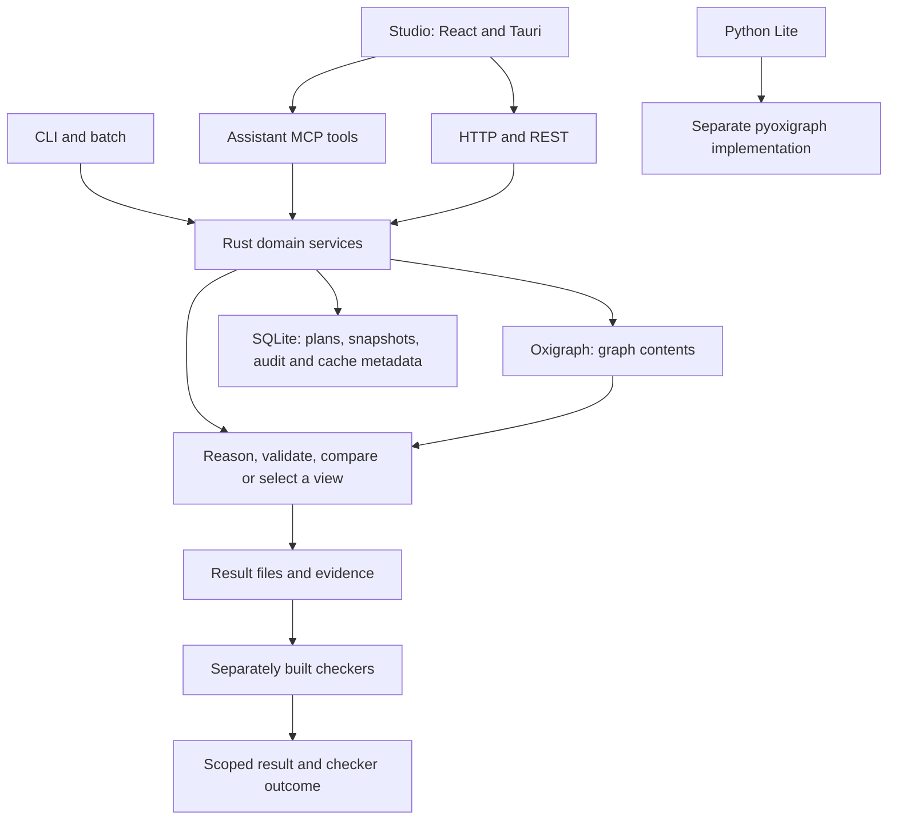

# How the repository is put together

Source: commit `c7fd75f9491253c56e4d4f408ceac179de343e48`. Counts describe tracked content in that checkout.
The grouping below is our navigation aid, not a layering policy enforced by
the upstream compiler.

## The main idea

The main Rust crate combines a graph database, reasoning tools, validation,
change reports and several ways to call them. Separate programs provide
formal checkers, a smaller Python implementation and a desktop interface.

The Rust package declares version 2.1.0. Python Lite declares 0.5.0 and Studio
declares 0.1.0; those are separate package declarations, not installed versions
or a guarantee of feature parity.

Most Rust services call the graph, database, filesystem or subprocesses
directly. This is one large crate, not a set of independently deployed
services. See [CLI, HTTP, and daemon entrypoints](https://github.com/fabio-rovai/open-ontologies/blob/c7fd75f9491253c56e4d4f408ceac179de343e48/src/main.rs#L1), [MCP services over shared graph and state](https://github.com/fabio-rovai/open-ontologies/blob/c7fd75f9491253c56e4d4f408ceac179de343e48/src/server.rs#L1), [SQLite metadata store](https://github.com/fabio-rovai/open-ontologies/blob/c7fd75f9491253c56e4d4f408ceac179de343e48/src/state.rs#L1) and [Python package boundary](https://github.com/fabio-rovai/open-ontologies/blob/c7fd75f9491253c56e4d4f408ceac179de343e48/python/pyproject.toml#L1).

## All main Rust areas

| Area | Source files | Responsibility |
| --- | ---: | --- |
| Requests and responses | 10 | CLI/batch, MCP, HTTP, daemon/socket dispatch, tool filtering and output. |
| Graph state and version reads | 8 | Oxigraph graph, SQLite metadata, saved versions, temporal scope, canonicalization and caches. |
| Change review and operation | 8 | Structural plans, drift, policy/monitor checks, enforcement, feedback, notifications and KGCL edits. |
| Reasoning over meaning | 7 | Forward rules, supplied-rule frontends, incremental inference, EL completion, tableaux and compiled claim checks. |
| Evidence, explanations and external solvers | 12 | Typed verdicts, proof formats, model/refutation checking, explanations, provenance and repair. |
| Data and rule checks | 7 | SHACL, result reports, vocabulary defects, competency questions and combinatorial shape analysis. |
| Smaller views and change consequences | 7 | Graph selection, modules, lost/support-preserved claims, closure differences and conservativity under selected rules. |
| Getting records into a graph | 13 | File/SQL intake, field mapping, conceptual-model conversion, schema suggestions and packs. |
| Comparing vocabularies and domain models | 8 | Alignment signals, crosswalks, clinical inputs, language and communities. |
| Similarity and retrieval | 9 | Optional vectors, local/remote embeddings, model fingerprints, indexes and retrieval measurements. |
| Action and causal experiments | 9 | Action effects, PDDL/BC+ integration, defaults, coevolution and structural/optional causal analysis. |
| Settings and extensions | 9 | Effective configuration, caches/buffers, registries, connection fallback, plugins and supporting reports. |

[The module map](MODULE-MAP.md) accounts for every one of the 107 files.
The [machine inventory](pattern-library/inventory/module-inventory.json)
also records public top-level symbols and lexical dependency references.

## The important flows

### Loading records

File or SQL rows become field mappings, then RDF statements in the graph.
Generated header mapping is basic; `onto_map` returns vocabulary candidates
but does not implement general semantic column alignment. Provenance is
optional in the intake path, so we cannot treat it as a replacement for Lab
source-digest and admission records. See [tabular file intake](https://github.com/fabio-rovai/open-ontologies/blob/c7fd75f9491253c56e4d4f408ceac179de343e48/src/ingest.rs#L1) and [field-to-RDF mapping](https://github.com/fabio-rovai/open-ontologies/blob/c7fd75f9491253c56e4d4f408ceac179de343e48/src/mapping.rs#L1).

Schema induction records proposed statements and the observations behind
them. Observed ranges are kept as evidence rather than silently turned into
universal restrictions. See [evidence-bearing schema proposals](https://github.com/fabio-rovai/open-ontologies/blob/c7fd75f9491253c56e4d4f408ceac179de343e48/src/induce.rs#L1).

### Reading without freezing writers

A pinned dependency exposes a stable graph snapshot. The forward/Horn
reasoning paths extract assertions from one snapshot, then reason over owned
data. A writer can continue while that run uses its fixed input. There is a
dedicated [writer-progress test](https://github.com/fabio-rovai/open-ontologies/blob/c7fd75f9491253c56e4d4f408ceac179de343e48/tests/read_does_not_block_writers_test.rs#L1).

The
[tableaux construction path](https://github.com/fabio-rovai/open-ontologies/blob/c7fd75f9491253c56e4d4f408ceac179de343e48/src/tableaux.rs#L3286)
uses the store's iteration helper. The pinned dependency also snapshots a
single iteration internally; this is not evidence of a mixed-state read.
[Dependency implementation](https://github.com/fabio-rovai/oxigraph/blob/37db8e1522585ed2f9aa994be6c5c716859af5c8/lib/oxigraph/src/store.rs#L423).
Separate reads can nevertheless select different states. Temporal metadata is
resolved before the separate assertion snapshot, so whole-operation isolation
across metadata and assertion selection is not established.

This matches our stable-view goal, but HTTP sessions share one live graph.
Saved named versions are full dataset snapshots in SQLite; restoring one
changes that common graph. There is no persistent per-agent version handle
across arbitrary requests, separate agent branches, or automatic merging.
See [stable graph reads](https://github.com/fabio-rovai/open-ontologies/blob/c7fd75f9491253c56e4d4f408ceac179de343e48/src/graph.rs#L1245), [pinned Oxigraph fork](https://github.com/fabio-rovai/open-ontologies/blob/c7fd75f9491253c56e4d4f408ceac179de343e48/Cargo.toml#L160), and [saved-version rollback](https://github.com/fabio-rovai/open-ontologies/blob/c7fd75f9491253c56e4d4f408ceac179de343e48/src/ontology.rs#L277).

Temporal selection separately describes when information is valid and when
it was recorded. That can complement our meaning and review cursors, but the
mapping must be explicit. See [explicit time scope](https://github.com/fabio-rovai/open-ontologies/blob/c7fd75f9491253c56e4d4f408ceac179de343e48/src/temporal.rs#L351).

### Asking what follows

The engine supports forward rules, a bounded description-logic reasoner,
shape validation, logic export and optional external solvers. Different
routes have different logical coverage and evidence. See [rule reasoning and certificates](https://github.com/fabio-rovai/open-ontologies/blob/c7fd75f9491253c56e4d4f408ceac179de343e48/src/reason.rs#L1),
[bounded description-logic search](https://github.com/fabio-rovai/open-ontologies/blob/c7fd75f9491253c56e4d4f408ceac179de343e48/src/tableaux.rs#L1), [Rust shape validation](https://github.com/fabio-rovai/open-ontologies/blob/c7fd75f9491253c56e4d4f408ceac179de343e48/src/shacl.rs#L1), and [logic export formats](https://github.com/fabio-rovai/open-ontologies/blob/c7fd75f9491253c56e4d4f408ceac179de343e48/src/tptp.rs#L1).

Some results emit a derivation, finite model or refutation that a smaller
separate checker can accept. A proof about supplied input does not establish
that it is the intended live graph, nor that the ontology describes reality.
See [assurance and tests](pattern-library/TESTING-ALIGNMENT.md).

### Reviewing and applying changes

A proposed graph is compared with the current graph. Reports can show
structural changes, logical defects and new consequences under a rule table.
The consequence report is more informative than counting edited edges alone.

Application is a weaker boundary than the Lab requires. Stored plans do not
carry an exact reviewed-base digest. Apply computes a new delta against the
current graph, so another caller's intervening additions can be removed to
reach the older proposed target. This is a source-based inference from
[stored plan fields](https://github.com/fabio-rovai/open-ontologies/blob/c7fd75f9491253c56e4d4f408ceac179de343e48/src/plan.rs#L670) and [plan application](https://github.com/fabio-rovai/open-ontologies/blob/c7fd75f9491253c56e4d4f408ceac179de343e48/src/plan.rs#L571), not an exploit executed in this review.

Risk and locked-IRI diagnostics are not all application gates. Monitor blocking
can be overridden. Separate write batches, blank-node clear/reload and saved
version rollback do not provide one atomic whole-operation commit. Individual
document loads do use a transaction; these are different claims.
See [batched graph writes](https://github.com/fabio-rovai/open-ontologies/blob/c7fd75f9491253c56e4d4f408ceac179de343e48/src/plan.rs#L647) and [saved-version rollback](https://github.com/fabio-rovai/open-ontologies/blob/c7fd75f9491253c56e4d4f408ceac179de343e48/src/ontology.rs#L277).

### Preparing a small view

Neighborhood selection and locality modules help choose a subset. Separate
checks ask whether named claims remain supported by that subset. A missing
claim, a claim never supported by the source, and an invalid subset assumption
are different outcomes. This is a strong fit for agent context preparation.
See [claim-preservation checks](https://github.com/fabio-rovai/open-ontologies/blob/c7fd75f9491253c56e4d4f408ceac179de343e48/src/projection_entailment.rs#L1) and [consequence-change analysis](https://github.com/fabio-rovai/open-ontologies/blob/c7fd75f9491253c56e4d4f408ceac179de343e48/src/conservativity.rs#L1).

## Interfaces and optional parts

The source declares 124 unique MCP tool attributes. Eight are feature-dependent;
the default full build therefore has a source-derived surface of 116 before
operator filtering. This is not a measured running `tools/list` response.
Build and operator filters remove routes rather than merely hiding names.
See [build-aware tool filtering](https://github.com/fabio-rovai/open-ontologies/blob/c7fd75f9491253c56e4d4f408ceac179de343e48/src/toolfilter.rs#L453) and [MCP services over shared graph and state](https://github.com/fabio-rovai/open-ontologies/blob/c7fd75f9491253c56e4d4f408ceac179de343e48/src/server.rs#L1).

Cargo defaults enable none of the optional PostgreSQL, DuckDB, embeddings,
causal-Python, WASM-plugin or TurboVec features. The main build still includes
the graph/query engine, SQLite, HTTP/MCP and tabular-data dependencies. Its
36 declared direct dependencies include a revision-pinned Oxigraph fork.
See [Rust dependencies and features](https://github.com/fabio-rovai/open-ontologies/blob/c7fd75f9491253c56e4d4f408ceac179de343e48/Cargo.toml#L1).

Python Lite is a different implementation using pyoxigraph and a Python Horn
reasoner; it is not a binding to all Rust features. Studio is React/Tauri with
engine and agent sidecars. Its replay source serves recorded/scripted material;
some live document-body, resolution and chat methods explicitly return errors.
The web try-it wrapper runs a released binary in temporary request directories.
See [Python package boundary](https://github.com/fabio-rovai/open-ontologies/blob/c7fd75f9491253c56e4d4f408ceac179de343e48/python/pyproject.toml#L1), [Studio live-source limits](https://github.com/fabio-rovai/open-ontologies/blob/c7fd75f9491253c56e4d4f408ceac179de343e48/studio/src/lib/live-source.ts#L1), and [Studio replay source](https://github.com/fabio-rovai/open-ontologies/blob/c7fd75f9491253c56e4d4f408ceac179de343e48/studio/src/lib/replay-source.ts#L1).

WASM plugins receive explicit JSON inputs and bounded execution, without direct
graph access or host imports. External model, solver, database and optional
causal routes introduce their own runtime dependencies. Structural causal
scores are not an owner permission or a proof of causal safety.
See [bounded WASM extension host](https://github.com/fabio-rovai/open-ontologies/blob/c7fd75f9491253c56e4d4f408ceac179de343e48/src/plugins.rs#L1) and [structural/optional causal analysis](https://github.com/fabio-rovai/open-ontologies/blob/c7fd75f9491253c56e4d4f408ceac179de343e48/src/civex.rs#L1).

## Every top-level area

| Area | Tracked paths | Contents |
| --- | ---: | --- |
| `(root files)` | 21 | Build and package manifests, README, license, security/contribution guidance, ecosystem and integration descriptors. |
| `.cargo` | 2 | Platform build configuration, including Windows runtime linkage. |
| `.claude-plugin` | 1 | Plugin distribution metadata. |
| `.github` | 9 | CI, release, benchmark and dependency-maintenance configuration. |
| `.mcp` | 1 | MCP distribution metadata. |
| `aeneas` | 16 | Narrow extraction of shared Rust boundary code into a separate Lean proof workspace. |
| `benchmark` | 562 | Reasoning, alignment, retrieval and domain benchmark inputs, scripts and recorded outputs. |
| `case-studies` | 736 | 22 domain/application bundles, crosswalks, datasets and evaluation harnesses. |
| `community` | 2 | Community ontology-pack catalog guidance and registry material. |
| `dafny` | 3 | Grammar/interner specifications and mutation runner; not proof of the actual Rust implementation. |
| `data` | 1 | Tracked example ontology material; other runtime data may be downloaded separately. |
| `demo` | 262 | Document-to-ontology scripts, model/engine integration and recorded replay material. |
| `docs` | 133 | Architecture, decisions, scope/assurance guides, operational instructions and assets. |
| `examples` | 12 | Small data/code demonstrations, privacy/extraction helpers and WASM plugin example. |
| `isabelle` | 104 | Independent Horn formalization, generated Standard ML checker and pipeline. |
| `lean` | 84 | Independent checkers and their Lean proof sources; separately built executables. |
| `python` | 51 | Independent lightweight pyoxigraph/Python package, optional server and validation extras. |
| `rocq` | 18 | Another Horn formalization, extraction/driver and cross-checking support. |
| `scripts` | 5 | Development, release and measurement automation. |
| `skills` | 4 | Workflow instructions for engine users; not extra engine implementations. |
| `src` | 107 | The main Rust library, command dispatch, transports and domain services. |
| `studio` | 102 | React/Tauri desktop app, engine/agent sidecars, and live/replay adapters. |
| `tests` | 671 | Rust integration tests, hostile inputs, vendored standards cases and expected baselines. |
| `tools` | 7 | Differential test helpers and supporting utilities. |
| `web` | 10 | Browser try-it page, serverless Python binary wrapper, and its install-race tests. |

The case studies cover health, manufacturing, robotics, environmental and
nature governance, finance, insurance, skills/occupations and model crosswalks.
They are worked examples and evaluation material, with their own assumptions,
runtime requirements and sometimes separate data licenses.

## What “complete map” means here

Every tracked path has a byte count and SHA-256 in
[file-inventory.json](pattern-library/inventory/file-inventory.json). Symlinks
are recorded as links, with the hash of the link target text; they are not
followed into unrelated directories. Every root Rust source file is classified.
Dependency edges are lexical references, including conditional/test code, not
a compiler-resolved call graph.

Three mapper reports and selected main-agent checks ground the detailed flows.
No one read all 97,137 Rust source lines or proved every possible runtime path.
Read [the verification record](VALIDATION.md) before treating a capability as
freshly tested.
