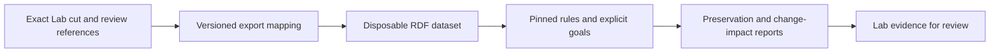

# What CyberAlchemy can take from this repository

The best fit is a reasoning and evidence companion that reads an exact Lab
view and returns a report. Our event histories and owner decisions continue
to determine the ontology state and what changes may be accepted.

These are source-grounded recommendations. No integration was implemented or
approved by this review.

## What we already have

Our [Ontology Lifecycle guide](../../../../ontology-lifecycle/ARCHITECTURE.md)
describes stable identities, meaning history, exact review joins, versioned
reads and calculated views. The
[graph snapshot implementation](../../../../ontology-lifecycle/runtime-candidates/cal-ontology-graph-read-model/v1/src/lib.rs)
lets a reader retain an earlier view. The
[Lab transaction validator](../../../../implementation/lab-runtime/v1/lab_runtime/operations.py)
checks expected HEAD, source snapshot, endpoint versions, allowed pairs and
qualifiers. These should be preserved.

The Lab also has substantial existing formal-assurance work. The
[relational-checker v3 implementation review](../../../../craft/formalization/candidates/relational-theorem-checker/v3/execution/extensions-review.md)
and [execution record](../../../../craft/formalization/candidates/relational-theorem-checker/v3/execution/PROGRESS.md)
describe completed, reviewed units for conditions, evidence aggregation,
delegation chains, fulfillment, lifecycle, typed representations, and an
independent-checker sample. Earlier design notes are not the current status
index for that work.

Definition assurance has a separate
[formalization model](../../../plans/definition-formal-assurance/candidate/foundations-first-v1/FORMALIZATION-MODEL.md)
and a dated
[source and formalization coverage snapshot](../../../plans/definition-formal-assurance/candidate/assurance-snapshots-v1/source-and-formalization-coverage.json).
The model distinguishes non-collapse, joint consistency, required existence,
source correspondence, and different strengths of evidence. A source expression
or a partial translation is not a proof of the whole natural-language definition.

## Limits of the Lab comparison

The original repository map considered selected Lab artifacts, but did not
perform a full comparison against the current definition-assurance and
relational-checker implementations. The subsequent proof-fit answer read the
definition model and v3 APIs, implementation review and independent-checker
study, without rerunning their checks. The definition coverage snapshot was
examined only during the follow-up clarification.

The ranked ideas below are therefore candidate transfers, not established
missing capabilities. Before implementation, compare each with the existing Lab
theorem, semantics, evidence binding, supported profile and current execution.
Classify the result as already covered, useful extension, independent cross-check,
or incompatible. This clarification is not a fresh validation of the Lab's
recorded acceptance or whole-definition coverage.

## Ranked opportunities

The later [focused proof comparison](LAB-PROOF-COMPARISON.md) checks actual
definition-assurance and relational-checker implementations. It finds
substantial existing coverage: generic evaluation, recursive inference,
model replay, invalidation and scoped conservativity are already present.
The table below ranks potentially useful upstream patterns; it does not rank
confirmed missing Lab features. The strongest extensions are concrete
agent-view and semantic-change workflows, with additional verified checkers
evaluated against our existing models.

| Priority | Idea | Value for the Lab | Cost and limit |
| --- | --- | --- | --- |
| 1 | Check that a small agent view preserves required claims | An agent can use less context without silently losing the facts needed for its task. | Needs a faithful Lab-to-logic mapping and explicit goals; partial rule coverage must be disclosed. |
| 2 | Preview semantic effects of a proposed change | Show downstream consequences before owner review, including changes a structural graph diff misses. | Requires exact before/after cuts, rule profile and work budgets. |
| 3 | Bind strong result labels to checked evidence | Make it harder for an unchecked report to acquire the status of a checked result. | Pattern is small; trustworthy checker identity and exact input binding need additional work. |
| 4 | Pin one input and carry selection scope through all checks | Keep reasoning reproducible while writers and other agents continue. | Lab already has versioned reads; reuse regression tests and mapping discipline rather than replacing them. |
| 5 | Preserve evidence and losses during intake/translation | Imported documents and spreadsheets produce reviewable candidates with named unsupported meanings. | Observations remain hypotheses; translators must not create authority or equivalence. |
| 6 | Prove CI checks actually ran and can reject | Prevent green results caused by missing tools, empty corpora or skipped checker tests. | Portable test discipline; specialized jobs still need pinned tools and data. |
| 7 | Separate live, replay, unknown and unavailable UI states | Make the human interface honest about what it has observed and what it can do. | Reuse the adapter pattern; upstream live feature coverage is incomplete. |

### 1. A useful view is one that preserves the task's claims

Selecting 95% of a graph is not enough if the omitted 5% contains the premise
the agent needs. Let a task name its required claims, then compare support in
the full selected source and the smaller view.

Keep four cases distinct: support retained, support lost by selection, no
support in the source, and an invalid source/subset assumption. This fits our
context selector and exact ontology cuts. Upstream checks ground positive
claims under a pinned rule table; they do not prove every possible behavior
of an agent consuming the view. Evidence: [claim-preservation checks](https://github.com/fabio-rovai/open-ontologies/blob/c7fd75f9491253c56e4d4f408ceac179de343e48/src/projection_entailment.rs#L1).

### 2. Show changed consequences, not just changed edges

A new domain or range statement can infer new types for existing records.
That can affect many conclusions even when no class is added or removed.
The useful report has separate sections for structural changes, logical
defects and consequences over the existing vocabulary.

The upstream result is relative to its selected Horn rule table. An empty
consequence diff is not universal OWL conservativity or proof of a harmless
business change. Evidence: [consequence-change analysis](https://github.com/fabio-rovai/open-ontologies/blob/c7fd75f9491253c56e4d4f408ceac179de343e48/src/conservativity.rs#L1).

### 3. A checked result needs evidence, not a status string

The result-type pattern uses private constructors and avoids deserializing
earned verification states. An engine can search freely, but the stronger
label requires a checker outcome bound to named input files.

The upstream code still trusts operator-chosen checker binaries and
caller-selected input paths. We should bind trusted checker identity, immutable
input bytes, the Lab source cut and mapping version before treating a result as
conformance evidence. Even then, it is evidence for an owner decision, not the
decision itself. Evidence: [evidence-carrying verdicts](https://github.com/fabio-rovai/open-ontologies/blob/c7fd75f9491253c56e4d4f408ceac179de343e48/src/verdict.rs#L1) and [remaining checker trust boundaries](https://github.com/fabio-rovai/open-ontologies/blob/c7fd75f9491253c56e4d4f408ceac179de343e48/src/verdict.rs#L34).

### 4. Stable inputs help agents work independently

The upstream forward/Horn paths obtain a no-writer-lock MVCC snapshot from the
patched store, extract assertions once, and reason over owned data. A single
store iteration is also implicitly snapshotted, but separate reads can select
different states. Temporal metadata selection precedes the data
snapshot, so they are not established as one atomic selection. Its snapshot
test checks writer progress during one long read, rather than accidentally
measuring gaps between separate reads.

We can use that test shape to harden our existing stable-view guarantee.
We should not copy the shared live graph or saved-version rollback as a
replacement for agent-held immutable views and canonical events. Evidence:
[stable graph reads](https://github.com/fabio-rovai/open-ontologies/blob/c7fd75f9491253c56e4d4f408ceac179de343e48/src/graph.rs#L1245), [writer-progress test](https://github.com/fabio-rovai/open-ontologies/blob/c7fd75f9491253c56e4d4f408ceac179de343e48/tests/read_does_not_block_writers_test.rs#L1), and [saved-version rollback](https://github.com/fabio-rovai/open-ontologies/blob/c7fd75f9491253c56e4d4f408ceac179de343e48/src/ontology.rs#L277).

### 5. Import candidates with their reasons and missing meanings

Schema induction reports the rows behind each proposal and avoids turning
observed numeric ranges into universal constraints. Conceptual-model translation
records constructs it cannot express. Extraction scaffolds separate asking a
model for candidate data from validating the returned shape.

These fit a Lab intake route: original evidence -> proposed interpretation ->
independent checks -> owner review. Evidence: [evidence-bearing schema proposals](https://github.com/fabio-rovai/open-ontologies/blob/c7fd75f9491253c56e4d4f408ceac179de343e48/src/induce.rs#L1), [translation with unsupported-construct reporting](https://github.com/fabio-rovai/open-ontologies/blob/c7fd75f9491253c56e4d4f408ceac179de343e48/src/ossie.rs#L1),
and [extraction request and output validation](https://github.com/fabio-rovai/open-ontologies/blob/c7fd75f9491253c56e4d4f408ceac179de343e48/src/extract_scaffold.rs#L1).

### 6. Make a green check mean the required work happened

Dedicated strict jobs fail when required checkers or fixtures are missing.
A coverage test checks whether skippable test files have a strict job or an
explicit exception. Hostile mutations show whether a gate actually rejects
bad evidence. These are useful additions to our existing evidence practices.
Evidence: [CI skip-coverage checks](https://github.com/fabio-rovai/open-ontologies/blob/c7fd75f9491253c56e4d4f408ceac179de343e48/tests/ci_gate_coverage_test.rs#L1).

### 7. Show what the interface really knows

The Studio source adapters separate replay from live data and return explicit
errors where live functionality is missing. The idea is reusable even though
the upstream app itself has incomplete live paths. Evidence: [Studio live-source limits](https://github.com/fabio-rovai/open-ontologies/blob/c7fd75f9491253c56e4d4f408ceac179de343e48/studio/src/lib/live-source.ts#L1) and
[Studio replay source](https://github.com/fabio-rovai/open-ontologies/blob/c7fd75f9491253c56e4d4f408ceac179de343e48/studio/src/lib/replay-source.ts#L1).

## Semantic mismatches to resolve before using its engine

| Lab concern | Upstream concern | Required mapping |
| --- | --- | --- |
| Exact governed subject/relation revision | RDF node or triple | Preserve source identity, version, scope and digest; do not use labels as identity. |
| Allowed ordered endpoint kinds and qualifiers | OWL domain/range and SHACL shapes | OWL often infers types instead of rejecting a forbidden pair. Encode closed validation separately. |
| Separate meaning/review cursors | Valid-time/recorded-time graph scope | Define correspondence explicitly; a temporal scope is not automatically an event cut. |
| Active, retired and removed state | Mutable graph and saved snapshots | Preserve event history and terminal-state rules outside the analytical projection. |
| Owner decision and authorized effect | Tool call, report or successful proof | Keep approval and effect policy in the Lab. |
| Declared profile completeness | Partial OWL/SHACL/rule implementation | Report supported, unsupported, unknown and untested meanings. |

Blank nodes, literal lexical forms, graph names and serialization also matter
when hashing and comparing representations. The dependency fork includes fixes
in these areas; switching to an arbitrary RDF library version changes the
assumptions. Evidence: [pinned Oxigraph fork](https://github.com/fabio-rovai/open-ontologies/blob/c7fd75f9491253c56e4d4f408ceac179de343e48/Cargo.toml#L160).

## What we should not take unchanged

- Applying a target graph without rejecting a stale reviewed base.
- Treating “safe” mode, risk scores or locked-IRI reports as Lab authorization.
- Whole-graph rollback, multi-batch mutation and best-effort audit as our
  canonical transaction/history model.
- Similarity-based rename guesses as automatic semantic equivalence.
- Proof results as proof of source accuracy, ontology truth or owner consent.
- Structural causal scores as permission to execute actions.
- Shared HTTP sessions as independent agent ontology versions.

## A small proposed first experiment

Use one frozen Lab ontology cut and two bounded views of it. Pick a few existing
relation kinds and a few claims that an agent task needs.

The analytical tool receives no canonical event-write authority. Retain the cut,
review references, export mapping version, output bytes, rule profile, checker
version where used, refusals and work limits with the report.

Deliberately remove a required premise from one view. The check must distinguish
that lost support from a claim that the original source never supported. Change
one relation or type rule and require the report to show the additional
consequences. Mutate an identity or version binding and require rejection by
the Lab-side mapping check.

Start with this evidence-producing slice. Compare an isolated command-line
adapter with the smaller Python route only after deciding which exact checks
are needed; Python Lite does not provide general Rust feature parity.
No model downloads, new dependency installation, service activation or runtime
migration was performed in this review.

## Adoption posture

Reusable patterns: strong candidates. Engine integration: bounded experiment.
Replacement of Lab history, approval or transaction handling: not supported by
this review. Code is MIT; check separate dataset terms before copying fixtures.
