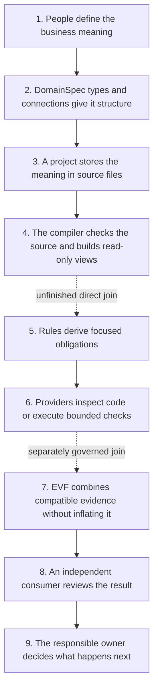

# DomainSpec v2 Architecture

## What DomainSpec v2 is

DomainSpec v2 is a way to make a **checked map of a software system**.

The map says:

- what things exist in the business;
- what each thing is allowed to do;
- how the things are connected;
- what the code should contain; and
- what evidence we have that the code matches the map.

For example, a game might contain:

```text
Player -------- performs -------> UnlockDoor
                                     ^
                                     |
                                enforced by
                                     |
                                 HasKeyRule

UnlockDoor ------ produces ------> DoorUnlocked
```

This small map says four concrete things:

1. `Player` is something with an identity.
2. `HasKeyRule` decides whether unlocking is allowed.
3. `UnlockDoor` changes the game's state.
4. `DoorUnlocked` records that the change happened.

DomainSpec can check whether this description is well formed. It can generate readable
views and focused checks from supported inputs. It can also collect evidence about code.

It cannot prove that a real player owns a key, that the game code works in production,
or that the business rule is correct. Those are different questions requiring different
evidence and decisions.

## How to read this document

This is the stable map of the whole DomainSpec v2 system.

- Read [COMPLETE-GUIDE.md](COMPLETE-GUIDE.md) for a longer tutorial.
- Read [.craft/ledger.yml](.craft/ledger.yml) for current work and blockers.
- Read `authority/` and `definitions/` when the exact meaning of a term matters.
- Read a component's own architecture document for its detailed design.

A design, roadmap, test, or receipt may describe or test the system. None of those
artifacts automatically approves a definition, implementation, release, or deployment.

## One idea at three levels

The same idea runs through every part of DomainSpec:

> Write down the intended meaning, derive what should be checked, observe what happened,
> and keep the final decision separate from the evidence.

### Level 1: one rule controls one action

Suppose a player may open a locked door only when they hold the required key.

```text
HasKeyRule -- enforces --> UnlockDoor
```

DomainSpec gives both concepts a stable name and type:

| Concept | DomainSpec type | Plain meaning |
| --- | --- | --- |
| `HasKeyRule` | Rule | Returns yes or no: may this action happen? |
| `UnlockDoor` | Operation | Changes state: the door becomes unlocked. |

This example demonstrates that a business decision has an explicit home and an explicit
connection to the action it controls.

It does **not** prove that the rule is a good rule or that any implementation enforces it.

### Level 2: one complete feature

Now add the actor and the result:

```text
Player -------- performs -------> UnlockDoor -------- produces -------> DoorUnlocked
                                     ^
                                     |
                                  enforces
                                     |
                                 HasKeyRule
```

The checked Key and Door fixture stores this feature in six editable files:

```text
project.json
specs/key-and-door/feature.json
specs/key-and-door/nodes/player.json
specs/key-and-door/nodes/has-key-rule.json
specs/key-and-door/nodes/unlock-door.json
specs/key-and-door/nodes/door-unlocked.json
```

The compiler reads those files and produces five read-only results:

```text
.domainspec/generated/graph.json
.domainspec/generated/source-manifest.json
.domainspec/generated/SPEC.md
.domainspec/generated/markdown-view.json
.domainspec/generated/build-receipt.json
```

Concrete checks include:

- every file named by `feature.json` exists;
- every node uses a type supported by the selected profile;
- the `enforces` connection starts at a Rule and ends at an Operation;
- `UnlockDoor` points to an existing `DoorUnlocked` node;
- generated results match the exact source files and registry versions.

If `UnlockDoor` points to a missing event, compilation fails. If someone edits generated
`SPEC.md` by hand, the recorded digests no longer match and the generated set is stale.

This example demonstrates checked structure, source tracking, and repeatable generation.

It does **not** execute the game or prove that the code unlocks a door correctly.

### Level 3: compare the map with code

The target end-to-end route adds implementation evidence:

```text
DomainSpec source
  -> checked graph
  -> obligations such as "HasKeyRule must guard UnlockDoor"
  -> language-specific checks against TypeScript, Python, or Rust code
  -> evidence combined by EVF
  -> independent review
  -> a human owner decides whether to accept or release
```

For example, a provider could inspect a TypeScript implementation and report:

```text
expected: HasKeyRule directly guards UnlockDoor
observed: UnlockDoor calls HasKeyRule before changing state
result:   supported for these exact files and tool versions
```

If the provider cannot inspect an indirect framework call, it must report
`unsupported`; it may not turn uncertainty into PASS. If TypeScript evidence passes but
the matching runtime case was never executed, the final claim must say so.

This example demonstrates how several kinds of evidence can support one bounded claim.

It does **not** describe a complete current pipeline. The compiled JSON graph now derives
and checks all applicable backend DS-D8 obligations, and the packed CLI is exercised by
isolated consumers. The general TDE/factory-to-EVF join remains unfinished.
Even a complete technical result would still require a separate owner decision before
release or deployment.

## What works now and what is still a target

| Area | What exists now | What is still missing |
| --- | --- | --- |
| Language | 13 active backend types and 31 active relationship signatures in total | Wider admitted type formation and implementation coverage |
| JSON source | A checked project/feature/node format and stable compiled-graph compiler with DS-D8 obligation derivation | External registry publication and broader derivation families |
| Generated views | Graph, source manifest, readable spec, view record, build receipt | Stable adoption by every downstream consumer |
| Markdown derivation | A deterministic engine that creates structural obligations and test material | A safe bridge from the selected JSON graph, or retirement of the legacy input |
| Conformance factory | Bounded, repeatable local evidence graphs | Broader providers and a governed general EVF connection |
| Implementation conformance | Stable generated-target compile checks and isolated package-consumer evidence | An independently adopted production runtime package |
| EVF | Architecture and partial candidate-local evidence | A general governed EVF join; this remains outside Stable 1.0 |
| Operational resilience | Offline checks over synthetic fixtures | Live production monitoring, deployment, rollback, and runtime proof |
| CLI | Stable 1.0 source, compiled graph, generation, verification, and certification across 13 backend meta-types and three languages | External registry publication; runtime remains experimental |
| Production release | A locally verified, packable Stable 1.0 implementation candidate | Independent release decision, publication, deployment, and production operations |

The counts need care. There are 13 active backend types. The registry also retains UI
candidates, deferred UI types, and the superseded `Saga` record. Those retained records
are not all active types. There are 31 active relationship signatures in total; 17 are
backend signatures used by the current backend validation denominator.

## The whole system at a glance



The dotted arrows are important. They show where the architecture intends to connect
components but the general connection is not yet proven complete.

## The parts and their jobs

| Part | What it does | Concrete example | What it cannot decide |
| --- | --- | --- | --- |
| Authority | Says which source owns a meaning and who may approve changes | The definition registry owns what `Rule` means | Whether passing code should be released |
| Language | Defines allowed concept types and connections | A Rule may `enforce` an Operation | Whether a particular business rule is wise |
| Project source | Stores the system description people edit | `has-key-rule.json` and `unlock-door.json` | Whether generated output is correct without checking it |
| Compiler | Checks and resolves the source | Reject a connection to a missing node | Whether the running application behaves correctly |
| Derivation engine | Turns supported meaning into focused checks | Create a check for every declared state transition | Whether those checks passed |
| Evidence provider | Observes one implementation using named tools | Inspect a TypeScript call from an Operation to a Rule | Anything outside its declared files, tools, and cases |
| Conformance factory | Locks and repeats a graph of provider runs | Re-run a Rule proof and reject a different semantic result | Business acceptance or release |
| EVF | Combines compatible results and accounts for gaps | Join structural and runtime evidence for the same obligation | Fill in missing evidence or convert `unsupported` to PASS |
| Independent consumer | Checks whether the receipt supports its stated claim | Reproduce a run from the same locked inputs | Promote or release unless it also has that authority |
| Owner gate | Makes the authorized decision | Accept a profile or authorize a release | Stretch an old decision over changed bytes |

## Where meaning comes from

Not every document in the repository has the same weight.

The [source spine](authority/source-spine.md) separates:

- **primary authority** — the local source that owns a definition or rule;
- **supporting precedent** — older or external material that may inform a decision;
- **local synthesis** — a proposed interpretation assembled from evidence;
- **evidence** — a test, observation, or receipt about exact inputs; and
- **open residue** — something the available sources do not settle.

Example: an old DomainSpec v1 document may explain why a relationship was introduced.
It can support a v2 proposal, but it cannot silently override the current v2 registry.

A new idea moves through explicit steps:

```text
source evidence
  -> recorded claim
  -> candidate definition or obligation
  -> validation and review
  -> recommendation
  -> owner decision
```

If a step is missing, the idea remains a candidate. A good test result does not skip the
owner decision.

## The language: types and connections

A **meta-type** is the role a concept plays in the system.

| Family | Examples | Plain question |
| --- | --- | --- |
| Structural | Entity, Value Object, Enum | What things exist? |
| Behavioral | Operation, Query, Calculation, Rule, Policy, Workflow | What happens or gets decided? |
| Connective | Interface, Event, Mapping | How do parts communicate or translate data? |
| Lifecycle | State Machine | How does something move between states? |

Examples:

- `Player` is an **Entity** because the same player keeps an identity over time.
- `Money(amount, currency)` is a **Value Object** because two equal values are
  interchangeable.
- `UnlockDoor` is an **Operation** because it changes state.
- `HasKeyRule` is a **Rule** because it allows or blocks an action.
- `DoorUnlocked` is an **Event** because it records something that happened.

A relationship is a checked connection between two typed concepts:

```text
HasKeyRule -- enforces --> UnlockDoor
UnlockDoor -- produces --> DoorUnlocked
Player -- performs --> UnlockDoor
```

A field that merely stores another ID is not automatically a DomainSpec relationship.
The connection needs a concrete consequence: it changes an allow/reject decision,
derivation, projection, composition path, owner route, or generated artifact.

The exact current vocabulary lives in
[DEFINITIONS-INDEX.md](definitions/DEFINITIONS-INDEX.md),
[meta-types.md](definitions/meta-types/meta-types.md), and the relationship registry.

## The two current source paths

### Path A: selected JSON source

```text
project.json -> feature.json -> node files
             -> compiler
             -> graph + provenance + readable view + build receipt
```

This path answers: “Did the project describe a well-formed graph using this exact
profile and these exact registries?”

Example failures:

- `feature.json` names a node file that does not exist;
- a node uses a type the selected profile does not support;
- a Rule points to an Entity using an Operation-only relationship;
- a generated view no longer matches its source digest.

See [impl/spec/minted-project/INDEX.md](impl/spec/minted-project/INDEX.md).

### Path B: legacy Markdown derivation

```text
aspect Markdown or normalized SPEC.md
  -> parsed graph
  -> deterministic rules
  -> stable obligation IDs
  -> test specifications and structural tests
```

This path answers: “Given this supported Markdown input, which structural checks follow
from what it declares?”

Example: one state-transition row can produce a positive transition check, while an
explicitly invalid transition produces a rejection check.

The engine does not invent equations or business behavior missing from the source. It
uses no language model and no network during derivation. See the
[engine README](impl/test-derivation-engine/README.md).

### Why they must not be described as one path

The JSON compiler currently produces a checked graph and read-only views. The legacy
engine currently derives obligations from Markdown. The planned machine route must
derive from admitted machine artifacts without secretly falling back to generated
Markdown.

Until that route is implemented and independently checked, a successful JSON build is
not evidence that the Markdown derivation path also ran.

## From a check to a justified claim

Consider the statement:

> `HasKeyRule` guards `UnlockDoor` in the implementation.

To support it, the system needs several different records:

| Record | Concrete question |
| --- | --- |
| Business source | Who decided that holding the key is required? |
| Specification source | Which exact files contain `HasKeyRule`, `UnlockDoor`, and `enforces`? |
| Checked graph | Did the compiler resolve that connection correctly? |
| Obligation | Which exact condition must an implementation meet? |
| Generated check | Which executable probe represents that condition? |
| Code binding | Which function or module implements each concept? |
| Run evidence | What did the named tool observe on the named files? |
| Receipt | What conclusion follows, and what remains unsupported? |

None can replace another. For example:

- a generated check is not a test execution;
- passing unit tests do not prove the business source was authorized;
- a receipt for one commit says nothing about changed code;
- a structural match does not prove production behavior.

## Conformance, factory, and EVF

### Implementation-conformance design

The [implementation-conformance architecture](development/implementation-conformance/ARCHITECTURE.md)
designs a pure evaluator. “Pure” means it would receive already collected facts and
return the same result for the same inputs. It would not read files, launch tools, call
a network service, or make owner decisions itself.

This is currently an admitted Design, not a completed runtime package.

### Conformance factory

The implemented [factory](impl/architecture-conformance/factory/README.md) runs bounded
local experiments. A factory run:

1. lists every required source file, tool, and dependency;
2. records their exact digests;
3. copies the locked inputs into a private snapshot;
4. runs provider nodes in dependency order;
5. repeats semantic work in separate processes;
6. rejects different semantic results;
7. records process details separately from semantic meaning; and
8. publishes only a complete verified run.

Example: a join checking `Rule enforces Operation` may use only Rule and Operation
results verified in that same run. It cannot quietly reuse yesterday's Rule result.

The factory proves only the claim named by its request and providers. Its current proof
is local and same-host; it is not production or cross-host proof.

### EVF

The [Evolvable Validation Framework](development/evolvable-validation-framework/ARCHITECTURE.md)
is the planned common evidence layer for different validators.

Suppose three providers report:

```text
structure provider: PASS
runtime provider:   PASS
formal provider:    UNSUPPORTED
```

EVF should preserve all three facts. It may conclude that structure and the tested
runtime case are supported. It may not claim formal coverage or silently calculate an
overall unlimited PASS.

That is what **non-inflating composition** means: combining evidence never makes the
claim larger than the evidence.

EVF has architecture and partial candidate-local evidence, but no current receipt proves
the complete path from selected source through an independent consumer.

## Rules, checks, and change over time

DomainSpec separates three questions:

1. **Rule:** What structure is allowed?
2. **Check:** Does this exact version follow the rule?
3. **Trend:** Is the system moving closer to or farther from the rule over time?

Concrete example:

```text
rule:       dependency A -> B is forbidden
check now:  this commit contains one A -> B import
trend:      the last four accepted measurements were 4, 3, 2, 1 violations
```

The current check can report one violation. It cannot claim improvement without
comparable earlier measurements. Even a clear improving trend does not repair the code;
an external action must make the change.

The rule/check/trend model is stable architecture. The persistent trend stream and
guarded convergence mechanism are not a complete current runtime.

## Durable Workflow recovery

DomainSpec models Workflow compensation as forward recovery through existing Operations. Workflow evaluation
produces one immutable Recovery Intent and frozen plan; it never executes recovery Operations directly.

The canonical logical runtime is:

```text
Recovery Planner
  -> one transactional Recovery Coordination Store
       (Intent, Dispatch, progress, Claims, Leases, Attempts, Retries,
        Terminal Disposition, dispatch outbox)
  -> fenced Durable Recovery Worker
  -> exact Operation Binding Resolver
  -> Operation-owned Invocation Ledger and ordinary Operation execution

Restart Reconciler -> first incomplete plan occurrence
Dispatch Outbox Publisher -> committed coordination events
```

The coordination store is one logical atomicity boundary. It does not include an Operation's business state
or Operation outbox; those remain inside the Operation's independent transaction and declared effect
authority. Queue messages, polling, clocks, and telemetry are adapters or observations and cannot author
dispatch truth.

The portable architecture requires version compare-and-set, atomic dispatch transition plus dispatch outbox,
monotonic progress, one current fenced Claim, an active latest-generation Lease at commit, unique Attempts,
stable Invocation Identity across replay, persisted bounded Retry, evidence-bound Terminal Disposition, and
restart from the first incomplete occurrence. Its delivery claim is at-least-once invocation with idempotent
semantic application, never universal exactly-once process execution.

The current in-process runtime implements deterministic planning, composition-root binding, complete binding
preflight, ordered external invocation, and explicit failure continuation. Durable coordination, fencing,
Lease renewal, Attempt journaling, persisted scheduling, restart reconciliation, and durable Operation replay
recognition remain designed rather than implemented.

See [the durable recovery architecture package](architecture/durable-recovery/README.md) for the component
cards, typed properties, constraints, evidence findings, tests, observability, and deferred adapter choices.

## Ontology, Craft, and release

The canonical private [product ontology package](ontology/README.md) explains how
DomainSpec product meaning connects to its current implementation, conformance, and
evidence surfaces. It is a read model: it does not write into the strict source contract,
redefine canonical terms, or grant publication, release, deployment, or production authority.

[`.craft/ledger.yml`](.craft/ledger.yml) tracks active work, blockers, decisions, and
continuation. It can say “this work is blocked” or “this task is next.” It does not define
what `Rule` means or authorize a production release.

Release requires a chain broader than one successful validation:

```text
accepted business meaning
  -> exact specification
  -> checked graph and obligations
  -> code bound to the graph
  -> structural and runtime evidence
  -> independent verification
  -> implementation acceptance
  -> external release authorization
```

The [first-production-release roadmap](development/first-production-release/ROADMAP.md)
describes the required dependency shape. It is not evidence that production is
authorized or ready. Current frontier details belong in Craft and the latest same-lane
receipts, not in this stable document.

## Where the pieces live

| Path | Plain-language purpose |
| --- | --- |
| `authority/` | Says which sources and people own which decisions |
| `definitions/` | Defines the DomainSpec vocabulary and allowed connections |
| `ontology/` | Holds the canonical private business-system product ontology and its validated views |
| `impl/spec/` | Holds schemas, profiles, examples, and source contracts |
| `impl/tools/minted-project/` | Creates and compiles the selected JSON source format |
| `impl/test-derivation-engine/` | Derives structural obligations from supported Markdown |
| `impl/architecture-conformance/` | Runs repeatable local evidence graphs |
| `impl/operational-resilience/` | Tests offline resilience contracts using synthetic evidence |
| `impl/cli/` | Holds the Stable 1.0 compiler, generator, verifier, certifier, and explicitly experimental runtime subpath |
| `development/implementation-conformance/` | Holds the target conformance Design |
| `development/evolvable-validation-framework/` | Holds the EVF architecture and evidence |
| `development/validation-architecture-roadmap/` | Plans one complete validation route |
| `development/first-production-release/` | Maps the proof needed before a first release |
| `.craft/ledger.yml` | Tracks current work and continuation |

The `development/` tree contains plans, experiments, work packs, candidates, and
receipts. A file existing there does not mean the idea is implemented or approved.

## Concrete failure behavior

| What goes wrong | What DomainSpec should do | What it must not do |
| --- | --- | --- |
| A node uses an unknown type | Reject the source | Guess the nearest type |
| `HasKeyRule` points to a missing action | Reject compilation | Invent the action |
| Generated `SPEC.md` was edited | Rebuild all bound generated files | Treat the edit as new source |
| A source or tool digest changed | Reject the old binding | Reuse the old receipt |
| A provider cannot inspect the code pattern | Report `unsupported` | Report PASS |
| Only some obligations ran | List the missing coverage | Claim full coverage |
| A repeated run changes semantic meaning | Block the evidence run | Average the results |
| A join receives evidence from another run | Reject the join | Mix old and new evidence |
| No independent consumer reviewed the result | Stop the claim at provider evidence | Call it independently verified |
| No owner authorized release | Stop before release or deployment | Treat technical PASS as permission |

## How changes should happen

Examples:

- To change what `Rule` means, start with the definition owner—not a code adapter.
- To add a new meta-type, provide its required shape, allowed connections, derivation
  behavior, examples, counterexamples, and downstream checks.
- To add a relationship, show the concrete validation or generated result that changes.
- To change the compiler, preserve the separation between editable source and generated
  views.
- To add a provider, list all inputs, tools, dependencies, raw evidence, and unsupported
  cases.
- To combine evidence in EVF, keep the final claim no stronger than the weakest required
  part.
- If authority-bearing bytes change, create new digests, validation, independent review,
  and owner acceptance. Do not reuse an older decision.

## Known gaps

1. The selected JSON graph feeds backend DS-D8 obligation derivation, but not the broader TDE/EVF obligation model.
2. Clean-package evidence covers isolated installed consumers, but no owner-bound release receipt exists.
3. All 13 active backend types have deterministic generated-target checks; wider admitted type formation remains open.
4. UI types are still candidate or deferred even where related connections are active.
5. Multi-language and formal examples prove bounded cases, not universal parity.
6. The general factory-to-EVF connection is not established.
7. Trend and guarded-convergence machinery is incomplete.
8. Offline resilience evidence does not establish production behavior.
9. The CLI has a Stable 1.0 compatibility boundary but has not been externally published or released.
10. Production authorization remains external and unsatisfied.
11. Durable Workflow recovery has a canonical architecture-property profile, but its coordination store,
    Claim/Lease runtime, Attempt journal, Retry scheduler, Terminal recorder, restart reconciler, and
    Operation-owned replay ledger are not implemented.

These gaps do not erase the working slices. They limit how far the evidence may be used.

## Small glossary

| Term | Plain meaning | Example |
| --- | --- | --- |
| Meta-type | The role a concept plays | Rule, Operation, Event |
| Typed graph | Named concepts joined by allowed connections | `HasKeyRule --enforces--> UnlockDoor` |
| Profile | The exact subset of language a project may use | The Key and Door fixture supports four types and three connections |
| Projection | A derived view of source meaning | `graph.json` built from node files |
| Obligation | One specific thing that must be checked | The Rule must guard the Operation |
| Provider | A bounded tool adapter that produces evidence | A TypeScript source inspector |
| Receipt | A record of exact inputs, checks, results, and limits | A factory semantic receipt |
| Claim ceiling | The strongest conclusion the evidence permits | “Supported for these files,” not “production correct” |
| Authority effect | Whether an artifact is allowed to change official state | An ontology candidate has `none` |
| Independent consumer | A separate checker of the evidence package | A reviewer reproducing a locked run |

## Reading order

1. Stay in this document for the system map and running example.
2. Use [COMPLETE-GUIDE.md](COMPLETE-GUIDE.md) for a detailed walkthrough.
3. Use [authority/AUTHORITY-MODEL.md](authority/AUTHORITY-MODEL.md) when deciding what a
   result may claim.
4. Use [definitions/DEFINITIONS-INDEX.md](definitions/DEFINITIONS-INDEX.md) for current
   language status.
5. Use [impl/spec/minted-project/INDEX.md](impl/spec/minted-project/INDEX.md) for the JSON
   source and generated-file contracts.
6. Use [impl/test-derivation-engine/README.md](impl/test-derivation-engine/README.md) for
   the legacy derivation path.
7. Use [the factory README](impl/architecture-conformance/factory/README.md) and
   [implementation-conformance Design](development/implementation-conformance/ARCHITECTURE.md)
   for code-evidence details.
8. Use [the EVF architecture](development/evolvable-validation-framework/ARCHITECTURE.md)
   for evidence composition.
9. Use [.craft/ledger.yml](.craft/ledger.yml) for current work status.
