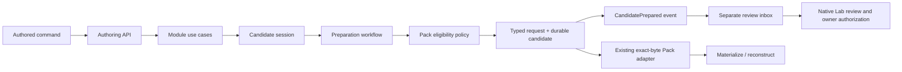

# Define: modules and use cases

This is the maintained authored model for Define, using the imported AlchLang
**0.7.0-candidate.0** and Craft Core **1.3.0**. Business operations live with their
local helpers. The model has separate authoring and candidate-preparation
selections, sharing the same domain contracts.

`define/define-alch` selects the host adapter in `runtime/`. Existing saved Work
journals continue to replay against their exact frozen source digest. That
source is archived as evidence and extracted only into ignored build cache;
there is one editable model here. New model edits do not silently migrate an
existing journal's source identity.

Verification uses fixture credentials. The model's review inbox does not replace
the native Lab v2 store or authorize a Lab owner.

## Organization

```text
alchlang/
├── define.alch                       # Authoring API and projection coordination
├── preparation.alch                  # Durable preparation workflow and publication
├── review-inbox.alch                 # Receiving service's Event entry
├── shared/
│   └── values.alch                   # Identifiers, exact-byte provenance, posture
├── modules/
│   ├── work/
│   │   ├── contracts.alch
│   │   ├── shared/session.alch        # Session creation and lifecycle
│   │   └── use-cases/                # Start, revise, context, bindings, close, resume
│   ├── conversation/
│   │   ├── contracts.alch
│   │   ├── shared/readiness.alch      # Question lifecycle
│   │   └── use-cases/                # Ask and respond, with their local transforms
│   ├── meanings/
│   │   ├── contracts.alch
│   │   └── use-cases/                # Require, record, apply, assess, choose placement
│   ├── packs/
│   │   ├── contracts.alch
│   │   ├── shared/preparation.alch    # Eligibility Policy and request conversion
│   │   └── use-cases/                # Selection, validation, confirmation, preparation
│   └── lab-integration/
│       ├── contracts.alch
│       └── use-cases/                # Inspect native outcomes; receive candidate notices
├── sources.json                      # Authoring source selection
├── preparation-sources.json          # Preparation source selection
├── profile.json                      # Transaction + Policy enforcement
├── preparation-profile.json          # Transaction + Event handoff + Policy enforcement
└── contracts/
    ├── bounds.json
    ├── transactions.json
    └── workflow-profile.json         # Recoverable finite local Workflow v2
```

A use-case file contains its Operation and the Rules, Mappings or Calculations
used only there. A module's `shared/` contains behavior reused within that
module. Cross-module imports use the owning module's contracts. The application
roots coordinate public operations and runtime effects.

The three root files are deployment composition boundaries. `define.alch` and
`preparation.alch` both declare the `Define` service namespace, and are selected
**separately**. Similarly the authoring selection uses Lab boundary contracts,
while preparation selects the receiving service's root. Each compiler invocation
has unique module identities. The source selections are explicit in the two JSON
files; the compiler receives independent sources without concatenation.

## Meta-types with concrete responsibilities

| Meta-type | Define responsibility |
| --- | --- |
| Entity | Disposable Work projections; durable preparation runs, candidates, continuation decisions and review requests |
| Value Object | Context, meaning, application, assessment, question, response, bindings and typed Pack requests |
| Enum | Commands, question outcomes, candidate standing, definition placement and native observations |
| Operation | Authoring actions, preparation, transactional publication and receipt of review requests |
| Query | Read a retained projection using its ID, project and Work selectors |
| Calculation | Deterministic selection, collection transforms and payload extraction |
| Rule | Context sufficiency, open-question and meaning-completeness checks |
| Policy | Ordered preparation admission and native-outcome continuation choices |
| State Machine | Question response transitions and active/suspended session transitions |
| Mapping | Record transformations, request conversion and Event payload conversion |
| Interface | Explicit candidate, agent-proposal, context, Pack and native Lab boundary schemas |
| Event | Candidate prepared notification with project/Work provenance and `authority_effect: none` |
| Workflow | Durable start → prepare/publish → authored continuation, with fenced restart/recovery |
| Entry | Protected authoring, query, worker and relay surfaces |

Formal claims and provider/model/agent execution profiles are not selected here:
there is no solver-backed proof or configured model/provider adapter in this
package. Agent output remains a proposed command through the schema interface.
An evidence-backed host adapter is required before selecting those execution
profiles.

## Two runtime compositions



The last native Lab step remains a separate connector boundary. Workflow
completion means candidate preparation and publication completed. It does not
mean an owner accepted the meaning, a definition was admitted, or an independent
project was provisioned. Event delivery is asynchronous and acknowledged through
the original relay, independently of local workflow completion.

The authoring runtime can create an explicit disposable projection and filter it
by project/Work. These selectors preserve scope; they do not establish a user's
project membership. Actor attribution and context sufficiency are authored data.
A production adapter must bind them to authenticated project context and check
source freshness. The source-pinned command journal remains the active Work
persistence path through the runtime adapter.

Preparation uses durable service stores plus a separate fenced workflow journal.
They contain coordination state and delivery receipts and **are not a
rebuildable cache**. Qualification creates these stores only in a fresh ignored
fixture directory. The model does not move durable state into
`.local/cache/lab.sqlite` or introduce repository SQLite migrations.

The real standalone Define adapter retains custody of Pack capture, byte storage,
materialization and reconstruction. The qualification feeds the workflow's typed
User Journey request into that adapter and checks the original definition's
SHA-256 and all nine reconstructed package members.

## Selected profiles and compiler boundaries

- Authoring: `craft.generic-transaction-profile/v1-candidate`, extended with
  `operation-policy-enforcement` and the existing bounded value/state/query stack.
- Preparation: `craft.generic-event-profile/v1-candidate`, extended with the same
  enforcement capability, original native Auth, transactional writes, command
  replay and durable Event handoff.
- Workflow: `craft.generic-workflow-profile/v2`, pinned to the preparation profile
  digest. Its local stage invokes an original protected transactional Entry and
  its authored continuation returns `complete` after committed preparation.
- Compute and transaction bounds remain explicit. Compiler limits are unchanged.

The imported journal and Event occurrence implementations currently require
`Module.Entry` and `Module.Event` wire selectors. Therefore those technical
Entries and publication live at service roots, while the preparation policy and
business Operation remain in the Pack module. Nested module Operations do work
under a shared namespace-prefix service owner.

The compiler also restricts same-service Operation calls to stateful
orchestration, and application Operations cannot bind arbitrary `let` steps.
State-machine proposals are checked directly in pure guards. The application
bundle reader has a 1 MiB limit; separate authoring and preparation selections
keep each generated bundle within that bound. The authoring bundle has limited
headroom, so further growth may require another explicit composition boundary.

## Reproduce

```bash
node implementation/define-cli/alchlang/verify.mjs build
node implementation/define-cli/alchlang/verify.mjs verify
node implementation/define-cli/alchlang/verify-preparation.mjs
node implementation/define-cli/alchlang/sources.mjs
```

The verification drivers re-execute the selected shared Node 26.12.1 and link the
existing imported Core package. They use fresh fixture-only native Auth and
stores. `VERIFICATION.json`, `PREPARATION-VERIFICATION.json` and the corresponding
`*-TEST-RESULTS.txt` files record actual results. `MODEL-INDEX.json` lists every
source and meta-type count; `ALL-ALCHLANG.md` contains all authored AlchLang files.

Latest qualification: **63 checks passed** (27 authoring, 10 preparation,
26 runtime regression checks). The existing User Journey journal replayed with
identical bytes before and after the host relocation.
See [QUALIFICATION.json](QUALIFICATION.json) for source digests, selected toolchain
and measured bundle sizes. Earlier authored attempts and their verification records are retained in
[the consolidation evidence](../../../evidence/define-alchlang/model-consolidation-2026-11-05/README.md).

## Maintenance

Edit this model in place. Use the existing module/use-case ownership and source
selections; do not add numbered copies for refinements. Keep history in Git and
immutable evidence when a frozen executable input is required.

The authoring and preparation selections are runtime compositions of this same
model, not successive model versions. Protocol/schema version identifiers and
the imported toolchain versions retain their existing meanings.

Historical ignored qualification stores remain at their original physical paths
under the former numbered directories. They contain no maintained authored model
and are retained to preserve store/owner bindings. No stores or journals were
rebased during consolidation.
