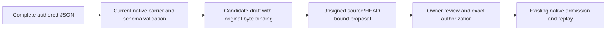

# Creating definition, record and Artifact Type drafts

The maintained runtime model now exposes `CreateDefinition`, `CreateRecord`,
`CreateArtifactType` and `PrepareCreation`. Creation produces candidate assets and an **unsigned** native
proposal. Definitions supply meaning; artifact instances use an explicit current
Artifact Type schema. Creating a Definition does not register a new record type. It does not sign an approval, admit a subject, advance native HEAD or
update the authority registry.



## Responsibilities

- **Definitions module:** new Definition/v2 meanings, with all required voices,
  explicit semantic owner and candidate-authored posture. Its creation Policy
  selects project or Work placement and preserves the original body.
- **Records module:** new artifact instances against an explicit current Artifact
  Type. The selected native carrier supplies schema and identity behavior. The
  draft envelope's candidate status does not rewrite the record's own lifecycle.
- **Artifact Types module:** draft a new descriptor and an exact schema/instance
  contract package. Semantic Definition references must already resolve. The
  native meta-carrier validates the descriptor; the schema and contract retain
  separate original-file and native JSON digest identities.
- **Transactions module:** combine one or more draft targets into an unsigned
  proposal bound to the selected source snapshot, scope, policy, challenge route
  and expected HEAD. Duplicate identities/Decisions are rejected.
- **Native creation port:** use original identity resolution and schema/type
  validation, check actual bytes and existing identities, then publish the draft
  bundle. Schema validation establishes structure, not semantic fidelity or owner
  acceptance.

The original native admission workflow now obtains its User Journey and Work
fixture targets through these creation helpers before signing. Qualification
compares their metadata against the compiled AlchLang Operations, then exercises
native owner approval, commit, replay and interruption recovery.

## Definition creation

Supply a complete Definition/v2 JSON file. The command does not invent a formal
voice, owner, source lineage, version, applicability or acceptance. It preserves
`classification.lifecycle_posture_ref`; it does not add a top-level `status`
property to a carrier that has no such field.

```bash
python3 implementation/lab-runtime/alchlang/create.py \
  --store /absolute/path/to/native-store \
  definition \
  --file /absolute/path/to/authored-definition.json \
  --project project:example \
  --scope project \
  --decision decision:proposed-definition-creation \
  --proposal-id definition-creation \
  --out work/definition-creation/outputs/definition-draft
```

For a Work-specific definition, select `--scope work --work work:example`.
Project and Work scope are explicit metadata; a project-scoped request cannot
also claim a Work placement. The output's logical placement is respectively
`ProjectDefinitions` or `WorkDefinitions`.

The output directory contains:

```text
<explicit draft directory>/
├── definition.json     # Exact supplied bytes
├── proposal.json       # Native unsigned proposal containing the decoded record
└── creation.json       # Candidate metadata, bindings and integrity receipt
```

`--out` is an explicit draft-bundle destination, not an inferred project binding
or a canonical registry publication. Once repository governance selects that
publication, the agreed folder convention remains
`authority/definitions/<term>/vN/` for shared meanings and
`work/<work>/define/definitions/<term>/vN/` for Work meanings. No separate candidate
folder or new implementation-model version is created. Human projection generation
and canonical registry updates remain separate operations.

## Record creation

Provide a complete record and its exact current carrier/version reference:

```bash
python3 implementation/lab-runtime/alchlang/create.py \
  --store /absolute/path/to/native-store \
  record \
  --file /absolute/path/to/authored-work-record.json \
  --project project:example \
  --scope work --work work:example \
  --carrier cal.artifact-type.work/v1 \
  --version-ref work:new-record@candidate.1 \
  --decision decision:proposed-work-creation \
  --proposal-id work-record-creation \
  --out work/example/outputs/records/new-record
```

The output has `record.json`, `proposal.json` and `creation.json`. Original JSON
bytes are retained independently from the native proposal's explicit JSON
parsing/encoding. The receipt binds both the original and the native record
digest; it is an integrity record with `authority_effect: none`.

An asserted owner in a record is not a permission grant. A supplied Work
reference is draft provenance, not proof of membership or an Agent assignment.
The public command requires the current Project to match the explicit native
branch and checks a Work record's declared Project as well.

Definitions and Artifact Types use their respective creation routes. Relation
Kind and Typed Relation creation require their specialized registration/closure routes;
this convenience command does not disguise them as ordinary artifact instances.
Generated Project State, history and Admission Transaction records are refused as
authored creation targets.

## Artifact Type creation

Supply a complete native descriptor, JSON schema and closed instance contract:

```bash
python3 implementation/lab-runtime/alchlang/create.py \
  --store /absolute/path/to/native-store \
  artifact-type \
  --file /absolute/path/to/artifact-type.json \
  --schema /absolute/path/to/schema.json \
  --contract /absolute/path/to/contract.json \
  --owner role:example-owner \
  --project project:example \
  --decision decision:proposed-artifact-type \
  --proposal-id register-example-type \
  --out work/example/outputs/artifact-types/example
```

The descriptor uses `cal.artifact-type.artifact-type/v3`. Its `artifact_type_ref`
is also its exact version reference, for example `cal.artifact-type.example/v1`.
The closed descriptor has no owner property: `--owner` records the draft steward
without changing the supplied body or granting authority.

The contract supplies `semantic_kind`, `schema_path`, `schema_sha256`,
`schema_selector`, `instance_discriminator`, `identity_field`,
`allowed_relation_kinds` and `relation_roles`. The descriptor and contract must
agree on the semantic kind and schema binding. The native schema path must be
`runtime/schemas/<name>.json`; existing schema paths cannot change contents.
`schema_sha256` hashes the original native `encoded(schema)` representation,
not the supplied schema file's formatting. That original file is bound separately.
The current v3 descriptor schema requires `schema_selector: null`.

The output contains exact `artifact-type.json`, `schema.json`, `contract.json`,
an unsigned `proposal.json` carrying the schema document, and `creation.json`.
Schema structure and its closed local reference envelope are checked without
remote retrieval. The native whole-proposal validator checks Definition
references, descriptor agreement, relation closure and instance contract shape.

After owner authorization and native admission, use `record --carrier
cal.artifact-type.example/v1` with that type's instance body. `CreateRecord`
resolves the schema from the verified committed transaction, including its
contract's explicit identity field and discriminator. It does not require the
schema input file or a new file under the repository's schema tree. Current
carrier standing is still required; a withdrawn or historical carrier is refused.

`SchemaMaterial` distinguishes `original-file-sha256` (frozen repository file,
provenance bound to the source snapshot) from `native-json-sha256` (committed
schema document, provenance bound to its transaction digest). A registration
draft binds its proposed native JSON digest to the separately retained schema
input's original-byte digest. Proposal summaries carry these typed bindings;
full schema documents remain in the native proposal.

## Review, authorize and admit

Drafts do not reserve an identity in the admitted catalog. The existing native
runtime rechecks the proposal against current sources and HEAD before signing
and applying it. For example:

```bash
python3 implementation/lab-runtime/v2/lab.py --store /absolute/path/to/native-store \
  review work/definition-creation/outputs/definition-draft/proposal.json
```

Use that runtime's existing owner-authorized `authorize` and `apply` flow after
review. No owner key is accepted or loaded by `create.py`. A later HEAD change
can make the saved proposal stale; replaying draft publication preserves its
original bytes and expected HEAD instead of silently rebasing it.

## Publication and limits

The output directory must be new, or contain exactly the same complete creation.
An exact repeat verifies the file bindings and returns `replayed`. Conflicting
requests, modified bytes and incomplete outputs are refused. Files are written
exclusively and fsynced, with `creation.json` written last as the completion
marker. A publication failure preserves the partial directory and reports
`creation-publication-outcome-unknown`; rerun never overwrites it.

This path creates new identities only. Revision, withdrawal, importing old
Definition/v1 bodies, generated Markdown and canonical publication are separate
operations. Schemas come from the frozen repository envelope or verified native
registration transactions. Each input file is bounded at 8 MiB;
the modeled proposal supports at most 16 targets and the existing bounded Ref
and compute contracts. No SQLite database or migration is needed for authored
drafts. Native stores and Workflow journals retain their existing durable roles.

Typed creation-validation observations are data. The host derives them from the
original native contracts and raw files; accepting caller-supplied `true` flags
is not a production authorization or validation adapter. The public command
uses those original validators directly and emits no approval or admission.

Qualification: **84 checks passed** across the maintained model and its native
fixture bridge. Creation commands were exercised only in fresh temporary
workspaces; production stores and current source registries were untouched.
