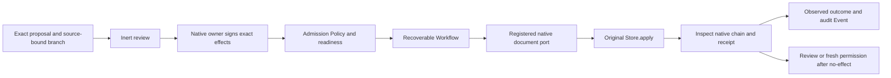

# Lab runtime authored model

One maintained AlchLang model of the current Lab runtime's local-branch behavior,
organized by **module → use cases**. It uses the selected imported AlchLang
**0.7.0-candidate.0**, Craft Core **1.3.0** and shared Node **26.12.1**.
Refinements update this model in place.

The selected native source is `implementation/lab-runtime/v2`. Its profile and
implementation bytes are pinned in `native-source.json`; the builder refuses
source drift. This model does not replace that runtime, change its admitted
predecessor, migrate a store or grant repository authority.

## Organization and ownership

```text
alchlang/
├── lab.alch                        # Protected API, durable coordination, Workflow
├── audit.alch                      # Separate native-outcome audit receiver
├── shared/values.alch              # References and exact-byte bindings
├── modules/
│   ├── source-context/
│   │   ├── contracts.alch          # Branch, HEAD and exact source envelope
│   │   └── use-cases/select-context.alch
│   ├── authority/
│   │   ├── contracts.alch          # Native validation observations, public admission Policy
│   │   ├── shared/eligibility.alch # Shared review checks within this module
│   │   └── use-cases/review-proposal.alch
│   ├── transactions/
│   │   ├── contracts.alch          # Proposal, targets, effects and readiness
│   │   ├── shared/lifecycle.alch   # Admission State Machine
│   │   └── use-cases/              # Acknowledge verified approval; prepare dispatch
│   ├── recovery/
│   │   ├── contracts.alch          # Native outcomes and workflow continuation
│   │   └── use-cases/resolve-outcome.alch
│   ├── definitions/                # First-class Definition/v2 creation
│   │   ├── contracts.alch
│   │   └── use-cases/create-definition.alch
│   ├── artifact-types/             # Descriptor, schema and native contract registration
│   │   ├── contracts.alch
│   │   └── use-cases/create-artifact-type.alch
│   ├── records/                    # Explicit-carrier artifact-instance creation
│   │   ├── contracts.alch
│   │   └── use-cases/create-record.alch
│   ├── catalog/
│   │   ├── contracts.alch
│   │   └── use-cases/resolve-subject.alch
│   ├── ontology/
│   │   ├── contracts.alch
│   │   └── use-cases/plan-traversal.alch
│   └── sessions/
│       ├── contracts.alch         # Ephemeral session value; no durable memory Entity
│       ├── shared/access.alch     # Lifecycle and context-access Policy
│       └── use-cases/             # Open, use, note, close and expire
├── create.py                       # Draft-only definition/record/artifact-type command
├── ports/creation.py               # Native validation and exclusive draft publication
├── ports/native-fixture.py        # Original native owner, only fresh disposable fixtures
├── ports/native-fixture.mjs       # Registered source-bound Workflow stage adapter
├── sources.json
├── profile.json
├── native-source.json
└── contracts/
    ├── bounds.json
    ├── transactions.json
    └── workflow-profile.json
```

Each use case contains its local Rules, Calculations and Mappings. Module-local
reuse lives in `shared/`. Cross-module reusable resources are exposed through
their owner's contracts; the service roots coordinate public use cases and
technical runtime effects. Only directories containing resources are created.

## What the model does

| Area | Authored responsibility |
| --- | --- |
| Creation | Validate definitions/records/Artifact Types, preserve original bytes and scope, and prepare unsigned proposals; see [CREATION.md](CREATION.md) |
| Context | Select the exact project/store and require current source/profile bindings |
| Review | Check the proposal's scope, snapshot, HEAD, effects and native target-validation observation; return an inert review plan |
| Approval | Acknowledge a native verified approval as readiness; never sign with an AlchLang calculation or infer ownership from readiness |
| Admission | Ordered Policy and State Machine gate dispatch; preserve exact raw proposal/approval and target references |
| Recovery | Preserve committed receipts; inspect unknown operations; require fresh permission after proven no-effect; retain refusal |
| Catalog | Keep effective standing independent from authored candidate fields; allow exact historical inspection without treating identity lookup as current |
| Ontology | Enforce traversal bounds and suppress confirmed paths for stale sources |
| Sessions | Bind context to project, source snapshot, HEAD and expiry; keep notes out of durable model Entities and erase returned short-memory state on close/expiry |
| Coordination | Persist the Workflow's dispatch ticket and observed outcome; expose a Query for the observed receipt |
| Events | Deliver `NativeOutcomeObserved` to a separate audit service with replay-safe inbox receipts |

The admission State Machine's proposals are zero-effect values. Readiness and
Workflow completion are not owner permission or source admission. The original
native writer remains responsible for the authoritative HEAD and both histories.

## Native handoff



The document stage is a checked host port for the native structured-file store;
it is not a provider HTTP call, model invocation or agent execution profile.
Its capability identity binds both adapter files and the selected native source
manifest. The fixture port loads exact original bytes, validates the frozen
ticket and delegates to original `Store.apply`, which rechecks source freshness,
scope, targets, signatures and replay itself.

The native fixture prepares its targets through the definition/record
creation helpers. The qualification uses the **actual User Journey Definition/v2 candidate** and a
Work record in one exact signed local transaction. The original User Journey
file remains SHA-256
`693045f6c86f0faa8b168d072e473bbb48f1e75cb71d440fc559c7440f147fe7`.
A separate disposable branch registers a new Artifact Type with an inline schema,
then creates and admits an instance using its custom identity field from a fresh
process. Its schema material binds the verified registration transaction; it
requires no schema file to be installed in the repository.
The model carries raw-byte bindings; native parsing/encoding is an explicit host
boundary. No semantic field is inferred or rewritten to obtain admission.

The typed `NativeChecks`, branch and subject summaries are observation data, not
forge-proof permissions. In this package the source-bound fixture adapter
reconstructs them from real native checks, validates exact frozen inputs, and
independently invokes the native writer. A production adapter must establish
that custody and authenticated project context itself. Passing a JSON object to
a pure Policy cannot authorize a native write.

## Profiles and needed meta-types

- `craft.generic-event-profile/v1-candidate` supplies bounded values, State
  Machines, original native Auth, protected Entries, transactional Entities,
  command replay, Queries and durable Event handoff. It explicitly selects
  `operation-policy-enforcement`.
- `craft.generic-workflow-profile/v2` selects one `document` stage, one attempt,
  an exact source capability and an authored continuation. Unknown native outcomes
  are inspected before any possible redispatch. This adapter exposes no automatic
  retry method.
- The original compute and transaction bounds remain selected. This model keeps
  within the compiler's 32-source and 1 MiB manifest limits.

Entities hold coordination and audit observations. Value Objects, Enums and
Interfaces define the typed boundaries; Operations own use cases; Rules and
Policies express admissibility; Calculations and Mappings derive data; State
Machines describe lifecycles; Workflow, Event, Query and Entry own runtime
coordination. `MODEL-INDEX.json` records their actual declarations.

No Formal Claim, provider, HTTP, model or agent-run profile is selected: there is
no corresponding implementation or solver-backed proof in this package.

## State, persistence and authority

The original native `config.json`, `baseline.json`, immutable transactions and
atomic `HEAD.json` remain authoritative for their provisioned local branch.
Both semantic and governance histories are generated and replay-checked by that
original runtime; the AlchLang Event is an observation notification, not either
of those native history events.

The generic coordinator's service store and fenced Workflow journal contain
durable coordination and delivery state. They are **not** a rebuildable cache.
They do not replace `.local/cache/lab.sqlite` or introduce a migration for a
cloned repository. Catalog, graph and context views remain derived observations.

No session memory enters the Workflow request, outcome Entity or audit Event.
The session Operations return new values; the actual host must own the ephemeral
session and execute expiry/close erasure. The original native Session is exercised
separately to verify its process-local expiry and memory-clearing behavior.

## Scope and remaining joins

This is a bounded executable model and qualification, not a full AlchLang rewrite
or production host cutover. The original native implementation owns:

- Ed25519 key provisioning/signing/verification and local filesystem custody;
- canonical hashing, closed JSON protocol/schema validation and exact type/relation closure;
- admission consequence generation, full catalog/graph traversal and native replay;
- single-writer locks, fsync, atomic publication and recovery-file validation;
- creation and ownership of real ephemeral sessions and their source-backed context records.

Proposal summaries support at most 16 targets in this profile. Session values are
bounded by the selected 64 KiB input and 32 KiB value limits; `Text` uses a 10,000-byte
bound, stricter than the native Python note's 10,000-character bound. The model
preserves these limits explicitly rather than claiming unbounded equivalence.

Independent project bootstrap/owner acceptance, team membership, general agent
delegation, team artifact synchronization and publication remain gaps in the
proposed product journeys. Provisioning a local branch from the current fixed
source profile does not create an independently owned Project. Those journeys
remain proposed.

The existing `craft-alchlang-ingress-working` fixture is separate historical
technical ingress evidence. Its synthetic acceptance flag is not substituted for
native owner verification here.

## Build and qualify

```bash
node implementation/lab-runtime/alchlang/verify.mjs build
node implementation/lab-runtime/alchlang/verify.mjs verify
node implementation/lab-runtime/alchlang/sources.mjs
```

The driver re-executes the selected shared Node, uses original fixture Auth for
the model services and creates fresh private native Lab branches outside the
repository. Private Ed25519 keys remain outside the repository and store, and
are removed with those owned native fixtures on close. Existing operator homes,
production stores, source profiles and authority files are never selected for
writes. Generated model state and qualification output live under ignored
`.local/`.

`VERIFICATION.json` and `TEST-RESULTS.txt` contain actual results. Qualification
includes native/model refusal agreement, real signature verification, local
admission, original replay, Event redelivery and native process interruption
before/after HEAD. A coordinator journal reopen and fresh Python-native
inspection are exercised; this does not establish power-loss durability,
multi-host concurrency or a deployed host's identity/authorization readiness.

See [SOURCE-AUDIT.md](SOURCE-AUDIT.md) for the implementation trace and
[ALL-ALCHLANG.md](ALL-ALCHLANG.md) for all authored source files.

Creation qualification is recorded in `VERIFICATION.json`, `QUALIFICATION.json`
and `TEST-RESULTS.txt`. All selected native source files remain pinned; no
production store or current registry is selected for writes.

Latest qualification: **84 checks passed**, including all three creation routes,
unsigned schema packages, newly registered carriers, native owner-authorized
admission, exact replay and interrupted publication/recovery. All 19 selected
native source files remain unchanged.
The generated manifest is 827305 bytes, within the original 1 MiB limit.
See [QUALIFICATION.json](QUALIFICATION.json) and [creation commands](CREATION.md).


Shared definitions and records are available through implementation/lab-runtime/lab.mjs shared.
Their maintained source, adapters, operator contract and checks are documented in shared-records/README.md.
The creation CLI evaluates its exact native-validated input through the original AlchLang creation policy before publishing a draft.
