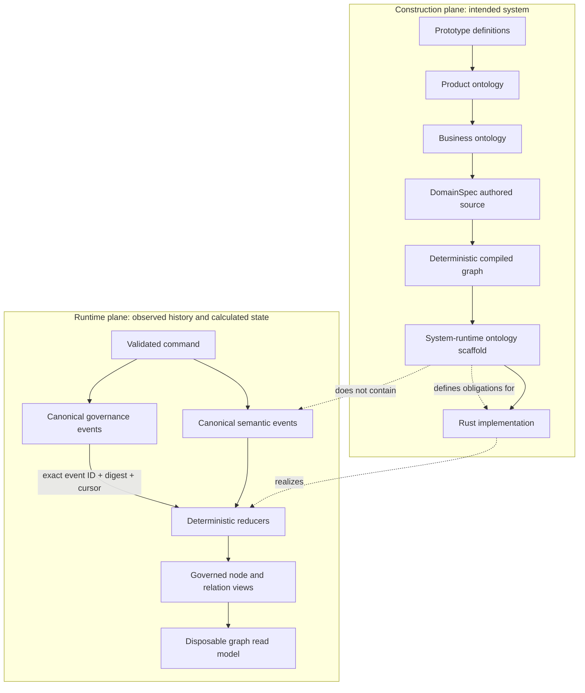
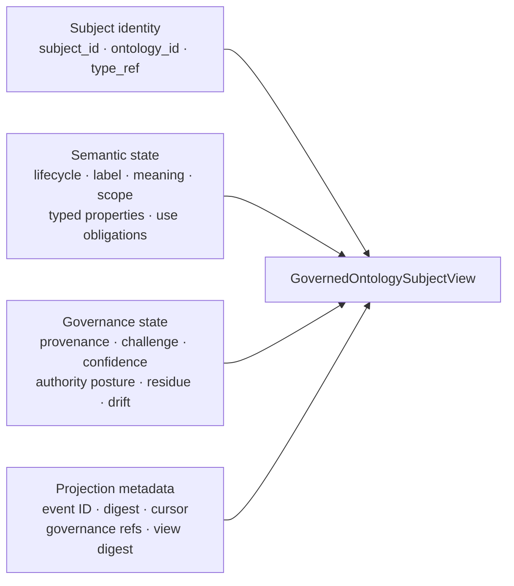
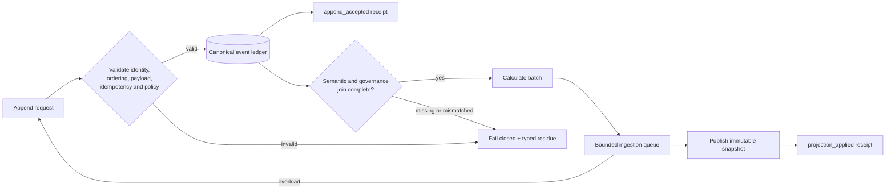
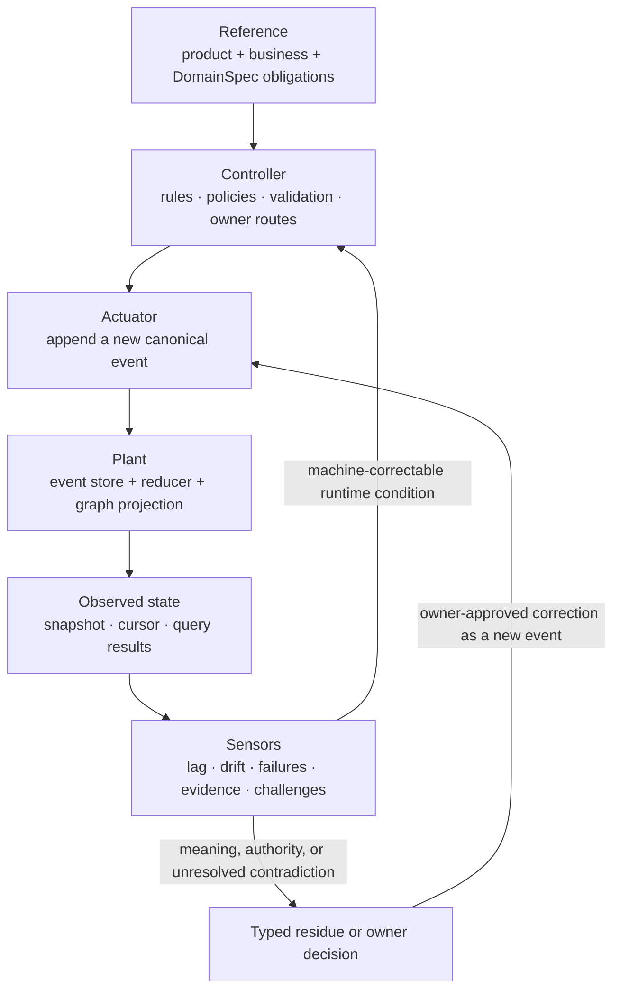
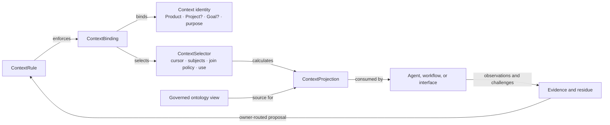
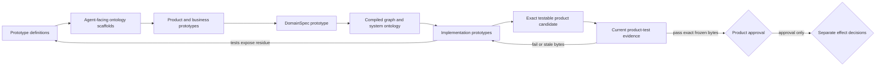
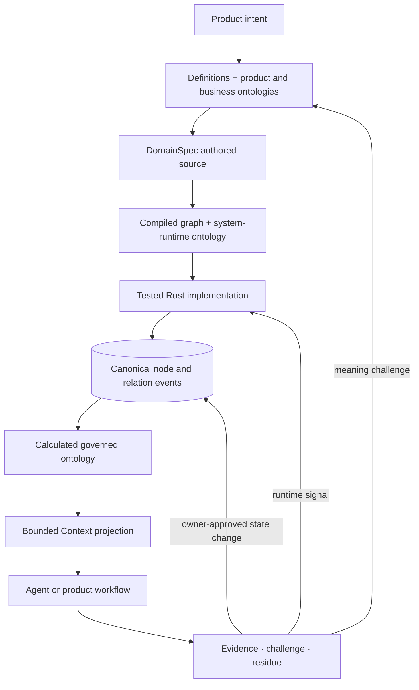
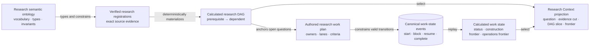
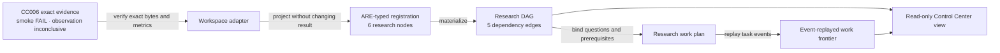

# Semantic and runtime ontology architecture

Status: explanatory prototype architecture  
Scope: CyberAlchemy Lab ontology construction, event-calculated runtime, and
Context integration  
Authority effect: none

## Purpose

CyberAlchemy uses ontologies in two different planes:

1. The **construction plane** describes what a product means and what a runtime
   must do.
2. The **runtime plane** records what happened and calculates the current
   ontology state from those canonical events.

A third plane, the **Context plane**, selects bounded views of that calculated
state for a declared purpose. Contexts consume ontology truth; they do not own
an alternate event history or become replay sources.

The architecture therefore separates authored intent, compiled design,
canonical history, calculated state, and contextual interpretation.

## Core definitions

| Term | Meaning in this architecture |
| --- | --- |
| Product ontology | The product promise, capabilities, boundaries, owner lanes, and forbidden interpretations. It says what value and meaning the product owns. |
| Business ontology | The capability-local language: actors, concepts, rules, contracts, workflows, outcomes, and failure meanings that connect product intent to a system contract. |
| DomainSpec source | Authored, typed technical intent. It describes runtime roles, operations, events, calculations, queries, rules, policies, interfaces, and allowed relations. |
| Compiled graph | A deterministic machine projection of exact DomainSpec source. It normalizes the authored design and retains source provenance. |
| System-runtime ontology | A deterministic ontology scaffold generated from the compiled graph. It describes the runtime structure and obligations; it is not runtime state and is not independently authored product meaning. |
| Ontology subject | An identity-bearing node or relation. Every relation is a first-class subject, not an unowned edge inferred from labels. |
| Semantic event | An append-only event carrying the complete resulting semantic state of one node or relation. Corrections append another event rather than editing history. |
| Governance event | A separate event carrying provenance, challenge, confidence, status, authority posture, residue, drift, or invalidation data, joined to an exact semantic event identity, digest, and cursor. |
| Event cut | One exact global cursor boundary. A calculated view may include no semantic event after the selected cut. |
| Reducer | A deterministic fold that calculates subject state from ordered canonical events. |
| Governed ontology view | The latest semantic state at a selected cut, joined with governance events whose semantic references validate exactly. |
| Projection | A derivative machine, human, graph, index, or Context view. It may be deleted and rebuilt; it is never the canonical replay source. |
| Challenge contract | The object's explicit “how to disagree with me correctly” surface: valid challenge modes, contradiction and validation links, owner route, resolution gate, blocking questions, and residue route. |
| Context | A durable, owner-qualified boundary of relevance and interpretation for one Product and, optionally, one Project and Goal. |
| DDD bounded context | A semantic ownership boundary with its own language, scope, exclusions, owner, and directional context maps. It is not the same thing as a CyberAlchemy Context. |
| Context selector | The exact cursor, subject set, governance join policy, intended use, and projection profile used to calculate one bounded Context view. |
| Context binding | An architecture-local integration record that binds one Context identity to one exact selector, projection contract, consumer, and intended use. Registration alone grants no authority. |
| Context rule | An architecture-local rule that constrains a Context binding or projection and defines its fail-closed behavior. A rule does not select or activate itself. |
| Cybernetic loop | A feedback structure with a reference, controller, actuator, observed system, sensors, and correction path. In CyberAlchemy, meaning and authority corrections still require their declared owner route. |
| Ontology scaffold | Provisional agent-navigation material created during construction. It helps agents find concepts and obligations but grants no truth, approval, admission, or execution authority. |

## The two-plane architecture



There are two deterministic transformations, and they must not be collapsed:

```text
DomainSpec source
  -> compiled design graph
  -> system-runtime ontology

canonical semantic events + exact governance events
  -> reduced subject states at cursor
  -> governed ontology view
  -> indexes and Context projections
```

The first transformation describes the system. The second transformation runs
the system against canonical history.

## Governed node and relation model

Every node and relation has a small universal identity, an ontology-specific
semantic profile, and separately calculated governance state.



Ontology-specific profiles specialize the semantic state without redefining
the shared identity or governance boundary. Current profile families include:

- `business-domain` for meaning, participants, rules, and outcomes;
- `system-runtime` for intent, runtime kind, technical body, implementation
  state, and forbidden inference;
- `premise` for supporting evidence, counterevidence, and falsification;
- `authority-governance` for authority kind, posture, and allowed use;
- `evidence` for observation conditions, exact evidence, and claim ceiling;
- `projection` for source cut, digest, allowed readings, and forbidden moves;
- `residue` for unresolved work, owner route, treatment, and next route.

Relations follow the same event-sourced model as nodes. An active relation must
have explicit direction and endpoints that are active in the same consistent
cut. Shared labels, directory placement, co-occurrence, or shared Context never
create a relation implicitly.

## Runtime calculation and acknowledgement

The event ledger is the canonical memory of the ontology. For an ordered stream
`E = [e1, ..., en]`, a projection is calculated as:

```text
P(E) = fold(apply, initial_state, E)
```

Each subject has its own semantic history, while a global commit cursor defines
consistent cross-subject cuts. Governance events remain separate and join only
through exact semantic references.



`append_accepted` and `projection_applied` are deliberately different facts:

- **Append accepted** means the canonical event is recorded.
- **Projection applied** means a complete calculated snapshot containing that
  event has been published.

If a process stops between them, restart recovery compares the canonical event
cut with the projection watermark and calculates the missing work. It never
invents an acceptance receipt from a projection, and it never treats an index
as the canonical ledger.

## Cybernetic runtime loop

The runtime behaves as a controlled feedback system, but governance decisions
remain owner-controlled rather than automatically promoted.



This loop preserves two types of correction:

1. A mechanical runtime correction may retry an idempotent append or rebuild a
   disposable projection.
2. A semantic or authority correction must travel through its challenge and
   owner route, then appear as a new canonical event. It may not silently edit
   old history.

## Context integration

A Context asks for a bounded, purpose-specific reading of the ontology. It does
not create a fork of ontology truth.



A valid Context projection retains:

- the semantic cursor and canonical event-set digest;
- selected node and relation identities;
- exact governance references and join policy;
- intended use and projection profile;
- forbidden authority moves.

Two Contexts may filter, order, or render the same governed ontology differently
because their purposes differ. They still point to the same canonical history.
Branch membership is a view classification, not a subject identity, lifecycle,
or authority posture.

### Context is not bounded context

```text
CyberAlchemy Context
  = coordination and interpretation frame for work

DDD Bounded Context
  = semantic ownership and language boundary

Context --references--> zero or more DDD Bounded Contexts
Context --does not replace--> DDD Bounded Context
```

Product identity, Project coordination, Goal, Product Capability, Context, DDD
Bounded Context, capability instance, artifact type, and directory placement
remain separate identities.

## Construction workflow

The runtime is built through the prototype-first `CAV2-D65` construction
invariant. Ontology scaffolds help construction from the beginning, but they do
not become authoritative merely because they validate.



The construction loop continues through definitions, scaffolds, product,
business, DomainSpec, compiled-system, and implementation prototypes until one
exact candidate is testable. Approval is requested only after its current tests
pass. Even product approval does not grant ontology admission, runtime
activation, cutover, publication, release, deployment, or external effects;
each remains a separate decision.

Operational support is a separate lane. Repository maintenance, environment
setup, publication preparation, deployment preparation, monitoring, and future
persistence selection remain visible, but they do not stop dependency-ready
prototype construction unless one is an exact current prerequisite or a safety,
privacy, credential, destructive-action, or external-effect boundary.

## End-to-end workflow



The workflow closes three feedback paths without collapsing them:

- **construction feedback** revises prototypes and their exact tests;
- **runtime feedback** retries, rebuilds, or appends new canonical events;
- **context feedback** returns evidence and challenges through an owner route.

## Research specialization: semantic ontology, DAG, and work state

The Agent Reasoning Engine (ARE) research-learning package provides a useful
specialization of this architecture. It separates the meaning of research from
the order of research dependencies and from the changing state of research
work. The event-sourced ontology runtime should preserve, rather than collapse,
those three layers.

| Layer | Definition | What it must not imply |
| --- | --- | --- |
| Research semantic ontology | The vocabulary, types, permitted relations, and invariants for hypotheses, observations, experiments, decisions, retained improvements, questions, and evidence. | A semantic relation is not automatically a scheduler dependency or permission to act. |
| Research registration | One immutable, content-addressed set of research records bound to exact source evidence. | Registration does not prove the hypothesis, preregister the experiment, or authorize successor work. |
| Research DAG | A deterministic acyclic projection of prerequisite-to-dependent research records. | The DAG is not the semantic ontology, a job queue, causal proof, or scheduling authority. |
| Research work plan | Authored tasks with owners, lanes, stages, dependencies, completion criteria, and verifiers. | A plan does not establish that a task ran or that its criteria passed. |
| Research work-state events | Canonical `start`, `block`, `resume`, and `complete` facts for plan tasks. | An event does not silently revise the plan, its evidence contract, or product authority. |
| Research Context projection | A bounded view selecting a question, exact evidence cut, relevant DAG slice, and current work frontier. | A Context does not acquire access to the whole graph or dispatch work automatically. |



### The direction changes when meaning becomes dependency

The semantic relation `Experiment --tests--> Hypothesis` says what the
experiment means. The calculated dependency edge
`Hypothesis --prerequisite-to--> Experiment` says which record must already
exist before the experiment can be interpreted. They refer to the same research
episode but answer different questions, so the compiler must map the direction
explicitly. It must never treat every ontology relation as a scheduling edge.

A learning cycle also remains acyclic by creating a successor registration:

```text
Question A -> Hypothesis B -> Experiment B -> Observation B -> Decision B -> Question B
```

The question from one registration informs a new hypothesis in a successor
registration. It does not add a backward edge that mutates the prior DAG into a
cycle. The old registration and its exact evidence remain reproducible.

### Workspace Control Center example

The current Workspace research-learning adapter demonstrates the separation on
the historical CC006 experiment:



The view currently keeps `latency.inspect` on the product-construction frontier
and `host.qualify` on the operational-support frontier. The rejected host blocks
the experiment task that depends on host qualification, but it does not hide or
stop the independent latency-inspection prototype work. No frontier entry is an
automatic dispatch or an authority decision.

This is retrospective research evidence, not preregistration. The original
result remains a smoke failure with an inconclusive observation and a
not-evaluable performance inference. Focused ARE and Workspace diagnostic tests
currently pass 23 of 23, but the frozen Workspace candidate remains blocked on
source-currentness because the selected ARE `index.mjs` bytes have changed.

### Event-sourced migration contract

| Existing ARE or Workspace surface | Event-sourced architecture role | Migration rule |
| --- | --- | --- |
| `research-learning-v1.json` | Prototype semantic ontology scaffold | Version and source-bind it; do not mistake loading static JSON for event replay. |
| Immutable research registration | Source-bound subject and evidence snapshot | Import through explicit canonical node and relation events while preserving its original digest and evidence cut. |
| Materialized research DAG | Disposable projection/read model | Rebuild it deterministically from canonical research records at one exact event cut. |
| Research work plan | Authored coordination source | Bind the exact plan digest; keep it separate from the research DAG. |
| Research work-state events | Coordination event stream | Persist and replay them separately from semantic ontology events; derive readiness rather than storing it as truth. |
| `view.json` and HTML view | Research Context projection | Retain the source cursor, event-set digest, selected question/DAG slice, work frontier, and forbidden moves. |

For the new runtime, research nodes and relations therefore become first-class
event subjects. The research DAG remains a calculated projection. Work-state
events remain a distinct coordination stream, and the Context selector binds a
question, evidence cut, DAG slice, and work frontier. The same two-receipt
boundary applies: `append_accepted` proves durable acceptance of a canonical
research or coordination event; `projection_applied` proves that a named DAG,
work-state, or Context projection incorporated it. Neither receipt grants
product approval or operational authority.

The existing ARE package is precedent, not yet a conformant implementation of
this event-sourced runtime: its ontology is static JSON, its research DAG starts
from registrations, its work-event replay has no durable event store, and its
Workspace view is not yet bound through the governed Context event cut.

## Failure and non-collapse rules

| Condition | Required behavior |
| --- | --- |
| Missing semantic event or cursor gap | Fail closed; do not calculate a partial cut. |
| Governance event references the wrong semantic ID, digest, or cursor | Reject the join and preserve typed residue. |
| Relation endpoint is absent or inactive at the cut | Reject the relation from the consistent view. |
| Duplicate retry | Use the idempotency handle; do not create a second semantic change. |
| Projection is stale or corrupt | Rebuild from canonical events; do not repair the event ledger from the projection. |
| Context asks for unsupported subjects or use | Reject or return bounded residue; do not broaden the Context silently. |
| Evidence contradicts a node | Use its challenge contract and owner route; do not rewrite confidence or meaning automatically. |
| Schema validates | Conclude shape validity only—not truth, conformance, promotion, approval, or authority. |
| Acceptance-bound bytes change | Create and test a new candidate epoch. |

## Current implementation frontier

The current Rust graph-read-model prototype already provides:

- deterministic node, relation, context, path, property, and challenge queries;
- exact semantic/governance cut validation;
- incremental calculated deltas equal to full rebuilds;
- immutable, structurally shared graph generations;
- bounded single-ingress projection with explicit overload and watermarks;
- source-bound cold recovery and disposable checkpoints;
- process-interruption-safe checkpoint replacement;
- current evidence through 250,000 governed subjects and 500,000 event files.

The next construction stage is the canonical append-to-calculation bridge. It
must implement the two-receipt boundary, deterministic dual-stream join, and
restart recovery for events accepted but not yet projected.

Not yet established:

- multi-writer or distributed event ordering;
- sudden-power-loss durability and storage-controller behavior;
- cross-machine replication or consensus;
- a production service-level workload;
- product approval, ontology admission, activation, publication, or cutover.

## Source anchors

- [Context and artifact architecture](../../../../docs/proposals/0001-context-artifact-architecture/PROPOSAL.md)
- [Governed event-sourced ontology node architecture](../../../../docs/proposals/0004-governed-ontology-node-architecture/PROPOSAL.md)
- [Event-sourced ontology first vertical](../../../../docs/plans/0001-event-sourced-ontology-first-vertical/PLAN.md)
- [D65-native ontology runtime integration](../../../../docs/plans/0003-d65-native-ontology-integration/PLAN.md)
- [Graph read-model prototype](README.md)
- [Continuous prototype plan](plan.md)
- ARE research-learning ontology:
  `domainspec-core:cyberAlchemy-v2/implementation/agent-reasoning-engine/packages/evolution-runtime/ontology/research-learning-v1.json`
- ARE research DAG materializer:
  `domainspec-core:cyberAlchemy-v2/implementation/agent-reasoning-engine/packages/evolution-runtime/src/research-dag.mjs`
- ARE research work materializer and replay:
  `domainspec-core:cyberAlchemy-v2/implementation/agent-reasoning-engine/packages/evolution-runtime/src/research-work.mjs`
- Workspace Control Center research adapter:
  `domainspec-core:cyberAlchemy-v2/workspace/experiments/control-center/research-learning/adapter.mjs`
- DomainSpec Core canonical definitions: `CAV2-D26` append-only event ledger,
  `CAV2-D40` challenge contract, `CAV2-D65` prototype-first construction
  invariant, and `CAV2-D66` Context.

## Claim ceiling

This document explains the selected prototype architecture and current evidence.
It does not make an ontology canonical, admit a system ontology, prove production
durability, approve a product, authorize implementation beyond the already
selected prototype scope, activate a runtime, publish, release, deploy, or
perform an external effect.
