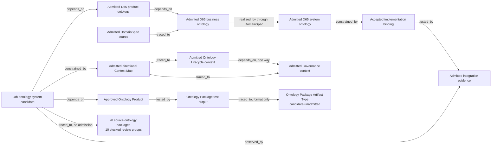

# Cohesive Lab ontology-system candidate

This is the first testable Product candidate that presents the selected
CyberAlchemy Lab ontology landscape as one navigable system without pretending
that every source ontology has the same lifecycle state or owner.

It composes four things:

1. the exact Ontology Product candidate approved by
   `CAL-ONTOLOGY-PRODUCT-APPROVAL-0042`;
2. the exact admitted D65 product, business, DomainSpec, system, binding, and
   integration vertical;
3. the admitted Governance and Ontology Lifecycle contexts and their
   directional Context Map; and
4. the 20-package legacy ontology inventory and its 10 blocked review groups as
   status-preserving, reference-only catalog entries.

The fourth group is visible but is not admitted. In particular, eleven
profile-qualified packages currently claim `domainspec-product-ontology@1`.
Queries return all eleven; this candidate never selects one by list order.

## Semantic and runtime graph



Canonical per-node and per-relation event histories calculate runtime state.
Snapshots, Context projections, compiled graphs, system ontologies, and read
models remain derived. This composition root is not a replay source.

## Validate and query

Run from the Lab repository root:

```bash
python3 product/products/ontology/v1/candidates/0005-cohesive-lab-system/validate.py
python3 product/products/ontology/v1/candidates/0005-cohesive-lab-system/validate.py list-components
python3 product/products/ontology/v1/candidates/0005-cohesive-lab-system/validate.py admission-status
python3 product/products/ontology/v1/candidates/0005-cohesive-lab-system/validate.py get-source-ontology domainspec-product-ontology@1
python3 -m unittest product/products/ontology/v1/candidates/0005-cohesive-lab-system/test_validate.py
```

The last source query intentionally returns eleven profile-qualified results.
An unknown identity exits non-zero.

## Admission boundary

The candidate can make the Lab cohesive as a navigation and admission overlay.
It cannot bulk-admit child ontology meaning. A later exact decision may admit
only this root and its typed composition relations after Product approval. Each
currently blocked or candidate child keeps its own owner route and admission
work.

The open product-to-runtime residue is deliberate: the approved Ontology
Product contract has not yet been proven to be realized by the separately
admitted D65 runtime. No `realized_by` edge is asserted between them.

## Construction and operations

- Product-construction frontier: validate and freeze this exact cohesive-system
  candidate, then obtain one Product approval decision.
- Runnable construction: all validation, hostile testing, deterministic query,
  and candidate freezing in this directory.
- Operational support: commit, publication, deployment, migration, and source
  retirement remain deferred and do not block prototype work.
- Causal admission blockers: Product approval of this exact successor is needed
  before a root admission decision; child admissions additionally require their
  own owner-bound resolutions.

## Claim ceiling

Passing tests prove only a digest-bound, queryable, status-preserving
composition of the selected Lab ontology landscape. They do not approve the
Product, admit the root or children, adopt a runtime, resolve legacy review
blockers, activate, migrate, cut over, publish, release, deploy, or create an
external effect.
