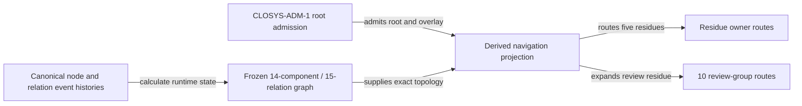

# Admitted cohesive Lab ontology navigation

This package makes the admitted `CAL-LAB-ONTOLOGY-SYSTEM` root usable as a
source-current navigation and owner-routing projection. It derives from the
exact Product-approved graph and the `CLOSYS-ADM-1` decision; it does not modify
either source.

The projection covers 14 components, the admitted 15-relation composition
overlay, five retained residue routes, and ten review-group routes. Eight review
groups have named owner routes. Two preserve `owner_route: unresolved` and are
routed to the CyberAlchemy migration review owner for owner assignment.

## Model



`navigation.json` is derived and is not a replay source or an independent
authority source. It may be relied on only while `validate.py` returns `PASS`.

## Query

Run from this directory or provide the complete path:

```bash
python3 query.py summary
python3 query.py list-components
python3 query.py get-component CAL-LAB-ONTOLOGY-SYSTEM
python3 query.py list-relations
python3 query.py route-residue CAL-RES-PRODUCT-RUNTIME-REALIZATION-UNPROVEN
python3 query.py list-review-routes
python3 query.py route-review cav2.governance-model
python3 query.py get-source-ontology domainspec-product-ontology@1
```

The final query deliberately returns all eleven profile-qualified DomainSpec
records. An unknown identity returns `BLOCK` and exits nonzero.

## Validate

```bash
python3 materialize.py
PYTHONDONTWRITEBYTECODE=1 python3 validate.py
PYTHONDONTWRITEBYTECODE=1 python3 -m unittest test_navigation.py
```

Receipt materialization is explicit and append-only:

```bash
PYTHONDONTWRITEBYTECODE=1 python3 validate.py --write-receipt
```

## Construction and operations

- Product-construction frontier: resolve owner-ready residues while continuing
  the independent package-to-event/runtime binding prototype and product test.
- Runnable product work: DomainSpec successor selection, review-led successor
  construction, Artifact Type testing/admission preparation, and runtime-binding
  construction.
- Causal blocker: two review groups lack a resolved source owner. This blocks
  only those groups.
- Operational support: the stale status projection belongs to the Ontology
  Lifecycle evidence owner; commit, publication, migration, and deployment stay
  separately authorized residue.

## Claim ceiling

Passing validation proves a byte-current navigation and routing projection over
the admitted root. It grants no child admission, owner transfer, DomainSpec
profile selection, runtime adoption, activation, migration, cutover,
publication, release, deployment, or external effect.
