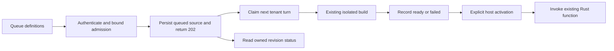

# Asynchronous Alch builds

Private product-construction candidate. Owner: Alch host implementation; Craft
ORODI consumes related evidence. Authority effect: none.

Uploads now return **202 Accepted** with a revision ID and status URL. A background
worker compiles accepted source while the API continues serving existing functions
and status requests. This successor reuses the tested
[local control plane](../local-control-plane-v1/README.md), compiler, Bubblewrap
launcher, and RWO/Ansible host. The previous package and its test evidence are
unchanged.

## DAG and meaning



[definitions.md](definitions.md) defines pending builds, tenant turns and recovery
as local prototype terms with formal, plain-language and Alch-context voices.
[ontology.json](ontology.json) maps those terms to the existing product/business,
DomainSpec and runtime dependencies. [PLAN.json](PLAN.json) carries the construction
DAG and separate operational-support lane. None of these scaffolds admits a new
DomainSpec or governance profile.

## Queue contract

- At most **eight queued or building revisions globally**, and **two per tenant**.
  A full queue returns 429 `BUILD_QUEUE_FULL` without creating another revision.
- One worker compiles at a time. HTTP admission and compilation have separate
  SQLite connections. Build execution holds no registry transaction.
- Choose the waiting tenant least recently dispatched, breaking ties by the oldest
  queued row; take that tenant's oldest revision. The durable journal preserves
  dispatch history across restart. This gives waiting tenants turns, not equal
  CPU usage or a fixed waiting-time guarantee.
- Persist source bytes, source digest, queued revision and journal entry before
  returning 202. Acceptance does not mean the source compiles or has permissions
  to execute. The worker verifies source/compiler hashes and current operator
  permissions before publishing a ready artifact.
- `queued -> building -> ready | failed`. On restart, queued work resumes; rows
  left building become failed with `BUILD_INTERRUPTED`. Leftover bundle files
  cannot make a revision ready.
- Shutdown stops new dispatch, terminates the active build process group, records
  interruption, and retains queued work. A controller crash can leave private
  scratch directories; automatic garbage collection remains deferred.
- A worker storage/control failure stops scheduling and makes new submissions
  return 503. Revision status reports `scheduler: unavailable`; existing ready
  routes remain usable. Restart reconciles the interrupted row.
- A ready build never selects a route automatically. Explicit activation still
  verifies the artifact and starts the RWO/Ansible host before selecting it.

## Running and API

Use the predecessor's Node/Rust, cached Cargo, Bubblewrap and RWO prerequisites and
[operator configuration example](../local-control-plane-v1/operator.example.json).
Use a **new private mode-0700 root** for this successor. Existing synchronous roots
require a separately designed migration and are rejected. A persisted async marker
binds this implementation and the predecessor source; changed implementation bytes
require a new prototype root. Support-code hashes are also checked before and
after builds and before starting or reusing a function host.

From the repository root:

```bash
PYTHONDONTWRITEBYTECODE=1 python3 cyberAlchemy-v2/language/capabilities/alchlang/plans/general-compiler-v1/extensions/async-control-plane-v1/control_plane.py \
  --root /tmp/alch-async-demo --config /path/to/private-operator.json
```

The server prints its loopback URL. Operator-configured bearer tokens, tenant/project
scopes, host policies and every existing operation remain unchanged. Clients using
this successor must handle the asynchronous upload response:

| Request | Response |
| --- | --- |
| POST `/v1/projects/shop/revisions` with `{"source":"..."}` | 202 with `revision`, `status: queued`, `source_sha256`, `status_url` |
| GET `/v1/projects/shop/revisions/<revision>` | Owned revision status, hashes, function, bounded error code and scheduler state |
| POST `/v1/projects/shop/revisions/<revision>/activate` with `{}` | 409 until ready; then the existing explicit activation flow |
| POST `/v1/projects/shop/functions/orders-local/invoke` | Existing producer invocation contract |

Reading a revision requires `read` scope and the owning tenant/project. Another
tenant's revision ID returns 404. Upload and status errors do not reveal build logs,
source contents, operator grants or host credentials. Full build diagnostics remain
local to the operator's private revision directory. Failed revisions remain visible;
a caller can submit a new revision after correcting the source or permissions.

Example from this directory with the URL and user token supplied in the environment:

```bash
python3 - <<'PY'
import json, os, time, urllib.request
from pathlib import Path
url = os.environ['ALCH_CONTROL_URL']
headers = {'Authorization': 'Bearer ' + os.environ['ALCH_USER_TOKEN'], 'Content-Type': 'application/json'}
def request(path, body=None):
    data = None if body is None else json.dumps(body).encode()
    with urllib.request.urlopen(urllib.request.Request(url + path, data, headers), timeout=35) as response:
        return json.load(response)
request('/v1/projects/shop', {})
accepted = request('/v1/projects/shop/revisions', {'source': Path('../local-control-plane-v1/orders.alch').read_text()})
deadline = time.monotonic() + 400
while True:
    result = request(accepted['status_url'])
    if result['status'] == 'ready':
        break
    if result['status'] == 'failed':
        raise SystemExit(result['error'])
    if time.monotonic() >= deadline:
        raise SystemExit('Build still pending; inspect its status later.')
    time.sleep(.5)
request('/v1/projects/shop/revisions/' + accepted['revision'] + '/activate', {})
print(result)
PY
```

The function remains expressed in the existing
[orders.alch](../local-control-plane-v1/orders.alch); queue scheduling is an operator
host concern and does not duplicate its rules, mappings or integration bindings.

## Tests and limits

```bash
PYTHONDONTWRITEBYTECODE=1 python3 -m unittest discover \
  -s cyberAlchemy-v2/language/capabilities/alchlang/plans/general-compiler-v1/extensions/async-control-plane-v1 \
  -p test_async.py -v
```

Tests cover bounded admission without partial revisions, tenant scheduling order,
FIFO, durable queue recovery, rejected source drift, revoked permissions, worker
failure, active process termination, cross-tenant status denial, queued activation
denial, changed support-code rejection and old-store rejection. Real HTTP tests compile two tenants' Alch functions,
invoke an existing function while the other build is in flight, and exercise failed
builds and restart with queued/interrupted work. See validation.json (referenced result or source binding is not imported),
[source-manifest.json](source-manifest.json), and test-results.log (result record excluded).

HTTP requests still serialize with each other; host activation and an individual
invocation can delay a subsequent request. Compilation no longer occupies that API
request loop. Queue limits bound pending work count, not total disk usage: completed
revisions have no retention policy yet. All existing per-process build/runtime limits
and lack of aggregate cgroup/filesystem quotas remain as documented in the predecessor.
Each revision retains separate state, and inactive queue behavior is unchanged.
There is no public listener or public-hosting security claim.

| Lane | Frontier or residue | Owner | Stage |
| --- | --- | --- | --- |
| Product construction | Durable background builds and responsive invocation | Alch host owner | Implementation and current product tests |
| Product construction | Revision state migration, inactive queue lifecycle, multiple credentials | Alch host owner | Runnable successor design |
| Operational support | Public hosting, aggregate quotas, security review | Platform/security owner | Deferred public deployment |
| Operational support | Live ORODI evaluation | Craft ORODI owner | Deferred runtime evidence |
| Operational support | Existing root migration and retained artifact cleanup | Alch operator | Deferred; new-root prototype has no migration prerequisite |

## Open Questions

- What cancellation, per-tenant retention and storage quota contracts should follow?
- Should host startup and invocation also move to a bounded concurrent request pool?
- How should shared state and inactive event queues behave across revision changes?
- Which live ORODI observation profile should expose queue age and worker failures?
