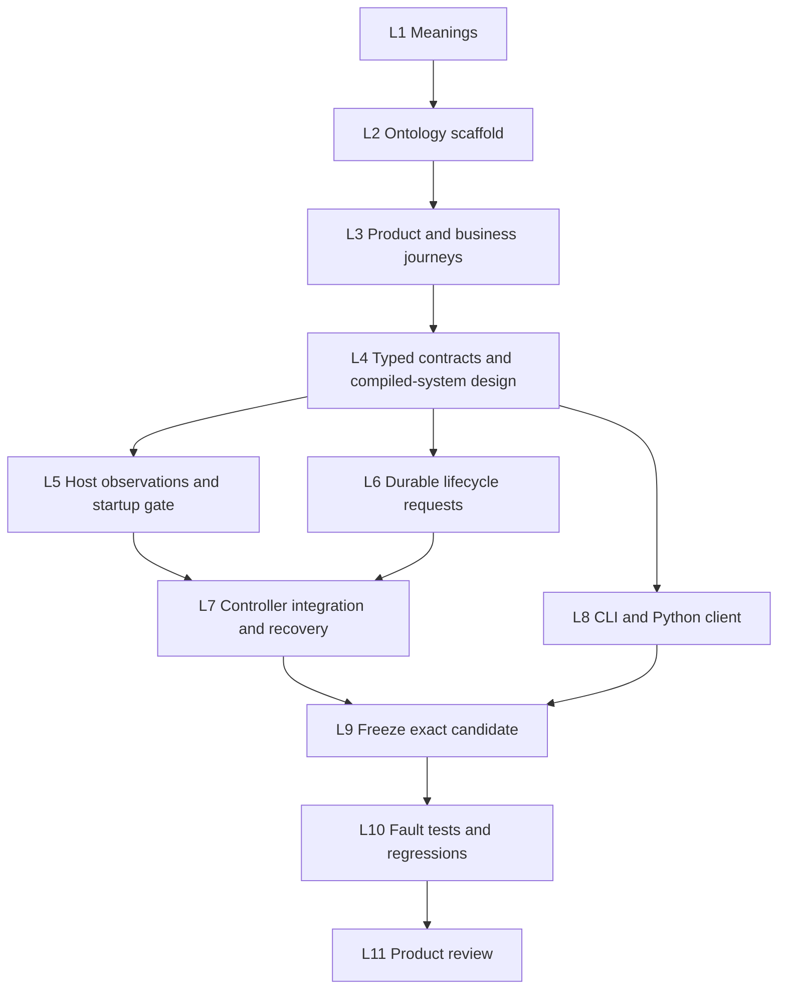

# Alch host lifecycle plan

Status: planning candidate. Owner: Alch host service owner. Route: CA2-ROUTE-PLAN.
Authority effect: none. No implementation, product approval or deployment is recorded here.

Users should be able to inspect, drain, resume and recover their own selected
Alch function without server access. Success requires durable state and message
deduplication to survive recovery, with tenant isolation preserved.

## Current evidence and scope

The [client](../host-service-client-v1/README.md) reports selected revision metadata.
The [controller](../semantic-corrections-v1/control_plane.py) has no function health
or user lifecycle endpoints. Its invoke path can launch a host. The inherited
[restore path](../compatible-upgrades-v1/control_plane.py) launches selected hosts
at controller startup. The [private host](../semantic-corrections-v1/function_host.py)
keeps its invocation pause flag in memory. Drain closes that gate, continues local
delivery, and waits up to 35 seconds for every outbox item to be published;
dead letters or a blocked worker make drain fail. Current health reports listening
and delivery state but omits the gate and counters. The controller HTTP server is
serial: synchronously exposing its existing drain would block status requests.

These inspected files are hashed in source-baseline.json. This is a planning
baseline, not complete implementation or product-test evidence.

The successor lives in this packet and consumes predecessor sources read-only.
It retains semantic-host-v1, the current Rust executor, SQLite event storage,
loopback HTTP, bubblewrap and RWO/Ansible provisioning. No new Alch syntax or
business schema fields are needed for operator lifecycle controls. Existing
function/revision/operation/delivery identities should be derived from compiled
artifacts; runtime health and desired mode belong to host-owned records.
No registered ontology records are used to authorize this plan. L2-L4 must pin
exact ontology selectors and source bytes before claiming binding coverage.

## Product-construction DAG

PLAN.json is the machine-readable task graph, with owners, outputs and completion
criteria. Graph branches describe independent dependencies, not a multi-agent
dispatch. Construction frontier: L1, runnable now. No current causal construction
blocker was identified. This planning request does not execute L1-L11.

## Proposed lifecycle contract

Separate three dimensions instead of compressing them into one status enum:

- Selection: selected revision and route epoch.
- Desired invocation mode: accepting or draining, persisted in the registry.
- Observation: starting, ready, draining, drained, stopped, failed or unknown,
  with observed time, process generation and bounded reason codes.

Ready requires a live host whose identity matches the selected revision, current
process generation and accepting gate, plus a healthy configured delivery worker.
Drained requires the invocation gate closed, no active invocation, no unfinished
outbox delivery and no dead letters. A failed drain retains draining intent.
Stopped means a confirmed absent host; there is no user stop command in this slice.
Probe timeout means unknown, not healthy or confirmed stopped. A dead-letter count
is visible separately from process health; diagnostics must never erase it.

Drain means stop admitting new invocations and allow already accepted work and
local events to finish. It does not pause the delivery worker. Resume explicitly
reopens invocation admission after checking the current identity and host health.
Restart replaces only the current host process, preserving its selected revision,
state generation, database, inbox, outbox and durable desired mode. A restart of a
drained function remains drained; it cannot silently resume traffic. No force
restart or automatic dead-letter retry/discard is included. For a live process,
restart first establishes a bounded quiescent point; if it cannot do so, report a
blocked operation rather than silently killing active work. Recovery of a confirmed
dead process reuses its state and observes existing lease/receive rules.

Use a monotonic lifecycle version for accepted desired-mode changes and a distinct
process generation for launches. A client fencing token binds revision, route
epoch, lifecycle version and process generation. State-generation identity remains
separate and internal. Any mismatched token rejects the action before host effects.

## Proposed API and CLI

| Interface | Contract |
| --- | --- |
| GET /v1/projects/{project}/functions/{function}/status | Read-only observation with selection, desired mode, fencing token, host health and delivery counts. Never call host(), launch, provision or repair. |
| POST /v1/projects/{project}/functions/{function}/{drain,resume,restart} | Exact body: request_id and expected fencing token. Persist a bounded lifecycle request and return 202 with its locator. |
| GET /v1/projects/{project}/functions/{function}/requests/{request_id} | Tenant-bound operation state: queued, running, succeeded, blocked, failed or outcome_unknown; stable sanitized reason and result. |

Status and request reads require read permission. Mutations require a new explicit
lifecycle scope in a successor operator configuration; existing read/build/activate/
invoke grants do not acquire it automatically. Adapt configuration validation in
the successor, preserving predecessor configuration and evidence bytes. Validate
tenant/project ownership before reading any process or storage detail.

Request identity is scoped to tenant/project/function. The same request ID and
identical payload return the original request, even after its action advanced the
fencing version. Reuse with a different action or expected token is a conflict.
Check existing request identity before applying fresh-request fencing checks.
Do not return bearer tokens, host ports, local paths, arbitrary exception text or
business payloads in status. Counts use a bounded read-only snapshot and carry
observation time and availability. Missing, locked or corrupt storage reports
unavailable with a reason, never zero. Define pending as the sum of nonterminal
unpublished statuses, exclude published and dead, and expose dead letters separately.
Resolve the actual storage status names during L4; unknown statuses fail the summary
rather than disappearing from totals. Health and storage observations need not be
atomic together and must expose their separate timestamps.

Proposed commands: status PROJECT FUNCTION; drain/resume/restart PROJECT FUNCTION
--expected TOKEN --request-id ID [--wait]; lifecycle-request PROJECT FUNCTION ID.
Client waiting polls GET only with an overall deadline. No automatic POST retry.
On response loss, retain the request ID and let the user inspect its durable result.
Keep the existing functions command's selected-revision meaning unchanged.

## Persistence, concurrency and recovery

Persist desired mode and lifecycle request stage before issuing private host
controls. A bounded background worker performs slow controls so status remains
responsive. Use thread-owned SQLite connections and short transactions; do not
share the existing request-thread connection with a lifecycle worker. Keep build
queue state separate. Serialize effects per tenant/project/function and synchronize
access to child-process tracking. Limit the local lifecycle queue to eight requests
globally, two per tenant and one nonterminal request per function; reject saturation
without changing intent. A pending request must recheck its bound identity before
each effect. Persisted duplicate detection survives controller restart.

Invoke must check durable mode before any implicit launch. Startup must launch
with the invocation gate already closed when intent is draining; launching open and
then sending drain creates an unsafe admission window. Drain progress may resume
on startup, but invocation admission stays closed on timeout or recovery failure.
Status never performs reconciliation. Startup/control workers own reconciliation.

Activation must participate in the same function arbitration, reject an outstanding
lifecycle action and reject user-draining mode in this first slice. Internal upgrade
drain remains distinguishable from user intent. Activation rollback and the existing
already-selected path must not bypass the durable gate or erase lifecycle versions.
Prepared activation baselines must include lifecycle concurrency state or revalidate
it under the shared function guard before effects. A new selected revision or process
generation invalidates old status tokens, including an A-to-B-to-A selection cycle.

On a crash between stopping and launching, recovery must verify the prior process
is absent and its ownership lock is available before launch. Do not kill an
unverified PID or start a competing host. Bound reconciliation by the durable
request and current selection. If host effect/registry outcome cannot be determined,
record outcome_unknown and prevent a second conflicting effect until reconciliation.
Never blindly repeat restart after a lost response. One failed host should remain
visible as failed/unknown without hiding status for healthy tenants.

## Tests and completion evidence

L5-L8 each require focused tests before integration. L10 must cover:

1. Healthy status, pending/published/dead counts, unavailable storage and missing
   process; repeated GET does not launch a process or mutate registry/business state.
2. Real in-flight invocation plus pending event drain; new calls rejected; successful
   drain persists across restart; resume restores acceptance; dead letters and timeout
   retain the closed gate and are observable.
3. Kill an isolated Rust host after commit and during delivery; controlled restart
   preserves state version, inbox/outbox, receive budgets and message deduplication.
4. Crash controller before private control, after control, after process stop and
   after launch but before result persistence; reconcile without duplicate processes
   or silently opening a draining function.
5. Duplicate request identity, conflicting reuse, stale revision/route/version/process
   token, queue saturation, concurrent activate/control and A-to-B-to-A fencing.
6. Status remains responsive during another function's slow drain; tenant and scope
   denial; no leakage through errors, summaries or request IDs.
7. Existing build/prepare/activate/invoke, additive migration, failure recovery and
   client unknown-outcome regressions using fresh local roots and real isolation.

Snapshot candidate hashes before testing and verify them afterward. Record exact
commands, logs, artifacts and failures. Missing dependent checks are not_evaluable
with causal reasons. L11 may present only the exact passing candidate for product
approval; no test or status edit grants approval or operational authority.

## Operational support and deferred residue

| Task | Owner | Affected construction stage | Status |
| --- | --- | --- | --- |
| Long-running service provisioning and credential issuance | Platform operator | None | Deferred; not a construction blocker |
| Existing registry-root migration | Service operator | None | Deferred; prototype uses fresh roots |
| Public endpoint, TLS, distribution and rollout | Platform owner | None | Deferred; separate exact scope required |

Required test-local provisioning is part of L10, not live operational rollout.
The route registry's Goals-validation blocker prevents admitted execution-state
registration; it does not prevent this standalone planning candidate or independent
prototype planning.

## Open Questions

No user decision blocks this bounded plan. L4 must verify the exact existing
DomainSpec binding representation for host-owned lifecycle observations; if the
current types cannot represent it, report that specific gap before expanding the
contract. Do not invoke the deferred meta-type factory or claim new types admitted.

Later slices may define a true stop command, automatic recovery policy, dead-letter
redrive, detailed metrics, remote transports and existing-root migration. They are
outside this candidate. Product approval and live operational scope remain separate
owner decisions after current product-test evidence exists.
