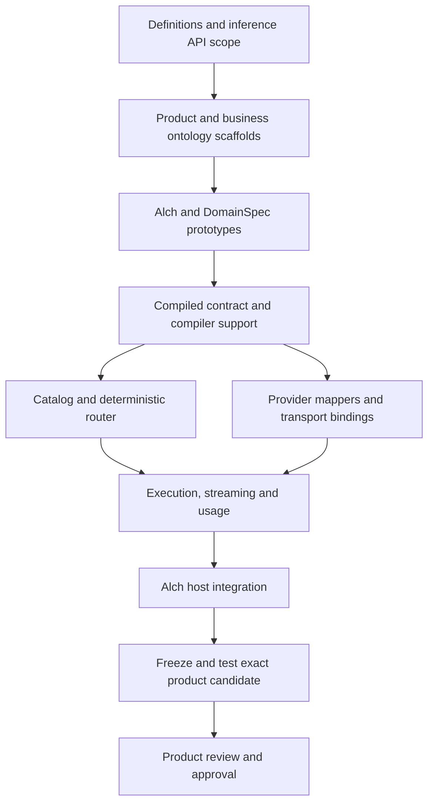

# Our inference router

Status: proposed construction plan. No implementation, registration, deployment
or paid provider calls are performed by this plan.

## Corrected objective

Build an inference service that people and agents consume through our API, with
our router selecting and invoking eligible inference providers. Telegraph is a
reference for organizing discovery, routed inference and provider dispatch.
Its wire contract, endpoint names, schemas and runtime are not requirements.

This plan supersedes the direction of
[`telegraph-inference-v1/DESIGN.md`](../telegraph-inference-v1/DESIGN.md).
That adapter and its test results are historical work on a different objective.
Their 32-route coverage is not acceptance evidence for this router. Do not make
the new service depend on Telegraph URLs, imported schemas or payment handling.

Reference: Telegraph's [Engine design](https://github.com/telegraphprotocol/telegraph-api-docs/blob/4d9f9714e351a2ea80b792ed5631a8c38e1951fc/openapi/engine.yaml)
separates discovery, automatic selection and direct execution. We borrow this
separation and define our own product contract below.

## First product slice

Proposed first supported task: text generation, including conversational input,
with JSON and SSE responses. Use two independently configured provider bindings
to demonstrate actual selection and controlled fallback. Providers may be hosted
services or a model runtime we operate; owning the router does not require
training or hosting every model.

Embeddings, images and other inference tasks extend the same capability model in
later slices. Marketplace registration, payments, blockchain jobs, wallets and
subscriptions are outside this first inference-only slice. Bearer API keys,
tenant access limits and usage measurement support initial users. Measurement
is not billing or a payment receipt.

## Public API proposal

| Method and path | Purpose |
| --- | --- |
| `GET /v1/capabilities` | Supported tasks and input/output capabilities visible to this caller |
| `GET /v1/models` | Eligible public model aliases, capabilities and supported limits |
| `POST /v1/inference` | Execute inference, using automatic routing or an explicit model alias |
| `GET /healthz` | Service liveness; does not disclose provider secrets or assert model availability |

The same inference endpoint handles direct and automatic selection. Public model
aliases are stable identifiers owned by us. Provider credentials, raw upstream
URLs and internal health diagnostics never come from request fields.

```json
{
  "task": "text.generate",
  "input": {
    "messages": [{"role": "user", "content": "Explain event-driven systems."}]
  },
  "routing": {"strategy": "balanced"},
  "parameters": {"max_output_tokens": 256},
  "stream": false
}
```

An optional `model` selects an eligible model alias explicitly; omitted means
automatic selection. Explicit selection does not silently substitute another
model. Omitted routing strategy defaults to a versioned balanced policy.
Capability-discriminated input/output schemas are generated from our Alch model.

JSON responses contain `request_id`, selected model alias, task output, finish
reason and normalized usage. Unknown usage values remain null and carry a
provenance label; unavailable usage is not zero. SSE uses our documented
`started`, `delta`, `completed` and `error` events, with a single terminal event
when the connection remains writable. An interrupted stream is incomplete.

Errors have stable codes and request IDs: invalid input (400), invalid key (401),
forbidden model/task (403), unknown model (404), conflicting idempotency key (409),
tenant limit (429), no eligible/available provider (503), failed upstream (502),
and timeout (504). After SSE headers are sent, errors use terminal stream events.

## Meaning and ontology scaffolds

Product capabilities: discover inference options, execute a task, select an
eligible model, stream output and explain operational outcomes.

Business roles: Caller, ServiceOperator and InferenceProvider. Records/values:
InferenceRequest, ModelOffering, ProviderBinding, RoutingPolicy, RoutingDecision,
InferenceAttempt, InferenceResult and UsageObservation. An actor is not declared
as a stored entity merely because it appears in an endpoint or binding.

Relations: ModelOffering supports Task; ProviderBinding serves ModelOffering;
RoutingDecision selects ProviderBinding for InferenceRequest; InferenceAttempt
executes that decision; InferenceResult completes an attempt; UsageObservation
measures an attempt. Requests and routing decisions pin the relevant model,
binding and policy versions. These are prototype navigation scaffolds until the
normal construction and test stages are complete.

## Router behavior

1. Authenticate, apply tenant limits and validate the task-specific input.
2. Filter bindings by enabled state, tenant permission, task support, context and
   output limits, requested streaming/features, and operator constraints.
3. For automatic routing, rank eligible bindings under a versioned policy:
   balanced, cost or latency. Use configured priorities initially; measured
   quality/cost/latency must carry evidence and freshness. Break ties by stable ID.
4. Pin the decision and map the canonical request to the selected provider's API.
5. Execute within bounded concurrency and deadline; normalize JSON or stream
   events and record the attempt outcome and observed usage.

Eligibility is a declarative predicate; ranking is a separate, explicit selection
operation. SFOL rules express constraints without embedding imperative loops in
Alch. The compiler must reject unsupported selection semantics instead of treating
them as successful opaque text. A language-model classifier is not necessary for
the first slice: the caller already supplies the task.

Fallback is at most one additional attempt, only for automatic routing and a
provider outcome proven safe to retry under that binding's contract. A known
pre-execution rejection can qualify. Ambiguous execution timeouts do not. Once
output has streamed, never switch providers or splice generations together.
Client disconnect cancels local forwarding and attempts upstream cancellation;
it does not prove remote execution or charges stopped. Record that distinction.

An optional idempotency key is tenant-scoped and bound to normalized request
bytes and the selected request record. Concurrent duplicates share one execution
or receive a defined in-progress response. Completed JSON results may replay
within bounded retention. Streams are not re-executed on duplicate submission;
stream resumption is deferred. Different bytes using the same key return 409.

## Alch and DomainSpec implementation plan

Alch owns request/result definitions, operation declarations, eligibility rules,
selection policy, provider integrations and public endpoints. Derive API schemas,
OpenAPI and ontology scaffolds from these definitions. Telegraph OpenAPI imports
are not the model source. Do not duplicate fields across ontology and API files.

Use DomainSpec mappers for provider request/response normalization. Keep HTTP,
SSE parsing, cancellation and secret resolution in reusable runtime bindings.
Extend the actual Alch compiler/DomainSpec path, with diagnostics, lowering and
target conformance tests, rather than promoting the previous standalone Python
profile to production by implication. Establish behavior on one target first;
record Rust parity separately rather than claiming it from Node tests.

## Product-construction DAG



Current frontier: corrected scope and planning only. D1 is runnable next, followed
by D2/D3. D5 and D6 become independently runnable after D4. No router implementation
or new product approval is asserted by this document. The machine DAG is in
`plan.json`; it is a planning artifact, not admitted Goals execution state.

Acceptance tests must demonstrate two eligible bindings and deterministic choice;
hard-constraint exclusion; explicit-model behavior; no eligible provider;
request and response mapper correctness; tenant isolation and credential secrecy;
bounded overload; cancellation and deadline behavior; allowed and forbidden
fallback; concurrent idempotency; correct usage provenance; and incremental SSE
with no provider switch after output. Include malformed provider output and
partial-stream failures. Full vertical proof must compile an authored `.alch`
service and run it through the real host path, not only a mock router in isolation.

## Operational support and deferred work

| Task | Owner | Affected stage | Dependency / state |
| --- | --- | --- | --- |
| Select two actual model/provider deployments | Product owner and inference operator | Live provider verification | Pending; fixtures enable D3-D8 independently |
| Configure credentials, quotas and any paid-call budget | Inference operator | Live provider verification | Required before external calls, not local compiler work |
| Verify a bounded real inference request per provider | Inference operator | Live provider evidence for production readiness | Depends on configured providers and tested bindings |
| Configure host policy, DNS/ingress and rollout limits | VPS operator | Deployment preparation | Deferred until host-supported product candidate |
| Deploy the exact reviewed candidate | Product owner and VPS operator | Deployment | Requires separate exact deployment authorization |

Use deterministic local fixtures for development while external configuration is
pending. Report real provider tests as not evaluable until their exact prerequisites
exist. Existing Alch/KEP/orchestrator services are unaffected by this plan.

## Open Questions

- Confirm text/conversational generation as the first task; add other inference
  modalities only with concrete contracts and provider support.
- Select two initial providers and public model aliases during D1/D3; no provider
  service or spending commitment is selected by this plan.
- Choose request/result retention and the initial latency/concurrency targets
  before freezing the product candidate. Default operational logs exclude raw
  prompts, outputs and credentials.
- Resolve exact compiler extension points and available DomainSpec selection and
  mapper support in D3. The previous proxy tests cannot settle those questions.
