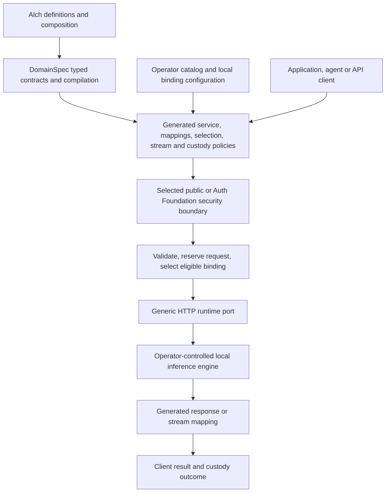

# Local inference pattern: analysis, design and plan

Status: planning candidate, 2026-09-07. Authority effect: none.
Scope owner: Alch product owner. Compiler contracts: DomainSpec v2 owner.
Request: “do a complete analysis see how telegraph done this too and present me a design and a plan”.
Open questions are owned by the final section of this document.

## Implementation status

LP-01..05 are implemented as a local candidate. [Validation](VALIDATION.md) records
205 passing tests and a standalone launcher smoke. LP-06 remains exact candidate
review; the original analysis below is retained as planning provenance.

## Outcome and scope correction

Deliver a reusable, executable local inference pattern authored in Alch, checked
and compiled through DomainSpec v2, with a small set of typed runtime bindings.
The deliverable is a pattern package, generated reference service, and contract
tests. Selecting a commercial provider is not a prerequisite. A reference fixture
proves protocol behavior; it does not prove model quality or actual model execution.

Interpretation of local for this candidate: an operator-controlled inference
engine reached through a fixed loopback HTTP endpoint. Private-network engines
and in-process model execution are separate topology variants. This interpretation
is proposed, not a claim that the user selected a concrete engine or deployment.

This proposal replaces the immediate provider-selection milestone in
[provider-evidence/PLAN.md](../security/provider-evidence/PLAN.md) for the local
pattern objective. Existing plans, receipts and tested recovery code remain
historical evidence; this document does not silently rewrite their scope or
promote candidate definitions. Synchronizing their current-next-work fields is
the first implementation unit after design review.

## What Telegraph actually documents

Reference revision: `4d9f9714e351a2ea80b792ed5631a8c38e1951fc`, the revision linked
by our original plan. These are published contracts, not an inspected running
implementation. The linked `AnomalyFi/Telegraph` repository returned 404 during
this analysis. Internal scheduling, code generation and recovery guarantees
therefore remain unverified. Documentation at this revision also contains differing
endpoint counts; this comparison relies on named operations rather than totals.

| Published behavior | Lesson for our pattern |
| --- | --- |
| YAML miner definitions describe identity, protocol, endpoint schema, parameter mapping, intent and output signal fields. Auth can be bearer, custom header or none. | Describe an engine integration once and let a reusable executor consume it. Alch is our authoring surface; importing Telegraph YAML is unnecessary. |
| Catalog discovery exposes registered miners and capabilities. | Generate discovery from the same offering definitions used for selection. |
| Engine `ask` classifies natural language, ranks miners, attempts primary/fallback; direct `ask` skips routing. | Separate discovery, selection and execution. Our explicit task and model alias make an LLM classifier unnecessary for v1. |
| Direct invocation accepts method, endpoint and payload from the client. | Our chosen boundary keeps destinations and wire details operator-owned; clients select a public alias. |
| WebSocket ask frames describe receipt, routing, execution and a final result. | Progress events are distinct from token deltas. These docs do not establish our SSE token-stream contract. |
| Marketplace payments, on-chain jobs and local job-result lookup exist. | They serve a different product scope. Job-result lookup is not evidence that every inference call has durable, recoverable execution. |

Primary references:

- [YAML integration standard](https://raw.githubusercontent.com/telegraphprotocol/telegraph-api-docs/4d9f9714e351a2ea80b792ed5631a8c38e1951fc/docs/integration-guides/yaml-standard.md).
- [Engine HTTP operations](https://raw.githubusercontent.com/telegraphprotocol/telegraph-api-docs/4d9f9714e351a2ea80b792ed5631a8c38e1951fc/docs/engine-daemon/engine-http.md).
- [Engine OpenAPI](https://github.com/telegraphprotocol/telegraph-api-docs/blob/4d9f9714e351a2ea80b792ed5631a8c38e1951fc/openapi/engine.yaml).
- [WebSocket sequence](https://raw.githubusercontent.com/telegraphprotocol/telegraph-api-docs/4d9f9714e351a2ea80b792ed5631a8c38e1951fc/docs/engine-daemon/engine-websocket.md).
- [Architecture and marketplace boundaries](https://raw.githubusercontent.com/telegraphprotocol/telegraph-api-docs/4d9f9714e351a2ea80b792ed5631a8c38e1951fc/docs/overview/architecture.md).

The relevant architectural analogy is definition → registry/catalog → selection
→ executor. Our typed compilation and generated behavior are our design, not a
claim about Telegraph's internal implementation.

## Current implementation: reuse and actual gaps

Current working-tree source was inspected. No commit-history reconstruction or
fresh runtime test execution was performed for this planning document.
The latest reconciliation receipt (result record excluded)
records 121 service, 28 custody/reconciliation, 38 authentication, two socket and
three compatibility tests. Those 192 recorded tests do not establish real-engine
compatibility or current source freshness by themselves.

| Area | Observed implementation | Design consequence |
| --- | --- | --- |
| Public API | [public-service.alch](../public-service.alch) declares health, models, capabilities and JSON/SSE inference routes with typed operation input/output. | Preserve the existing API. |
| Selection | [provider-selection.alch](../provider-selection.alch) filters enabled/task/permission/context/output/stream constraints and ranks with stable-ID tie breaking. | Reuse declarative deterministic selection. Rank is configuration, not measured performance. |
| Mapping | [Request](../provider-request.alch) and [response](../provider-response.alch) mappings compile fixture shapes. | Retain these as fixture examples; define an explicitly versioned local protocol before claiming compatibility. |
| Invocation | [provider-invocation.alch](../provider-invocation.alch) composes validation, selection, binding, mapping and one HTTP attempt. | Preserve generated orchestration; no new inference executor is justified. |
| Local transport | [http-invocation-adapter.ts](../../../alchlang/src/http-invocation-adapter.ts) requires a nonempty secret, sends bearer auth, and permits numeric loopback HTTP only with `allowLoopbackFixtures`. | Add an explicit local transport/auth policy. Do not activate a real local service by pretending it is a fixture. |
| Streaming | [provider-stream.alch](../provider-stream.alch) owns transitions and mappings; [stream-runtime.ts](../../../alchlang/src/stream-runtime.ts) parses named SSE events containing JSON objects. | Name this exact wire profile. Arbitrary SSE, sentinel frames and NDJSON are not interchangeable with it. |
| Limits | Invocation source selects 5 seconds/64 KiB. DomainSpec's outbound validator also caps deadlines at 5 seconds; runtime overrides may only tighten limits. | Local model budgets need an explicit bounded contract revision, not just a host environment setting. |
| Context fitting | [host.mjs](../host.mjs) supplies one synchronous conservative total estimate, including output allowance, to all candidates. | V1 must require a valid bound across the selected catalog, or introduce per-binding estimates with exact witnesses. Do not call a character heuristic an exact tokenizer. |
| Custody | Memory and SQLite declarations exist; generated policy controls reservation, replay and outcome handling. | Offer explicit memory/durable profiles; preserve their different restart guarantees. |
| Security | [protected-service.alch](../protected-service.alch) and Auth Foundation integration already exist. | Keep protected service composition as an existing option. A loopback engine with no upstream auth does not disable client authentication. |
| Packaging | [build-public-policy.mjs](../build-public-policy.mjs) builds several generated factories, then native host wiring supplies catalog, estimator and dependencies. | Package this composition as one reproducible pattern entry, with an explicit native binding manifest and conformance suite. |

The earlier [support matrix](../SUPPORT-MATRIX.md) is a historical audit. Many
gaps listed there were subsequently implemented in [SERVICE-PLAN.md](../SERVICE-PLAN.md).
Do not reopen all of those language extensions.

Inspected sibling contract sources:

- DomainSpec outbound validation (source binding requires reconciliation).
- DomainSpec HTTP invocation port (source binding requires reconciliation).
- DomainSpec stream validation (source binding requires reconciliation).
- DomainSpec custody validation (source binding requires reconciliation).

## Structural model and ownership

The following names describe roles in the proposed pattern; they are not newly
accepted Alch syntax or promoted canonical definitions.

| Concept | Meaning / owner |
| --- | --- |
| Task contract | `text.generate`, conversation input, limits, output and error vocabulary. Authored in Alch. |
| Model offering | Public alias and declared capabilities/limits. One alias may have multiple compatible bindings. |
| Engine binding | Versioned association between an offering and an operator-controlled execution endpoint/protocol. Existing `ProviderBinding` can fulfill this role; avoid a gratuitous global rename. |
| Protocol profile | Request mapping, JSON response mapping, stream framing and terminal semantics. Reusable across engines implementing the same protocol. |
| Routing policy | Eligibility and configured ordering. Authored behavior, separate from endpoint configuration. |
| Execution attempt | One selected, pinned binding/model/policy invocation. Resource settlement and client outcome are distinct. |
| Custody profile | Optional-key deduplication, bounded retention, stored outcomes and declared restart behavior. |
| Security binding | Public development scope or existing Auth Foundation protected composition. Identity and permissions remain Auth Foundation responsibilities. |

Alch owns authoring and lowering. DomainSpec owns normalized typed validation and
the supported compilation contracts. Native runtime ports own bytes, sockets,
clocks, cancellation, persistence and credential resolution. The local engine
owns tokenization, model weights, model loading and inference computation.

Actual compiler entry points already include `compileOutboundComposition`,
`compileStreamLifecycle` and `compileRequestCustody`, called from Alch's
[outbound](../../../alchlang/src/outbound-composition.ts),
[stream](../../../alchlang/src/stream-builder.ts) and
[custody](../../../alchlang/src/custody-builder.ts) builders.
[Service routes](../../../alchlang/src/service-routes.ts) assemble typed
routes around DomainSpec-compiled functions. These are existing candidate
profiles, not a claim of universal DomainSpec or Rust target support.

## Proposed execution flow

1. Operator supplies public aliases, local endpoint bindings, protocol versions,
   security mode, context estimator and bounded execution budgets. Validate
   configuration before serving; no client chooses URLs or credentials.
2. Client reads `/v1/capabilities` and `/v1/models`. These expose declared visible
   capabilities, not a promise that weights are loaded or capacity is available.
   `/healthz` remains liveness, not engine readiness.
3. Client submits `/v1/inference` with conversation, output allowance, optional
   model alias and stream flag. Existing validation/defaults apply.
4. Selected security mode supplies scope. Custody reserves the normalized request;
   matching retained keys replay or reject without another execution. Current
   authorization gates execution and replay in protected mode.
5. Selector chooses an eligible binding and pins its version. An explicit alias
   never silently changes to a different alias. Map and send one bounded request.
6. Return normalized JSON or `started`, `delta`, `completed`/`error` SSE. Missing
   usage remains unknown. Bound total bytes, event size, concurrency and deadline;
   preserve backpressure and keep resource slots until actual cleanup settles.
7. Disconnect/deadline attempts cancellation. It does not prove computation stopped.
   No automatic retry after ambiguous execution and no stream splicing/resumption.

An engine implementing the selected canonical local protocol needs no schema
translation beyond validation/identity mapping. An existing engine using another
protocol needs declarative mappings and, only if its framing differs, a reusable
codec capability. There should be no per-model handwritten adapter.

## Minimum pattern and optional extensions

Minimum: one text-generation contract, declared discovery, explicit and automatic
selection, JSON and named-SSE protocol, fixed local HTTP binding, bounded execution,
memory custody, generated bundle and deterministic conformance fixtures. Two
fixture bindings prove selection; they do not require two real model deployments.

Keep durable SQLite custody, protected Auth Foundation hosting and operator
reconciliation as separate supported compositions. Browser renewal and ingress
remain consumer/hosting features. Recovery requires engine evidence only if that
optional capability is selected. Same-machine execution does not remove the
crash window between dispatch and recording an outcome.

Deferred: cloud providers, paid calls, marketplace/on-chain features, automatic
model downloads, GPU provisioning, distributed scheduling, batching, tool execution,
additional modalities, stream resumption, automatic uncertain-outcome recovery,
and Rust service parity. No one of these blocks the minimum pattern.

## Implementation plan and acceptance gates

D65 construction chain: candidate meaning delta → typed contracts and product
scaffold → authored Alch and compiler changes → generated candidate → exact tests
→ product review. No ontology runtime record/selector is required for this scope.

| Unit | Owner / dependency | Deliverable and completion evidence |
| --- | --- | --- |
| LP-01 Correct and consolidate scope | Alch owner; design review | Use Define for the bounded local-binding/protocol meaning delta; reconcile current-next-work fields in paired Alch/DomainSpec plans and Craft contexts. Preserve historical receipts and approved auth semantics. Publish a current existing/proposed/deferred matrix. |
| LP-02 Specify local protocol and configuration | Joint; LP-01 | Versioned schemas and binding manifest: fixed endpoint, explicit auth none/bearer, transport scope, mappings, stream profile, estimator contract and limits. Prefer existing normalized contracts; reject unsupported combinations. No invented syntax presented as executable. |
| LP-03 Close demonstrated generic gaps | DomainSpec + Alch runtime owners; LP-02 | Explicit loopback HTTP policy and no-auth mode; bounded deadline contract revision; any required configuration validation/lowering. Reuse existing invocation and stream machinery. Per-binding estimator support only if selected over a documented catalog-wide conservative bound. |
| LP-04 Package the reference pattern | Alch owner; LP-02, LP-03 | One build entry composes the authored modules and records source/compiler/native binding identities. Include operator configuration example, generated API contract/view, launch instructions using the shared toolchain, and two deterministic local engine fixtures. No temporary compiler paths or model-name branches in generic runtime code. |
| LP-05 Prove behavior and reuse | Joint; LP-04 | Compile and exercise the actual host over loopback HTTP; run the matrix below and existing affected regressions. Change an authored alias/rank/mapping and prove behavior changes without editing runtime policy. Preserve the independent non-inference quote-service compatibility witness. |
| LP-06 Review exact candidate | Product owner; LP-05 | Freeze source/manifest and fresh evidence; review the reusable pattern. Actual engine compatibility remains explicitly unverified until an optional engine-specific witness is run. Approval grants no deployment effect. |

LP-01/02 can proceed without choosing an engine vendor. A real-engine witness is
an optional next integration, not a mandatory commercial-provider decision.

Test matrix for LP-05:

- Definition/compilation: incompatible types, unknown fields, missing mappings or
  ports, invalid protocol versions, conflicting binding IDs and unsupported limits.
- Local transport: explicit no-auth emits no Authorization header; bearer mode
  resolves only operator credentials; loopback scope excludes non-loopback targets,
  redirects and client-supplied destinations. Preserve existing HTTPS behavior.
- API/selection: discovery and runtime use the same catalog; disabled/incompatible
  engines excluded; stable ordering, ties, explicit alias and no eligible binding.
- Context: total input plus output fits the configured bound; unknown or invalid
  estimates fail; differing tokenizer assumptions are not silently shared.
- Execution: bounded overload, engine unavailable, malformed JSON, byte overflow,
  legitimate response after five seconds under a larger declared budget, deadline
  cancellation, and no retry or premature slot release on an unsettled transport.
- Streaming: partial UTF-8/CRLF, split frames, slow consumer, unknown event,
  missing completion, cancellation and one terminal outcome; no output splicing.
- Custody profiles: same-key duplicate/conflict, expiry and JSON replay; memory
  restart limitation; durable restart unresolved/replay semantics when selected.
- Protected composition: existing tenant isolation and current authorization
  before attempt/replay; local upstream no-auth cannot bypass client security.

Do not assert full performance or engine compatibility from fixture tests.

## Operational lane and blockers

Current frontier: candidate pattern design ready for review; no runtime changes
made by this analysis. Planning cannot be registered as admitted Goals execution
state while the repository route's Goals-validation blocker remains.

| Operational task | Owner | Affected stage / causal blocker |
| --- | --- | --- |
| Pick model engine, weights and hardware | Inference operator | Optional real-model witness only; no blocker for LP-01..05 fixtures |
| Model license, download and memory/GPU budget | Inference operator | Required before provisioning that engine; no downloads authorized here |
| Choose measured deployment budgets and estimator | Operator + compiler owner | Real-engine performance acceptance; declared bounded test budgets suffice for conformance |
| Key storage, backup and recovery evidence | Storage/operator owners | Durable operational profile only |
| Issuer/policy and private-network TLS | Auth/platform owners | Selected protected/network deployment only |
| Deployment and activation | Product/platform owners | Separate exact operational scope after tested candidate |

## Open Questions

1. **Local topology:** use fixed loopback HTTP for v1 (recommended), or is in-process
   inference a requirement? In-process execution would require a separately typed
   compute port; the inspected invocation profile currently requires one HTTP step.
2. **Protocol boundary:** establish our canonical local protocol first (recommended),
   or require compatibility with an already installed engine's wire format now?
   The latter requires its exact contract and a framing/mapping witness, not a
   choice among commercial providers.
3. **Context budget:** can v1 use a documented conservative bound valid across its
   catalog, or must heterogeneous per-engine tokenization be supported immediately?
4. **Reference composition:** document public loopback plus memory as the minimal
   example, with existing protected/durable variants (recommended). This does not
   change the previously approved tenant/principal model or authorize public exposure.
5. **Execution budgets:** select explicit reference-test limits in LP-02; production
   latency/concurrency targets need actual hardware measurements. Do not silently
   make the existing five-second compiler ceiling a production requirement.

These recommendations make the plan concrete while leaving unconfirmed choices
visible. No commercial provider decision is required for this objective.
