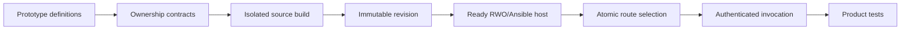

# Local Alch control plane

Private product-construction candidate; authority effect: none.
Owner: Alch compiler and host owners. Craft ORODI consumes related evidence.

Two operator-configured users can create projects, upload complete `.alch` source,
select a built revision, and invoke its function through one loopback server.
The existing compiler supplies DomainSpec 1.0.0 operations, rules, mappers and event
bindings. The existing host supplies RWO/Ansible provisioning and isolated Rust
execution. This package supplies authentication, ownership, revision storage and
routing; it does not introduce another business-rule interpreter.

## DAG and construction boundary



[PLAN.json](PLAN.json) separates construction from operational support and records
the dependency frontier. [definitions.md](definitions.md) is the local candidate
term index, with formal, plain-language and Alch-context voices.
[ontology.json](ontology.json) links the product/business scaffold to existing
Alch/DomainSpec and compiled host bindings. No canonical definition or ontology
admission is changed. Product approval and operational decisions remain distinct.

Runtime build states are `building -> ready` or `building -> failed`. SQLite
records build-requested, build-ready/build-failed and route-selected journal
stages. Startup marks interrupted builds failed; it does not guess that leftover
files completed successfully. A failed build or host startup leaves the old route
unchanged. Route selection is a transaction after the generated host reports ready.
This control-plane sequence is implemented locally; the underlying provisioning
DAG continues to execute through the existing Rust RWO bridge and Ansible adapter.

## Operator setup

Use the Node 26.8.1 and Rust 1.95.0 paths declared in `control_plane.py`; its build
sandbox also requires `/usr/bin/bwrap`, GCC, cached Cargo crates and working Linux
user namespaces. Build the existing compiler before starting this prototype:

```bash
export PATH=/home/vrondelli/.nvm/versions/node/v26.8.1/bin:$PATH
npm run build --prefix cyberAlchemy-v2/language/capabilities/alchlang/plans/general-compiler-v1/implementation
```

The predecessor's Rust RWO bridge must already be built. See
[local-host-v1](../local-host-v1/README.md) for its provisioning prerequisites.
The package is tied to this checkout and the declared local toolchain paths.

Copy [operator.example.json](operator.example.json) into a private operator-owned
file. Replace each placeholder with the SHA-256 of a distinct randomly generated
32–256 character bearer token (`A-Z`, `a-z`, digits, `_`, `-`). Keep the original
token with its user. Tokens are not stored in the registry or passed into builds.
The example deliberately contains no usable credentials. Token rotation takes
effect when the control plane restarts with updated configuration.

Each user entry has a tenant ID, token hash, allowed projects (`["*"]` for all of
that user's projects), scopes (`read`, `build`, `activate`, `invoke`), and a trusted
host policy. The uploaded file cannot override this policy. An invoke-only entry
cannot build or select revisions. This candidate has one credential per tenant;
shared memberships, multiple credentials per tenant and signup are future work.

Start from the repository root, selecting a new or existing private mode-0700
state directory whose parent exists:

```bash
PYTHONDONTWRITEBYTECODE=1 python3 cyberAlchemy-v2/language/capabilities/alchlang/plans/general-compiler-v1/extensions/local-control-plane-v1/control_plane.py \
  --root /tmp/alch-control-plane-demo --config /path/to/private-operator.json
```

It prints a loopback URL with an allocated port. `--port` can choose a fixed port;
there is no public address option. The state directory is exclusively locked.
SIGTERM/SIGINT stop the listener and its managed hosts. A Linux parent-death signal
also stops managed host processes when the controller dies. Durable revision and
provisioning state remains for restart. There is no user-facing deletion API.

## API

Every request requires `Authorization: Bearer <user-token>`. POST requires JSON
with an explicit content length. Duplicate authorization headers, browser Origin,
transfer encoding, malformed paths and oversized bodies are rejected.

| Method and path | Body | Result |
| --- | --- | --- |
| POST `/v1/projects/shop` | `{}` | Create the authenticated user's project, idempotently |
| POST `/v1/projects/shop/revisions` | `{"source":"<complete .alch file>"}` | Build and return revision/source/artifact hashes |
| GET `/v1/projects/shop` | — | This tenant's revision statuses and active routes |
| POST `/v1/projects/shop/revisions/<revision>/activate` | `{}` | Start a verified host and select its route |
| POST `/v1/projects/shop/functions/orders-local/invoke` | `{"facts":{...},"expected_version":0}` | Invoke the selected producer |

Use [orders.alch](orders.alch), with a 30-second delivery lease instead of the
predecessor crash fixture’s two-second lease, as the uploaded source and
[place-order.request.json](../event-execution-v1/place-order.request.json) for the
`facts` and `expected_version` fields. Example upload with a token already supplied
in the environment, from this extension directory:

```bash
python3 - <<'PY'
import json, os, urllib.request
from pathlib import Path
url = os.environ['ALCH_CONTROL_URL']
headers = {'Authorization': 'Bearer ' + os.environ['ALCH_USER_TOKEN'], 'Content-Type': 'application/json'}
def post(path, value):
    request = urllib.request.Request(url + path, json.dumps(value).encode(), headers)
    with urllib.request.urlopen(request, timeout=240) as response:
        return json.load(response)
post('/v1/projects/shop', {})
revision = post('/v1/projects/shop/revisions', {'source': Path('orders.alch').read_text()})
post('/v1/projects/shop/revisions/' + revision['revision'] + '/activate', {})
request = json.loads(Path('../event-execution-v1/place-order.request.json').read_text())['request']
print(post('/v1/projects/shop/functions/orders-local/invoke', {key: request[key] for key in ('facts', 'expected_version')}))
PY
```

Repeat with Bob's token against the same URL and project name. Ownership always
comes from the credential. Supplying Alice's revision ID as Bob returns 404.
There are no client-supplied tenant IDs, host paths, grant overrides, consumer
commands, queue-control calls, compiler options or arbitrary runtime uploads.
A successful producer reply means state/outbox commit; consumer completion follows
through the existing lease-fenced local event worker. Unknown invocation outcomes
return 504 and require retrying the same message identity. The proxy never retries
a potentially committed invocation automatically.

## Revisions, builds and isolation

Revision IDs are server-generated. The registry binds each to tenant/project,
source SHA-256, a complete bundle inventory digest, and the root's compiler binding.
The API cannot overwrite a revision. Every activation and invocation verifies its
bundle inventory against the registry. These hashes detect local drift; they are
not remote signatures or protection against an administrator rewriting the store.

Builds run in Bubblewrap with a private network, cleared environment and only the
specific compiler distribution/package files, the existing outbox binding, minimal
repository marker/provisioner inputs, Node, Rust, system tools and read-only Cargo
registry mounted. Tenant directories, credentials and the repository root are not
mounted. A private job directory and ephemeral `/tmp` contain outputs and Cargo
target files; builds never share writable target caches. Missing sandbox or compiler
inputs fail the build; no unsandboxed fallback exists.

The root pins hashes of both compiler distributions, package manifests, the outbox
binding, Node/cargo/rustc executables and provisioning inputs. Before/after-build
checks reject drift; restart with a changed binding requires a new control-plane
root in this prototype. OS libraries, the entire Rust sysroot and Cargo cache are
operator-controlled dependencies, not a fully hermetic or reproducible toolchain
claim. Generated Cargo.lock and all bundle files are included in the artifact hash.

Build limits: 128 KiB source, 180-second wall deadline, 120 seconds per-process CPU,
8 GiB per-process address space, 256 MiB per-file size, 256 descriptors, two Cargo
jobs and 512 MiB Node heap. Invocation limits remain those of the existing host.
These limits do not impose aggregate cgroup memory/process/disk quotas. A fresh
Cargo target takes time; builds intentionally block other API requests in this
serialized local prototype. This is a correctness boundary, not fair scheduling.

At most eight revision hosts run per controller. Each has an opaque provisioning
root and separate SQLite state/outbox/inbox. Switching versions starts fresh state
for the new revision; switching back resumes that revision's previous state.
There is no schema migration or cross-revision event handoff. Previously started
hosts keep delivering their own events until controller shutdown. On restart only
selected revisions are started lazily when invoked; inactive revision queues pause.
This is not a continuous inactive-queue draining guarantee. Host slots are not yet
automatically evicted; restart releases them.

## Evidence and remaining work

Run the local end-to-end tests:

```bash
PYTHONDONTWRITEBYTECODE=1 python3 -m unittest discover \
  -s cyberAlchemy-v2/language/capabilities/alchlang/plans/general-compiler-v1/extensions/local-control-plane-v1 \
  -p test_control_plane.py -v
```

Tests create disposable tenants/tokens, compile uploaded Alch source inside the
sandbox, provision real local hosts, invoke generated Rust and inspect resulting
state/event receipts. They also test cross-tenant access, scope checks, failed
builds, artifact drift, build namespace isolation, exclusive ownership, denied
policy, restart deduplication, interrupted builds, revision switching, readiness
failure and compiler/sandbox failure. Test cleanup stops hosts and removes only
its own temporary roots. See validation.json (referenced result or source binding is not imported) for actual results
and [source-manifest.json](source-manifest.json) for exact candidate bytes.

| Lane | Frontier / residue | Owner | Stage |
| --- | --- | --- | --- |
| Product construction | Tenant/project build and invocation through one server | Alch host owners | Local candidate and tests |
| Product construction | Asynchronous scheduling, revision migrations, inactive queue lifecycle, multiple credentials | Alch host owners | Runnable successor design |
| Operational support | Aggregate cgroups/quotas, independent security tests, TLS/public target | Platform/security owner | Deferred public deployment |
| Operational support | Independent live host and queue evaluation | Craft ORODI owner | Deferred runtime evidence |
| Operational support | Historical Craft source-binding migration | Craft owner | No stage dependency |

There is no public service, cloud provisioning, admitted control-plane ontology,
or independent live ORODI evaluation in this candidate. Existing provisioning
observations remain historical local evidence under their own adapter contract.

## Open Questions

- What target-wide cgroup and filesystem quota policy should constrain compilation and workers?
- Should credentials belong to tenant members rather than one account per tenant?
- What state migration and inactive-queue draining contract should version changes use?
- Which live ORODI observation profile should report project and revision health?
- How should crash-left build scratch directories and retired revisions be collected under an explicit retention policy?
