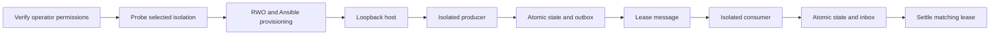

# Local event delivery and isolated Alch workers

Status: private product-construction prototype. Authority effect: none.
Owner: Alch language and local host implementation; Craft ORODI evidence consumer.

The local host now dispatches committed producer events to the declared consumer
and can execute every Rust invocation inside a Bubblewrap sandbox. The complete
[orders.alch](orders.alch) example extends the existing deployment block with:

```alch
  events local
  isolation bubblewrap
```

Both fields are optional for compatibility. The defaults are `events disabled`
and `isolation trusted-process`. There is no automatic fallback when an explicitly
selected sandbox fails. Public listeners remain rejected by the compiler.

## Meaning and source chain

Local delivery, formal prototype meaning: a host-owned adapter claims one leased
outbox message, invokes the already-declared consumer with the same envelope and
message identity, and settles only the matching attempt. Plain language: deliver
the recorded event and acknowledge what actually happened. Domain context: the
existing DomainSpec channel, transport, failure policy, outbox and inbox definitions
remain authoritative for function behavior. This package adds no message ontology.

Isolation binding, formal prototype meaning: an explicit selection of the local
invocation mechanism and its fixed filesystem, environment, namespace and resource
boundaries. Plain language: choose where the generated code is allowed to run.
Domain context: Bubblewrap wraps the Rust executable while the trusted host retains
credentials, provisioning history and revision binding outside the writable mount.
These meanings specialize the prior deployment prototype, not canonical terms.

Product prototype: the operator starts one authenticated local function instance;
HTTP producer calls automatically drive its declared consumer. Business hypothesis:
authors can test a complete event flow without writing host or transport code.
The existing Alch/DomainSpec compiler still parses operations, mappings and event
bindings. The new deployment fields select the host adapters; `host.json` records
the resolved consumer, boundary and transport. The execution pipeline is:



Unknown results return through the existing retry policy. The host never edits
queue statuses directly. The source example uses a two-second visibility lease
to make local crash-recovery tests short; it is not a production tuning choice.

## Operator policy and running

Build as in [local-host-v1](../local-host-v1/README.md), selecting this example:

```bash
node implementation/dist/cli.js build extensions/local-host-events-v1/orders.alch --out /tmp/orders-events-host
export ALCH_HOST_TOKEN="$(openssl rand -hex 24)"
export ALCH_HOST_POLICY="$(cat extensions/local-host-events-v1/operator-policy.json)"
PYTHONDONTWRITEBYTECODE=1 python3 /tmp/orders-events-host/serve.py --run-root /tmp/alch-provision-orders-events
```

Run from `general-compiler-v1` after building the CLI. The predecessor's local
RWO/Ansible build prerequisites still apply. `/usr/bin/bwrap` and working Linux
user namespaces are required for the selected isolation. The startup probe
checks availability before provisioning; failure stops startup.

The [operator policy](operator-policy.json) separately grants the HTTP producer,
the local consumer and the declared transport. It also selects Bubblewrap.
Authoring a consumer or a transport does not grant access to it. None of these
permissions can come from an HTTP request. The token is scoped to this host
instance; separate instances use separate roots and tokens. This is not yet an
account-management or tenant-control-plane service.

The HTTP body and endpoint are unchanged from local-host-v1. A successful producer
response means state/outbox commit, not consumer completion. The background
worker shares the invocation slot with HTTP; callers may receive `FUNCTION_BUSY`
while delivery is running. `/health` exposes the last worker polling result, not
a durable queue summary or a product-readiness verdict.

## Delivery behavior

- The worker claims with the existing lease and attempt number, invokes the
  consumer, and accepts only `processed` or `duplicate` for the same message ID.
- Here, `provider-accepted` settlement means this local adapter observed consumer
  completion. It does not claim acknowledgement from an external broker.
- Consumer rejection or unknown completion settles as `unknown`, using the
  authored exponential retry and maximum attempts. Exhaustion leaves a `dead`
  outbox row; a remote dead-letter queue is not provisioned.
- If the process dies after consumer commit and before settlement, the lease
  expires, the same envelope is delivered again, and the inbox prevents a second
  state change. No exactly-once transport claim follows from this behavior.
- Stale settlement cannot bypass lease fencing. A failed claim stops the worker
  and reports `blocked`; a failed settlement remains unconfirmed for recovery.
- Shutdown stops the polling loop and waits for bounded in-flight work. The
  `--test-crash-after-consume` flag is a local fault-injection hook that exits 75.

## Isolation contract and limits

Bubblewrap creates private namespaces for each invocation. The executable and
system libraries under `/usr`, `/lib` and `/lib64` are read-only. Only the function's
`target/state/runtime` directory is writable through `/data`; revision metadata,
provisioning history, sibling data and the host home are not mounted. The sandbox
gets a fresh `/tmp`, `/proc`, `/dev`, and a cleared environment with only the
runtime path and database binding. Its network namespace has no external route.

A separate launcher applies per-process CPU time, 256 MiB address-space,
64-file-descriptor and 64 MiB file-size limits before execution. The wall deadline
kills the invocation process group. These are not aggregate cgroup memory,
process-count, filesystem quota or fair-scheduling guarantees.

The [Bubblewrap maintainers](https://github.com/containers/bubblewrap#sandbox-security)
explicitly place security-policy responsibility on the caller. Our selected
arguments and tests establish this bounded local isolation candidate, not a
complete public-hosting security result. Seccomp policy, aggregate resource
accounting, tenant lifecycle, TLS and independent security review remain open.
The compiler still accepts only loopback listeners. No public service was deployed.

## Construction plan and evidence

| Lane | Frontier or task | Owner | Stage |
| --- | --- | --- | --- |
| Product construction | Authored event/isolation bindings and local adapters | Alch compiler/host owners | Implemented candidate |
| Product construction | Crash recovery, isolation and rejection tests | Alch runtime owners | Current product tests |
| Product construction | Aggregate resource policy, tenant lifecycle and live ORODI service observations | Host / ORODI owners | Runnable successor design and prototypes |
| Operational support | Cloud target, credentials, DNS/TLS, production kernel policy and security review | Platform operator / security owner | Deferred public deployment; no local test prerequisite |
| Operational support | Historical Craft source bindings | Craft owner | No stage dependency |

The current product frontier is a loopback instance with isolated invocations and
durable local delivery. There are no causal blockers for its local tests on this
host. Public operation remains outside the tested candidate.

See validation.json (referenced result or source binding is not imported) and [source-manifest.json](source-manifest.json).
Tests cover real isolated producer/consumer execution, crash-before-settlement
recovery, bounded retry exhaustion, separate instance credentials/state, missing
operator grants, unavailable isolation, hidden sibling files, cleared secrets and
network denial. All test servers and temporary directories are cleaned up.

## Open Questions

- What tenant-wide cgroup, process and disk policy should the public target enforce?
- Which seccomp policy and independent security tests should bind that target?
- Which broker adapter should replace direct local delivery when hosts separate?
- Which durable queue-health projection should ORODI consume?
