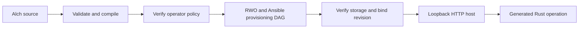

# Local Alch function host v1

Status: product-construction prototype. Private. Authority effect: none.

One `.alch` file now contains business behavior, event mappings, integration
bindings and local deployment intent. `alchlang check` validates it and
`alchlang build` generates the Rust function and a Python loopback HTTP host.
The host uses the existing RWO–Ansible prototype to configure temporary storage
before exposing the declared producer operation.

## Authoring

[orders.alch](orders.alch) retains the complete event-execution example, changes
the profile to `local-host-v1`, and adds:

```alch
deployment orders-local:
  runtime rust
  provisioner ansible-local-v1
  listen loopback
  operation place-order
  timeout-ms 5000
  max-request-bytes 65536
```

The existing Alch parser, SFOL checks, mapping implementation and DomainSpec
event-binding compiler still own function behavior. The new compiler parses a
closed deployment block and rejects duplicate, unknown or unsupported fields.
Only the declared producer can be exposed in this version. No embedded Python,
TypeScript, Rust, shell, credentials or privileged playbook is authored in Alch.

## Prototype meaning and construction

DeploymentBinding, formal: one exact authored source binds a declared producer
operation to the local Rust runtime, fixed provisioner, loopback endpoint and
bounded invocation settings. It requests these facilities; it grants no access.
Plain language: the file says which function to expose and how to run it locally.
Domain context: the operator must separately supply an actor and boundary grant
matching the existing function declarations before provisioning begins.
This is local prototype vocabulary, not a canonical definition amendment.

Product prototype: a trusted operator builds an Alch function, provides local
credentials, starts it and calls it over HTTP. Business hypothesis: authors can
exercise deployment intent without implementing a custom host per function.
DomainSpec continues to own the normalized event contracts. `host-plan.json`
and `host-ontology.json` are deterministic deployment projections generated by
the compiler from the authored source; they confer no activation authority.



| Lane | Task / frontier | Owner | Stage |
| --- | --- | --- | --- |
| Product construction | Deployment grammar, compiled host and end-to-end tests | Alch compiler / host owners | Current implementation candidate |
| Product construction | Event delivery worker, revision updates and richer host evidence | Alch / ORODI owners | Runnable successor prototypes |
| Operational support | Cloud selection, credentials, DNS/TLS and public isolation | Platform operator | Deferred remote deployment |
| Operational support | Historical Craft binding maintenance | Craft owner | No dependency on this candidate |

No cloud prerequisite blocks these local product tests. Product approval,
public activation and deployment remain separate decisions.

## Build and run

The repository provisioning runtime must be built as described in
[its README](/home/vlad_/projects/cyberAlchemy-v2/work-orchestration-implementation/extensions/alch-host-provisioning-v1/README.md).
This prototype uses the installed repository runtime at a bound absolute path;
the generated bundle is not yet portable to a clean machine.

From `general-compiler-v1`, with the required Node version on PATH:

```bash
npm run build --prefix implementation
node implementation/dist/cli.js check extensions/local-host-v1/orders.alch
node implementation/dist/cli.js build extensions/local-host-v1/orders.alch --out /tmp/orders-host
export ALCH_HOST_TOKEN="$(openssl rand -hex 24)"
export ALCH_HOST_POLICY="$(cat extensions/local-host-v1/operator-policy.json)"
python3 /tmp/orders-host/serve.py --run-root /tmp/alch-provision-orders
```

The process prints its loopback URL and endpoint; port 0 selects a free port.
Optionally supply `--port`. The only listener address is `127.0.0.1`.
`GET /health` requires the same bearer token and reports listening status only.

POST to `/functions/orders-local/place-order` with bearer authentication,
`Content-Type: application/json`, and this body shape:

```json
{
  "facts": {
    "operationId": "op1",
    "orderId": "o1",
    "status": "pending",
    "outboxMessageId": "m1",
    "occurredAt": "2026-09-06T12:00:00.000Z",
    "payload": {"quantity": 2}
  },
  "expected_version": 0
}
```

The host supplies invocation time and trusted execution context. Additional
request fields, including `context`, `command`, grants and database paths, are
rejected. `claim`, `settle`, consumer invocation and inspection are not exposed.
Successful producer invocation commits state and its outbox entry; no broker
delivery is implied. Exact retry returns `already-committed`, including after
the host restarts with the same run root.

## Boundaries and recovery

- Source and generated bundle hashes are checked before provisioning and
  invocation. These are local integrity checks, not signed artifact admission.
- The operator policy is environment-provided and checked before provisioning.
  It permits exactly the exposed operation. The token never enters the Rust
  handler environment or responses. Browser Origin requests are rejected.
- The provisioning owner lock is held for the server lifetime, excluding another
  host on the same root. Graceful shutdown waits for bounded active requests.
- A root binds one source revision and stable SQLite database. A different
  source cannot silently reuse it; migration and revision switching are later work.
- Invocation concurrency is one, request size is bounded, and the Rust process
  has a deadline. A timeout reports an unknown outcome, because a transaction
  may have committed before the response was lost; retry uses the same message ID.
- The runtime is a subprocess, not a tenant sandbox. CPU/memory/egress isolation,
  tenant accounts, scale-to-zero scheduling and public TLS are not implemented.
  The prerequisite fixture's configuration labels do not establish isolation.
- All servers started by tests are stopped and their test-owned directories
  removed. Running the documented command intentionally keeps a local server
  alive until the operator stops it.

ORODI historical provisioning observations remain available after shutdown via
the prior evidence adapter. It deliberately refuses to snapshot an active
owner-locked run. `/health` is not a full ORODI evaluation or deployment proof.

## Validation

Focused tests exercise real Ansible provisioning and Rust HTTP invocation,
restart deduplication, missing operator credentials, unauthorized requests,
context/command injection, limits, rules, competing hosts and bundle drift.
See validation.json (referenced result or source binding is not imported) and [source-manifest.json](source-manifest.json).

## Open Questions

- Which event worker should connect the generated outbox to local consumers?
- How should compatible revisions share storage and drain older event schemas?
- Which independent service observations should the ORODI host adapter collect?
- Which tenant isolation implementation should a public deployment target use?
