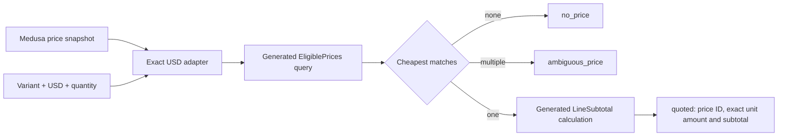

# Medusa quantity-price quote prototype

A runnable AlchLang module for a bounded slice of Medusa v2.18.0 base-price
calculation. For 15 shirts, a $10 default and an $8 tier covering quantities
10–19 produce an $8 unit quote and a $120 subtotal.

## Run

From `implementation`, after `npm run build`:

```sh
node ../extensions/medusa-quantity-price-v1/demo.mjs
node --test ../extensions/medusa-quantity-price-v1/module.test.mjs
```

`demo.mjs` builds through the AlchLang CLI, lowers to DomainSpec 1.0.0 using
`domainspec-1.0.0-exact-uint64-v1`, compiles the generated TypeScript, executes it,
and removes its temporary output. Node 26.8.1 or newer and the existing local
DomainSpec compiler/toolchain are required. No Medusa installation is needed
for the demo or local regression tests.

For a fresh comparison with the actual pinned Medusa repository, from this directory:

```sh
npm ci --ignore-scripts --no-audit --no-fund --prefix oracle
node oracle/parity.mjs
# Keep a generated application and receipt in a new directory:
node oracle/parity.mjs --out /tmp/quantity-price-evidence-new
```

The oracle requires Docker and creates one uniquely named, loopback-bound
PostgreSQL container with temporary storage. It removes only its own container
and temporary output in `finally`. The image is pinned by digest. Dependency
installation uses `oracle/package-lock.json`. The oracle does not use an existing
Medusa database, apply Medusa migrations, or contact a shop.

## Design



The `.alch` source owns inclusive range filtering, exact amount ordering, and
subtotal multiplication. The adapter owns the Medusa snapshot boundary, currency
conversion, null bounds, and the explicit no-price/tie outcomes. It does not
implement the eligibility query in JavaScript.

The quote is a pure function over a supplied snapshot. It does not fetch prices,
reserve stock, modify carts, collect payment, or promise snapshot freshness.
The variant-to-price-set association is explicitly supplied and checked for
internal consistency; no live Medusa link lookup is claimed.

## Contract

- One variant and one associated price set per call; explicit positive integer
  quantity from 1 through 2147483647. That cap is a prototype choice, not a
  Medusa numeric limit. Omitted quantity and fractional quantities are excluded.
- USD requests only, case-insensitive with no whitespace trimming. A snapshot
  may contain other currencies; those rows are excluded. Stored currency codes
  must already be lowercase, as in Medusa storage. Missing currency is an
  error, while no eligible USD row returns `no_price`.
- Each supplied price is a base price: `price_list_id: null` and `rules_count: 0`.
  Contextual rules, price lists, tax preferences, and extra request context are
  rejected rather than silently treated as equivalent.
- Snapshot prices use `raw_amount: {value: "10.99", precision: 20}`. The value is
  a decimal **major-unit string**, converted to `1099n` cents. Binary floats,
  exponent notation, negatives, more than two decimal places (even trailing
  zeroes), and cents beyond UInt64 are rejected without rounding.
- Quantity bounds are inclusive. Null/omitted minimum becomes zero in the
  generated record; null/omitted maximum becomes UInt64 maximum. Explicit
  bounds must be positive integers within the quantity cap and not inverted.
- Among eligible undeleted rows, lowest unit amount wins. A cheaper default can
  beat a more specific tier. Equal cheapest amounts return `ambiguous_price`
  with sorted IDs, because upstream has no guaranteed ID tie-breaker.
- `quoted` carries exact decimal strings and cents strings. The generated
  multiplication rejects subtotal overflow. No price and ambiguity have no
  payable subtotal. Subtotal is an AlchLang extension, not Medusa tax/cart parity.

`fixtures.json` is the executable input/output example collection.
`adapter.mjs` exports `quotePrice(api, snapshot, request)`; `api` is the compiled
bundle's `domain.js`. `build.mjs` supplies the build-and-load helper.

## Product and business scaffolds

[definitions.json](definitions.json) defines the prototype terms.
[product-ontology.json](product-ontology.json) connects inputs, capabilities,
outputs, and evidence. [business-ontology.json](business-ontology.json) connects
merchant price offers, shopper demand, and quote meaning. These are local
navigation scaffolds, not registered or admitted ontologies.

The exact selected dependencies are those three files, the declarations and
property selectors in `quantity-price.alch.domainspec.json`, and the pinned
sources in [sources.json](sources.json). No ambient ontology epoch is used.

## Evidence and limits

The local suite tests successful quotes, boundary/error behavior, input
immutability, input-order independence, and overflow through a real CLI build.
The optional oracle invokes the **unmodified installed Medusa PricingRepository**
with a manager that supplies a real Knex connection. The test schema contains
only query-relevant PostgreSQL columns with numeric amounts and bounds.

It compares eligible row sets and ordered amounts on 20 named cases, reversed
input order, and 80 deterministic generated cases. Equal-amount ID order is
intentionally not compared. Missing currency rejection is checked on both sides.
The service source separately establishes first eligible base-price selection;
the full service, ORM lifecycle, migrations, tax handling, and storefront are
not executed by this harness. The upstream integration test file is inspected
source evidence, not a suite claimed to have been run here.

[sources.json](sources.json) pins release, commit and source hashes.
[evidence/application/parity.json](/home/vlad_/projects/cyberAlchemy-v2/language/capabilities/alchlang/plans/general-compiler-v1/extensions/medusa-quantity-price-v1/evidence/application/parity.json) records the
actual package hash, npm integrity, image digest and individual outcomes.
[candidate.json](candidate.json) identifies the current local tested candidate.
[PLAN.md](PLAN.md) tracks construction and operational support separately.

## Open questions

- Does the product owner want ambiguity returned to callers, or a separately
  specified deterministic tie-break policy?
- What future integration should own snapshot freshness and variant-to-price-set
  lookup? What source API will produce the explicitly bounded snapshot DTO?
- Fractional quantities, extra currencies, rules, price lists and taxes require
  new scoped designs and evidence.
- Product approval is not recorded. No publication, deployment, live-shop
  integration, or operational activation is authorized by these tests.
