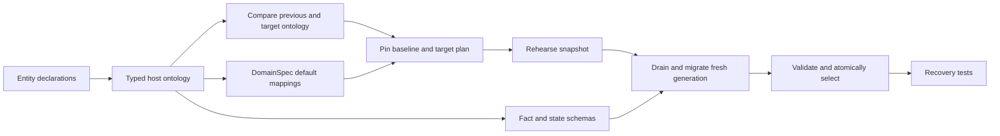

# Ontology-derived host schemas and migration plans

The `ontology-host-v1` profile makes one entity property declaration drive typed ontology, fact and state schemas, state-mapping defaults, and DomainSpec-generated migration mappers. The user no longer writes a separate migration identifier, mapper name, subject, or source contract hash.

This is a local product-construction successor using fresh private controller roots. Existing migration and compatible-upgrade packages remain historical candidates. Public operation, importing existing roots, retention cleanup and live ORODI adoption are separate work.

## Author once

Keep the existing order function, use `profile ontology-host-v1`, and add one property:

```alch
entity OrderOperation:
  schemaVersion: string optional default "v2"
  # Existing properties follow.
```

[orders-v1.alch](orders-v1.alch) and [orders-v2.alch](orders-v2.alch) are complete examples. V2 adds exactly that property. There is no `migration` block and no hand-maintained hash.

The optional scalar and literal default express the author’s intent. The enclosing entity identifies the subject. Generated stable property IDs identify matching fields across versions. Mapper and migration IDs derive from those property IDs. The previous revision is resolved during preparation and pinned in the stored plan.

In this bounded host profile, property defaults generate literal **state-mapping** values. They do not add operation inputs or event payload fields, and are not a general fallback expression facility. Required defaults, computed defaults and record defaults are rejected. Existing opaque `record` payloads remain opaque objects; their nested shape is not guessed from stored samples.

## One typed representation

The compiler produces `typed-ontology.json` with source identity, typed record properties, operation storage keys, state/payload mapping references and mapping clauses. `schemas.json` is projected from this representation. The compiler also checks that its projected facts and mapping clauses match the generated Rust runtime configuration.

- `schemas.facts` validates incoming facts at the controller before Rust invocation.
- `schemas.states` validates migrated state before a generation can be selected.
- Each authored default produces a typed DomainSpec `Mapping`, generated module and trace under `defaults/`.
- `default-mappers.json` relates property identity to the generated mapper directory.

The existing declarative-function ontology generator remains unchanged. This representation joins the host, state-schema and migration paths; it does not claim that every Alch profile already uses one universal ontology format. Generated ontologies remain source-derived scaffolds, not admitted business authority.

From the compiler implementation directory, build/check/inspect using the existing toolchain:

```sh
node dist/cli.js check ../extensions/ontology-schema-v1/orders-v2.alch
node dist/cli.js ontology ../extensions/ontology-schema-v1/orders-v2.alch
node dist/cli.js build ../extensions/ontology-schema-v1/orders-v2.alch --out /tmp/alch-ontology-bundle
```

The build output must be a new directory. The generated ontology answers what the compiler understood, including the property default and its state mappings.

## Preparation and activation

Run `python3 control_plane.py --root /tmp/alch-ontology-demo --config /absolute/path/operator.json` from this directory. Use the operator configuration and bearer-token rules documented in the [local control-plane package](../local-control-plane-v1/README.md). Node, the offline Rust toolchain, Bubblewrap, local RWO/Ansible provisioning and Python `jsonschema` are required.

The inherited API uploads source and builds revisions asynchronously. Once a revision is ready:

1. `POST /v1/projects/<project>/revisions/<revision>/prepare` with `{}` derives and returns an immutable plan. Preparation uses the caller’s build scope and makes no host switch.
2. Inspect `kind`, `baseline`, `migration`, and `digest`. Initial and compatible revisions have no migration. Additive plans identify the exact generated mapper and default.
3. `POST /v1/projects/<project>/revisions/<revision>/activate` with `{}` uses the caller’s activation scope and executes the pinned plan.

`GET` on the revision returns its state contract, ontology digest and prepared plan. Preparation is idempotent for the same unchanged baseline. It pins the selected revision, artifact, state contract, storage key, and route-selection epoch, together with the target artifact and ontology. A changed baseline returns `BASELINE_CHANGED`; upload a new candidate to prepare against the new baseline. Retrying an already-selected revision is idempotent.

The plan does not freeze live data. Rehearsal uses a snapshot; after draining, a fresh stable snapshot includes writes made before drain. Runtime state and all delivery receipts are preserved through the existing generation handoff. Revision, generation and receipt commit together. The old generation remains retained and startup restores the durable selected generation.

## Construction DAG



The runnable construction frontier and operational residue are recorded separately in [PLAN.json](PLAN.json). [Definitions](definitions.md) and the [candidate concept scaffold](ontology.json) explain the prototype terms. The product/business purpose is preserving accepted orders and message history while reducing authoring duplication. DomainSpec owns the generated Mapping contract; Rust executes the existing durable event protocol; the controller handles preparation and the local RWO/Ansible lifecycle.

## Limits and evidence

Automatic migration permits one new optional scalar property with an explicit default per revision. Existing properties must retain identity, type, requiredness and default. Removal, ambiguous rename, identity change, unspecified default and unrelated business/runtime changes are rejected. The source and target must both use this ontology host profile. Multiple existing default declarations can remain present, but a migration selects only its one newly added property.

A type alone cannot determine a business default or rename. Those choices require authored intent. No inverse migration is inferred, and a stale plan cannot roll back over newer state. Preparation and activation remain serialized by the loopback API. Generation retention, aggregate quotas and asynchronous migration jobs are deferred.

Run `PYTHONDONTWRITEBYTECODE=1 python3 -m unittest -v test_ontology` here. Compiler tests live in `implementation/test/ontology-host.test.ts`. Source hashes and current results are recorded in `source-manifest.json` and `validation.json`. These are bounded local product tests, not exhaustive crash coverage, product approval, public deployment or live Craft ORODI evidence.

## Open questions

- How should explicit rename/inverse mappings reconcile post-migration writes?
- Which existing ontology formats should converge after the host representation is tested?
- How should nested record schemas be declared when the payload has a known type?
- Which aggregate retention quotas and asynchronous preparation APIs should operators use?
- Which live ORODI observation contract should consume migration-plan and handoff evidence?
