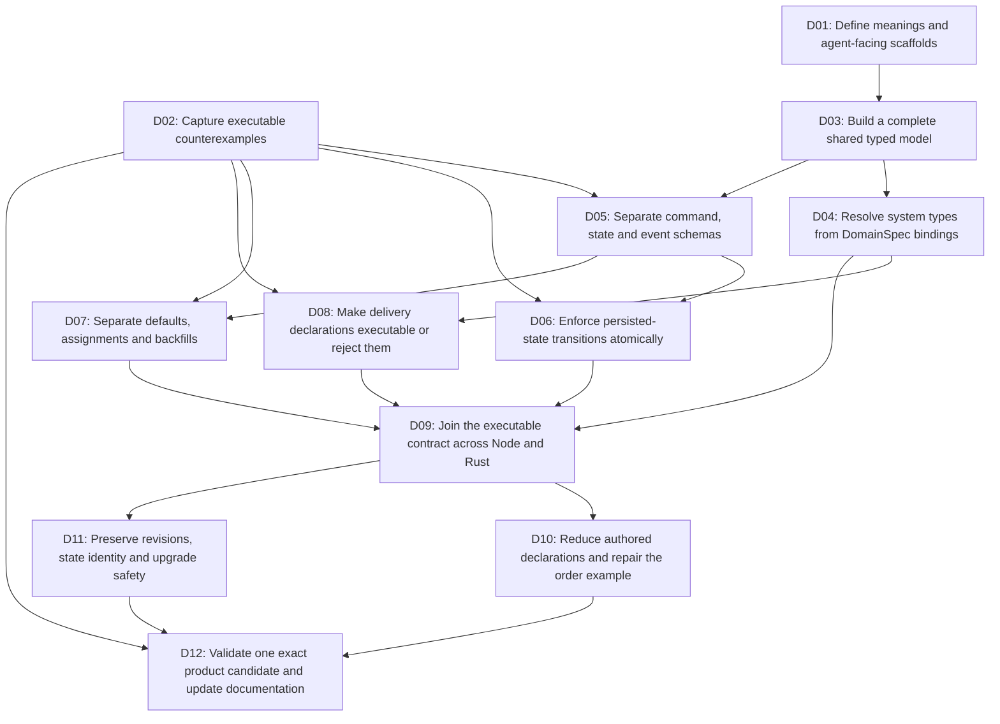

# Alch semantic corrections DAG

Status: all 12 construction nodes implemented and tested in the local successor; see execution.json (referenced result or source binding is not imported) for current evidence. The original planning-only validation is historical. This packet covers the eight findings from the authoring/runtime review. It does not register an admitted Goal or authorize deployment.

The target is an Alch file whose declared inputs, state transitions, mappings, delivery policies and authority relationships match its runtime behavior. Authors should state business choices once; the compiler should derive structural repetition and binding-owned types.

The original start frontier was **D01 and D02**; construction is now complete for this bounded candidate. Definitions/scaffolds and counterexample fixtures can progress together. Complete the minimum shared typed representation, then implement schema, transition, value and delivery corrections. Simplify authoring only after these semantics agree across Node and Rust.

## Dependency graph

Branches express independent work, not an approved agent fan-out. The machine-readable source is [PLAN.json](PLAN.json). Review findings and source hashes are in [review-baseline.json](review-baseline.json).

## Work packages

### D01 — Define meanings and agent-facing scaffolds

Owner: Alch language and DomainSpec contract owners. Stage: definitions; ontology scaffold; product and business prototype. Dependencies: none.

Outputs:

- Definitions for command input, entity state, event payload, system envelope, projection, actor selection and binding-owned type
- Transition, default/assignment/backfill and delivery-counter semantics
- Order product/business prototype and explicit authored-versus-derived matrix

Acceptance:

- Every finding maps to an invariant with an owner and observable outcome
- Unambiguous actor selection remains explicit and cannot create a grant
- Business default values, event IDs for retry, and ambiguous renames are never guessed
- Message identity, operation identity and entity identity have separate meanings

### D02 — Capture executable counterexamples

Owner: Alch validation owner. Stage: product-test fixture prototype. Dependencies: none.

Outputs:

- Reproducible source variants and expected failures
- Shared input/state/event fixture corpus for Node and Rust
- Current behavior receipt pinned to source bytes

Acceptance:

- Reproduce accepted cancelled transition still writing committed
- Reproduce narrowed input still requiring six entity fields
- Reproduce max-receives 1 yielding runtime limit 5 and retention omission
- Reproduce a supplied value overwritten by default and absent OutboxMessage import
- Label initial probes as known failures rather than product PASS; Rust execution must be exercised, not inferred from Node

### D03 — Build a complete shared typed model

Owner: Alch compiler owner. Stage: DomainSpec and compiled-system prototype. Dependencies: D01.

Outputs:

- Typed records for state, command, payload, projection, actors, permissions, boundaries, effects, bindings and transitions
- Source provenance, stable identities and typed relationships
- Explicit compatibility boundary between host and declarative-function projections

Acceptance:

- Round-trip every declared concept without losing actors, boundaries, events or empty typed imports
- Reject unresolved references and ambiguous identities
- Entity storage identity and consumer projection identity are explicit
- Schemas and backend plans consume typed records rather than reparsing emitted text

### D04 — Resolve system types from DomainSpec bindings

Owner: DomainSpec binding owner and Alch compiler owner. Stage: DomainSpec binding and system-ontology prototype. Dependencies: D03.

Outputs:

- Typed OutboxMessage/inbox/envelope definitions with version and provenance
- Binding resolver and collision diagnostics
- Rust and Node adapter capability/evidence declarations

Acceptance:

- An operation selecting the outbox binding resolves its system types without an empty entity declaration
- Missing or incompatible binding types fail before execution
- User types cannot silently shadow imported system types
- A Node-specific adapter/evidence declaration cannot stand in for a Rust implementation claim

### D05 — Separate command, state and event schemas

Owner: Alch compiler and host owners. Stage: schema and implementation prototype. Dependencies: D03, D02.

Outputs:

- Operation-specific input validators
- Entity state and consumer projection schemas
- Event payload and system-envelope schemas with independent requiredness

Acceptance:

- Only declared command inputs are accepted; internal state fields are not required from callers
- Consumer input is derived from its selected event payload contract
- Required stored fields may have defaults/backfills without becoming required request fields
- Unknown fields and wrong types reject consistently in Node and Rust
- No nested business schema is fabricated for an opaque record

### D06 — Enforce persisted-state transitions atomically

Owner: Alch runtime owner. Stage: implementation prototype. Dependencies: D05, D02.

Outputs:

- Transactional transition evaluator over stored state and command facts
- One derivation of next state and emitted event
- Explicit state/projection keys and optimistic concurrency rules

Acceptance:

- Changing the declared destination changes resulting state or produces a compile-time conflict
- A caller-supplied pending value cannot reset committed state
- Concurrent updates from one version allow only one valid transition
- State and outbox commit together or both roll back
- Identical message replay succeeds without repeating a transition; conflicting replay rejects

### D07 — Separate defaults, assignments and backfills

Owner: Alch language/compiler and DomainSpec Mapping owners. Stage: implementation prototype. Dependencies: D05, D02.

Outputs:

- Explicit typed default/assignment/backfill nodes
- DomainSpec-generated mapping contracts for those nodes
- Schema/version metadata owned by compiler/storage

Acceptance:

- Fallback default preserves an explicitly supplied valid value
- Explicit assignment deliberately replaces a value and is identified as such
- Backfill affects eligible legacy records only and preserves delivery receipts
- Missing, null, false, zero and empty string have distinct tested policies
- Business properties do not need schemaVersion solely for storage migration

### D08 — Make delivery declarations executable or reject them

Owner: DomainSpec delivery contract and Alch transport owners. Stage: implementation prototype. Dependencies: D04, D02.

Outputs:

- Delivery capability matrix with supported and rejected values
- Explicit receive/transport attempt accounting, retention and dead-letter behavior
- Trace from each accepted delivery field to runtime enforcement

Acceptance:

- max-receives 1 and max-attempts 5 have defined, observable stage-specific behavior; no setting is silently ignored
- Expired messages cease eligible delivery under the selected retention policy
- Retention cannot silently destroy deduplication history needed for safe retries
- A declared dead-letter destination receives the terminal message or the unsupported declaration rejects
- Lease fencing, bounded backoff, unknown outcomes and consumer deduplication retain fault tests

### D09 — Join the executable contract across Node and Rust

Owner: Alch backend and DomainSpec compiler owners. Stage: compiled-system and implementation integration. Dependencies: D04, D06, D07, D08.

Outputs:

- One typed execution plan consumed by both backends
- DomainSpec binding/mapping trace and backend capability checks
- Complete schema-to-runtime correspondence report

Acceptance:

- Every accepted executable declaration has an enforcement path or an explicit compile-time unsupported error
- Node and Rust run the same transition, schema, delivery and mapping counterexamples
- No stale handwritten interpretation contradicts the generated Mapping contract
- Actor/grant checks cannot be weakened through derived relationships

### D10 — Reduce authored declarations and repair the order example

Owner: Alch language and documentation owners. Stage: product authoring prototype. Dependencies: D09.

Outputs:

- Complete revised ecommerce example with business state, command, event and projection roles
- Derived identity mappings, relationship closure and imported system types
- Explain output showing authored facts versus generated decisions

Acceptance:

- No empty OutboxMessage placeholder or duplicated structural relationship is required
- One explicit actor/binding choice drives references while preserving authorization
- Equivalent explicit and concise files compile to the same executable meaning
- Ambiguous actor, identity, binding or rename selection produces a targeted diagnostic
- Measure required authored declarations and repeated references before/after; no reduction target overrides semantic clarity

### D11 — Preserve revisions, state identity and upgrade safety

Owner: Alch host and migration owners. Stage: migration and host implementation prototype. Dependencies: D09.

Outputs:

- Successor schema/execution version contract
- Explicit legacy operation-key to entity/projection mapping where required
- Snapshot rehearsal and immutable baseline/target binding

Acceptance:

- Incompatible operation-keyed state is not silently reinterpreted as shared entity state
- Migration preserves inbox/outbox identities, commit fingerprints, versions and accepted writes
- Ambiguous merges and destructive transforms require explicit intent
- Stale plans, target drift, interrupted preparation and uncertain selection recover safely
- Unsafe rollback cannot restore old data over post-migration writes

### D12 — Validate one exact product candidate and update documentation

Owner: Alch product-test and review owners. Stage: exact product candidate and current product-test evidence. Dependencies: D10, D11, D02.

Outputs:

- Exact source/compiled-artifact manifest
- Full finding-to-test closure report and fresh Node/Rust/host evidence
- Final design, tutorial, examples, limitations and candidate review packet

Acceptance:

- All eight findings have passing acceptance tests in the final candidate
- Run a full create-order, event delivery, projection, restart, migration and replay scenario
- Run denial, concurrency, loss/duplication, retention, dead-letter and upgrade failure cases
- Hash-bound docs and examples describe implemented semantics, including unsupported cases
- Product approval remains a separate owner decision after current tests; no approval or deployment is manufactured

## Finding coverage

| Finding | Corrective nodes | Final closure |
|---|---|---|
| F1: Declared state transitions do not govern persisted-state execution | D06, D09, D11 | D12 |
| F2: Operation input declarations disagree with entity-wide runtime validation | D05, D09, D11 | D12 |
| F3: Delivery policy values are omitted or misrepresented by execution | D08, D09 | D12 |
| F4: Default, assignment, optionality and migration backfill are conflated | D07, D09, D11 | D12 |
| F5: Empty OutboxMessage placeholder has no imported binding-owned type | D04, D09, D10 | D12 |
| F6: Business state, command, event envelope and consumer projection share one entity | D03, D05, D06, D09, D10, D11 | D12 |
| F7: Host ontology drops actors, permissions, boundaries, events and empty entities | D03, D04, D09, D10 | D12 |
| F8: Authors repeat relationships, bindings and identity mappings | D04, D10 | D12 |

## Product and operational boundaries

The current construction frontier is separate product-owner review of the exact tested candidate. No construction nodes remain runnable in this packet. The three contract questions below have candidate-scoped resolutions recorded in PLAN.json.

Existing-data migration **implementation and local tests** belong to D11. Applying that migration to an existing installation is O1, owned by the Alch operator, and is deferred. Production retention/cleanup is O2, public deployment is O3, and live ORODI integration is O4. Their owners, affected stages and dependencies are explicit in PLAN.json. None blocks new-root product construction.

D12 freezes one exact candidate with current tests and documentation. Product approval is then a separate Alch product-owner decision bound to that candidate. Approval does not grant live migration, deployment, publication or destructive cleanup authority.

## Preservation and scope

The reviewed compiler and extension paths in PLAN.json are investigation/implementation pointers. Before executing a node, resolve its exact current files and write scope. Preserve historical candidates and unrelated dirty bytes. Changes to shared compiler dependencies require fresh currentness evidence; older passing receipts do not automatically cover revised code.

The previous review ran eight compiler probes and one Node runtime reproduction. Its Rust findings were source-inspected. D02 must reproduce relevant behavior on actual Rust execution before D12 can claim parity. The original planning receipt validates graph structure and coverage only. Current execution evidence includes actual Node and Rust counterexamples and fresh correction tests.

## Open questions

- D04 resolves the actual DomainSpec public API for imported system types; no typed OutboxMessage schema is assumed to exist already.
- D01/D08 define the relation between transport retries, consumer receive counts, retention and deduplication lifetime.
- D11 resolves explicit legacy row ownership; ambiguous record merges are never inferred.

These questions constrain their affected nodes. They do not prevent starting D01 and D02.
