# Additive Alch state migration candidate

This successor lets a local operator activate an Alch revision that adds one scalar state field with an explicit default. It uses the DomainSpec CLI 1.0.0 public declarative Mapping compiler. The existing Rust event runtime and the RWO/Ansible local provisioner execute the function.

Product construction is local prototype work. This package does not migrate existing controller registries, publish services, admit a canonical meta type, or grant operational approval. Its selected dependencies are the previous compatible-upgrade controller, asynchronous build controller, local control plane, Alch compiler, public DomainSpec compiler API and fixed local provisioning package. See `source-manifest.json` for exact bytes.

## Alch authoring

Start with the existing order function and change its profile to `local-host-migration-v1`. Append:

```alch
migration add-schema-version:
  from-contract 65b116169724e8c2ed0d10269e876b62770af39dac6cb666dc70ce04ceb5deb3
  subject OrderOperation
  mapper AddSchemaVersion
  field schemaVersion default string "v2"
```

The complete example is [orders-v2.alch](orders-v2.alch). The source contract binds the exact compiled `compatible-upgrades-v1/orders-v1.alch` fixture used by the tests. Read `state_contract` from `GET /v1/projects/<project>/revisions/<revision>` for your selected ready revision before authoring a migration; the example digest is not a wildcard.

The compiler derives an optional entity fact and adds the default to each state mapping for that subject. Requests and historical event payloads remain unchanged. This makes existing message retries valid. New producer and consumer writes retain the default. String, safe integer and boolean literal defaults are supported. Computed expressions, overwrites, field removal, required request changes and payload evolution are rejected in this slice.

The bundle includes `migration.json`, the DomainSpec contract and trace, generated `migration.mjs`, and a bounded structural adapter. DomainSpec computes the new field; the adapter preserves the existing JSON record, including opaque nested payloads. It is not a second expression interpreter. The migration runner mounts only the generated modules and Node/system runtime in Bubblewrap, receives rows through stdin and cannot access tenant storage or the network.

## Construction DAG and behavior

```mermaid
flowchart LR
  A[Alch migration declaration] --> B[DomainSpec Mapping compilation]
  B --> C[Snapshot rehearsal]
  C --> D[Drain and stop old host]
  D --> E[Provision fresh generation with RWO and Ansible]
  E --> F[Migrate fresh stable snapshot and validate]
  F --> G[Start candidate host]
  G --> H[Commit route and generation together]
  H --> I[Restart and recovery tests]
```



Before draining, the controller compares the old and new semantic models. Only the declared optional field and state-mapping default may differ; source-location annotations do not count as semantics. Event delivery, permissions, rules, request contracts and runtime implementations must remain the same. The migration must bind the old compatibility digest exactly.

The rehearsal uses an online SQLite backup. After drain, a fresh backup includes any writes made since rehearsal. Only selected `state.state` JSON values change. State operation/key/version tuples, other state rows, outbox bodies and commit fingerprints, inbox bodies/IDs, observation records, counters and SQLite sequences are preserved. All non-state tables are compared. Snapshot input is bounded to 64 MiB, 10,000 state rows and 16 MiB of selected JSON; mapping has a 15-second timeout and a bounded Node heap.

A new storage generation is provisioned and validated before the registry changes. Revision and state pointer commit in the same SQLite transaction. The old generation remains retained. Rehearsal or preparation failure resumes the selected old host. Restart eagerly starts the persisted selected generation. An uncertain commit is resolved from the registry, never by assuming the old revision is still selected.

Cross-schema rollback is rejected with `MIGRATION_REQUIRED_ROLLBACK_UNSAFE`, including after post-migration writes. An explicit inverse contract is future work. Compatible revisions may still switch within the current generation. No old database is silently restored over newer state.

## Running the local candidate

Use a fresh private controller root and an operator configuration following [the existing local control-plane contract](../local-control-plane-v1/README.md). Keep the example credential setup local.

```sh
python3 control_plane.py --root /tmp/alch-migration-demo --config /absolute/path/operator.json
```

The inherited HTTP API creates tenant projects, accepts `.alch` source into the isolated asynchronous build queue, exposes revision status, activates ready revisions and invokes selected functions. Upload and activate v1 first. Upload the source-bound v2, wait for its build to become ready, then activate it through the same revision activation endpoint. The activation response includes its storage key and migration attempt ID.

Migration records in the private controller `registry.sqlite` bind the source/target contracts, revisions, mapper digest, snapshot evidence and preservation checks. `migration-attempts/` retains rehearsal and candidate snapshots; provisioned generations live under `/tmp/alch-provision-migration-<key>`. Failed attempts are retained for investigation. Cleanup, importing existing roots and storage retention policy belong to the operator and are deferred; no automatic destructive cleanup runs.

## Validation and claim ceiling

Run `python3 -m unittest -v test_migrations` from this directory with `PYTHONDONTWRITEBYTECODE=1`. Compiler tests are in `implementation/test/state-migration.test.ts`. Current results and source hashes are recorded in `validation.json` and `source-manifest.json` after tests complete.

Tests cover real asynchronous compilation, Rust invocation, local event delivery, mapper rehearsal, rejection of undeclared changes, tenant ownership, failure before selection, durable generation selection, preserved deduplication, new writes and rejected unsafe rollback. Injected failures are bounded cases, not exhaustive crash-at-every-instruction or production readiness evidence.

The product/business purpose is preserving accepted orders and delivery history during a small schema evolution. [Definitions](definitions.md), [ontology scaffold](ontology.json) and [construction plan](PLAN.json) are candidate artifacts. Craft ORODI is the related evidence consumer; these receipts are local product-test evidence, not live ORODI observations or capability adoption.

## Open questions

- How should inverse mappings reconcile writes accepted after migration?
- Which aggregate storage quota and retention policy should cover retained generations and snapshots?
- How should migration jobs become asynchronous and expose operator-facing progress?
- Which exact live ORODI contract should describe migration and handoff observations?
