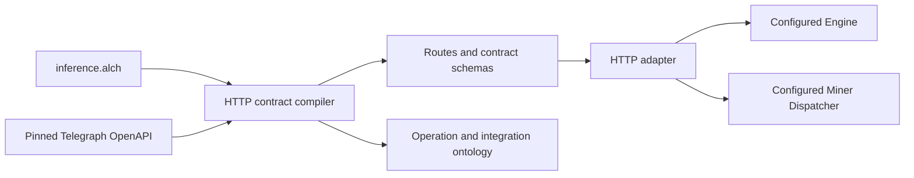

# Inference compatibility design

## Definitions and product prototype

**API contract** owns HTTP method/path pairs, input/output shapes and declared
security schemes. **Integration binding** selects a fixed upstream through an
environment reference. **Inference request** is caller input; **inference result**
is provider output. **Payment proof** is opaque evidence presented to a verifier;
its mere presence does not establish payment. **Compatibility** here means
preserving public HTTP request/response transport for the pinned contract within
declared adapter limits. It does not prove equivalent models, prices, reasoning,
settlement, or chain state.

The product capability is to consume a known inference API through an Alch-defined
boundary without manually repeating its endpoint schemas. The product ontology
scaffold consists of the API contract, operation, integration and external
provider roles. It is generated in `generated/ontology.json`; no canonical
meta-type is created or promoted by this prototype.

## Business prototype

The caller chooses a routed query or a direct provider request. A provider supplies
inference; an upstream payment verifier decides whether a submitted proof is
valid. The operator chooses eligible upstream URLs. The local adapter owns only
HTTP routing/forwarding. An inference payload cannot choose an arbitrary network
destination, change the operator binding, or confer payment authority.

The x402 challenge and result are separate outcomes. Failed or ambiguous transport
must not cause an implicit second paid call. Caller retry/payment decisions remain
with the caller. On-chain job details remain upstream-owned observations.

## Alch and compiled-system prototype

The compiler rejects unknown clauses, undeclared integration references, escaping
contract paths, duplicate mounts/routes and accidental inclusion of internal
secret-protected endpoints. Exact source hashes accompany the generated model.
The runtime uses the compiler directly so its route decisions have one source.

Payload transport is identity-preserving: no mapper rewrites request/result
fields. Provider-specific transformations, if selected later, must use the
DomainSpec mapper implementation rather than embedded code in `.alch` files.
Native DomainSpec lowering for this multi-endpoint profile remains a named gap;
the generated JSON is not represented as an admitted DomainSpec artifact.

## Construction DAG

| Node | Lane | Depends on | Outcome / owner |
| --- | --- | --- | --- |
| D1 Define compatibility and authority boundaries | Product construction | Pinned upstream source | Definitions above |
| D2 Derive contracts and ontology scaffold | Product construction | D1 | Alch contract projections and compiler |
| D3 Implement HTTP binding | Product construction | D2 | Adapter with x402/header/status/SSE pass-through |
| D4 Test exact local candidate | Product construction | D3 | Fixture-based HTTP tests; product-test.json |
| D5 Integrate profile with core Alch and DomainSpec | Product construction | D4 | Next runnable prototype; language owner |
| D6 Add WebSocket transport if selected | Product construction | D2 | Deferred independent transport scope |
| O1 Select/configure actual upstreams | Operational support | User/operator choice | No current local-construction blocker |
| O2 Run authorized real inference/payment tests | Operational support | O1 and explicit payment scope | Inference/payment operator; live integration stage |
| O3 Deploy a tested host-supported candidate | Operational support | D5, product review, deployment scope | VPS operator; deployment stage |

Current frontier: the standalone HTTP profile/compiler/adapter is locally tested.
Core compiler/DomainSpec and host integration is runnable follow-on construction.
Real upstream configuration and payment authority are operational residue; they
do not block local language development. No new live deployment is part of this
candidate. Changes to the existing shared compiler are not hidden inside this
extension's test result.

## Test and claim boundary

The test fixture simulates an upstream and labels its outputs as fixtures. Tests
exercise every public route, exact method/path/query forwarding, payment challenge
and receipt headers, binary request preservation, incremental event streaming,
restricted headers, excluded endpoints, no retry after connection failure, no
redirect following, traversal rejection, configuration rejection and request caps.
Fixture proofs are not signatures and do not prove x402 settlement or inference.

## Open Questions

See [README.md](README.md#open-questions) for backend selection, exact upstreams,
host/DomainSpec integration, WebSocket and operational prerequisites.
