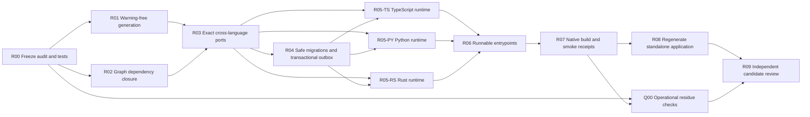

# DomainSpec Whole-Application Runtime Remediation DAG

This DAG turns the current formation-only output into a coherent, runnable
candidate in TypeScript, Python, and Rust. It does not authorize publication,
release, deployment, or production operation.

## Audit baseline and executed corrections

- TypeScript originally reported 52 unused diagnostics. Capability-derived
  support now compiles with `noUnusedLocals` and `noUnusedParameters` enabled.
- Rust originally reported 12 warnings. A freshly generated provider application
  now passes `cargo clippy --locked -- -D warnings`.
- Python Protocols now declare their provider methods as async at the canonical
  integration generator rather than through a whole-application text rewrite.
- The canonical application graph now has 29 nodes and 25 edges. The two added
  owned-composition edges close the authored Order relationships; broader
  executable port dependencies remain represented by the separate runtime-port
  manifest rather than being invented as domain edges.
- The TypeScript, Python, and Rust providers now implement the generated Operation
  transaction dependency, atomically prepare Order state and the outbox, invoke
  exact Mapping bindings for NATS and HTTP, compose inbound Operation Requests,
  and dispatch `commerce:perform` exactly once. Rust uses the generated typed
  `PerformStore`/`PerformTransaction`, Mapping projections, and Operation Request
  instead of the older string pass-through integration traits.
- The application graph now emits six exact Mapping runtime bindings and the
  whole-application composer generates executable Mapping registries for
  TypeScript and Python plus typed Rust re-exports. Every authored binding now
  also has a binding-ID-specific native invoker, so providers do not have to
  choose a Mapping by selector or collapse two occurrences that reuse one
  Mapping. First-class typed identity references close Event and Entity
  identity inputs without embedding an Entity or inventing a Store lookup.
  TypeScript, Python, and Rust derive the native reference carrier from the
  declared Entity identity.
- Inbound message and HTTP bindings now target an explicit Operation Request,
  declare protocol-body paths and request-member composition, and are checked
  against the selected Operation inputs. TypeScript and Python reuse the exact
  generated `OperationInput`; Rust reuses `PerformRequest`. Missing or
  type-mismatched request members fail planning.
- Publication contracts now return a transport-neutral provider-acceptance
  receipt in all three languages. The receipt records the acceptance boundary
  and provider acknowledgement while explicitly retaining false delivery and
  consumer-completion observations.
- Migrations now create tables before foreign keys, run transactionally, record
  migration-ledger rows, derive outbox/inbox/dead-letter tables, and verify
  columns, constraints, indexes, and ledger state. Atomic runtime use of the
  outbox remains unproved.
- Generated projects now expose executable entrypoints. Formation receipts still
  state that native compilation was not performed; the separate external
  runtime-evidence receipt records native compilation and bounded loopback
  behavior without claiming production guarantees.

## Dependency graph

`R00` through `R09` are product construction. `Q00` is a separate support lane:
it audits temporary files, caches, fixture isolation, and cleanup, but cannot
substitute for product behavior.

## Layer decisions

| Layer | Decision after the layer | Minimum working unit | Value | Cost | Exit evidence |
| --- | --- | --- | --- | --- | --- |
| L0 — Source truth | The baseline fails for the known reasons and every future fix has a focused regression test. | R00 audit fixtures plus strict TypeScript, Python protocol, Rust clippy, graph, migration, and entrypoint checks. | Prevents passing broad tests from hiding product gaps. | Small test and documentation surface. | Reproducible red tests with exact diagnostics. |
| L1 — Coherent generated model | Generated code contains only used helpers and the graph contains every semantic dependency needed by generation. | R01 and R02. | Removes dead output and orphaned meaning before runtime code is added. | Generator specialization and graph schema changes. | TypeScript unused checks, Rust warning denial, Python import checks, graph reachability/orthogonality tests. |
| L2 — Executable ports | All three targets expose the same async operation, transaction, persistence, mapping, publication, and HTTP contracts. | R03 and R04. | Makes adapters implement the generated application instead of parallel placeholder interfaces. | Cross-language contract and migration work. | Port-equivalence manifest, migration dependency/constraint verification, rollback-and-outbox tests. |
| L3 — Runnable application | Each generated target can construct clients, apply migrations, bind endpoints, invoke mappings and operations, publish accepted messages, and shut down. | R05 branches and R06. | Produces an actual application entrypoint rather than a library-shaped source bundle. | Runtime adapters and lifecycle handling in three languages. | Isolated provider tests and one local smoke scenario per language. |
| L4 — Reproducible candidate | The CLI records native compilation and smoke evidence, then regenerates one exact standalone application. | R07 through R09 plus Q00. | A clean consumer can distinguish formation, compilation, startup, and observed runtime behavior. | Toolchain execution and independent review. | Exact receipts, clean regeneration, zero owned residue, discrepancy-free review. |

## Node contracts and status

| Node | Depends on | Status | Work product | Must not happen |
| --- | --- | --- | --- | --- |
| R00 | — | complete | Frozen diagnostics and focused regression denominator. | Broad test count used as a substitute for exact failures. |
| R01 | R00 | complete | Capability-derived helpers; no unused generated declaration. | Suppressing warnings with artificial reads. |
| R02 | R00 | complete | Authored composition edges are closed; executable dependencies remain explicitly represented by the separate runtime-port manifest rather than being invented as domain relationships. | Inferring missing edges from generated filenames. |
| R03 | R01, R02 | complete | One language-neutral five-port/transaction manifest, six exact Mapping bindings, explicit Operation Request composition, exact native request types, typed provider-acceptance receipts, executable cross-language Mapping registries, binding-ID-specific native invokers, and first-class typed Entity identity references exist. | Generic union or string pass-through replacing exact types; identity references collapsed into embedded Entities; provider acceptance collapsed into delivery or completion. |
| R04 | R03 | complete | Dependency-safe DDL, delayed constraints, indexes, ledger write, outbox/inbox/dead-letter storage, verification SQL, and transaction tests cover state-plus-outbox atomic use. | Claiming atomicity without a transaction test. |
| R05-TS | R03, R04 | complete | PostgreSQL Operation transaction/store, state-plus-outbox commit, exact request/message/HTTP Mapping invocation, one Operation invocation per inbound request, NATS provider-acceptance publication, and webhook dispatch. | Mocked provider evidence treated as live PostgreSQL, broker delivery, or consumer completion. |
| R05-PY | R03, R04 | complete | Async PostgreSQL Operation transaction/store, state-plus-outbox commit, exact request/message/HTTP Mapping invocation, one Operation invocation per inbound request, NATS provider-acceptance publication, webhook dispatch, and explicit immutable-Fact-to-Operation-input materialization. | Mapping facts passed directly into an Operation capture boundary; mocked provider evidence treated as live infrastructure. |
| R05-RS | R03, R04 | complete | Typed SQLx Operation transaction/store, state-plus-outbox commit, exact request/message/HTTP Mapping invocation, one Operation invocation per inbound request, JetStream provider-acceptance publication, signed async webhook dispatch, and explicit JSON boundary conversions. | String pass-through traits substituted for typed generated ports; isolated provider evidence treated as live infrastructure. |
| R06 | all R05 | complete | CLI-generated executable entrypoints decode configuration, connect selected clients, apply migrations before binding, expose lifecycle-aware health, and close HTTP, messaging, HTTP-client, and database resources deterministically in all three targets. Python explicitly pins Uvicorn as its ASGI server. | Health reporting ready before dependency checks. |
| R07 | R06 | complete | Separate `verify-runtime` command, external schema-bound receipt, target-preserving temporary-copy execution, native compilation, and bounded signed loopback HTTP evidence for TypeScript, Python, and Rust. | Converting compilation into live-provider or production-runtime proof. |
| R08 | R07 | complete | Standalone commerce project regenerated from the current vendored CLI and canonical spec into exact 76-artifact TypeScript, 128-artifact Python, and 90-artifact Rust targets, with three external runtime-evidence receipts. | Hand edits in generated output. |
| Q00 | R00, R07 | complete | Final task-owned validation roots, working dependency installations, and compiler outputs were removed after native and packed-consumer evidence. Cargo's caller-managed registry cache is reused rather than duplicated per run. | Deleting user-owned or unrelated caches. |
| R09 | R08, Q00 | complete | Independent read-only obligation-by-obligation review found no unresolved discrepancy after target-boundary and package-lock corrections. | Publication or promotion. |

## Execution waves

1. Wave A: R00, then R01 and R02.
2. Wave B: R03, then R04.
3. Wave C: R05-TS, R05-PY, and R05-RS against the same port manifest.
4. Wave D: R06 and R07.
5. Wave E: R08 and Q00, then R09.

Work stops only for a product decision that changes an already resolved semantic
contract. Implementation defects, failed tests, or additional bounded code work
do not require a new decision.

## Current execution evidence

- CLI typecheck including materialized-source and schema checks: pass.
- Whole-application suite: 52/52 pass after exact TypeScript, Python, and Rust
  provider-runtime wiring, R06 lifecycle coverage, and the R07 command contract.
- Binding-ID invokers execute the selected outbound Mapping in disposed
  TypeScript and Python projects; Rust emits exact typed aliases and invocation
  symbols for the same six bindings.
- Typed Entity reference checks preserve `Order.id` as `bigint`, `int`, and
  `u64`; direct Entity and Event sources remain non-collapsed graph bindings.
- Provider/reference focused suite: 17/17 pass.
- Incomplete Operation Request composition fails before publication; the
  language-neutral manifest retains the exact two inbound bindings and their
  `amount`/`notice_input` sources.
- Provider-acceptance tests reject any implied delivery or consumer completion.
- The focused R05 TypeScript test natively compiles the generated application,
  observes one exact Operation invocation, one transaction containing Order and
  outbox writes, the exact outbound NATS Mapping result and deduplication ID,
  and exact HTTP request/response Mapping results using isolated provider doubles.
- The focused R05 Python test compiles every generated Python source and observes
  the same one-Operation transaction, exact state/outbox payload, NATS Mapping
  result and message ID, provider-acceptance receipt, and HTTP Mapping behavior
  using isolated provider doubles.
- The focused R05 Rust test passes locked offline Cargo compilation, clippy with
  warnings denied, and native tests that observe one Operation transaction plus
  exact inbound, response, NATS, and HTTP Mapping results. Source checks bind the
  SQL state/outbox transaction and reject the former `String` store pass-through.
- R06 emits a directly executable `main` plus a testable entrypoint for every
  language. TypeScript and Python lifecycle probes observe migration before
  listener readiness, then idempotent reverse-order resource shutdown. Rust
  clippy and native tests cover the compiled binary surface and the complete
  `starting -> ready -> stopping -> stopped` health sequence.
- Python pins `uvicorn==0.53.0` and its resolved `click==8.5.0` dependency in
  the generated package and lock; TypeScript emits a compile-and-run `start`
  script, and Rust enables only the Tokio network and signal features required
  by its generated binary.
- The reconciled reference-runtime plan reuses the generated PostgreSQL store
  and NATS outbox publisher; its auxiliary inbox/dead-letter tables no longer
  collide with provider-owned tables. A disposable installed 78-artifact plan
  passes native TypeScript compilation.
- The separate `verify-runtime` command passes real TypeScript, pinned-container
  Python, and warning-denied Rust native compilation plus signed loopback HTTP
  probes. Each external receipt records currentness before and after, keeps live
  PostgreSQL/NATS/outbound HTTP unobserved, and reports zero target mutation.
- Installed packed-CLI whole-application scenario, including the user-facing
  `verify-runtime` command for TypeScript, Python, and Rust: 1/1 pass outside the
  checkout against a freshly built and packed tarball.
- `/home/vrondelli/projects/domainspec-commerce-whole-application` was rebuilt
  through a fresh sibling staging project, verified before and after an atomic
  swap, and now vendors CLI tarball SHA-256
  `af69280cc6c5c719f2faafff7bcddf14c3eb8de8fb329a13a15e62beaa1d6306`.
  Its three generated targets pass exact currentness and retain no `node_modules`,
  `dist`, `target`, `__pycache__`, or `.pyc` output. External runtime receipts
  record native compilation and signed loopback behavior for all three languages.
- Direct integration generation suite: 5/5 pass using the repository-pinned
  TypeScript compiler.
- Fresh Rust provider application: `cargo clippy --locked -- -D warnings` pass.
- Current task-owned temporary validation roots removed after final inspection;
  R07 working dependency installations and native compiler outputs were disposed
  with their owning command/test roots. Cargo registry downloads use the normal
  caller-managed cache and are not duplicated into each temporary root.
- Independent R09 replay confirmed the enforced external receipt and temporary
  path boundary, three-language currentness and receipt bindings, exact packaged
  bytes and lock integrity, and absence of owned dependency/build residue. The
  review retained the technical-candidate claim ceiling.

## Non-regression guardrails

- Domain meaning remains in DomainSpec meta-types; provider identifiers never
  become business meaning.
- Mappers consume declared inputs. They do not call undeclared calculations.
- Policies select declared behavior and do not execute targets.
- Event creation, message formation, provider acceptance, transport delivery,
  consumer completion, and business observation remain distinct stages.
- Generation stays deterministic and performs no provider effect.
- TypeScript, Python, and Rust share one semantic denominator even when their
  idiomatic syntax differs.
- Every receipt retains `authority_effect: none` and states exactly whether
  source formation, native compilation, startup, or runtime observation occurred.

## Completion condition

The DAG completes only when a clean CLI regeneration produces warning-clean,
natively compiled, runnable TypeScript, Python, and Rust applications; the
standalone commerce project is entirely generated; all focused semantic and
runtime tests pass; owned temporary resources are absent; and an independent
review reports no unresolved discrepancy.
