# Authoring-to-runtime implementation DAG

Current frontier: P03 is scoped complete; see `P03-COMPLETION.md`. One exact
working-tree-selected candidate binds per-file source, test, tool, extracted
package and generated-project inventories to the archive and build identities
tested by P02. Its currentness validator is non-mutating and fails closed on
source, receipt, tool, environment, archive, generated-project or claim drift.
P04 owns the Project-controlled D65 ConstructionBinding candidate for this
exact candidate identity. Thirty-four scoped completions, 3 remaining nodes. Earlier review
snapshots below retain their original evidence and do not override this frontier.

Revision 5: [current implementation review and reviewed execution sequence](/home/vlad_/projects/cyberAlchemy-v2/craft/projects/domainspec-v2/development/authoring-to-runtime-v1/CURRENT-REVIEW-AND-PLAN.md)
is the current scheduling entry point. The machine DAG retains all 37 nodes and
edges, strengthens I03 typed same-source closure, and assigns public Mapping v3
runtime-consumer compatibility to I04. The earlier sections retain historical
context; they do not reset completed nodes or claim full messaging support.

Current scheduling: I00 completion (result record excluded) and
[I02 static persistence lowering](/home/vlad_/projects/cyberAlchemy-v2/craft/projects/domainspec-v2/development/authoring-to-runtime-v1/PERSISTENCE-LOWERING.md) are complete for their
bounded obligations. I03 messaging, I04 APIs and I05 runtime profiles are ready.
The [revision-4 review](/home/vlad_/projects/cyberAlchemy-v2/craft/projects/domainspec-v2/development/authoring-to-runtime-v1/LIVE-REVIEW-AND-NEXT-DAG.md) records the preceding
public Mapping/typecheck gaps, now repaired. I06/I07 still explicitly cover
optional Query verifier compatibility.
The earlier remaining-work review is historical; all node IDs and edges remain.

This plan completes the coherent product path described in
[`AUTHORING-TO-RUNTIME.md`](/home/vlad_/projects/cyberAlchemy-v2/craft/projects/domainspec-v2/AUTHORING-TO-RUNTIME.md). It reuses the live
AlchLang front end and the working DomainSpec three-language application
compiler. It does not restart those systems or treat historical candidates as
current.

## Implementation Layering Result

- Target: one `.alch` application lowers into one typed DomainSpec application
  graph, explicit runtime/provider selections, bounded verification requests,
  and a generated runnable application.
- Artifact: `development/authoring-to-runtime-v1/IMPLEMENTATION-DAG.md`
- Mode: updated after current implementation review
- Layer count: 5
- Recommended next layer: L1 (bounded L0 complete)
- Boundary heuristic: applied
- Key decision unlocked by L0: whether target FormalClaim-bound AlchLang can
  lower deterministically into current DomainSpec without legacy-inline-logic
  or semantic invention.
- Major deferred scope: publication, release, deployment, production operation,
  provider admission, and product approval.
- Validation: machine DAG validation plus evidence-backed plan review.

## Context

- Current state: partially implemented and fragmented across working compiler
  paths, target documentation, JSON contracts, and profile-specific prototypes.
- Primary user: a domain/application author who writes AlchLang rather than
  assembling internal JSON inputs by hand.
- Primary constraint: complete the user path without creating a general-purpose
  programming language or allowing providers to redefine domain meaning.
- Predecessor evidence: see
  [`CURRENT-IMPLEMENTATION-REVIEW.md`](/home/vlad_/projects/cyberAlchemy-v2/craft/projects/domainspec-v2/development/authoring-to-runtime-v1/CURRENT-IMPLEMENTATION-REVIEW.md).

## Settled product decisions

1. AlchLang is the user-facing authoring language; DomainSpec is the typed
   semantic substrate and compiler backend.
2. DomainSpec retains thirteen backend meta-types. Integration concepts remain
   in their typed integration partition rather than becoming domain meta-types.
3. FormalClaim owns one definition-bound proposition. Rule gives it an
   application role. Policies and guards reference Rules.
4. Integration paths use canonical graph relationships and preserve Event,
   Message, Mapping, Operation, endpoint, and publication identities.
5. Runtime profiles select target/runtime requirements and provider packs
   explicitly. They do not embed credentials or business rules.
6. Verification profiles are separate from operational runtime profiles.
7. TypeScript, Python, and Rust are the supported realization denominator.
   Kotlin is not introduced by this plan.
8. Multiple entry points are explicit and never select the first entry by
   convention.
9. Compiler planning and generation remain effect-free. Runtime execution is a
   downstream, separately invoked product surface.
10. Product-owner testing begins only at the L4X product-validation boundary.
    All earlier smoke, compilation, runtime, parity, evidence, packaging, and
    clean-consumer checks are internal construction verification and must not be
    presented as a request for owner validation.

## Layer boundary heuristic

```text
Layer value = decision unlocked + user-visible outcome + risk reduced
Layer cost = implementation time + verification time + coordination burden
```

Each layer stops when its decision has the smallest convincing end-to-end
proof. Later layers must preserve all earlier guarantees.

## Layer decision table

| Layer | After this layer, we know whether… | Minimum working unit | User outcome | Main risk reduced | Promotion decision |
| --- | --- | --- | --- | --- | --- |
| L0 — Semantic authoring proof | target FormalClaim-bound AlchLang can lower to current DomainSpec without semantic invention. | One Entity, FormalClaim, Rule, Operation, and target trace lowered and compiled to TypeScript. | A target-syntax domain file becomes real typed artifacts. | Logic duplication, identity drift, parser fork, fake relationship. | Continue only when current compatibility and target semantics are explicitly separated and deterministic. |
| L1 — Whole-application vertical | one `.alch` source can express integration and explicit provider intent and generate one coherent TypeScript application. | Persistence, subscription/publication, inbound/outbound API, runtime profile, existing whole-application composer. | One authored commerce slice builds without hand-written integration/provider JSON. | Event/message collapse, implicit providers, disconnected authoring. | Continue only when graph joins and generated target are exact and natively compilable. |
| L2 — Complete authoring breadth | the coherent path supports the full declared language and all three target languages. | Thirteen meta-types, formal consumers, modules/multiple entries, TypeScript/Python/Rust. | A realistic multi-feature application uses one language and one compilation model. | Profile forks, cross-language drift, partial entry-point behavior. | Continue only with complete obligation accounting and no silent unsupported residue. |
| L3 — Evidence-connected runtime | verification and runtime observations bind to authored meaning without becoming that meaning. | Verification profile, exact projection adapter, EVF join, stage-separated runtime evidence. | Users can inspect what was checked and what actually ran. | Proof/runtime/authority collapse and stale evidence. | Continue only when typed non-pass states and source-to-evidence currentness work. |
| L4 — Installed product candidate | a clean consumer can reproduce the complete path from `.alch` to bounded runtime evidence. | Packages, examples, clean installs, exact candidate, independent review, D65 binding candidate. | Reviewable first-release candidate. | Checkout coupling, stale receipts, unbounded claims. | Present for product review; do not infer approval or release. |

## Product-validation boundary

The sole product-owner test handoff is **after L4X**. No L0, L1, L2, L3, I07,
smoke, native-compilation, runtime-evidence, or P02 result asks the product owner
to test. Those checks remain implementation-team evidence used to decide whether
construction can advance.

The L4X handoff is eligible for product-owner validation only when all of the
following are current and mutually bound:

1. P01 records exact package and documentation boundaries with no checkout-only
   dependency or development residue.
2. P02 has three passing clean-consumer reports covering the documented `.alch`
   path, native compilation, bounded runtime scenario, evidence inspection, and
   cleanup for TypeScript, Python, and Rust.
3. P03 freezes one exact candidate manifest and a non-mutating currentness
   validator for its source, emitted contracts, generated projects, package
   files, tools, environments, receipts, and claim ceiling.
4. P04 records complete D65 construction-stage accounting for that exact tested
   candidate without treating registration as approval.
5. P05 supplies an independent read-only obligation review with no unresolved
   discrepancy in the handoff scope.
6. L4X names the exact candidate, provides one product-level validation
   protocol and expected outcomes, identifies known limitations, and repeats the
   forbidden-inference list.

If any condition is missing, stale, failed, or not evaluable, work returns to
the responsible construction node without asking the product owner to test.
Passing product-owner validation may support a later product-approval decision;
it does not itself authorize publication, release, deployment, or operation.

## Cross-layer DAG

Revision 4 retains all 37 nodes and the bounded Query/public-contract prerequisite
in I00, preceding persistence as well as messaging and API lowering.
B00–L0X have scoped completion evidence.
See `EXECUTION-STATUS.md`; the graph is not a completion receipt.

```mermaid
flowchart LR
  B00["B00 Freeze current evidence"] --> S01["S01 Authoring semantic contract"]
  S01 --> S02["S02 FormalClaim cross-partition binding"]
  S02 --> S03["S03 Alch normalized model and parser"]
  S03 --> S04["S04 DomainSpec and FormalClaim lowering"]
  S04 --> S05["S05 Compatibility migration"]
  S05 --> S06["S06 L0 semantic proof"]
  S06 --> L0X["L0 exit"]

  L0X --> I01["I01 Integration arrow grammar"]
  L0X --> I00["I00 Domain and public-contract prerequisites"]
  I00 --> I02
  I00 --> I03
  I00 --> I04
  I01 --> I02["I02 Persistence lowering"]
  I01 --> I03["I03 Messaging lowering"]
  I01 --> I04["I04 API lowering"]
  L0X --> I05["I05 Runtime-profile lowering"]
  I02 --> I06["I06 Application graph join"]
  I03 --> I06
  I04 --> I06
  I05 --> I06
  I06 --> I07["I07 TypeScript whole application"]
  I07 --> L1X["L1 exit"]

  L1X --> C01["C01 Unified profile architecture"]
  C01 --> C02["C02 Thirteen-type authoring closure"]
  C01 --> C03["C03 Formal consumer closure"]
  C01 --> C04["C04 Multi-entry and modules"]
  C02 --> C05["C05 Three-language parity"]
  C03 --> C05
  C04 --> C05
  C05 --> C06["C06 Diagnostics and currentness"]
  C06 --> L2X["L2 exit"]

  L2X --> E01["E01 Verification-profile authoring"]
  E01 --> E02["E02 Exact FormalClaim projection"]
  E02 --> E03["E03 EVF evidence join"]
  L2X --> E04["E04 Runtime observation join"]
  E03 --> E05["E05 Evidence non-collapse suite"]
  E04 --> E05
  E05 --> L3X["L3 exit"]

  B00 --> O01["O01 Portable toolchain harness"]
  L3X --> P01["P01 Package boundary"]
  P01 --> P02["P02 Clean installed flows"]
  O01 --> P02
  P02 --> P03["P03 Exact candidate freeze"]
  P03 --> P04["P04 D65 binding candidate"]
  P04 --> P05["P05 Independent review"]
  P05 --> L4X["L4 exit"]
```



## L0 — Semantic authoring proof

Decision question: After this layer, we know whether the accepted target model
can replace legacy inline formal expressions for one useful end-to-end slice.

| Node | Work | Exit evidence | Hard stop |
| --- | --- | --- | --- |
| B00 | Capture exact current AlchLang, DomainSpec, formalization, test, and historical-candidate state. | Current implementation review and immutable input manifest. | Historical receipts are relabeled current or dirty bytes are overwritten. |
| S01 | Freeze the target authoring contract for FormalClaim, Rule, Policy, State Machine guard, Invariant, and Operation enforcement. | Versioned syntax/semantic contract and positive/negative examples. | A second proposition language is added or provider syntax chooses meaning. |
| S02 | Define the typed cross-partition Rule-to-FormalClaim binding and its validation obligations. Keep it outside the thirteen backend meta-types. | Relationship contract, source/target kinds, multiplicity, identity, and hostile fixtures. | FormalClaim is collapsed into Rule or inserted as a backend data type. |
| S03 | Extend the existing normalized model/parser with FormalClaim identity, signature, proposition, assumptions, ceiling, and Rule reference. | Parser/model tests with source-linked diagnostics. | A second parser is created or target syntax silently falls back to `sfol-v1`. |
| S04 | Lower one target source into current DomainSpec project source plus FormalClaim v4 candidate source and complete trace map. | Deterministic emitted bytes, symbol table, and source-to-target trace. | Lowering invents definitions, Rules, defaults, or relationships. |
| S05 | Preserve legacy `sfol-v1` only behind an explicit compatibility profile and diagnostic. | Compatibility matrix and no-default-cutover proof. | Old syntax is mislabeled target or silently changes meaning. |
| S06 | Compile the emitted project with current DomainSpec, typecheck generated TypeScript, and compare Rule outcomes through an explicit bounded projection. | Repeatability, hostile mutation, typecheck, and semantic-parity report. | Passing TypeScript is treated as FormalClaim proof. |
| L0X | Join all L0 evidence. | L0 completion receipt with `authority_effect: none`. | Any S01–S06 obligation is omitted or not evaluable without cause. |

Explicitly deferred: integrations, provider selection, multiple entry points,
Python/Rust, EVF execution, packaging, and runtime operation.

## L1 — Whole-application vertical

Decision question: After this layer, we know whether one target-syntax `.alch`
file can generate a coherent provider-backed TypeScript application without
hand-authored internal JSON.

| Node | Work | Exit evidence | Hard stop |
| --- | --- | --- | --- |
| I01 | Define one closed graph-arrow grammar for subscription, publication, inbound endpoint, outbound call, and persistence. | Grammar, typed path rules, and canonical relationship map. | Arrows become control flow or introduce non-canonical synonyms. |
| I00 | Implement only the domain slice needed by this vertical: Event occurrence identity/version, Mapping inputs/outputs, FindOrder Query, request/response data and operation effects using existing contracts. | Typed source, native Event/Mapping/Query fixtures and total trace. | Waiting for C02 creates a forward dependency; a second parser or invented behavior is forbidden. |
| I02 | Lower persistence declarations into the current persistence composition contract. | Positive/hostile lowering fixtures and exact trace. | Database/provider choice enters domain meaning. |
| I03 | Lower subscription/publication declarations into current messaging contracts. | Event–Mapping–Message–Topic graph fixtures. | Event and Message, emission and publication, or acceptance and delivery collapse. |
| I04 | Lower inbound/outbound API declarations into current external API contracts. | Endpoint–request–Operation and Operation–request–external API fixtures. | Endpoint owns business logic or credentials enter source. |
| I05 | Implement generic runtime-profile syntax that selects target, runtime requirements, provider pack, capability bindings, and environment/secret references. | Profile schema and exact current provider-selection JSON. | A provider is inferred, a credential value is embedded, or ARE-specific configuration leaks into the generic layer. |
| I06 | Join lowered domain, integration, and runtime-profile outputs through the existing application binding and compiled graph. | One deterministic graph with exact cross-partition joins. | Duplicate identities, path collisions, or unqualified fallback resolution. |
| I07 | Build, verify, and natively compile one TypeScript commerce application through the public whole-application API/CLI. | Generated project, exact receipt, native compile, one bounded loopback scenario. | Manual generated-code patch or internal checkout-only input. |
| L1X | Join all L1 evidence. | L1 completion receipt and copyable user flow. | Runtime behavior is inferred from generation or compilation. |

Explicitly deferred: complete language breadth, Python/Rust equivalence,
verification profiles, EVF evidence, release packaging, and production providers.

## L2 — Complete authoring breadth

Decision question: After this layer, we know whether the coherent authoring path
can represent the full promised DomainSpec application model across all supported
languages without multiplying incompatible AlchLang profiles.

| Node | Work | Exit evidence | Hard stop |
| --- | --- | --- | --- |
| C01 | Refactor profile dispatch into one shared source model plus explicit bounded capabilities; preserve optional packages for Rust and local-host operation. | Profile compatibility matrix and shared-parser proof. | Profile-specific parsers remain competing language definitions. |
| C02 | Close authoring/lowering for all thirteen backend meta-types and selected field constructors (`scalar`, explicit reference, `optional`, `list`, `set`, `sum`). | 13/13 authoring and lowering obligation matrix. | Everything is represented as `record` or references lose target identity/cardinality. |
| C03 | Complete Rule reuse by Policy, State Machine, Invariant, Operation, Query projection, and Workflow guards without inline proposition duplication. | Formal-consumer graph and non-collapse tests. | A consumer introduces an unbound formal expression. |
| C04 | Generalize existing modules and `service-v1` entries for coherent application composition with explicit entry selection and no implicit default. | Multi-file/multi-entry source, namespace, route, and collision tests. | First-entry selection, escaped imports, or duplicated runtime identity. |
| C05 | Emit and verify equivalent TypeScript, Python, and Rust applications through the existing DomainSpec compiler. | 39-cell domain realization accounting plus the L1 integration scenario on all three targets with normalized semantic parity. | Missing/skipped cells, domain-only integration claims, or byte equality substituted for semantic equivalence. |
| C06 | Add exact source currentness, unsupported-residue accounting, diagnostics, repeatability, Unicode/case collision, and fail-before-publication controls. | Adversarial corpus and deterministic receipts. | Partial output can look complete or a failed build mutates a destination. |
| L2X | Join all L2 evidence. | Full-language completion receipt. | An optional prototype is advertised as core product behavior. |

Explicitly deferred: provider admission, production scale, publication, release,
deployment, and product approval.

## L3 — Evidence-connected runtime

Decision question: After this layer, we know whether authored claims, formal
checks, and runtime observations remain exact, current, and non-collapsed.

| Node | Work | Exit evidence | Hard stop |
| --- | --- | --- | --- |
| E01 | Implement verification-profile authoring that selects an exact FormalClaim, EvaluationContext, route, provider profile, runtime bounds, and ceiling. | Lowered verification request and source trace. | Provider availability changes FormalClaim identity. |
| E02 | Implement the exact meaning-preserving v4-to-current-v2 FormalClaim projection adapter, with explicit losses and currentness. | Positive and semantic-mutation projection suite. | Adapter repairs, adds, or reinterprets business meaning. |
| E03 | Join provider request/result evidence through EVF with typed pass, fail, unknown, timeout, malformed, stale, unavailable, and not-evaluable outcomes. | Exact evidence-join fixtures and causal non-pass results. | Missing evidence is omitted or converted to pass. |
| E04 | Bind runtime receipts to source, graph, provider selection, generated bytes, and separate commit/acceptance/delivery/completion observations. | Stage-separated runtime evidence and cleanup report. | One runtime stage is inferred from another or ORODI gains a return edge. |
| E05 | Run non-collapse, semantic, orthogonality, property/oracle, mutation, determinism, and currentness suites across E01–E04. | Obligation-to-test matrix with no unexplained gap. | Representation-only tests stand in for semantic checks. |
| L3X | Join all L3 evidence. | Evidence-connected candidate receipt. | Formal or runtime evidence is described as product approval or production proof. |

## L4 — Installed product candidate

Decision question: After this layer, we know whether a clean consumer can use
the documented product path and reproduce its bounded evidence.

| Node | Lane | Work | Exit evidence | Hard stop |
| --- | --- | --- | --- | --- |
| O01 | Operational support | Repair the Node container wrapper so package-local TypeScript and Cargo are resolved by declared tool identities. | Same focused suite passes on host and container without path repair. | Tool download, ambient fallback, or product semantics changed to satisfy harness. |
| P01 | Product construction | Define exact package boundaries for AlchLang core, optional Rust/local-host layers, DomainSpec CLI, schemas, examples, and documentation. | Export map and exact file allowlists. | Development residue or checkout-only import. |
| P02 | Product construction | In separate clean consumers, install exact packages and run `.alch` check, lowering, build, verify, native compile, bounded scenario, evidence inspection, and cleanup for all three languages. | Three complete installed-consumer reports. | Undocumented repair, weaker language path, or owned residue. |
| P03 | Product construction | Freeze exact source, emitted contracts, generated projects, package files, tests, tools, environments, receipts, and claim ceiling. | Immutable candidate manifest and non-mutating currentness validator. | Historical evidence is refreshed instead of replaced or broad directories stand in for file inventories. |
| P04 | Product construction | Prepare a Project-owned D65 ConstructionBinding candidate for the exact tested product. | Complete stage accounting and product-review request eligibility only. | Registration is treated as approval, authority, admission, publication, or release. |
| P05 | Product construction | Perform independent obligation-by-obligation read-only review. | Pass/fail/not-evaluable report with no unresolved discrepancy for handoff. | Review mutates candidate bytes or omits a failed obligation. |
| L4X | Product construction | Form the sole product-owner validation handoff. | Exact candidate identifier, product-level validation protocol, expected outcomes, known limitations, and forbidden-inference list. | Any earlier construction result is presented for owner testing, or product approval or operational authority is inferred. |

## Runnable work and parallelism

The next runnable work is **I00, I01 and I05** after the bounded L0 completion.
`L0-COMPLETION.md` records that evidence. I00, I01 and I05 are
dependency-independent. I02/I03/I04 require both I01 and I00.
These are scheduling opportunities, not authorization to create agent tasks.
C02, C03, and C04 may run concurrently after C01. E01 and E04 may run in
parallel after L2. O01 may run at any time after B00 but does not block product
construction until P02.

## Non-regression guardrails

- Reuse the existing AlchLang parser and DomainSpec compiler; no second language
  implementation may become the new source of truth.
- Preserve all thirteen DomainSpec backend meta-types and existing explicit
  unsupported boundaries.
- Preserve existing CLI behavior unless a separately reviewed compatibility
  decision changes it.
- Keep integration contracts, provider selections, and formalization profiles
  versioned and separate.
- No generated adapter may introduce a Rule, Policy, Workflow, State Machine,
  outcome, or business decision.
- Planning and generation perform no provider effects.
- Every supported language receives the same semantic denominator; native
  representation differences remain explicit.
- Every layer records `authority_effect: none`.

## Deferred operational residue

- npm publication, marketplace distribution, VSIX publication, release, and
  deployment;
- production credentials, remote providers, HA, scale, load, chaos, and support;
- package-size optimization unless an explicit product constraint is adopted;
- product approval and every later authority/admission/activation decision.

## Recommended next implementation unit

The L0 vertical is implemented and natively tested. Next, start **I01** to bind
the concise integration forms to exact canonical relationships, while I00
supplies the Event/Mapping slice and I05 supplies explicit runtime/provider
selection. These branches must converge at I06; none may invent business
behavior or silently narrow unsupported formal constructs.

I07 owns the public `application-v1` CLI/API path, safe companion-file loading,
and one loopback scenario without manual intermediate JSON. Explicit authored
choices must produce interpretation/action selections; meaning and acceptance
evidence remain explicit inputs, not generated approvals. Reject escaped paths,
stale companions and invalid source without modifying the destination. Target support in
a separately named prototype profile cannot discharge this obligation.

The five layer boundaries follow the implementation-layering heuristic: first
semantic executable proof, then one complete application, then breadth, then
evidence, then installed reproducibility. The added I00 moves only prerequisite
work earlier; it does not move all thirteen-type closure into the first example.

## Decisions and unresolved work

No product-changing decision is required by this plan revision. Existing
meaning, authority and language boundaries remain fixed. During remaining work, inability
to realize a selected proposition without changing its meaning must become an
explicit unsupported result or an owner decision, never an inferred narrowing.
Implementation gaps and their owning nodes are tracked in
`CURRENT-IMPLEMENTATION-REVIEW.md`; product approval stays outside this DAG.
